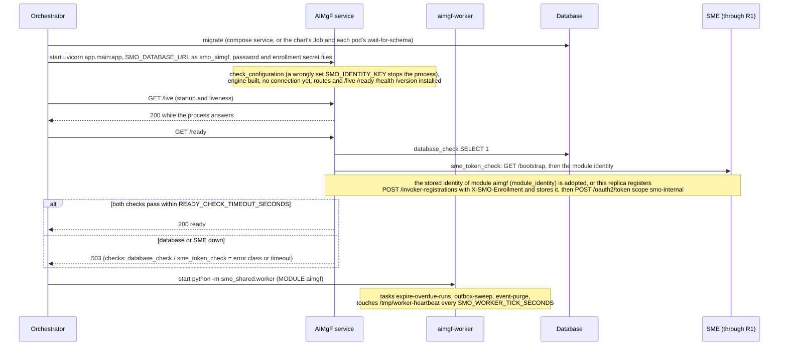
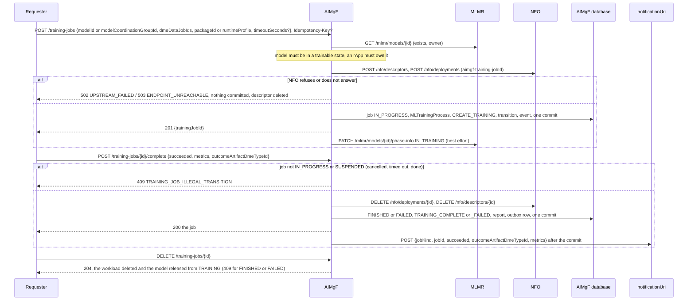
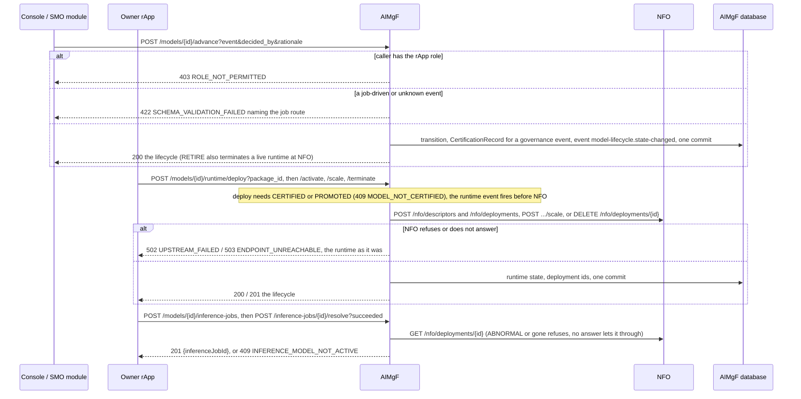
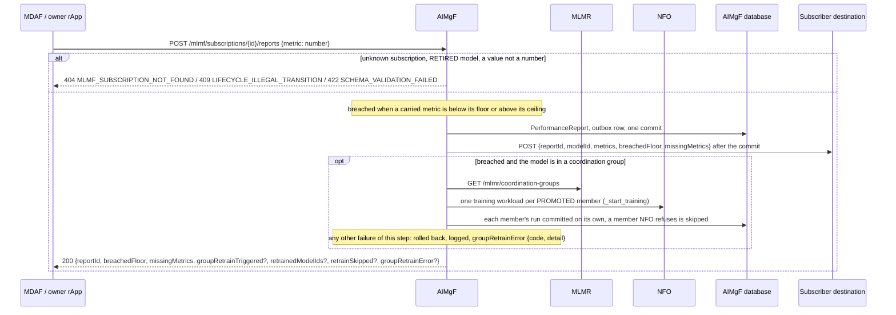
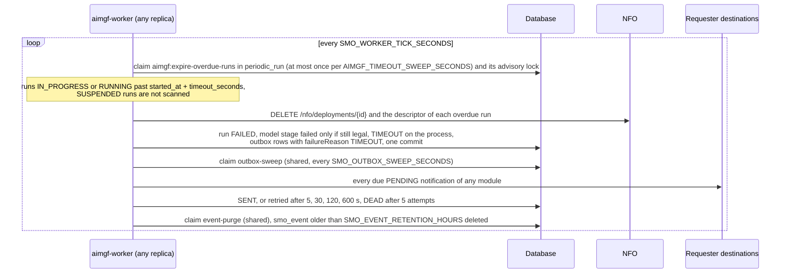
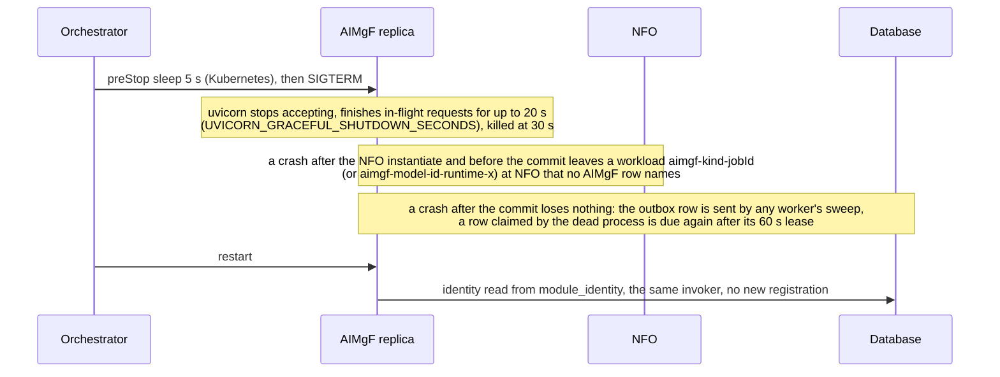

# AIMgF: lifecycle

AIMgF decides the lifecycle of an AI/ML model and has the other modules carry it out: it runs the training, validation, emulation and inference jobs
(each run on an NFO workload), records the governance decisions, drives the model's serving runtime and keeps the MLMF performance subscriptions. It is
reached at the R1 prefix `/aimgf` through R1 Termination, keeps its tables in the database schema `aimgf` (role `smo_aimgf`, which also uses the shared
`module_identity`, `notification_outbox`, `idempotency_key`, `periodic_run` and `smo_event`), and runs as two processes from one image: the HTTP service
and the worker `aimgf-worker`. What each route does is in [`../README.md`](../README.md). Six diagrams:

| | Step | Who starts it | Ends with |
|---|---|---|---|
| a | Starting and becoming ready | the orchestrator (compose, Kubernetes) | a ready replica and a worker ticking |
| b | A run: start, complete, cancel | an rApp (SDK), SA SMOS / SO SMOS, the console, MLMF group retrain | a job with an NFO workload, then a finished run, its workload gone and its requester told |
| c | Governance and the serving runtime | the console, an SMO module, the owner rApp | a decided model state, a deployed or terminated runtime, an inference job |
| d | MLMF reports and group retrain | MDAF (drift), the owner rApp, the console | a stored report, its push, and the retrain of a breached group |
| e | The worker | `aimgf-worker` on its own | overdue runs failed, every pending notification sent |
| f | Stopping, crashing and recovering | the orchestrator, a crash | what is lost, re-done or left behind |

**How to read the diagrams.** As in the call flows: an arrow is one call with the inputs that matter, a box on the receiver says what it does with them,
an `alt` block is the outcome (success first, then each failure and what the caller gets). Every call AIMgF makes to MLMR, NFO, DME and Onboarding goes
through R1 Termination with AIMgF's own token (`R1Client`), so it is drawn straight to the module. Every notification AIMgF sends is an outbox row committed
with the change (`smo_shared.outbox`) and sent after the commit.

## a — Starting and becoming ready

AIMgF registers nothing at SME but its own invoker, which every replica and the worker share (one `module_identity` row, PR-ST-4); the first `/ready`
is usually what creates it. Nothing is read from another module at start: MLMR, NFO, DME and Onboarding are asked only when a request needs them, so
they are not readiness checks. A `/ready` 503 takes the replica out of rotation and never restarts it; only `/live` failing does.

## b — A run: start, complete, cancel

Validation and emulation runs follow the same shape (`/validation-jobs`, `/emulation-jobs`, gated on `APPROVE_TRAINING` and `APPROVE_VALIDATION`);
the stages, gates and NRM requests are [call flow 02](../../docs/call-flows/02-aiml-model-train-to-inference.md) and
[call flow 27](../../docs/call-flows/27-ts28105-provisioning-resources.md). A run started for a model already TRAINING supersedes the old one: the old
job is CANCELLED and its workload deleted in the same request. The `Idempotency-Key` makes a repeated create return the first answer
(`idempotency_key`, PR-ST-3). Every job read and completion first runs the timeout sweep of e, so a GET can write and call NFO.

## c — Governance and the serving runtime

Activation is AIMgF's own decision (no NFO call). An inference job uses the model's serving deployment and has no workload of its own. The decisions are
[call flow 26](../../docs/call-flows/26-model-governance-and-end-of-life.md), the runtime [call flow 17](../../docs/call-flows/17-model-runtime-lifecycle.md).
MLLF writes the node groups (`PATCH /models/{id}/runtime/node-groups`) for the rApp that asked it, named in `X-R1-On-Behalf-Of`, and the owner rule
judges that rApp as if it had called (MLLF-NODEGROUP-OWNER; every route the owner rule guards treats a module acting for an rApp so). MLMR reads the
lifecycle before a delete on its own account; the lifecycle row is made the first time any route asks about a model (`GET /models/{id}/lifecycle` writes).

## d — MLMF reports and group retrain

The subscription itself is [call flow 13](../../docs/call-flows/13-mlmf-subscription-lifecycle.md). Feature groups (`/feature-groups`) are the other
thing AIMgF creates elsewhere: with `enableDme` it makes a DME data job first (`POST /dme/data-jobs`, 422 `FEATURE_GROUP_DME_JOB_REFUSED` when DME
refuses) and deletes it when the group is deleted or the insert loses a race on the name. Once the report is committed the answer is 200: a failure of the group step
(`WEIGHTED_TRIGGERS`, MLMR or NFO not answering) is answered as `groupRetrainError`, so the SDK's repeat is replayed and stores no second report
(MLMF-REPORT-REPLAY). **Phase 1:** the group is looked up on MLMR's first page of groups only.

## e — The worker

A task that raises is logged and not offered again by that worker for `SMO_WORKER_FAILURE_BACKOFF_SECONDS`; its claim is given back so another worker
may run it. `POST /execution-timeouts/sweep` runs the same expiry on demand ([call flow 27e](../../docs/call-flows/27-ts28105-provisioning-resources.md)).
The worker has no port: it is healthy while the heartbeat file is younger than a minute.

## f — Stopping, crashing and recovering

Every request is one transaction, so a crash before the commit leaves no job, transition or notification. What is lost is what runs after the commit
in the same request: the best-effort MLMR phase write-back, and a group retrain after a breached report (the report and its push are kept, the retrain
is not re-done). An Idempotency-Key reservation of a dead replica is taken over after `IDEMPOTENCY_IN_PROGRESS_SECONDS`. A run left IN_PROGRESS by a
requester that died is failed by the worker at its deadline, which deletes its workload. Any number of service replicas share the database
(a stale write is 409 `CONCURRENT_MODIFICATION`) and any number of workers share each task's claim.

## Configuration it reads

| Variable | Default | What it changes |
|---|---|---|
| `SMO_DATABASE_URL`, `SMO_DATABASE_PASSWORD_FILE` | none (required) | the database; without it the process does not start |
| `R1_GATEWAY_URL` | `http://r1-termination:8000` | where every call to MLMR, NFO, DME, Onboarding and SME's bootstrap goes |
| `SMO_ENROLLMENT_SECRET_FILE` | unset | makes SME record AIMgF as an SMO module (`internal`) |
| `SMO_BOOTSTRAP_KEY` | unset | sent to `/bootstrap` when the gateway asks for one |
| `SMO_IDENTITY_KEY` (or `_FILE`) | unset | encrypts the stored invoker secret, a wrong value stops the process |
| `AIMGF_TIMEOUT_TRAINING_SECONDS` / `_VALIDATION_` / `_EMULATION_` / `_INFERENCE_` | 1800 / 900 / 1800 / 5 | a run's deadline when the request names none |
| `AIMGF_TIMEOUT_SWEEP_SECONDS` | 60 | how often the worker expires overdue runs (read at the worker's start) |
| `AIMGF_FEATURE_GROUP_TOKEN_<REF>` (or `_FILE`) | unset | the data-lake token of a feature group registered with `tokenRef` |
| `SMO_OUTBOX_INLINE_DRAIN` | `true` | send a notification right after its commit, or leave it to the worker |
| `SMO_OUTBOX_SWEEP_SECONDS`, `SMO_WORKER_TICK_SECONDS` | 5, 5 | how often the worker sends what is pending and ticks |
| `READY_CHECK_TIMEOUT_SECONDS` | 3 | how long `/ready` waits for the database and SME |

## Decisions this module depends on

- **Two state machines per model** (certification path and serving runtime), and the operator gates `APPROVE_TRAINING` / `APPROVE_VALIDATION`
  (OI-6.1); `advance` refuses job-driven events and an rApp (SEC-15.1).
- **Every run has an NFO workload, made before the commit and deleted when the run ends** (OI-6.2, call flow 17); a refusal is 502 / 503 with nothing kept.
- **Notifications go through the outbox** (PR-MSG-1.7, OI-6.5): committed with the change, sent at least once.
- **A run nobody reads still times out**: the worker's `expire-overdue-runs` (W7-04, call flow 27e).
- **An rApp acts only on its own models** (SEC-15.3, SEC-15.3b, SEC-15.3c, call flow 02).
- **One identity per module, shared by replicas and the worker** (PR-ST-4); readiness is the database and SME (PR-ST-7); periodic work only in a worker (PR-MSG-4).
- **Every lifecycle transition is an event** `org.oran.smo.model-lifecycle.state-changed` (call flow 26).
