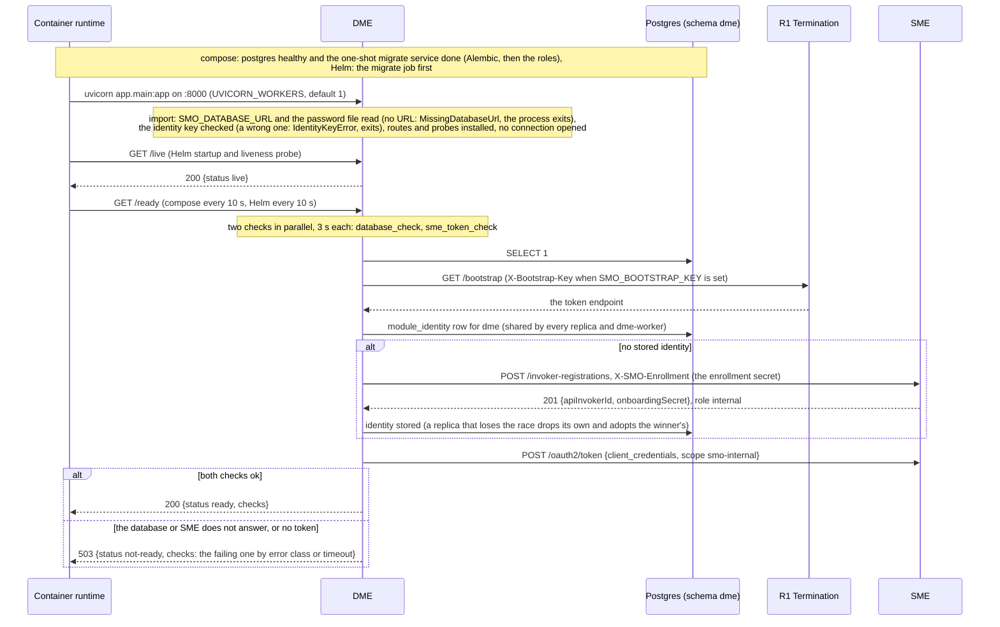
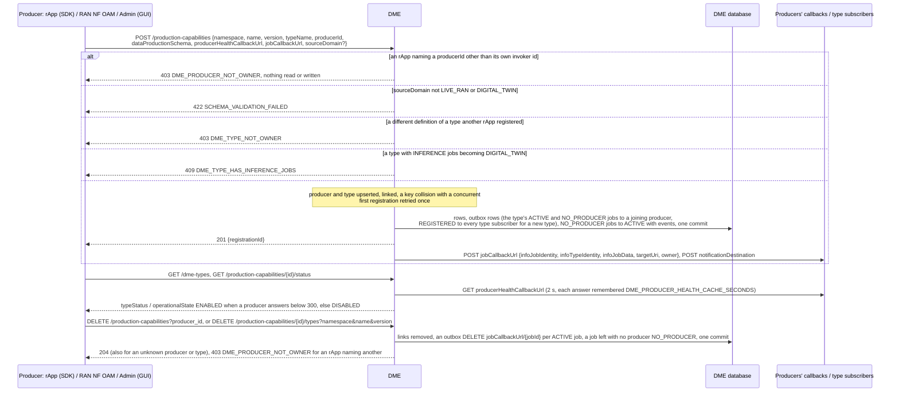
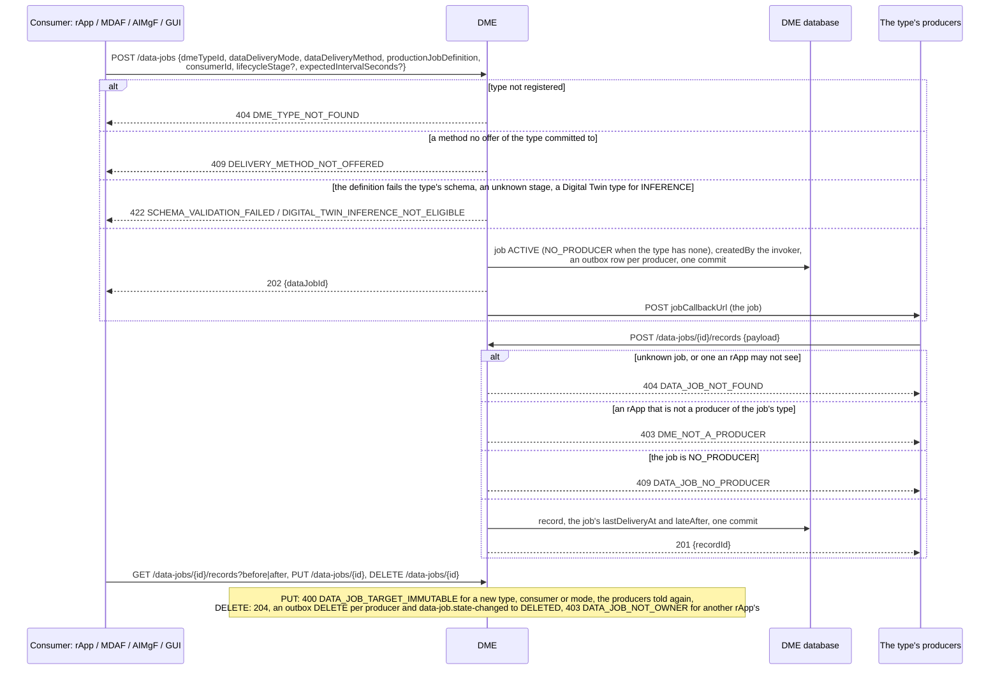
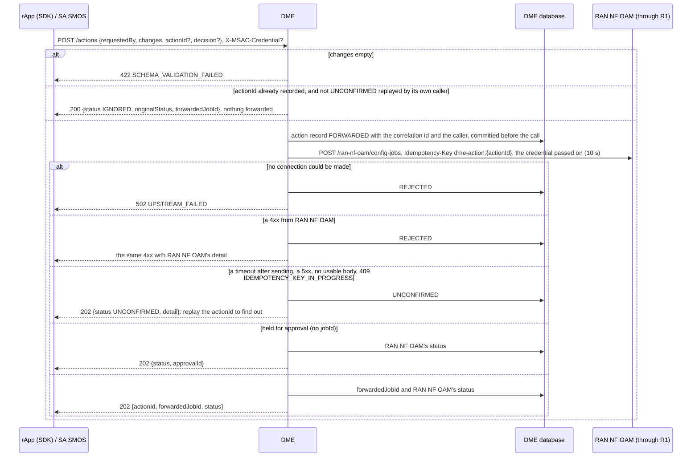
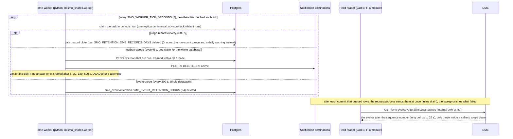
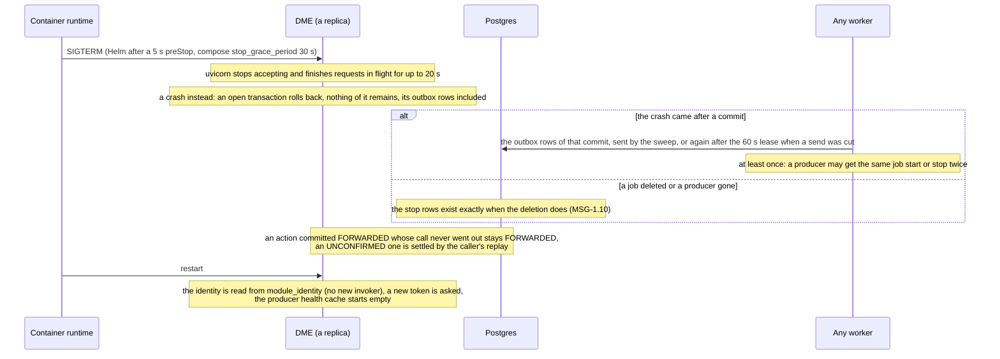

# DME: lifecycle

DME (Data Management and Exposure) is the data broker between rApps, SMO modules and the RAN: producers register the data types they can produce,
consumers open data jobs, DME tells each producer of a job and keeps the records producers deliver, and it forwards an rApp's O1 action to RAN NF OAM. It
is reached at the R1 prefix `/dme` through R1 Termination, keeps its tables in the database schema `dme` (it connects as the role `smo_dme`, which also
uses the shared tables `module_identity`, `notification_outbox`, `idempotency_key`, `periodic_run` and `smo_event`), and runs as two processes from one
image: the request service `dme` and the worker `dme-worker`. Its design is in [`../README.md`](../README.md). Six diagrams:

| | Step | Who starts it | Ends with |
|---|---|---|---|
| a | Starting and becoming ready | the container runtime, the first readiness probe | a replica that answers `/ready` 200, with the module's identity at SME |
| b | Producers and types | a producer rApp (SDK), RAN NF OAM, rApp Management, Admin (GUI) | a producer linked to a type and sent its open jobs, or a producer gone and its jobs waiting |
| c | Data jobs, records and offers | a consumer (rApp, MDAF, AIMgF, GUI), a producer | a job told to its producers, records stored and read, an offer made or ended |
| d | Forwarding an O1 action | an rApp (SDK), SA SMOS | the action recorded with RAN NF OAM's answer, or UNCONFIRMED and asked again |
| e | The worker, later delivery and the event feed | `dme-worker`, the outbox, a feed reader | records past retention purged, every notification delivered at least once |
| f | Stopping, crashing and recovering | the container runtime, a crash | requests drained, what was committed delivered, what was not left as the record says |

**How to read the diagrams.** As in the call flows: an arrow is one call with the inputs that matter, a box on the receiver says what it does with them,
an `alt` block is the outcome (success first, then each failure and what the caller gets). Calls reach DME through R1 Termination, which stamps the
caller's role (`rapp` or `internal`) and invoker id. Every notification DME sends to a caller-supplied URL (a producer's job callback, a type subscriber,
an offer's termination URI) is an outbox row committed with the change and sent after the commit (`smo_shared/outbox.py`).

## a — Starting and becoming ready

DME registers nothing at start: it is the registry. Its identity at SME exists only so it can call RAN NF OAM through R1 (d); the first `/ready` is what
onboards it, and the token is cached until 30 s before it expires. A failing `/ready` takes the replica out of rotation and does not restart it; `/live`
depends on nothing. The worker (e) has no HTTP port: its probe is the age of `/tmp/worker-heartbeat`.

## b — Producers and types

A type stays when its producers leave; only `DELETE /dme-types/{id}` removes it (403 `ROLE_NOT_PERMITTED` for an rApp, 409
`DME_TYPE_HAS_ACTIVE_PRODUCERS` while one is linked), with its jobs (each announced `DELETED`), its offers (each termination URI told) and a `DEREGISTERED`
notice. RAN NF OAM is the producer `ran-nf-oam` of `RAN.PMCounters.<counter>`, `RAN.FaultRecords` and `RAN.KPI.<name>`, registered when it is first
asked for them (call flow 20c, 20d). Health is asked at read time, never polled. Call flow [11](../../docs/call-flows/11-dme-producer-type-lifecycle.md)
walks each step.

## c — Data jobs, records and offers

An offer (`POST /offers`, 201) commits the first of its delivery methods; ending it (`DELETE /offers/{id}`, 204, 403 `DATA_OFFER_NOT_OWNER` for another
rApp's) queues a POST to its termination URI. `POST /offers/{id}/notify` is acknowledged and nothing more. A type subscription (`POST /type-subscriptions`)
is told every `REGISTERED` and `DEREGISTERED`, unfiltered. **Phase 1:** a job's status is only `ACTIVE` or `NO_PRODUCER`, records are stored as sent and
not checked against any schema, and `late` is computed when a job is read. Call flow [12](../../docs/call-flows/12-dme-data-record-lifecycle-eligibility.md)
walks each step.

## d — Forwarding an O1 action

A replay of an `UNCONFIRMED` action by the caller that made it asks RAN NF OAM again under the same key, so the write runs at most once and the record takes
the first attempt's answer. A caller with a scope claim reading `GET /actions` or `/actions/{id}` makes DME ask RAN NF OAM for the elements inside the claim
(`GET /ran-nf-oam/managed-entities`, pages of 500; 502 `UPSTREAM_FAILED` when it does not answer). Call flow
[03f](../../docs/call-flows/03-config-write-with-schema-check.md) walks the RAN NF OAM side.

## e — The worker, later delivery and the event feed

A failed task is retried by that worker after `SMO_WORKER_FAILURE_BACKOFF_SECONDS` (30), and its claim is given back so another may run it sooner. The
outbox sweep and the event purge are shared tasks: whichever module's worker claims them serves the whole database, so DME's notifications are delivered
even when `dme-worker` is down, as long as some worker runs.

## f — Stopping, crashing and recovering

DME keeps no state in a process but the token and the producer health cache, so any number of replicas may run behind R1; each asks a producer's health
at most once per cache period. Nothing is resumed on restart because nothing runs in the background of a request: a data job is a row, and its producers
were told by outbox rows. The worker may run in any number of replicas too. **Phase 1:** an action left `FORWARDED` by a crash before the call is
answered `IGNORED` on replay, so its caller cannot learn whether RAN NF OAM ever got it.

## Configuration it reads

| Variable | Default | What it changes |
|---|---|---|
| `SMO_DATABASE_URL`, `SMO_DATABASE_PASSWORD_FILE` | none, required | Where the `dme` schema is, as `smo_dme`; without a URL the process does not start |
| `SMO_ENROLLMENT_SECRET_FILE` | none (compose: `/run/secrets/enrollment_secret`) | Presented once at SME, so DME is an `internal` invoker |
| `R1_GATEWAY_URL` | `http://r1-termination:8000` | Where `/bootstrap` and RAN NF OAM are reached (`https://` with `SMO_MTLS=on`) |
| `SMO_BOOTSTRAP_KEY` | unset | Sent to `/bootstrap` when the gateway asks for one |
| `SMO_IDENTITY_KEY` (or `_FILE`), `SMO_IDENTITY_PREVIOUS_KEY` | unset | Encrypt the stored identity; set wrongly, the process does not start |
| `SMO_MODULE_IDENTITY_STORE` | `db` | `off`: each process registers its own invoker at SME |
| `READY_CHECK_TIMEOUT_SECONDS` | `3` | How long each `/ready` check may take |
| `DME_PRODUCER_HEALTH_CACHE_SECONDS` | `30` | How long a producer's health answer is kept per process; 0 asks every time |
| `SMO_RETENTION_DME_RECORDS_DAYS` | `0` | Worker: days a data record is kept; 0 keeps them |
| `SMO_RETENTION_WARN_ROWS` | `1000000` | Worker: the size above which a table kept forever is warned about daily |
| `SMO_OUTBOX_INLINE_DRAIN` | `true` | `false`: only the sweep sends notifications |
| `SMO_OUTBOX_SWEEP_SECONDS`, `SMO_EVENT_PURGE_SECONDS`, `SMO_EVENT_RETENTION_HOURS` | `5`, `300`, `24` | Worker: the shared delivery sweep and event purge |
| `SMO_WORKER_TICK_SECONDS`, `SMO_WORKER_FAILURE_BACKOFF_SECONDS` | `5`, `30` | Worker: how often it looks for due tasks, how long it leaves a failed one |
| `UVICORN_WORKERS`, `UVICORN_GRACEFUL_SHUTDOWN_SECONDS` | `1`, `20` (Dockerfile) | Processes per container, and the drain on stop |

## Decisions this module depends on

- **Producers and types are separate, many-to-many** (HISTORY.md section 7, DME vs. the real ICS API): a producer joins a type, a type outlives its
  producers, a job waits `NO_PRODUCER` until one joins (call flow 11, DOC-CF-1.8).
- **An rApp acts only as itself** (`SEC-15.10`, `SEC-15.10b`, DOC-CF-1.8): its `producerId` is its invoker id, it changes only the jobs and offers it made and
  delivers only to the types it produces (call flow 12).
- **A notification is an outbox row in the change's transaction** (`PR-MSG-1.5`, `MSG-1.10`), delivered after the commit and again by any worker's sweep
  (`PR-MSG-2`); every job status change is on the event feed (`docs/EVENTS.md`).
- **Health is asked when it is read** (call flow 11c): no scheduler, an answer cached per process.
- **An action is recorded before it is forwarded and forwarded under one key** (call flow 03f): an unknown outcome is `UNCONFIRMED`, never guessed.
- **Periodic work runs in the worker, never in a request process** (`PR-MSG-4`; `scripts/check_statelessness.py`), once per interval across replicas.
- **One identity per module** (`PR-ST-4`, `PR-SEC-14`), shared by replicas and the worker; probes from the shared library (`PR-ST-7`).
