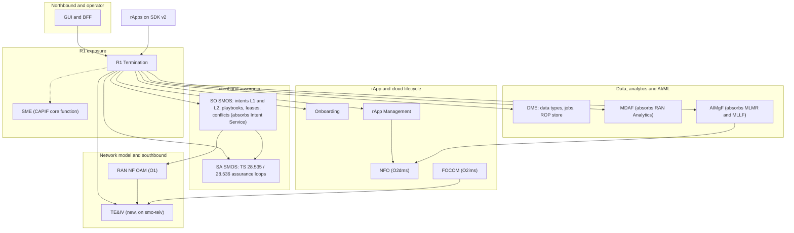

# ADR 0008 — Converged architecture: fourteen services, two tiers of intent, one writer per table, the stores, and the O-RAN SMOS map

> **Status: decided 31 October 2026 (decisions D1, D3, D4, D6–D13, D19 of the converged rewrite plan, answered in `HISTORY.md` PR-CONV-S0.1); not built.**
> This record is plan tasks S0.2 and S0.12 (`OPEN_ITEMS.md` §7, closed into `HISTORY.md` §11). It changes no code: every module still runs as
> `docs/ARCHITECTURE.md` describes, and that document marks each rule this record replaces with the stage that replaces it. The intent model is
> [ADR 0009](0009-intent-model-ts28312.md), AI/ML is [ADR 0010](0010-aimgf-absorbs-mlmr-mllf.md), and the interfaces are [ADR 0011](0011-standard-interfaces-only.md).

Paths are relative to `smo/` unless they start with `specs/` or `.github/`. Written against `main` at cf95d1e (release 0.9.0 plus rewrite mode). The plan is
`docs/plan/CONVERGED_REWRITE_PLAN.md`; the direction documents (SMO-HLD-ORAN-3GPP-005 Rev 5.0, SMO-EXEC-PLAN-002 Rev 2.0, SMO-HLD-PART2-OPS-002 Rev 2.0)
are direction only, not a full design, and where they disagree with the plan the plan wins (section 7 lists each place).

**Tags.** **[N]** normative: a 3GPP or O-RAN specification, with the version the repository carries (`specs/README.md`, "Specification release table").
**[O]** pre-normative: a technical report or a draft. **[D]** this project's own design.

## 1. Goal and non-goals

Goal. One architecture the whole rewrite builds towards: which services exist, which layer each sits in, which tables each owns, which stores the
platform runs on, which O-RAN SMOS and which 3GPP management service each realises, and which of today's practices are binding on every new module.

Non-goals. The intent model (ADR 0009), the AI/ML package layout (ADR 0010) and the interface catalogue (ADR 0011). Sizing, the scale targets and
the 1.0 criteria (plan Stage 8). Phase 2 scope: A1, xApps, the Near-RT RIC and E2 stay out (`OPEN_ITEMS.md` "Scope"; plan R14). The O-RU M-plane stays out
of Phase 1 (D20): the O-RU is managed through the O-DU.

## 2. What exists today (main at cf95d1e)

| Thing | Where | Relevance |
|---|---|---|
| Seventeen services: Onboarding, rApp Management, RAN NF OAM, AIMgF, MLMR, MLLF, SO SMOS, SME, DME, R1 Termination, NFO, FOCOM, RAN Analytics, MDAF, Intent Service, SA SMOS, GUI BFF | `docker-compose.yml`, `deploy/helm/smo/values.yaml`, one folder each | The module map of section 3.1 starts here |
| Layers drawn as Platform Services / SDK / rApps / Runtime roles / Infrastructure; seven golden rules | `docs/ARCHITECTURE.md` "Layered architecture", "Golden rules" | Rules 1, 5 and 6 change (section 3.2) |
| One Postgres; one schema and role per module (`migrations/db_roles.json`); a table-owner map with a CI check against cross-module foreign keys | `migrations/table_owners.json`, `HISTORY.md` PR-DB-2 | The base of one writer per table (section 3.4) |
| 63 Alembic revisions, `scripts/migrate.py` with lock timeout and retry, models checked against Postgres | `migrations/versions/`, `docs/adr/0001-schema-migrations.md` | Kept (K1); squashed to one baseline at 1.0 (S8.8) |
| `managed_object` containment tree in RAN NF OAM, exported at `/topology` and `/topology/graph` in TE&IV wire shape | `ran-nf-oam/app/`, `ran-nf-oam/README.md` | TE&IV is carved out of it (section 3.6) |
| Table-backed event bus (`smo_event`) and the decided, unbuilt Kafka relay | `shared/smo_shared/events.py`, `docs/adr/0006-msg-3-4-kafka-event-sink.md` | D9 |
| Model artifacts as bytes in a database row | `mlmr/app/`, table `model_artifact` | D10, ADR 0010 |
| Image `python:3.14-slim`; CI locks compiled for Python 3.11 | `Dockerfile`, `requirements/README.md` | D11 |
| One Helm chart, per-module values; a migrate pre-upgrade hook | `deploy/helm/smo/` | D12 |

## 3. Decision

### 3.1 Module map: seventeen services become fourteen (D1, D3, D4, D13)

The repository is restructured in place, module by module (D1). Folders stay `smo/<module>/` (D13): no `services/`, `libs/` or `rapps/` move.

| Today | After | How | Stage |
|---|---|---|---|
| MLMR, MLLF | **AIMgF** | Packages inside `aimgf/`; routes deleted once every caller moved (ADR 0010) | S2 |
| Intent Service | **SO SMOS** | Its intent package; tables move into the `so_smos` schema (ADR 0009) | S5.1 |
| RAN Analytics | **MDAF** | Its producer registry becomes MDAF's `MDAFunction` registration | S7.5 |
| – | **TE&IV** (new) | Carved out of RAN NF OAM's managed-object tree, built on O-RAN-SC smo-teiv (section 3.6) | S3.1, S3.4 |
| SO SMOS (387 lines, sequential orders) | **SO SMOS** rewritten | The intent brain: Level-1 and Level-2 intake, playbooks, leases, conflict management (ADR 0009) | S5 |
| The other ten | kept, changed | Each moves to TS 28.532 ProvMnS resources and the standard interfaces of ADR 0011 | S1–S7 |

The fourteen services after the rewrite: **SME, R1 Termination, TE&IV, RAN NF OAM, DME, MDAF, AIMgF, Onboarding, rApp Management, NFO, FOCOM,
SO SMOS, SA SMOS, GUI BFF.** The mock O1 adaptor stays a test double (S0.15), not a service; the O-RAN-SC simulator `sim-o1-ofhmp-interfaces`
replaces sim-o1-interface, which O-RAN-SC deprecates in its N release (R16); [ADR 0012](0012-o1-simulator-oran-sc.md) records the choice.

The arrows are who calls whom for the main flows; every arrow is a standard operation over R1 (ADR 0011), and the dotted one is CAPIF discovery
and token issue, which every caller uses.

### 3.2 Layers

| Layer | Services | Rule |
|---|---|---|
| Northbound and operator | GUI BFF | Uses only the standard operations of ADR 0011; no BFF-only route (S6.1) |
| R1 exposure | R1 Termination, SME | Every call between modules, and from an rApp, crosses R1; peers are found by CAPIF discovery (S1.16) |
| Intent and assurance | SO SMOS, SA SMOS | The only path that changes the network: SO SMOS enacts, SA SMOS assures (ADR 0009) |
| Data, analytics and AI/ML | DME, MDAF, AIMgF | Data, analytics and models; no network writes |
| rApp and cloud lifecycle | Onboarding, rApp Management, NFO, FOCOM | Packages, instances, O2 |
| Network model and southbound | TE&IV, RAN NF OAM | TE&IV owns the topology; RAN NF OAM terminates O1 and writes only on SO SMOS's instruction |
| Shared library | `shared/smo_shared/` (and `smo_shared.mns`, S1.1) | Every service is built on the generic ProvMnS router |
| Runtime roles | MLTF, MLVF, MLEF, MLIF | Roles NFO places, not modules (ADR 0010) |

Golden rules of `docs/ARCHITECTURE.md` that change: rule 1 (the service list) becomes the fourteen above; rule 5 ("AIMgF owns lifecycle ... does not store
anything") changes in Stage 2, when AIMgF keeps the model catalogue and the artifacts (ADR 0010); rule 6 (R1 owns exposure) is kept and sharpened by
ADR 0011 (standard operations only, CAPIF discovery). Rules 2, 3, 4 and 7 are kept.

### 3.3 Two tiers of intent

- **Level-1** [N] TS 28.312 v20.0.0 intent with KPI targets (TR 28.912 v19.0.0 Type 2 [O]): from the operator or an OSS to SO SMOS, which runs a
  playbook and may delegate a scoped Level-1 intent to an rApp.
- **Level-2** [N] TS 28.312 v20.0.0 intent with CM targets `<IOC>.<attribute> IS_EQUAL_TO value`: from an rApp to SO SMOS, the only way an rApp changes
  the network (D14). SO SMOS enacts it through RAN NF OAM's ProvMnS facade, with a lease and a snapshot.

The parent link, the lease, the safeguards and the autonomy modes are ADR 0009.

### 3.4 One writer per table (D6)

Every table has exactly one writing module, the owner `migrations/table_owners.json` names, and only that module's database role may write it.
The shared tables (`public`: outbox, idempotency keys, module identity, periodic runs, audit chain, rate limiter, event feed) keep their existing rule:
each module writes its own rows through `smo_shared`.

| Store | Writer | Others |
|---|---|---|
| `common_teiv_nrm` (MOIs and edges: containment, `NEIGHBOR_CELL`, `CO_COVERAGE_OVERLAY`, `HOSTED_ON_OCLOUD`) | **TE&IV only** | RAN NF OAM writes discovered NRM, FOCOM writes hosting edges, both through TE&IV's ProvMnS (S3.4, S4.5) |
| Cell lock table (`lock_state`, `lock_owner_intent`, `lock_expires_at`) | **SO SMOS only** | TE&IV, SA SMOS and rApps read it as SO SMOS's `CellLock` class over ProvMnS and the lock notifications (S3.2). *Amended by S0.5: the table lives in SO SMOS's own schema, so it is read from SO SMOS, not through TE&IV (ADR 0011 D-23)* |
| `common_dme_telemetry` (ROP tables, KPI rows) | **DME only** | RAN NF OAM publishes ROP batches to DME (S3.8); MDAF, SA SMOS and rApps read through DME's R1 services and the [D] matrix query (ADR 0011 D-02), never by SQL |
| TS 28.111 alarm list | **RAN NF OAM** for RAN alarms; **FOCOM** for O-Cloud alarms in its own table | Read through TS 28.111 operations (S3.15) |

The direction documents let several modules write `common_teiv_nrm.moi_store` and read `common_dme_telemetry` by SQL (R5, and HLD §3.2); this record
refuses both. S1.9 creates reader roles for a common schema only for the owning module's own worker processes. A grant test proves a second writer is
refused (S3.2).

### 3.5 Stores (D7, D8, D9, D10)

| Need | Decision | Not taken, and when it would be |
|---|---|---|
| Graph (topology) | **D7**: relational edges and recursive SQL in Postgres (inside smo-teiv's store, section 3.6) | Apache AGE only if 1,000-node queries miss their target when measured (S1.6, S8.9) |
| Telemetry | **D8**: TimescaleDB for `common_dme_telemetry`: hot 14 days raw, warm 90 days as continuous aggregates, cold as daily Parquet in the object store (S3.11) | No InfluxDB; VictoriaMetrics only for the SMO's own metrics if Prometheus falls short |
| Event backbone | **D9**: Kafka through the ADR 0006 relay (slices 1–3 in S1.10); the table-backed bus stays the source of truth | Kafka never inside a request's transaction (ADR 0006 section 3.1) |
| Objects (model artifacts, CSARs, cold Parquet) | **D10**: SeaweedFS (Apache-2.0) by default; MinIO (AGPL-3.0) only as an optional profile | Follows the direction document's own licensing rule (isolate AGPL, offer an Apache-2.0 alternative, R10) |
| Relational | One Postgres (CloudNativePG, PgBouncer), one schema and role per module (kept, K12) | – |

Each new store is behind a compose profile and a chart flag (S1.10, S8.4) and its image is pinned by digest in `deploy/mirror/images.txt`.

### 3.6 TE&IV on O-RAN-SC smo-teiv (D19)

TE&IV is a new module that **reuses O-RAN-SC smo-teiv as its topology store**, and is reached **only through the standards**:

- [N] TS 28.532 v19.2.0 ProvMnS reads (getMOIAttributes with scope and filter) of the TS 28.541 v19.6.0 NR NRM and the TS 28.622 generic NRM
  (OpenAPI TS 28.623 v19.7.0);
- [N] TS 28.532 notifications (notifyMOICreation, notifyMOIDeletion, notifyMOIAttributeValueChanges) through the TS 28.622 `NtfSubscriptionControl`
  subscription manager (S1.13);
- [N] the O-RAN WG10 TE&IV topology and inventory R1 services (version recorded by S0.13; `specs/README.md` holds none today).

**smo-teiv's own API stays internal to the TE&IV module**: no other module, rApp, SDK or the BFF calls it, and the ADR 0011 interface gate (S0.17)
fails a route or a call that names it. TE&IV is the only writer of its store (section 3.4); RAN NF OAM and FOCOM write through TE&IV's ProvMnS.
S3.1 describes `moi_store` "grown from RAN NF OAM's `managed_object`": with D19 that means the data of `managed_object` is loaded into smo-teiv by
S3.4, and the columns S3.1 names (`attributes` JSONB, `moi_version`) are what TE&IV's ProvMnS face must answer, wherever smo-teiv keeps them. The
S0.13 spike runs smo-teiv on the current tree, measures load, query latency and change events, and turns every place smo-teiv's model or API differs
from the specifications into a Stage 3 task.

### 3.7 Runtime, packaging, layout (D11, D12, D13)

- **D11**: Python 3.12 everywhere, image and CI; one `Dockerfile` with a `BASE_IMAGE` argument for Ubuntu 24.04 or Red Hat UBI 9 (which ships
  `python-312`); non-root, group-0 file modes (S1.11). The R1 gateway stays Python (`r1-termination/`). The Go and Java SDKs are client libraries, not
  service runtimes.
- **D12**: one application chart with per-module values (kept), plus a separate infrastructure-prerequisites chart and a post-upgrade canary hook (S8.4).
- **D13**: `smo/<module>/` stays; the schema bundle goes to `specs/smo-schema-bundle/` (S0.5).

### 3.8 The eighteen practices kept from ai-ran-smo are binding

Each row of the plan's "Keep from ai-ran-smo" table is a rule every rewrite PR and every new module follows. The plan reads the direction documents as
intent, not instruction, wherever this list differs from them.

| # | Rule |
|---|---|
| K1 | **Migrations**: Alembic, one history (`docs/adr/0001-schema-migrations.md`), `scripts/migrate.py` with lock timeout and bounded retry, models checked against a real Postgres (`check_migration_matches_models.py`), one schema and role per module. Destructive revisions are allowed until 1.0 (rewrite mode, `docs/RELEASES.md`); one squashed baseline at 1.0 (S8.8) |
| K2 | **Outbox and events**: an outbox row in the same transaction, retry with backoff, SSRF-guarded webhooks (`smo_shared.webhook`); CloudEvents envelope; Kafka through a relay after commit (ADR 0006), never inside a request's transaction |
| K3 | **Request idempotency**: `Idempotency-Key` replay on every create the SDKs retry, with the CI guard (`tests_integration/test_sdk_post_routes_idempotent.py`); built into `smo_shared.mns`, so every ProvMnS create is replay-safe |
| K4 | **Intent validation**: the strict TS 28.312 v20.0.0 models generated from the five expectation-family files; the bundle is corrected to them (ADR 0009) |
| K5 | **Model lifecycle**: the 14 AIMgF states, two operator approval gates, certification records, end of life, mapped to the HLD's 7 stages (ADR 0010) |
| K6 | **Scope and authorization**: ADR 0005 tenant and region claims enforced where the data lives, fail-closed, console-user claims; MSAC (TS 28.319); gateway-stamped R1 roles; plus a SubNetwork axis (D15) |
| K7 | **rApp safeguards**: per-package limits, approval queue with an optional second approver, a decision record per action, kill switch, refusal log; moved into SO SMOS's Level-2 intake (S5.4), none lost (plan working rule 4) |
| K8 | **Configuration jobs**: dry run, change windows, canary waves with a health gate and automatic revert, KPI-guard revert, before and after images, rollback; RAN NF OAM's job engine becomes Branch A of the parallel split (S3.3, S5.6) |
| K9 | **Scale-out discipline**: stateless services (`scripts/check_statelessness.py`), one runner per timed task by advisory lock; applies to every new module. No StatefulSet for a service: NETCONF sessions are persisted so any replica can resume them (S3.6) |
| K10 | **Audit**: SHA-256 hash-chained audit and decision records with verification |
| K11 | **Supply chain**: CSAR signing with a trust store, offline validator, runtime conformance, SBOM attestation; plus the model-format allow-list (S2.5) |
| K12 | **Data platform HA**: CloudNativePG, PgBouncer, Postgres TLS `verify-full`, service mTLS, DR scripts and drills |
| K13 | **Quality gates**: lint, per-module suites with coverage floors, mutation testing, fuzzing, DAST, OpenAPI drift check, the code-documentation gate, call-flow diagram checks, test counts; the simulator (S0.15) and Tier-3 lanes are added |
| K14 | **Documentation system**: module README with HLD, LLD and tests; `OPEN_ITEMS.md` to `HISTORY.md`; ADRs; call flows with images; the changelog |
| K15 | **SDKs**: Python, Go and Java, retries tied to server-side replay; v2 in all three (S7.1) |
| K16 | **O1 vendor handling**: the vendor capability registry, CM schema check, NETCONF over SSH, the NETCONF lab; the YANG dialect mapper is built on the registry (S3.5) |
| K17 | **KPI engine**: the whitelisted formula language over counters and the seeded KPI set, running over the new ROP tables (S3.8) |
| K18 | **Kubernetes lanes**: kind HA, upgrade and node-drain lanes; the chart's network policies, PDB/HPA and Prometheus rules; the upgrade lane paused until 1.0 (S0.8) |

### 3.9 O-RAN SMOS and 3GPP MnS per module (S0.12)

Every module maps to one O-RAN OAD v14 SMOS, or is marked [D] with a reason, and lists the 3GPP or O-RAN management service it produces. The SMOS
names are the plan's (G23) and the request for this record; the OAD v14 document itself is not among the inputs, so the names were not re-read from it
(section 8).

| Module | O-RAN OAD v14 SMOS | 3GPP / O-RAN service it produces | Tag |
|---|---|---|---|
| RAN NF OAM | RAN NF OAM | TS 28.532 v19.2.0 ProvMnS facade on the TS 28.541 v19.6.0 NR NRM and the TS 28.541 SON functions (S3.3, S3.14); TS 28.111 v19.3.0 fault supervision; TS 28.532 file data reporting (v19.1.0) and streaming (v19.0.0); TS 28.622 `PerfMetricJob`, `ThresholdMonitor`, `TraceJob` with DME (S3.16); R1GAP v14 §5.4 RAN OAM services | [N] |
| NFO | NFO | Consumer of O2dms, Kubernetes-native profile v7; R1GAP v14 §5.5.3 O2 deployment management service (read only to rApps) | [N] |
| FOCOM | FOCOM | Consumer of O2ims v12; R1GAP v14 §5.5.2 O2 infrastructure management service (read only to rApps) | [N] |
| SME | SME | TS 29.222 v20.0.0 CAPIF core function (TS 23.222 architecture); TS 28.622 `MnsRegistry` / `MnsInfo` and TS 28.537 `MgmtDataInfo` (S1.12); R1GAP v14 §5.1 | [N] |
| DME | DME | R1GAP v14 §5.2 data management and exposure services; R1TD v05 data types; with RAN NF OAM, the TS 28.622 PM and trace jobs | [N]; the ROP matrix is [D] (ADR 0011 D-02) |
| TE&IV (new) | TE&IV | O-RAN WG10 TE&IV topology and inventory R1 services; TS 28.532 ProvMnS reads and notifications on the TS 28.541 / TS 28.622 NRM (section 3.6) | [N] |
| MDAF (absorbs RAN Analytics) | RAN Analytics | TS 28.104 v20.0.0 MDA MnS (`MDAFunction`, `MDARequest`, `MDAReport`) | [N] |
| SO SMOS (absorbs Intent Service) | Service and Subnet Slice Orchestration and Assurance (orchestration) | TS 28.312 v20.0.0 Intent MnS (`IntentHandlingFunction`, `Intent`, `IntentReport`); TS 28.567 v20.0.0 `ConflictManagementAndCoordinationEntity` (S5.14); TS 28.561 v20.0.0 `NDTJob` consumer (S7.11) | [N]; leases, playbooks and the approval queue [D] |
| SA SMOS | Service and Subnet Slice Orchestration and Assurance (assurance) | TS 28.535 requirements and TS 28.536 v19.1.0 `AssuranceClosedControlLoop`, `AssuranceGoal`, `AssuranceReport` | [N] |
| AIMgF (absorbs MLMR and MLLF) | AIMLWF | TS 28.105 v19.5.0 AI/ML management MnS; R1GAP v14 §5.6 AI/ML workflow services; TS 29.482 v19.1.0 MLR model management | [N]; the 14-state governance [D] (ADR 0010) |
| rApp Management | rApp Management | R1GAP v14 §5.7 rApp registration (S4.8); `RappPackage` / `RappInstance` over TS 28.532 ProvMnS | [N] operations; the two classes are [D] (no 3GPP IOC) |
| Onboarding | SW Package Onboarding | O-RAN WG10 Application Packaging and Onboarding v1.00 (members-only; provisional until S0.14) | [N], provisional |
| R1 Termination | none | The R1 gateway: it terminates R1 and forwards standard operations; it produces no service of its own | [D]: infrastructure of the R1 exposure, not an SMOS |
| GUI BFF | none | A consumer of the standard operations for the operator console | [D]: an operator front end, not an SMOS |
| PMI | – | No module maps to it today | Named in the OAD v14 list; its scope was not in the inputs, so whether SO SMOS's intent functions belong to it is an open point (section 8) |

## 4. Consequences

- Three services and one module folder disappear (`mlmr/`, `mllf/`, `intent-service/`, `ran-analytics/`) and one appears (`teiv/`), each in the PR
  series of its stage, with no route alias (rewrite mode, `docs/RELEASES.md` "Until 1.0").
- Every new store is an operational dependency: TimescaleDB, SeaweedFS and Kafka each get a compose profile, a chart flag, a mirror entry and a DR
  line (S8.7).
- No module reads another module's tables, including the common schemas; the price is the R1 round trip for analytics reads, which the ROP matrix
  query (ADR 0011 D-02) keeps to one call per question.
- smo-teiv is a third-party dependency with its own release cadence; the S0.13 gap list is where its model and the 3GPP / WG10 models are reconciled.
- `docs/ARCHITECTURE.md` keeps describing the code as it runs and marks each superseded statement "replaced by ADR 0008, pending Stage n".

## 5. Slices mapped to PR-CONV rows

| What | PR-CONV rows |
|---|---|
| This record and the SMOS map | S0.2, S0.12 (closed by this PR) |
| TE&IV spike, then the module | S0.13, S3.1, S3.2, S3.4 |
| Common schemas and roles | S1.9 |
| Stores and infrastructure profiles | S1.10, S8.4, S8.7 |
| Runtime alignment, OpenShift | S1.11, S8.6 |
| Merges: AIMgF, SO SMOS, MDAF | S2.1–S2.9, S5.1, S7.5 |
| ARCHITECTURE.md amended with each merge | S2.9 and the stage that lands each change |
| Migration baseline at 1.0 | S8.8 |

## 6. Decisions

All decisions this record rests on were answered on 31 October 2026 (`HISTORY.md` PR-CONV-S0.1): D1, D3, D4, D6 to D13 and D20 as recommended, D19
with the change recorded in section 3.6. Nothing is left to ask in this record.

## 7. Where the direction documents differ, and what holds

| Direction document says | What holds | Why |
|---|---|---|
| Several modules write `common_teiv_nrm.moi_store`; SA SMOS and MDAF read `common_dme_telemetry` by SQL (HLD §3.2, §4.2–4.5) | One writer per table; reads over R1 (section 3.4) | R5, Principle 3 of the HLD itself, ADR 0011 |
| TE&IV owns a JSONB + Apache AGE store of its own (HLD §4.10, §7.3) | smo-teiv as the store (D19); no AGE unless measured (D7) | D19, D7 |
| Go 1.22 co-runtime for R1, the VES collector and the O2 controllers; Envoy or Spring Cloud Gateway as the R1 gateway (EXEC §3.2, §6.1) | Python 3.12 for every service (D11); the R1 gateway stays `r1-termination/` | One runtime for build and test; the gateway already carries scope, introspection, rate limits and audit |
| Per-module subcharts, three replicas per SMOS, RAN NF OAM as a partitioned StatefulSet (EXEC §5.2, §5.4) | One chart (D12); stateless services (K9) with NETCONF sessions persisted (S3.6); replica counts from sizing | D12, K9 |
| Per-module schemas `so_smos, sa_smos, ran_oam, mdaf, aiml_wf, rapp_mgmt, sme_capif`; the AI/ML module named "AI/ML Workflow" (HLD §3.2) | The repository's schema and module names stay (`aimgf`, `ran_nf_oam`, ...); "AIMLWF" is the OAD SMOS name in section 3.9 only | D13: renaming every path breaks CI, imports and history for no runtime gain |
| MinIO and Grafana by default (EXEC §7) | SeaweedFS by default, MinIO optional; no Grafana in the permissive profile (S8.4) | D10, R10 |
| NFO deploys cloud-native O-CU / O-DU network functions; FOCOM provisions DMS clusters and discovers acceleration hardware (HLD §2.3, §4.11) | Not decided by the plan: Stage 4 covers rApp and runtime workloads only | Recorded in section 8 for a decision |
| E-UTRAN and legacy non-O1 RANs under RAN NF OAM (HLD §1.1, §4.3, §4.4) | Not decided by the plan: the NRM work names NR classes only | Recorded in section 8 |
| 3GPP Rel-18 baseline; ProvMnS `version: 18.4.0`, `/ProvMnS/v18` (HLD §7.1) | The releases the repository carries: TS 28.312 and TS 28.104 at v20.0.0, TS 28.105 at v19.5.0, TS 28.532 ProvMnS at v19.2.0; one ProvMnS form with the version in one constant (D5) | R2 |

## 8. Uncertainties and open points

- **OAD v14** was not among the inputs: the SMOS names in section 3.9 come from the plan (G23) and the request for this record. "PMI" is listed there
  without its scope; whether SO SMOS's intent functions map to it, or to Service and Subnet Slice Orchestration and Assurance as recorded, needs the OAD
  text.
- **Not covered by the plan, found in the direction documents**: NFO deploying O-CU / O-DU network functions and FOCOM's cluster lifecycle and
  hardware discovery (HLD §2.3, §4.11); E-UTRAN and non-O1 southbound (HLD §1.1, §4.4); O-Cloud alarms mapped into TS 28.111 and infrastructure metrics
  into `common_dme_telemetry` (HLD §4.11); contract mock servers and a schema registry (EXEC §2); the DME cold tier's retention (1–3 years), partition key
  and late-ROP-file recovery (Part 2 §5). Each needs a plan row or an explicit exclusion; none is decided here.
- smo-teiv's licence, release cadence and store schema were not read; S0.13 records them.
- The O-RAN WG10 TE&IV, R1AP and O2 versions are not recorded in `specs/README.md`; S0.5 and S0.13 pin them.
