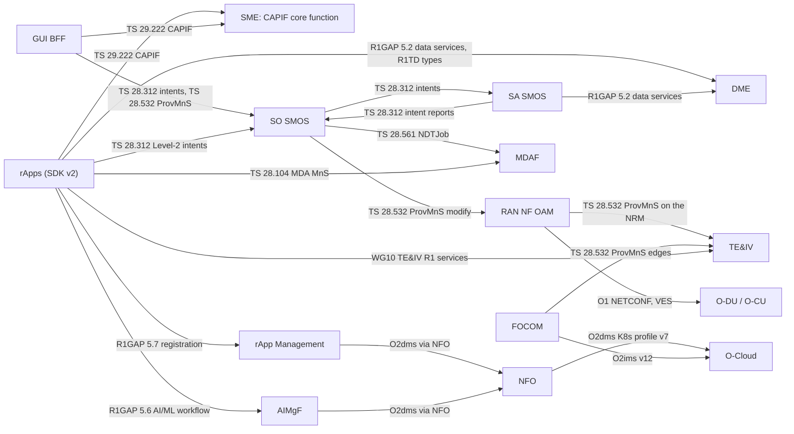

# ADR 0011 — Standard interfaces only: every call between modules, rApps and the console is a 3GPP or O-RAN operation over R1, with a named list of [D] exceptions

> **Status: decided 31 October 2026 (the plan's "Interface rules", made binding here; decisions D5, D14, D17 and D19 answered in `HISTORY.md` PR-CONV-S0.1);
> not built.** This record is plan task S0.16 (`OPEN_ITEMS.md` §7, closed into `HISTORY.md` §11). The CI gate that enforces it is S0.17 (section 7: written,
> not built). Today's 750 route operations still run; [appendix A](0011-appendix-a-route-map.md) maps each to the standard operation that replaces it,
> to deletion, or to a [D] exception of section 6.

Paths are relative to `smo/` unless they start with `specs/`. Written against `main` at cf95d1e. Standards versions are those `specs/README.md` records;
O-RAN texts were read from the plan's inputs (O-RAN.WG2.TS.R1GAP-R005-v14.00, O-RAN.WG2.TS.R1TD-R005-v05.00, O-RAN.WG2.TR.R1ServCnfMtgt-R005-v01.00).
Related: [ADR 0008](0008-converged-architecture.md) (architecture), [ADR 0009](0009-intent-model-ts28312.md) (intents),
[ADR 0010](0010-aimgf-absorbs-mlmr-mllf.md) (AI/ML).

**Tags.** **[N]** normative, with spec, version and clause. **[O]** pre-normative. **[D]** this project's own design.

## 1. Goal and non-goals

Goal. No module talks to another, to an rApp or to the console over an interface of our own. Every call is a 3GPP operation, or an O-RAN one where O-RAN
defines the interface, and it travels over R1. The few project-defined operations that remain are named in section 6, each with a reason and an
owner, and a CI gate fails anything else.

Non-goals. The southbound protocols themselves (O1 NETCONF / VES, O2), which are already standard and unchanged. The internal API of a reused
component behind a module (smo-teiv's own API, section 3.5): it is never an interface between modules. Process probes and metrics scraping, which are
not R1 operations (exception D-01).

## 2. What exists today (main at cf95d1e)

| Thing | Where | Relevance |
|---|---|---|
| 21 OpenAPI documents generated from the code, 750 operations (path × method), checked against the live schemas | `docs/openapi/*.json`, `scripts/generate_openapi_specs.py`, `tests_integration/test_openapi_specs.py` | The inventory of appendix A |
| R1 gateway with a **static routing table** by path prefix, `/bootstrap` for discovery, dynamic `/rapps/{instance}/operator/...` prefix | `r1-termination/app/main.py`, `shared/smo_shared/r1_client.py` | Replaced by registry routing and CAPIF discovery (S1.8, S1.16) |
| SME: CAPIF-derived onboarding, publish, discover, events; token issue and introspection | `sme/app/`, `sme/README.md` | Becomes the CAPIF core function at the TS 29.222 paths (section 3.2) |
| GUI BFF: 45 routes of its own (session, MFA, OIDC, admin, preferences, exports, search, summaries, events) and a proxy to module routes under a role matrix | `gui-bff/app/`, `gui-bff/app/rbac.py` | Section 3.4 |
| Consumer-call check: every literal-path `R1Client` call is checked against the producer's spec | `tests_integration/test_r1_consumer_calls.py`, `r1_consumer_waivers.json` | The base of the S0.17 gate's consumer half |
| SDKs in Python, Go and Java over the same gateway | `sdk/`, `sdk-go/`, `sdk-java/` | Section 3.5 |

## 3. Decision

### 3.1 The interface rules, binding

| Between | Standard | Over | Notes |
|---|---|---|---|
| Any module or rApp and SME | [N] TS 23.222 (architecture) and TS 29.222 v20.0.0 CAPIF APIs: API invoker management, API provider management (v19.5.0), publish, discover, events, security | R1 (O-RAN R1GAP v14 §5.1) | SME is the CAPIF core function; discovery replaces the static routing table (S1.16) |
| SO SMOS and SA SMOS; SA SMOS and any module | [N] TS 28.312 v20.0.0 intents (Intent MnS on TS 28.532 ProvMnS) | R1 | Work handed over, fulfilment reported and corrections asked for as intents and intent reports (S5.17) |
| Inside SA SMOS | [N] TS 28.535 requirements, TS 28.536 v19.1.0 `AssuranceClosedControlLoop` and `AssuranceGoal` | – | Cell loops scoped through the RAN subnetwork's slice profile (section 3.3) |
| Any module and RAN NF OAM | [N] TS 28.532 v19.2.0 ProvMnS on the TS 28.541 v19.6.0 NRM; O-RAN R1GAP v14 §5.4 RAN OAM services | R1, then O1 NETCONF | Network writes come only from SO SMOS (D14) |
| Any module and DME | [N] O-RAN R1GAP v14 **§5.2** data management and exposure services (registration, discovery, request, subscription, delivery, offer); R1TD v05 data types; TS 28.622 PM and trace jobs; TS 28.532 file data reporting (v19.1.0) and streaming (v19.0.0) | R1; Kafka delivery per R1TD | The ROP matrix is the one [D] data type (D-02). The plan's table cites R1GAP "§5.3"; in v14 §5.3 is A1-related services and data management is §5.2 |
| Any module and AIMgF | [N] TS 28.105 v19.5.0 MnS on ProvMnS; R1GAP v14 §5.6 AI/ML workflow services | R1 | ADR 0010 |
| Any module and TE&IV | [N] O-RAN WG10 TE&IV topology and inventory services; TS 28.532 ProvMnS reads and notifications on the TS 28.541 / TS 28.622 NRM | R1 | Built on O-RAN-SC smo-teiv; its own API is never called from outside (D19) |
| Any module and MDAF | [N] TS 28.104 v20.0.0 MDA MnS | R1 | RAN Analytics merges in (S7.5) |
| Any module and rApp Management | [N] R1GAP v14 §5.7 rApp registration; `RappPackage` / `RappInstance` over ProvMnS ([D] classes, D-19) | R1 | |
| NFO and FOCOM to the O-Cloud | [N] O-RAN O2ims v12; O2dms Kubernetes-native profile v7; rApps read through R1GAP v14 §5.5 | O2 | ETSI profile v10 in H2 |
| Notifications, everywhere | [N] TS 28.532 notifications with TS 28.622 `NtfSubscriptionControl` and `HeartbeatControl` (OpenAPI TS 28.623 v19.7.0); alarms per TS 28.111 v19.3.0 | R1, Kafka | One subscription manager in `smo_shared.mns` (S1.13) |
| Access, everywhere | [N] TS 28.319 v19.0.0 `Identity`, `Role`, `AccessRule`; O-RAN WG11 OAuth2 with mTLS client authentication | – | ADR 0005 scope expressed as AccessRules (S1.14, S1.15) |
| GUI BFF and the modules | The same standard operations as above | R1 | No BFF-only routes (section 3.4) |

### 3.2 SME is the CAPIF core function; peers are found by discovery (S1.16)

Every module is a CAPIF API provider: it publishes its APIs (TS 29.222 `CAPIF_Publish_Service_API`) when it starts, and every caller (module, rApp,
BFF) is a CAPIF API invoker that finds its peers with `CAPIF_Discover_Service_API` and gets its token through `CAPIF_Security_API`. `R1Client` finds a
peer by discovery, not from a static table; R1 Termination routes `/ProvMnS/{version}/{LDN}/{class}={id}` by MnS-registry lookup (TS 28.622 `MnsInfo`,
S1.8, S1.12) and keeps its introspection cache. `/bootstrap` is deleted once discovery works (appendix A). Done when (S1.16): a module started with
no peer addresses finds every peer through CAPIF.

### 3.3 SA SMOS: intents outside, TS 28.535 / 28.536 inside (S5.17, R19)

SA SMOS talks to SO SMOS, and to every module, **only through TS 28.312 intents and intent reports over R1**: SO SMOS hands it assurance work as an
intent; SA SMOS reports FULFILLED or NOT_FULFILLED / DEGRADED as intent reports and asks for corrections as intents (ADR 0009 section 4.11). Inside
itself it follows TS 28.535 and TS 28.536: an `AssuranceClosedControlLoop` with `AssuranceGoal`s, readable by anyone through ProvMnS. **Cell loops
(NES, MRO) are assurance goals scoped through the RAN subnetwork's slice profile** (the default slice when none is configured). TS 28.567 v20.0.0
`ClosedControlLoop` / `CCLScope` is the fallback **only if** TS 28.536 cannot express that scope (R19). Its private routes (`/sa-smos/monitors/...`,
`/o1-cm-handler/...`) are deleted. Done when (S5.17): in the integration mesh, no call into or out of SA SMOS falls outside TS 28.312, TS 28.535 / 28.536
and CAPIF.

### 3.4 The GUI BFF uses the same standard operations (S6.1)

The BFF reaches modules through R1 like any other invoker, with two generic families only: `/api/mns/{class}` (the four ProvMnS operations with scope
and filter) and `/api/intents` (TS 28.312 operations). Its role matrix (role × class × operation) is generated from SME's MnS registry. Its own 45 routes
are of two kinds: the console session (sign-in, OIDC, MFA, the user's preferences, pins and layouts, admin of console users, the console's audit view,
exports, JWKS), which is exception D-20 because it is the console's own state, not an SMO interface; and the module-shaped reads (search, summaries,
module status, rApp list), which become reads through the generic families (S6.1, S6.2). The direction document's "internal SBMA REST" from the BFF
to the modules (HLD §4.12) is not taken.

### 3.5 SDKs and sample rApps call only standard operations

SDK v2 in Python, Go and Java (S7.1) is generated from the bundle and offers only: CAPIF onboarding, publish and discover (TS 29.222); TS 28.312 intent
submit with background lease renewal; TS 28.532 ProvMnS reads; DME data types (R1GAP v14 §5.2, R1TD v05); the R1GAP v14 §5.6 AI/ML workflow services;
TE&IV queries (WG10); TS 28.104 analytics; and the declared operator page (D-09). v1 is deleted once the four samples run on v2 (S7.13); the interface
gate finds no [D] call in `samples/` other than the listed exceptions. **smo-teiv's own API is in no SDK** and no module calls it (D19).

### 3.6 What a [D] exception is

A route or a data type that no 3GPP or O-RAN operation covers, kept because the SMO needs it. Each one is named in section 6 with a reason and an
owner (the module that serves it after the rewrite); adding one is an amendment of this record in the same PR as the code, and the S0.17 gate refuses a
route that is neither standard nor listed.

## 4. Interface map

Every edge above the O1 and O2 ones crosses R1 Termination, which is left out of the picture for readability. Notifications (TS 28.532, through
`NtfSubscriptionControl`) flow back along each edge. The SO SMOS → MDAF edge stands for the twin gate's `NDTJob`; which module hosts the
`NDTFunction` is S7.11's to decide (the plan names `ran-analytics/`, which merges into MDAF).

## 5. Consequences

- Of today's 750 operations, 21 are already standard and stay, 423 are replaced by a standard operation, 90 are deleted with no successor route, and 216
  are [D] exceptions, 84 of them process probes (appendix A has the table per module and the full list).
- Most paths change shape: a REST collection such as `/aimgf/ml-training-requests` becomes `{apiRoot}/ProvMnS/{version}/{LDN}/MLTrainingRequest={id}`
  (D5), and the O2 and CAPIF routes move to their standard prefixes.
- Every new route starts from the bundle (`specs/smo-schema-bundle/`, S0.5–S0.7, plan working rule 1) and passes the S0.17 gate.
- R1ServCnfMtgt's conflict query and subscribe have no normative API yet; they are listed as [O] (D-21) until O-RAN publishes one.

## 6. The [D] exceptions allowed today

Counts are of today's operations in appendix A; a zero means the exception is decided now and the route comes with its stage.

| ID | Exception | Reason | Owner | Today's operations |
|---|---|---|---|---:|
| D-01 | Process probes and metrics: `/health`, `/live`, `/ready`, `/version`, `/metrics` | Kubernetes probes and build identity; not R1 operations, never routed by the gateway to another module | Shared library (`smo_shared.health`) | 84 |
| D-02 | The ROP matrix: DME data type and `POST /dme/v1/query` (cell × time × feature) | R1TD v05 has the normative `ORAN:RanOamPmData:1.0.0`; a wide per-ROP matrix for analytics has no standard type, and it is what keeps analytics reads to one call (ADR 0008 section 3.4) | DME | 0 (S3.9) |
| D-03 | Operator approval queue (SUPERVISED_MODE votes, optional second approver, two-person rule) | TS 28.312 negotiation is between consumer and producer, not a person's vote | SO SMOS (today RAN NF OAM `/rapp-approvals`, `/approval-subscriptions`, `/rapp-approval-policy`, `/config-jobs/{id}/approve`, `/reject`) | 12 |
| D-04 | SMO event feed `GET /dme/smo-events` (CloudEvents, internal only) | The console's live updates and the Kafka relay's source (ADR 0006); not an interface to rApps | DME (shared event bus) | 1 |
| D-05 | Decision records on the hash-chained audit | No MnS for an action's rationale and model version | SO SMOS (today RAN NF OAM) | 3 |
| D-06 | rApp safeguards: kill switch, Global Stop, package limits, refusal log | No standard for per-rApp limits or a kill switch | SO SMOS (today RAN NF OAM and rApp Management) | 17 |
| D-07 | Model governance on the 14-state lifecycle (operator gates, certification, promotion, end of life) | TS 28.105 has no governance operation | AIMgF | 6 |
| D-08 | Model owner (`SEC-15.3`, package-level from S4.7) | No TS 28.105 attribute for who may deploy a model | AIMgF | 1 |
| D-09 | The rApp's declared operator page and its own operator API (ADR 0004) | The rApp's own surface for the console; not an SMO interface | rApp Management (declaration); each rApp (its API) | 40 |
| D-10 | KPI formula definitions (whitelisted formula language) | TS 28.554 names KPIs and their formulas in text; there is no definition operation | DME (today RAN NF OAM) | 6 |
| D-11 | Vendor capability registry and YANG dialect mapper | O1 has no vendor-registration operation | RAN NF OAM | 8 |
| D-12 | Day-1 configuration templates for zero-touch onboarding | The triggers are standard (pnfRegistration, NETCONF call-home RFC 8071); the Day-1 plan is ours | RAN NF OAM, with SO SMOS matching the plan (S8.2) | 8 |
| D-13 | Configuration history and before / after diff | No MnS returns history | RAN NF OAM | 2 |
| D-14 | O1 southbound endpoint registry | Where to reach an element; no northbound standard | RAN NF OAM | 2 |
| D-15 | Software campaigns and jobs (waves, health gate, rollback) | The O1 software-management RPCs underneath are O-RAN [N]; the northbound campaign is ours | RAN NF OAM | 13 |
| D-16 | Test-double controls of the mock O1 adaptor | Never deployed in production | mock O1 adaptor (tests) | 13 |
| D-17 | Generic TS 28.312 contexts `parentIntent`, `leaseDurationSec`, `executionMode` and the decision-record fields | Placed where TS 28.312 allows free content (ADR 0009) | SO SMOS | 0 |
| D-18 | Autonomy ceiling per package and SubNetwork, and the promotion vote | D16; no standard | SO SMOS | 0 (S5.10) |
| D-19 | `RappPackage` and `RappInstance` classes over ProvMnS | No 3GPP IOC for an rApp; the operations are standard | rApp Management | 0 (S4.2) |
| D-20 | GUI BFF console session and console administration (sign-in, OIDC, MFA, the user's settings, console users, the console's audit view, exports, JWKS) | The console's own state, not an SMO interface | GUI BFF | 0 in `docs/openapi` (37 of the BFF's 45 routes, appendix A.2) |
| D-21 | R1 conflict query and subscribe | R1ServCnfMtgt v01.00 is a TR: [O] until O-RAN defines the API | SO SMOS | 0 (S5.14) |
| D-22 | ADR 0005 scope attributes (region, tenant, site cluster, SubNetwork) on `ManagedElement` and on invokers | A [D] attribute on a standard class, set and read through standard operations, enforced through TS 28.319 AccessRules | TE&IV (attributes), SME (invoker claims) | 0 |

## 7. The S0.17 interface gate (written, not built)

A CI job (`scripts/` plus `.github/workflows/smo-tests.yml`, made a required check) that fails when:

1. **A route is neither standard nor listed.** Every operation in `docs/openapi/*.json` must match one of: a ProvMnS path in the D5 form whose class is
   registered in the bundle (`specs/smo-schema-bundle/`); a TS 29.222 CAPIF path; an R1AP DME, AI/ML workflow or rApp-registration path of R1GAP v14;
   the VES listener; RFC 7662 introspection; or a route of a [D] exception in section 6, read from a machine-readable list the gate keeps beside this record
   (ID, path pattern, method, owner). An exception with no matching route is reported as stale, as `breaking_change_waivers.json` does.
2. **A call is neither standard nor listed.** Every literal-path `R1Client` call, every SDK call (the three languages) and every BFF upstream call
   names a standard operation or a listed exception (extending `tests_integration/test_r1_consumer_calls.py`).
3. **Anything names smo-teiv's own API** outside `teiv/` (D19).
4. **SA SMOS** has a route or a call outside TS 28.312, TS 28.535 / 28.536 and CAPIF (S5.17).

Done when (S0.17): required check; it fails on a private route added in a test PR. During the rewrite the gate reports today's routes against
appendix A's verdicts, so a replaced route that is still served is listed, not failed, until its stage deletes it; from M5 it fails.

## 8. Slices mapped to PR-CONV rows

| What | PR-CONV rows |
|---|---|
| This record, the [D] list and appendix A | S0.16 (closed by this PR) |
| The interface gate | S0.17 |
| ProvMnS router, MnS registry, subscriptions, access rules, security baseline, CAPIF | S1.1–S1.6, S1.12–S1.16 |
| R1 routing by registry | S1.8 |
| SA SMOS on intents only | S5.17 |
| BFF generic proxy; admin through generic views | S6.1, S6.11 |
| SDK v2; samples on standard interfaces | S7.1, S7.13 |
| Conformance suites mapped to standard test IDs | S8.12 |

## 9. Where the direction documents differ, and what holds

| Direction document says | What holds | Why |
|---|---|---|
| The BFF calls modules over "internal SBMA REST"; the NBI is terminated by "SO SMOS and SME API gateway" (HLD §2, §4.12) | The BFF is a CAPIF invoker over R1, with no BFF-only routes beyond D-20 | Section 3.4 |
| Controllers and DTOs generated from the schemas, zero hand-written DTOs (EXEC §1.3) | The code stays code-first, held to the bundle by the S0.7 drift check and this gate; only the SDKs are generated (S7.1) | S0.7 |
| Contracts published to a schema registry (Apicurio) and served by mock servers (Prism, WireMock) (EXEC §2) | Not decided by the plan | Recorded in `HISTORY.md` PR-CONV-S0.16 for a plan row |
| SA SMOS reports through `notifyMOIAttributeValueChanges` on the ACCL (HLD flow 2) | TS 28.312 intent reports (section 3.3) | S5.17 |
| Per-class CAPIF token scopes for rApps (Part 2 §1: an MRO token may GET `NRCellDU` and create a Level-2 intent, never delete a SubNetwork) | Expressed as TS 28.319 AccessRules on the invoker (S1.14, D-22); the plan does not say it for rApps explicitly | Recorded for S1.14 |
| Data management is "R1GAP §5.3" (the plan's own table) | R1GAP v14 §5.2 | §5.3 is A1-related services in v14 |
