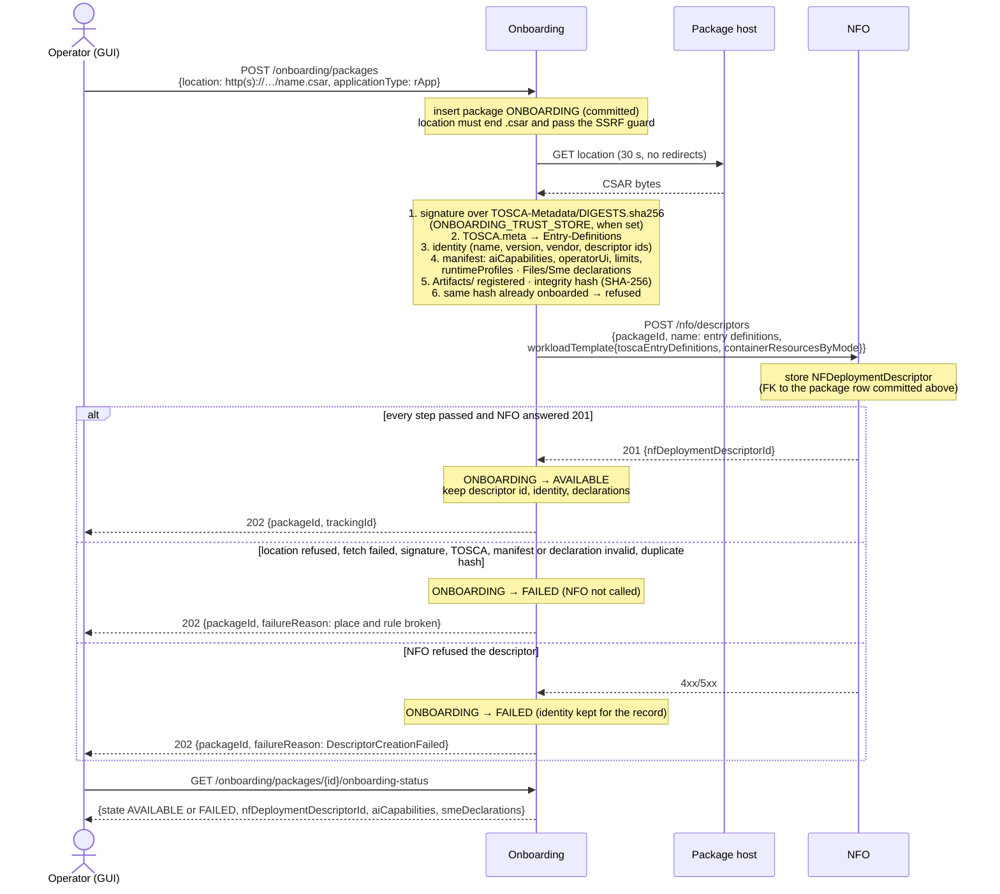
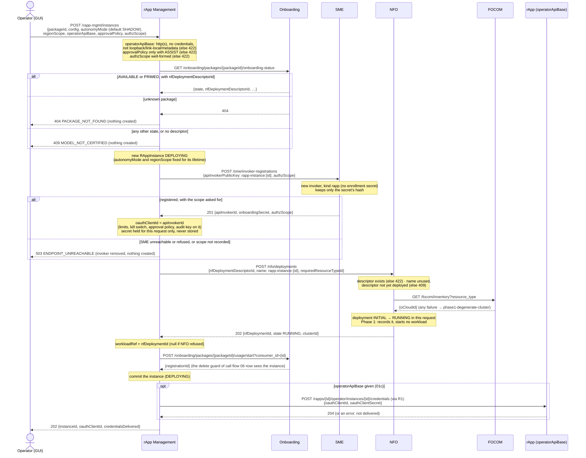
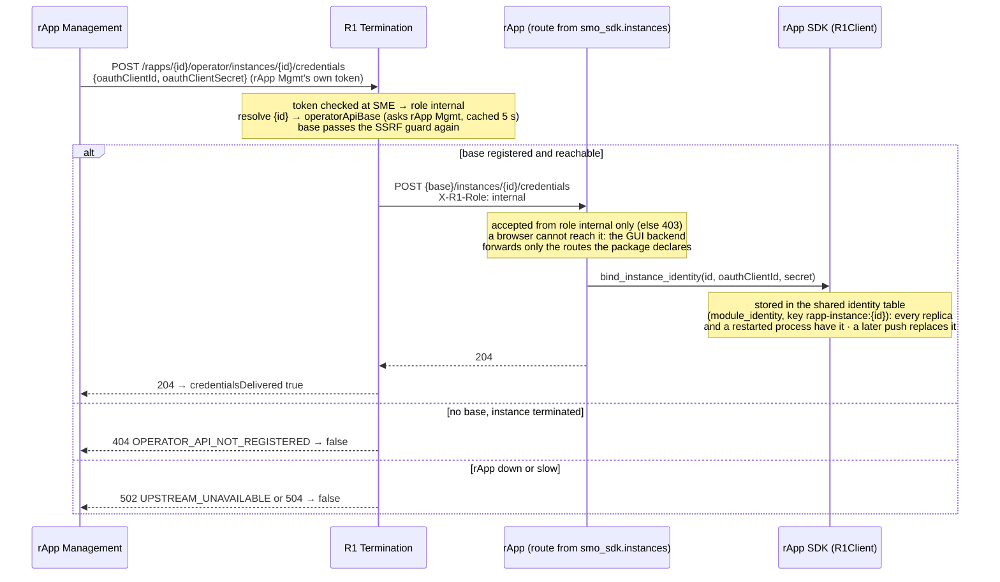
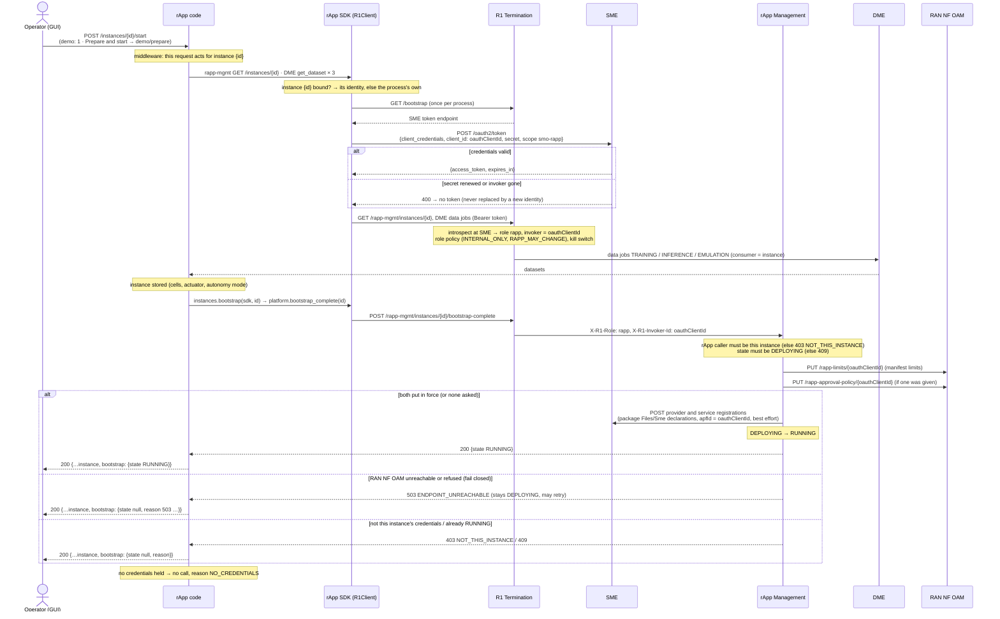
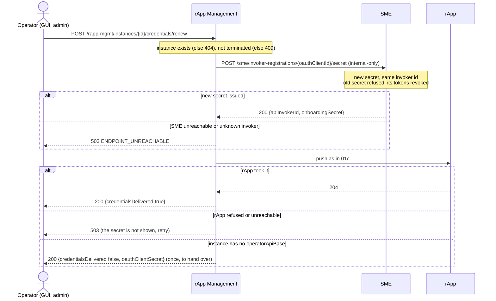

# Call Flow 01: rApp onboarding → running instance

An operator onboards an rApp package, creates an instance of it, and the rApp that serves the instance bootstraps as that instance. Five
diagrams, each one step a person or a component takes:

| | Step | Who starts it | Ends with |
|---|---|---|---|
| 01a | Onboard a package | Operator | package AVAILABLE (or FAILED) |
| 01b | Create an instance | Operator | instance DEPLOYING, its identity made and pushed to its rApp |
| 01c | The rApp receives the instance's credentials | rApp Management (inside 01b) | the rApp holds them in its SDK |
| 01d | The rApp bootstraps as the instance | rApp code (`/start`) | instance RUNNING, its safeguards in force |
| 01e | Re-send the credentials (rApp unreachable at create, or a rotation) | Operator | the rApp holds a new secret for the same identity |

**How to read the diagrams.** An arrow is one call: method, route and the inputs that matter. A box (`Note over`) on the receiver says what it
does with them. An `alt` block is the outcome: the first branch is success, each `else` a failure and what the caller gets. Every operator call
goes from the console (GUI → GUI backend → R1 Termination) to the module; that path is the same everywhere and is not drawn: the actor
*Operator (GUI)* stands for it. An rApp's calls go through its SDK and R1 Termination, which checks the token at SME and stamps the caller's
role and invoker id; 01d draws that once.

**What this build does not do yet (Phase 1).** NFO records a deployment and answers RUNNING, but starts no workload: the sample rApps run as
fixed services of the compose file (or the Helm chart), each serving every instance of its package. That is why an rApp gets its instance's
credentials pushed to it (01c) instead of finding them in the environment of a workload started for the instance.

## 01a — Onboard a package

The answer is 202 whatever the verdict: the verdict is the package's state. A body without `location` or with an unknown `applicationType`
is 422 and creates nothing.

## 01b — Create an instance

`credentialsDelivered: false` (no base, or the rApp did not take them) leaves the instance DEPLOYING; the rApp cannot bootstrap it until it
gets them: the operator sends them with **Re-send credentials** (01e) once the rApp is reachable.

## 01c — The rApp receives the instance's credentials

## 01d — The rApp bootstraps as the instance

The rApp's own code calls nothing about identity: `smo_sdk.instances.install(app)` makes every request under `/instances/{id}/…` act for that
instance, so the SDK picks its token. The sample rApps bootstrap in `POST /instances/{id}/start` (the demo's **1 · Prepare and start**).

From here on, every call the rApp makes for the instance carries the instance's identity: the instance's scope claim narrows what it reads and
writes, its limits and approval policy apply to its writes, the kill switch stops it, and the audit trail names it.

## 01e — Re-send the credentials

The rApp keeps an instance's credentials in the shared identity table, so a restart or another replica does not lose them. They are re-sent
when the rApp was down or unreachable when the instance was created (`credentialsDelivered: false`; the instance stays DEPLOYING and its
bootstrap says `NO_CREDENTIALS`), or to rotate the secret. The operator presses **Re-send credentials** on the rApp's page (admin).

For a DEPLOYING instance `POST /rapp-mgmt/instances/{id}/credentials` makes a **new** identity instead (and pushes it); it is refused once the
instance runs, because its registrations at SME and DME are under the old id.

## Key decisions this flow depends on

- **One identity per instance.** rApp Management registers it at CreateInstance with the instance's scope claim; `oauthClientId` is what R1
  Termination vouches for and what the limits, kill switch, approval policy and audit trail key on (PR-SEC-14, PR-SEC-10.3, AI-10, AI-11).
- **The rApp acts as the instance it serves.** One rApp process may serve several instances, so the SDK holds one identity per instance and picks
  it per request (`smo_sdk.instances`, `smo_shared.r1_client.bind_instance_identity`); a call outside any instance uses the process's own.
- **Credentials are pushed, never fetched or shown.** rApp Management pushes them through R1 Termination to the instance's operator API, which
  accepts them from an SMO module only and keeps them in the shared identity table (every replica, and after a restart); rApp Management never
  stores the secret, and it reaches a browser only when there is no operator API to push to.
- **The rApp reports itself up.** `bootstrap-complete` from an rApp is accepted for its own instance only, and is where the instance's safeguards
  are put in force, fail-closed, before it may run.
- **NFO resolves a placement through FOCOM** even though Phase 1's answer is one cluster and nothing is started (NFO+FOCOM LLD section 4).
- **`autonomyMode` and `regionScope` are fixed at CreateInstance** for the instance's lifetime; call flow 09 shows what they drive (HISTORY.md
  OI-6.3). `usage/start` and `usage/stop` (at terminate) let Onboarding's delete guard see every instance (call flow 06).
