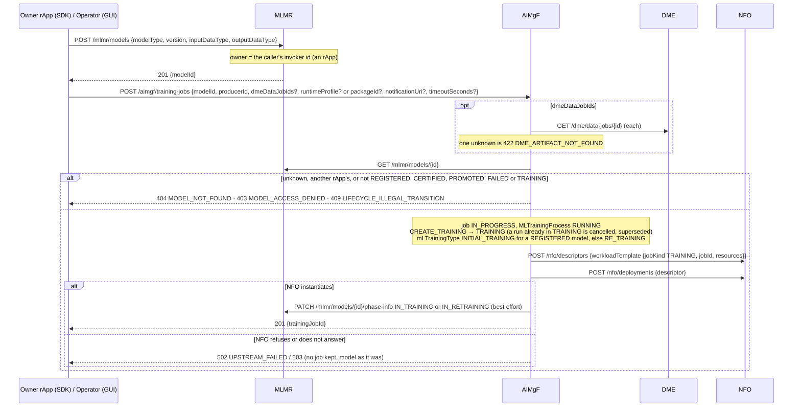
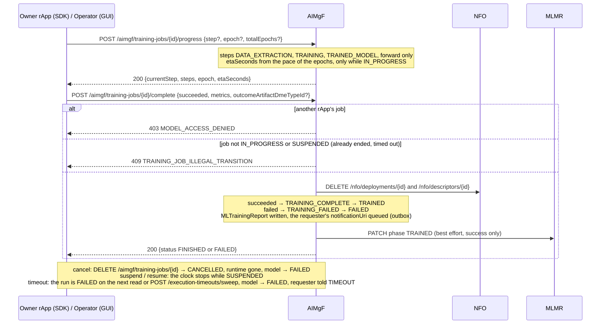
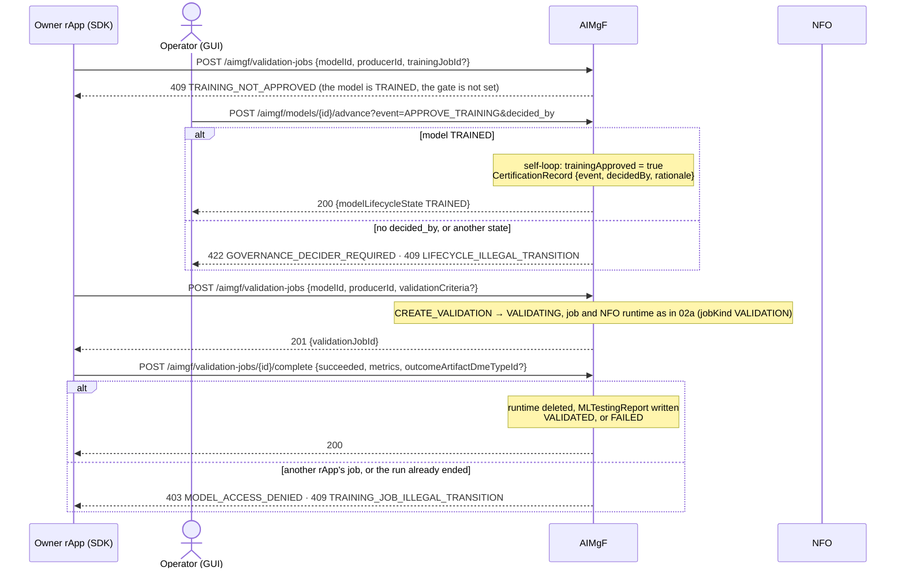
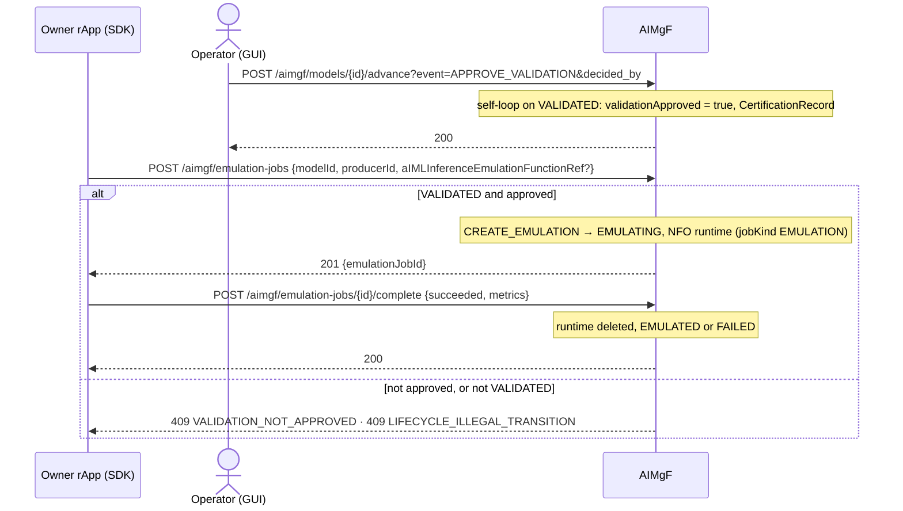
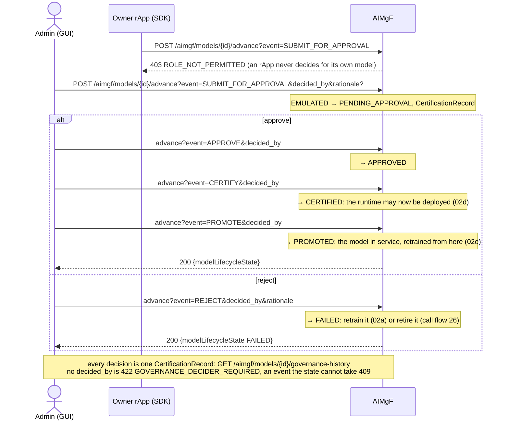
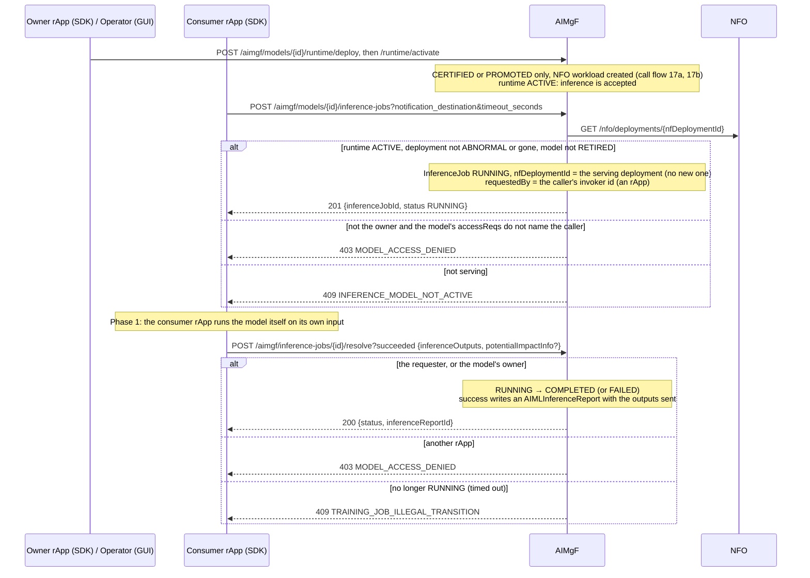
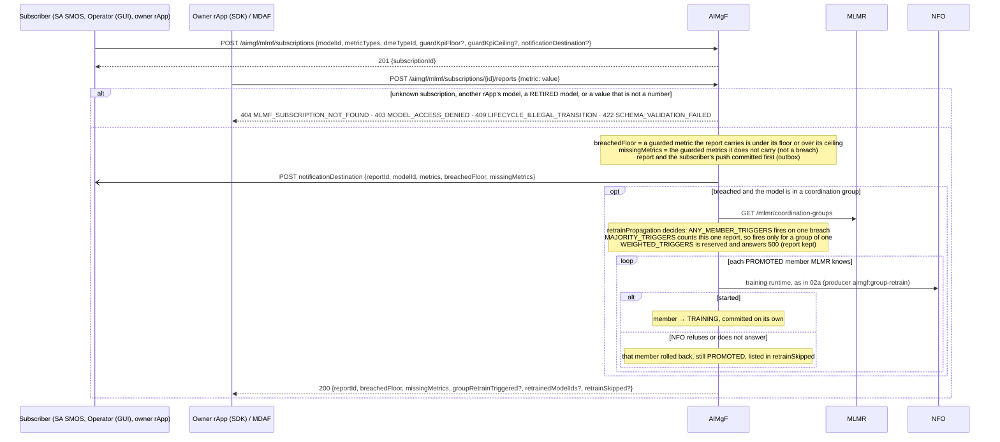

# Call Flow 02: AI/ML model — register, train, validate, emulate, certify, deploy, infer, monitor

The whole life of an AI/ML model, from the rApp that registers it to the retrain a performance breach starts (AI/ML Workflow LLD sections 1-8).
AIMgF keeps two state machines on its own `model_lifecycle` row: `ModelLifecycle` (14 states, the model's certification path) and
`RuntimeLifecycle` (the serving runtime, call flow 17). Five diagrams:

| | Step | Who starts it | Ends with |
|---|---|---|---|
| 02a | Register and train | the owner rApp (SDK), Operator (GUI) | model TRAINED (or FAILED), the run's NFO runtime gone |
| 02b | The gates, then validate and emulate | Operator (GUI) approves, the owner rApp runs | model EMULATED |
| 02c | Governance | Admin (GUI) | model CERTIFIED and PROMOTED (or FAILED on reject) |
| 02d | Deploy and infer | the owner rApp, Operator (GUI), a consumer rApp | an inference job COMPLETED with its report |
| 02e | Monitor and retrain | a monitoring subscriber, the owner rApp, MDAF | a performance report, and a breach retrains the group |

**As images:** [02a](images/02-aiml-model-train-to-inference/02a-register-and-train.png),
[continued](images/02-aiml-model-train-to-inference/02a-continued-progress-complete-cancel-timeout.png) ·
[02b](images/02-aiml-model-train-to-inference/02b-the-gates-then-validate-and-emulate.png),
[continued](images/02-aiml-model-train-to-inference/02b-continued-approve-validation-then-emulate.png) ·
[02c](images/02-aiml-model-train-to-inference/02c-governance.png) ·
[02d](images/02-aiml-model-train-to-inference/02d-deploy-and-infer.png) ·
[02e](images/02-aiml-model-train-to-inference/02e-monitor-and-retrain.png)
(PNG, drawn from the diagrams below by `scripts/render_call_flows.py`).

**How to read the diagrams.** As in call flow 01: an arrow is one call with the inputs that matter, a box on the receiver says what it does
with them, an `alt` block is the outcome (success first, then each failure and what the caller gets). *Owner rApp (SDK)* is the rApp that
registered the model (`sdk.models.register_model`, `sdk.lifecycle.start_training`, `report_training_progress`, `complete_training`, …);
*Operator (GUI)* and *Admin (GUI)* stand for the console's path. In the console, the job routes and the two training gates need the
**operator** role, the governance decisions (submit, approve, reject, certify, promote, rollback) **admin**.

**Who may act on what.** MLMR records the model's `owner`: the rApp that registered it. A caller with the rApp role may start a run on, act
on a running job of (complete, report progress or metrics, suspend, resume, cancel, and the same through the TS 28.105 request and process
resources), or file a performance report for, only a model it owns; another rApp is **403 `MODEL_ACCESS_DENIED`** and nothing changes. A
coordination-group job needs every member MLMR knows to be the caller's. A model with no owner, or one MLMR no longer knows, is open to any
rApp. The console, the SMO modules and a call with no role are not asked. An rApp never fires a governance decision (403 `ROLE_NOT_PERMITTED`).

## Model states

| State | Left by (→ target) | Through |
|---|---|---|
| `REGISTERED` | `CREATE_TRAINING` → `TRAINING` | a training request (02a) |
| `TRAINING` | `TRAINING_COMPLETE` → `TRAINED`, `TRAINING_FAILED` → `FAILED` | complete, cancel, timeout (02a) |
| `TRAINED` | `APPROVE_TRAINING` (self-loop, sets the gate), `CREATE_VALIDATION` → `VALIDATING` | 02b |
| `VALIDATING` | `VALIDATION_COMPLETE` → `VALIDATED`, `VALIDATION_FAILED` → `FAILED` | 02b |
| `VALIDATED` | `APPROVE_VALIDATION` (self-loop, sets the gate), `CREATE_EMULATION` → `EMULATING` | 02b |
| `EMULATING` | `EMULATION_COMPLETE` → `EMULATED`, `EMULATION_FAILED` → `FAILED` | 02b |
| `EMULATED` | `SUBMIT_FOR_APPROVAL` → `PENDING_APPROVAL` | 02c |
| `PENDING_APPROVAL` | `APPROVE` → `APPROVED`, `REJECT` → `FAILED` | 02c |
| `APPROVED` | `CERTIFY` → `CERTIFIED` | 02c |
| `CERTIFIED` | `PROMOTE` → `PROMOTED`, `CREATE_TRAINING` → `TRAINING`, `DEPRECATE` → `DEPRECATED` | 02c, 02a, call flow 26 |
| `PROMOTED` | `CREATE_TRAINING` → `TRAINING`, `ROLLBACK` → `CERTIFIED`, `DEPRECATE` → `DEPRECATED` | 02e, call flow 26 |
| `FAILED` | `CREATE_TRAINING` → `TRAINING`, `RETIRE` → `RETIRED` | 02a, call flow 26 |
| `DEPRECATED` | `RETIRE` → `RETIRED` | call flow 26 |
| `RETIRED` | (none) | |

There is no shortcut: a retrain always re-enters at `TRAINING` and goes through every gate again. An event the state cannot take is **409
`LIFECYCLE_ILLEGAL_TRANSITION`**. The job-driven events fire only from their job routes: `advance` refuses them with 422 (call flow 26).

## 02a — Register and train

## 02a (continued) — Progress, complete, cancel, timeout

**Phase 1:** the NFO workload of a run is a placeholder: no training code runs in it and it calls nothing back. The owner rApp trains
itself and reports progress and the result through the SDK. The TS 28.105 `MLTrainingRequest` / `MLTrainingProcess` resources (call flow
27) are a second way to start, suspend and cancel the same runs.

## 02b — The gates, then validate and emulate

## 02b (continued) — Approve validation, then emulate

A run of a later stage that is cancelled or times out fails its model's stage the same way as in 02a. The console lists the models that wait
for a gate in its inbox (GUI-7.3).

## 02c — Governance

Rollback, deprecation and retirement, and the event published on every change, are in call flow 26.

## 02d — Deploy and infer

**Phase 1:** the result is what the resolver sends: the `AIMLInferenceReport` holds it, and nothing is published through DME against the
model's `outputDataType`. The serving workload at NFO is a placeholder, so the consumer rApp runs the model itself. What the rApp then does
with the result is set by its `autonomyMode` (call flow 09). A job requested from the console records no requester, so among the rApps only
the owner may resolve it.

## 02e — Monitor and retrain

A guarded metric the report does not carry does not breach: it is listed in `missingMetrics` (MDAF's drift reports carry only their own outputs, call
flow 13b). A member that is not PROMOTED (already training, mid-certification) is passed over. A model in no group is not retrained by a breach: the
subscriber decides. Subscribe, notify and unsubscribe, and the pull-only subscription, are in call flow 13.

**Phase 1:** a retrained model is the same model: while it trains, its serving runtime keeps the version that was certified, and the new one
replaces it at the next deploy. There are no model versions side by side (OPEN_ITEMS.md AIML-VER).

## Decisions this flow depends on

- No lightweight update path: retraining re-enters at `TRAINING` and goes through both gates and governance again.
- `ModelLifecycle` and `RuntimeLifecycle` are independent: retraining a PROMOTED model does not take its runtime down, and the runtime is
  scaled or terminated without touching certification (call flow 17).
- AIMgF's `model_lifecycle` row is the one record of both states and of `clearedNodeGroups`; MLMR keeps none of it, only the model and its owner.
- Every run (training, validation, emulation) gets its own NFO runtime, removed when the run ends. Inference does not: it uses the serving
  deployment made at deploy.
- The completion routes are the only way a stage ends; `advance` takes only governance and end-of-life events (call flow 26).
- `APPROVE_TRAINING` and `APPROVE_VALIDATION` are governance self-loops with a decider and a `CertificationRecord` (HISTORY.md OI-6.1).
- `dmeDataJobIds` are checked against DME, `requiredData` stays opaque (HISTORY.md OI-6.4).
- A group retrain is best effort per member: one member NFO refuses does not stop the others, and the report is kept (DOC-CF-1.6).
- Who may act on a running job, and who may resolve an inference job, is decided by the model's owner (DOC-CF-1.6, SEC-15.3c).
