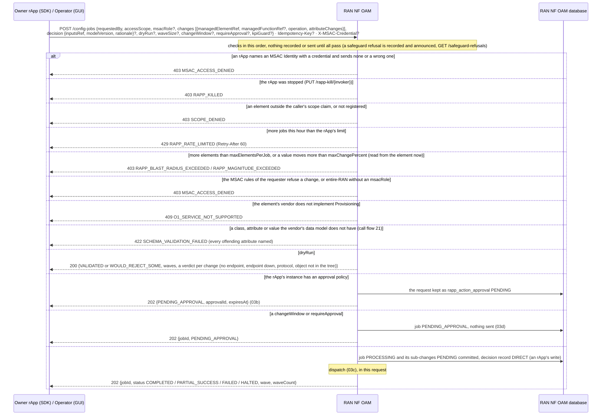
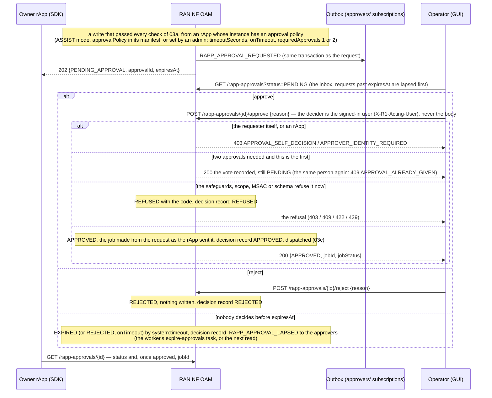
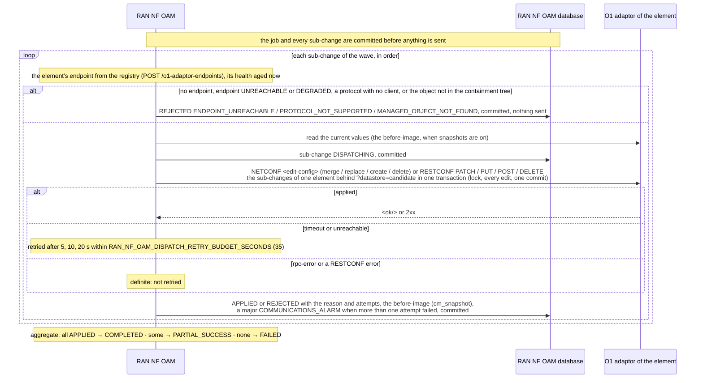
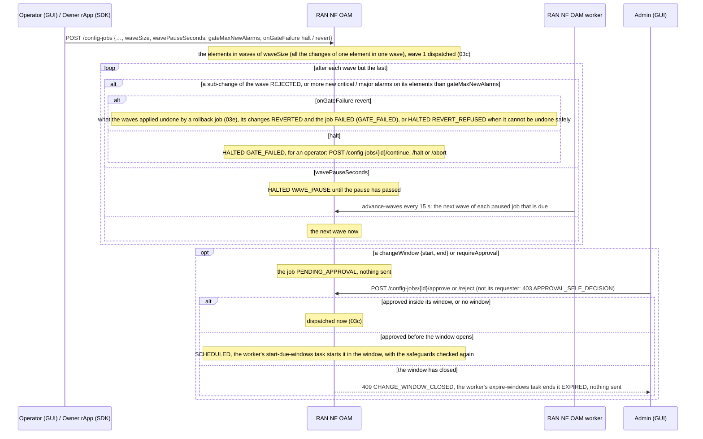
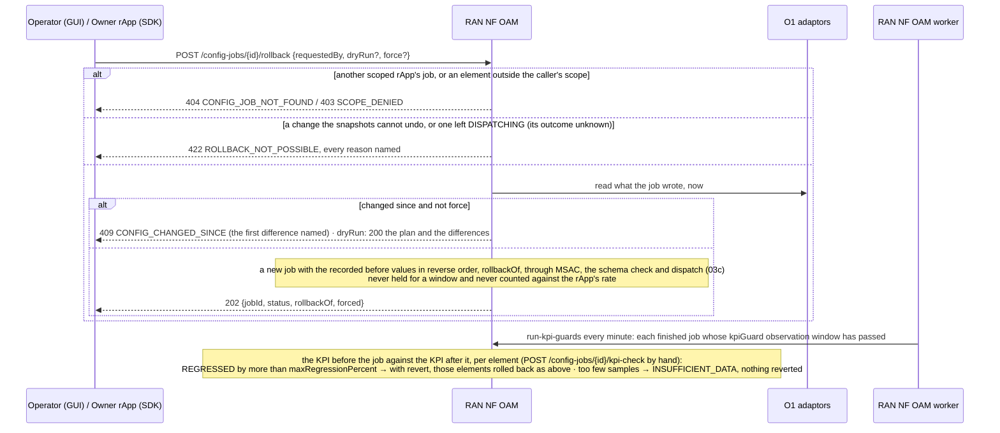
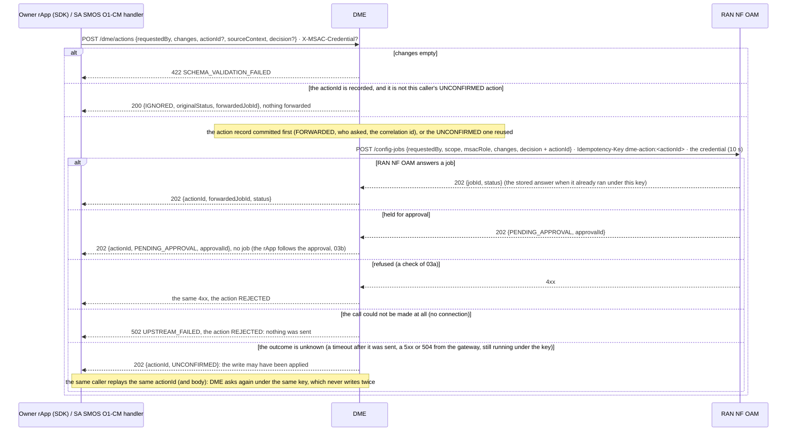

# Call Flow 03: Configuration write — checks, approval, dispatch per element, waves, rollback, and the DME path

How a configuration change reaches the managed elements (RAN NF OAM LLD sections 1–5). RAN NF OAM is a fleet aggregator: it splits one
`WriteConfigurationChanges` call (`POST /config-jobs`) into one sub-change per change, sends each to its element's O1 adaptor (NETCONF `<edit-config>` or
RESTCONF), and aggregates the outcomes, which makes `PARTIAL_SUCCESS` real without breaking TS 28.532's all-or-nothing edit. There are two entry paths: a
caller asks RAN NF OAM directly (path A, the console, an SMO module, or an rApp), or an rApp asks DME's O1 action mediation (`POST /dme/actions`, path B),
which records the decision and forwards it to the same route. An rApp in AUTONOMOUS or ASSIST mode usually writes through an Intent (call flow 09), whose
O1-CM handler then uses path B. Six diagrams:

| | Step | Who starts it | Ends with |
|---|---|---|---|
| 03a | The write request and its checks | Owner rApp (SDK), Operator (GUI), an SMO module | refused with a code, a dry-run plan, held for approval (03b), or a job dispatched (03c) |
| 03b | An rApp's write held for approval | an rApp whose instance has an approval policy | APPROVED (a job, 03c), REJECTED, EXPIRED / REJECTED by timeout, or REFUSED on approve |
| 03c | Dispatch per element and the aggregate | the job | each sub-change APPLIED or REJECTED; the job COMPLETED, PARTIAL_SUCCESS or FAILED |
| 03d | Staged waves, the health gate and change windows | a job with `waveSize`, `changeWindow` or `requireApproval` | waves run, halt or revert; a windowed job runs inside its window |
| 03e | Rollback and the KPI guard | Operator (GUI), an rApp, or the worker | the job undone by a new job, or refused |
| 03f | Path B: through DME | Owner rApp (SDK), SA SMOS's O1-CM handler | the action recorded with RAN NF OAM's answer, or UNCONFIRMED and asked again |

**As images:** [03a](images/03-config-write-with-schema-check/03a-the-write-request-and-its-checks.png) ·
[03b](images/03-config-write-with-schema-check/03b-an-rapp-s-write-held-for-approval.png) ·
[03c](images/03-config-write-with-schema-check/03c-dispatch-per-element-and-the-aggregate.png) ·
[03d](images/03-config-write-with-schema-check/03d-staged-waves-the-health-gate-and-change-windows.png) ·
[03e](images/03-config-write-with-schema-check/03e-rollback-and-the-kpi-guard.png) ·
[03f](images/03-config-write-with-schema-check/03f-path-b-through-dme.png)
(PNG, drawn from the diagrams below by `scripts/render_call_flows.py`).

**How to read the diagrams.** As in call flow 01: an arrow is one call with the inputs that matter, a box on the receiver says what it does
with them, an `alt` block is the outcome (success first, then each failure and what the caller gets). Every call reaches RAN NF OAM through R1
Termination, which vouches for the caller (`X-R1-Invoker-Id`, its role, an rApp's scope claim, and the signed-in console user as `X-R1-Acting-User`).

## 03a — The write request and its checks

A repeat with the same `Idempotency-Key` from the same caller is answered from the first attempt (`Idempotent-Replayed: true`) and sends nothing; a repeat
while the first still runs is 409 `IDEMPOTENCY_KEY_IN_PROGRESS`. The MSAC credential is not part of what a repeat must match.

**Phase 1:** the dispatch runs in the request: the answer comes when every sub-change of the first wave has its outcome (up to about 65 s per sub-change
with retries, one after another). R1 Termination answers 504 after 60 s while the job goes on; its record is in `GET /config-jobs/{id}`.

## 03b — An rApp's write held for approval

Every rApp action has a decision record (`decision` on the request: inputs reference, model version, rationale), with its disposition (DIRECT, APPROVED,
ROLLBACK, REJECTED, EXPIRED, REFUSED), hashed into the audit chain a moment after the commit (retried by the worker's `chain-decisions` task).

## 03c — Dispatch per element and the aggregate

If RAN NF OAM stops while an edit is out (a crash, a restart), the job stays PROCESSING with the changes already sent and their outcomes, the change in flight
DISPATCHING (the element may or may not have taken it) and the later ones PENDING. Nothing undoes a DISPATCHING change by guess: a rollback names it (03e).

**Phase 1:** a job left PROCESSING by a crash is not resumed; an operator reads it (`GET /config-jobs/{id}`) and the element (`GET
/managed-entities/{me}/config`) and writes again.

## 03d — Staged waves, the health gate and change windows

## 03e — Rollback and the KPI guard

## 03f — Path B: through DME

DME records what the rApp's decision asked for (`GET /dme/actions`); RAN NF OAM's job is the record of what the network did. A rApp that verifies by reading
the element back (the sample rApps) treats UNCONFIRMED like any write it has not yet seen: it reads the value.

## Decisions this flow depends on

- **A fleet aggregator, not one client** (Option A, LLD section 1): RAN NF OAM resolves each element's O1 adaptor from the endpoint registry its adaptors
  register in (`POST /o1-adaptor-endpoints`), and sends each sub-change on its own. `PARTIAL_SUCCESS` has no wire counterpart in TS 28.532: each edit stays
  atomic and the job aggregates them (LLD section 3.2).
- **The protocol follows the element** (HISTORY.md OI-1-cm-sync-restconf): NETCONF (`edit-config`, over the HTTP mock, SSH or TLS) or RESTCONF (RFC 8040:
  merge is PATCH, replace PUT, create POST on the parent, delete DELETE). Any other protocol is `PROTOCOL_NOT_SUPPORTED`, never silently "applied". Both
  share one retry policy and one exhaustion alarm; a definite refusal is not retried.
- **Checks before anything is recorded or sent** (03a): the MSAC credential, the kill switch, the scope claim, the rate, blast-radius and magnitude limits
  (AI-10), the MSAC rules (TS 28.319) and the vendor's data model (call flow 21). An rApp's write may need a person's approval (AI-11), and every rApp
  action has a hashed decision record (AI-13).
- **Saved before it is sent** (DOC-CF-1.8): the job and its sub-changes are committed before the first edit, each sub-change is committed DISPATCHING before
  its edit and with its outcome right after, so the record never lags the network by more than the edit in flight.
- **Path B never duplicates path A** (Wave 3): DME's `/actions` is a thin forward to the same route, which records the decision's provenance. It forwards
  under an idempotency key derived from the `actionId`, so a timeout is UNCONFIRMED and asked again rather than recorded REJECTED (DOC-CF-1.8).
- **Alarm ids are minted at ingestion**, never taken from the raising element, which closes R1UCR's fleet-wide collision risk.
