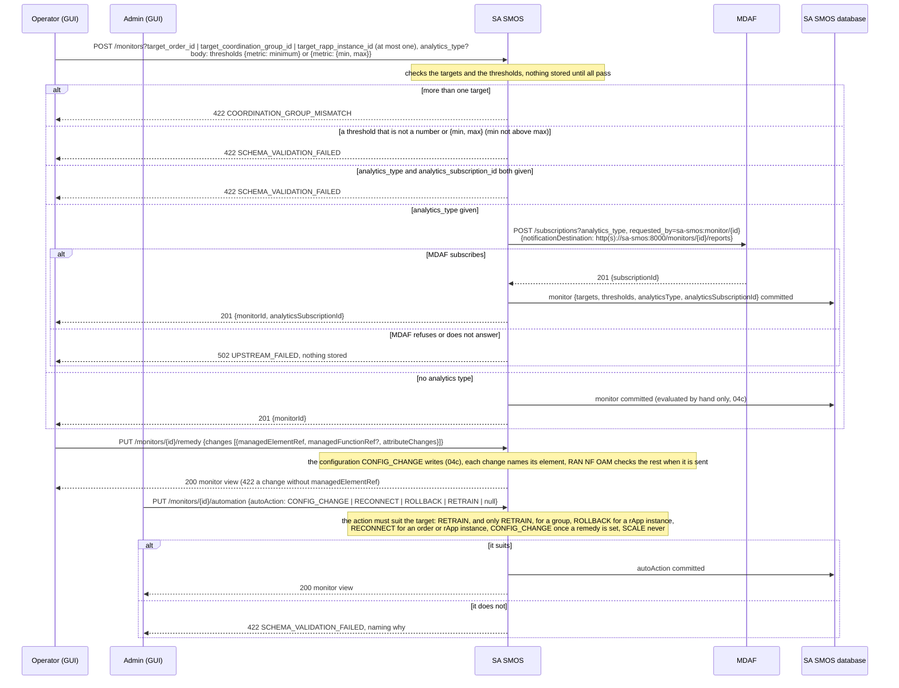
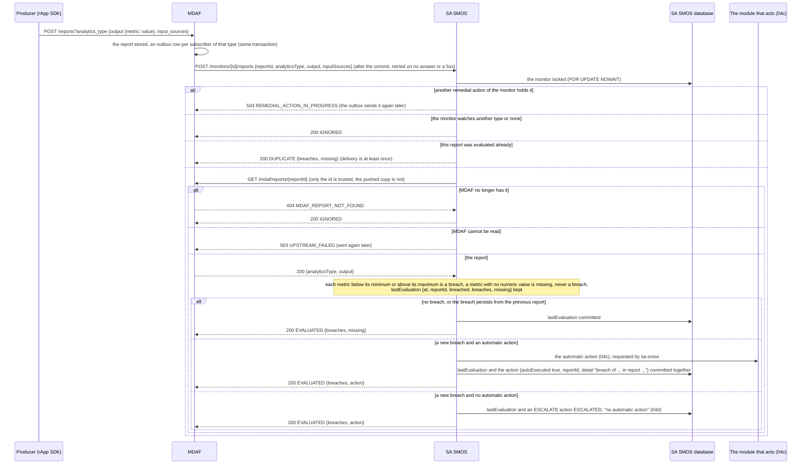
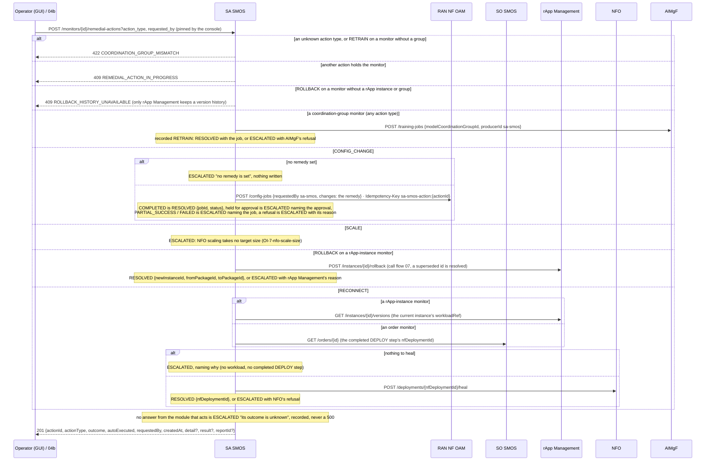
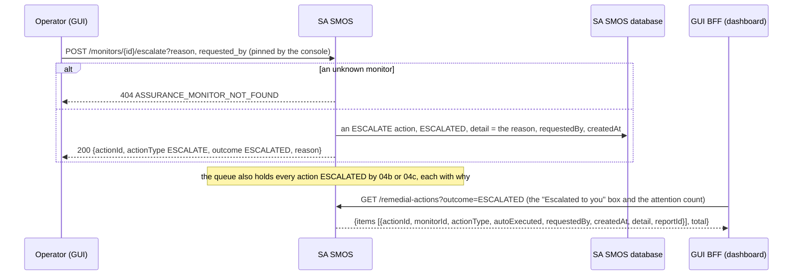

# Call Flow 04: Closed-loop assurance — a monitor, MDAF's reports, the remedial action and the escalation

How SA SMOS keeps a target within its requirement thresholds (SO/SA SMOS LLD section 2). A monitor holds thresholds and at most one target: an SO SMOS
order (its NF deployment), a model coordination group, or an rApp instance. A monitor that names an MDAF analytics type closes the loop by itself: SA SMOS
subscribes to that type, MDAF pushes each report, SA SMOS reads it back and evaluates it, and a new breach runs the monitor's automatic action or is
escalated to the operator. An operator can also evaluate metrics and run a remedial action by hand. Four diagrams:

| | Step | Who starts it | Ends with |
|---|---|---|---|
| 04a | Registering a monitor and its MDAF subscription | Operator (GUI); an admin sets the automatic action | a monitor watching an analytics type, or refused |
| 04b | A report, the evaluation and the automatic action | MDAF's notification outbox | evaluated (nothing to do), the automatic action run, or the breach escalated |
| 04c | The remedial actions, by type and target | Operator (GUI), or 04b | RESOLVED, or ESCALATED with the reason |
| 04d | Escalation and the operator's queue | Operator (GUI), or 04b | an ESCALATE action in the queue |

**As images:** [04a](images/04-closed-loop-assurance/04a-registering-a-monitor-and-its-mdaf-subscription.png) ·
[04b](images/04-closed-loop-assurance/04b-a-report-the-evaluation-and-the-automatic-action.png) ·
[04c](images/04-closed-loop-assurance/04c-the-remedial-actions-by-type-and-target.png) ·
[04d](images/04-closed-loop-assurance/04d-escalation-and-the-operator-s-queue.png)
(PNG, drawn from the diagrams below by `scripts/render_call_flows.py`).

**How to read the diagrams.** As in call flow 01: an arrow is one call with the inputs that matter, a box on the receiver says what it does with them,
an `alt` block is the outcome (success first, then each failure and what the caller gets). The console's calls and SA SMOS's own calls to other modules
go through R1 Termination, which vouches for the caller; MDAF's push goes straight to SA SMOS. How the order that a monitor may target is run is call flow
10; how a configuration write reaches the elements is call flow 03.

## 04a — Registering a monitor and its MDAF subscription

**Phase 1:** the console lets only an admin set the automatic action (an operator gets 403 from the console) and pins who ran an action or escalation to
the signed-in user. There is no route to delete a monitor, so its MDAF subscription stays until it is deleted at MDAF. The target ids are not checked
against the modules that own them; a wrong one shows when an action runs (04c).

## 04b — A report, the evaluation and the automatic action

A breach acts once: the next reports that still breach only update `lastEvaluation`; after a report within the thresholds, the next breach acts again.

**Phase 1:** MDAF's push reaches SA SMOS directly, not through R1 Termination, as the O1-CM handler's intents do; SA SMOS trusts only the report id and
reads the report back through R1. Only MDAF analytics are watched: a model's performance is watched by AIMgF's own MLMF monitor, which triggers the group
retrain itself (call flows 13 and 02e). Evaluation compares the report's top-level `output` values; a nested value counts as missing.

## 04c — The remedial actions, by type and target

**Phase 1:** a RESOLVED rollback has started an upgrade back, which rApp Management resolves like any upgrade (call flow 07); RESOLVED means the module that
acts accepted the action, not that the next report is within the thresholds, which 04b shows. The remedy is written as `sa-smos`, not as the person who
asked; the person is the action's `requestedBy`.

## 04d — Escalation and the operator's queue

**Phase 1:** an escalation is a record, not a ticket: nothing assigns, acknowledges or closes it, and the queue is every ESCALATED action ever recorded.

## Decisions this flow depends on

- **The loop closes on MDAF's reports** (DOC-CF-1.8): a monitor that names an analytics type is subscribed at MDAF and evaluates each report pushed. Before,
  nothing pushed or polled: evaluation and action happened only when someone asked. The report is read back from MDAF so a forged push cannot trigger an
  action, and an action runs once per new breach, not on every report.
- **The automatic action is an admin's decision** (REQ-CNFG-ADM pattern): what a breach may run by itself is set apart from the monitor, admin-only in the
  console, and must suit the target; SCALE is never automatic. Without one, a breach reaches the operator.
- **No false success** (DOC-CF-1.8): CONFIG_CHANGE writes a remedy the monitor holds, under an idempotency key named after the action; with none it is
  ESCALATED. Before, it sent an empty change list and recorded RESOLVED.
- **An action says what happened**: the type actually run (RETRAIN for a group, ESCALATE for an escalation), who asked, when, why it ended as it did and
  what the module that acted answered. One action per monitor at a time.
- **ROLLBACK needs a version history**, and only rApp Management keeps one (HISTORY.md OI-1-sa-rollback); a rApp-instance monitor keeps its id across
  upgrades, which rApp Management resolves.
- **SO SMOS never rolls back completed steps** of an order on a later failure (call flow 10); RECONNECT heals the order's deployed NF instead.
