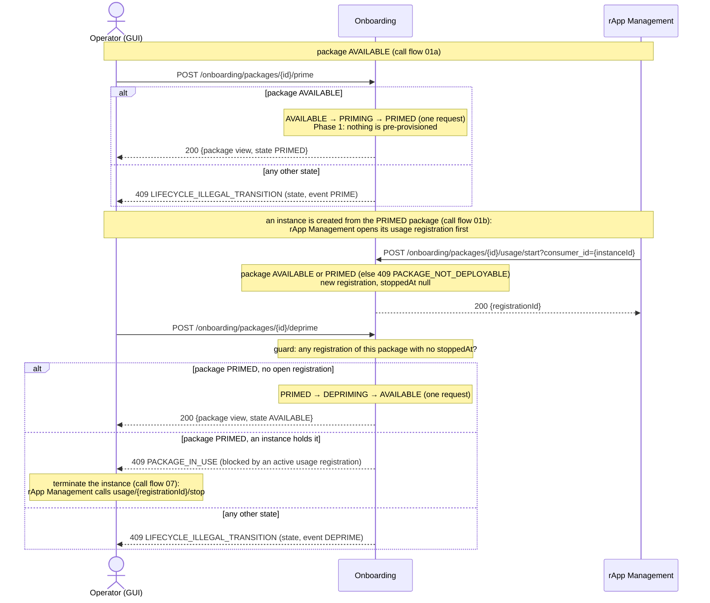
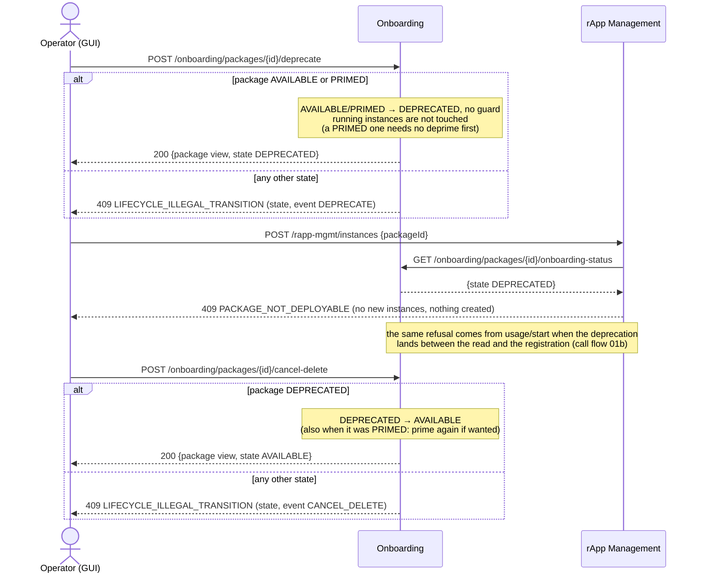
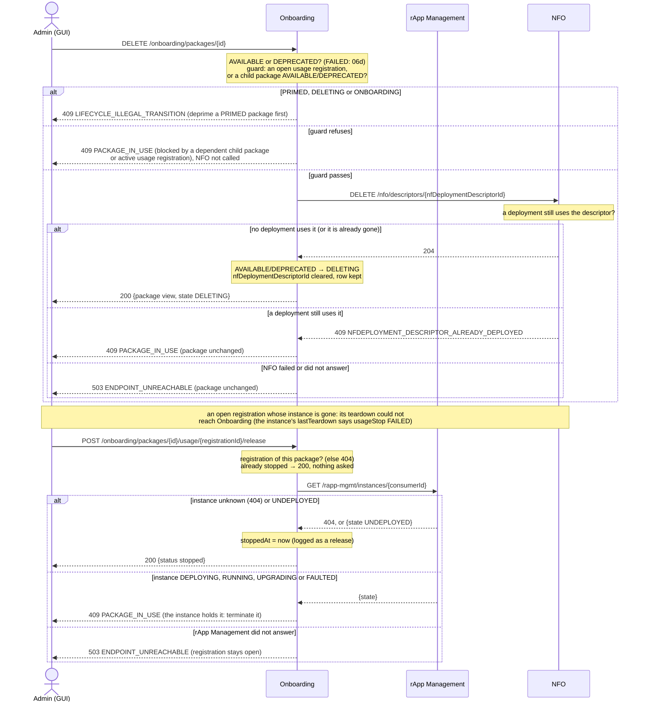
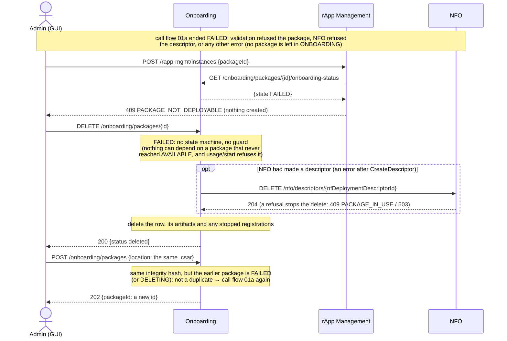

# Call Flow 06: rApp package lifecycle — prime, deprecate, delete

What happens to an rApp package after onboarding (call flow 01a), until it is deleted. Four diagrams, each one thing an operator does:

| | Step | Who starts it | Ends with |
|---|---|---|---|
| 06a | Prime and deprime | Operator | package PRIMED, or back to AVAILABLE once no instance holds it |
| 06b | Deprecate, and cancel the deprecation | Operator | package DEPRECATED (no new instances; from AVAILABLE or PRIMED), or AVAILABLE again |
| 06c | Delete a package, and release an orphaned registration | Admin | package DELETING, its NFO descriptor deleted |
| 06d | A package that failed to onboard | Admin | the FAILED package's row deleted; its CSAR can be onboarded again |

**As images:** [06a](images/06-package-lifecycle/06a-prime-and-deprime.png) ·
[06b](images/06-package-lifecycle/06b-deprecate-and-cancel-the-deprecation.png) ·
[06c](images/06-package-lifecycle/06c-delete-a-package-and-release-an-orphaned-registration.png) ·
[06d](images/06-package-lifecycle/06d-a-package-that-failed-to-onboard.png)
(PNG, drawn from the diagrams below by `scripts/render_call_flows.py`).

**How to read the diagrams.** As in call flow 01: an arrow is one call with the inputs that matter, a box on the receiver says what it does
with them, an `alt` block is the outcome (success first, then each failure and what the caller gets). *Operator (GUI)* stands for the console's
path (GUI → GUI backend, which checks the role → R1 Termination → the module). Prime, deprime, deprecate and cancel-delete need the
**operator** role; delete and release need **admin**.

**Who takes part.** Onboarding owns the package and its state; rApp Management is the only one that opens and closes the package's *usage
registrations* (one per instance); NFO owns the package's NF deployment descriptor. The rApp and its SDK take no part: an rApp cannot change
anything under `/onboarding` (R1 Termination refuses it), and the console cannot open or close a usage registration (the GUI backend has no rule
for those routes).

**The usage registration is the one signal.** rApp Management opens it first when it creates an instance (call flow 01b: the instance is not
created without it) and closes it when the instance is torn down: terminate, an upgrade's commit (the old instance) or rollback (the
replacement), call flow 07. An open registration blocks deprime and delete. When a teardown could not close it (Onboarding unreachable at
that moment, recorded in the instance's `lastTeardown`), an admin releases it (06c).

## Package states

| State | Events out (→ target) | Guard |
|---|---|---|
| `ONBOARDING` | `VALIDATE_OK` → `AVAILABLE`, `VALIDATE_FAILED` → `FAILED` | none |
| `AVAILABLE` | `PRIME` → `PRIMING`, `DEPRECATE` → `DEPRECATED`, `DELETE` → `DELETING` | `DELETE`: no open usage, no blocking child |
| `PRIMING` | `PRIME_COMPLETE` → `PRIMED` | none |
| `PRIMED` | `DEPRIME` → `DEPRIMING`, `DEPRECATE` → `DEPRECATED` | `DEPRIME`: no open usage |
| `DEPRIMING` | `DEPRIME_COMPLETE` → `AVAILABLE` | none |
| `DEPRECATED` | `CANCEL_DELETE` → `AVAILABLE`, `DELETE` → `DELETING` | `DELETE`: no open usage, no blocking child |
| `DELETING` | none: terminal, the row is kept as the record | — |
| `FAILED` | none in the state machine: `DELETE` removes the row directly (06d) | — |

`PRIMING` and `DEPRIMING` are never seen: each route fires both of its events in one request. Instances are created from `AVAILABLE` or
`PRIMED` packages only. An event with no edge from the current state is **409 `LIFECYCLE_ILLEGAL_TRANSITION`** (the detail names the state and
the event); an edge whose guard refuses is **409 `PACKAGE_IN_USE`**; an unknown package is **404 `PACKAGE_NOT_FOUND`**.

## 06a — Prime and deprime

`GET /onboarding/packages/{id}/usage` lists the registrations with an `active` flag and the consumer (the instance id), so the console shows
which instance blocks a deprime.

## 06b — Deprecate, and cancel the deprecation

Deprecation only stops new instances: an instance already running keeps running and keeps its registration, and it is what blocks the
delete in 06c. A PRIMED package is deprecated as it is: depriming first would be refused while its instances run, which left no way to stop new
ones (decided with the product owner, DOC-CF-1.2). Priming provisions nothing yet, so a DEPRECATED package does not remember it was primed:
cancel-delete returns it AVAILABLE, and its delete needs no deprime.

## 06c — Delete a package, and release an orphaned registration

A DELETING package is the record that it existed: its row and its artifact list stay, and the same CSAR can be onboarded again as a new
package (the duplicate check ignores DELETING and FAILED packages).

## 06d — A package that failed to onboard

## What this build does not do yet (Phase 1)

- **Priming provisions nothing.** In the reference, priming pre-provisions the package's ACM, DME and SME resources; here `prime` and
  `deprime` only move the state, in one request. SME declarations are registered per instance, when it bootstraps (call flow 01d).
- **No child packages.** The delete guard also refuses while a child package (one whose `parent_package_id` is this package) is AVAILABLE or
  DEPRECATED, but no route sets `parent_package_id` today, so in practice the usage registrations decide.
- **DELETING is final.** A deleted package's row and artifacts stay as its record; nothing purges them.

## Key decisions this flow depends on

- **One signal for "in use".** The deprime guard and the delete guard both read the open usage registrations. rApp Management is their only
  writer: it opens one before anything else at CreateInstance (and fails the create without it) and closes it at every teardown. The console
  can only release one whose instance is gone, after Onboarding asks rApp Management (DOC-CF-1.2).
- **Errors say what happened.** A guard refusal is `PACKAGE_IN_USE`, a package an instance may not be created from is
  `PACKAGE_NOT_DEPLOYABLE`; an event the state does not allow is `LIFECYCLE_ILLEGAL_TRANSITION` (OI-2-lcm-error-mapping).
- **A deleted package leaves no descriptor at NFO.** The descriptor is deleted before the package changes state, and NFO refuses while a
  deployment uses it; so a refusal leaves the package as it was.
- **`FAILED` is terminal in the state machine**, and its delete skips the guard (Onboarding/rApp Mgmt LLD section 3): a failed onboard is retried
  as a new `POST /packages`, never resumed. Every error during onboarding ends in FAILED, never in a package stuck in ONBOARDING.
- **The duplicate check ignores DELETING and FAILED packages** (HISTORY.md OI-2-package-redeploy): a deleted or failed package never locks
  its CSAR out.
- **An AI/ML model's lifecycle is a different state machine** (AIMgF, call flow 02); this flow is the rApp package's only.
