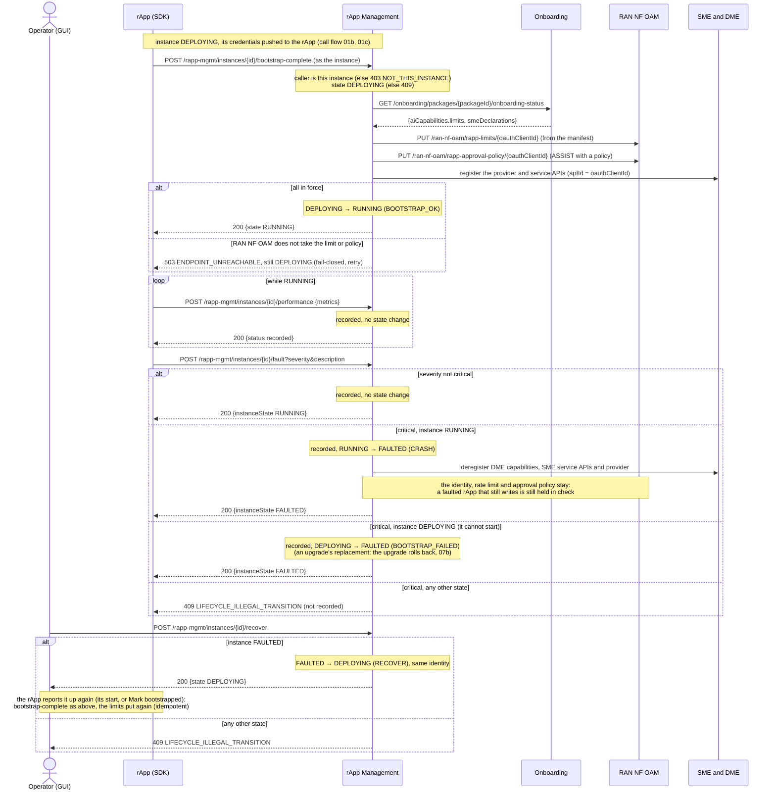
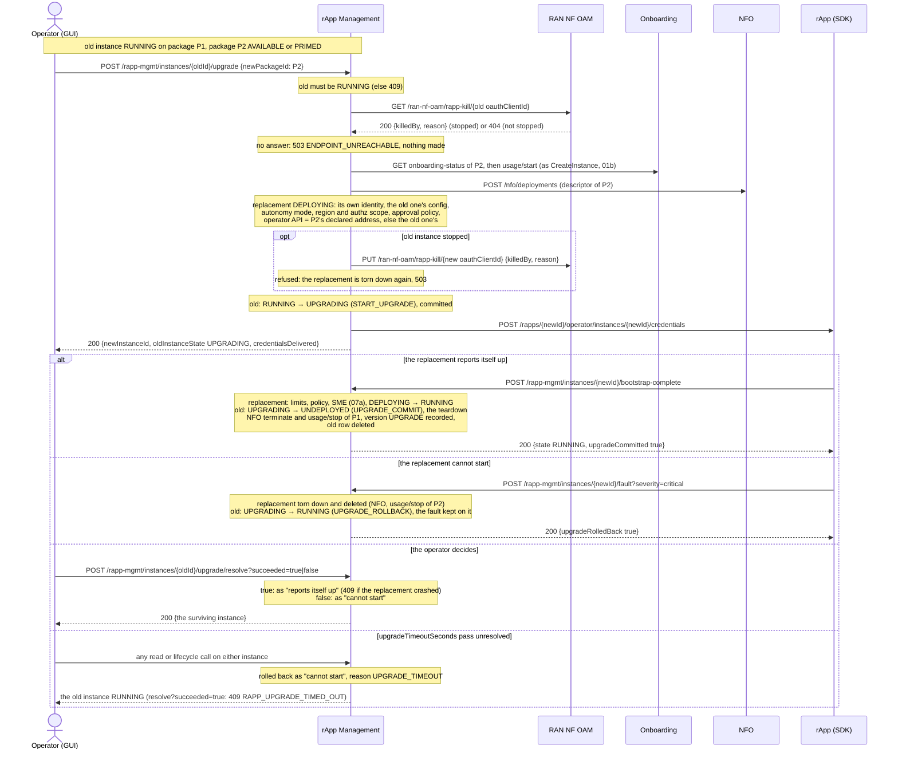
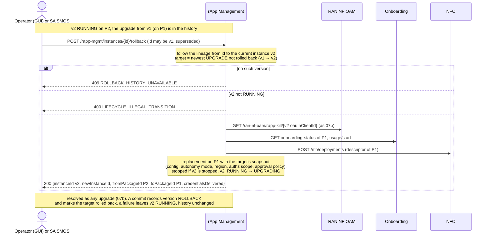
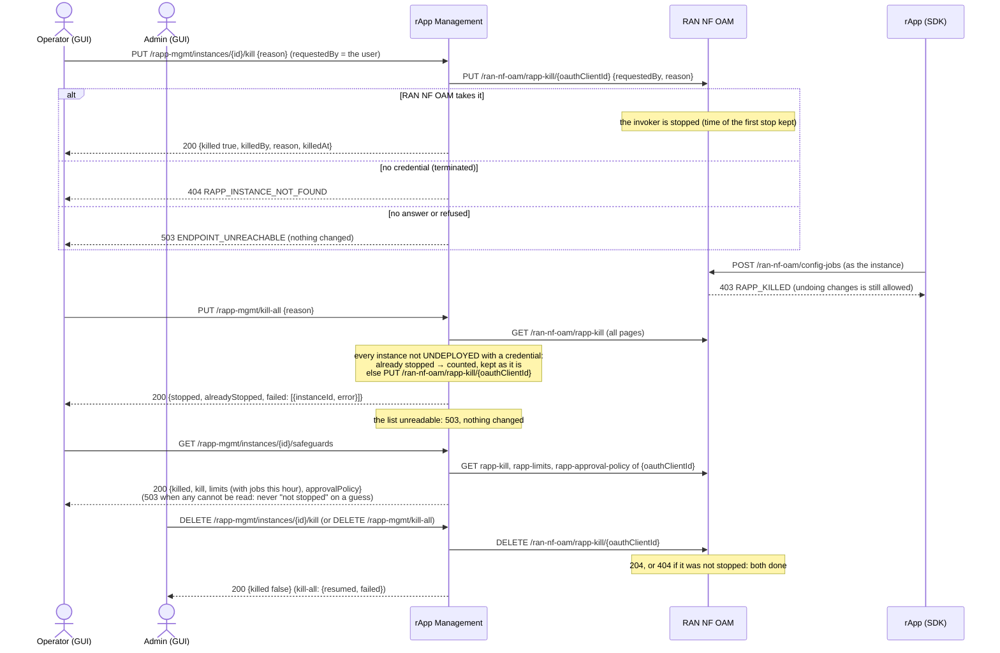
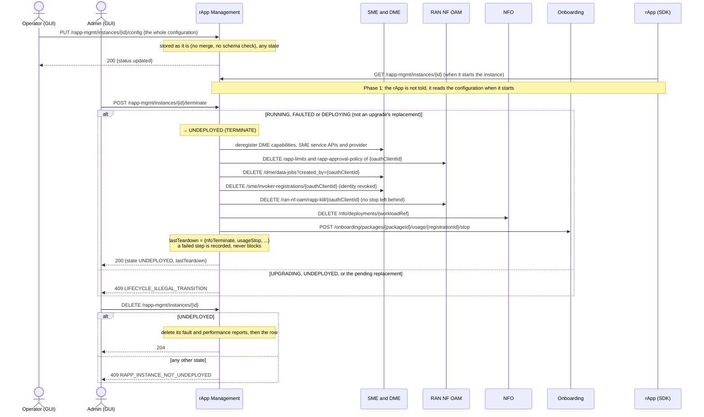

# Call Flow 07: rApp instance lifecycle — run, fault, upgrade, roll back, stop, terminate

What happens to an rApp instance after it is created (call flow 01b), until its row is deleted. Five diagrams, each one thing that happens to
an instance:

| | Step | Who starts it | Ends with |
|---|---|---|---|
| 07a | Come up, report, fault and recover | the rApp (SDK), the operator | instance RUNNING; FAULTED after a critical fault, and RUNNING again after a recover |
| 07b | Upgrade: commit, roll back, time out | Operator | the replacement RUNNING and the old instance gone, or the old one RUNNING and the replacement gone |
| 07c | Roll back to the previous version | Operator or SA SMOS | the version before the last upgrade RUNNING again (as 07b) |
| 07d | Stop an rApp, the global stop, safeguards | Operator (stop), admin (resume) | the instance's config writes refused at RAN NF OAM, or allowed again |
| 07e | Reconfigure, terminate, delete | Operator (config), admin (terminate, delete) | instance UNDEPLOYED, then its row deleted |

**As images:** [07a](images/07-rapp-instance-lifecycle/07a-come-up-report-fault-and-recover.png) ·
[07b](images/07-rapp-instance-lifecycle/07b-upgrade-commit-roll-back-time-out.png) ·
[07c](images/07-rapp-instance-lifecycle/07c-roll-back-to-the-previous-version.png) ·
[07d](images/07-rapp-instance-lifecycle/07d-stop-an-rapp-the-global-stop-safeguards.png) ·
[07e](images/07-rapp-instance-lifecycle/07e-reconfigure-terminate-delete.png)
(PNG, drawn from the diagrams below by `scripts/render_call_flows.py`).

**How to read the diagrams.** As in call flow 01: an arrow is one call with the inputs that matter, a box on the receiver says what it does
with them, an `alt` block is the outcome (success first, then each failure and what the caller gets). *Operator (GUI)* stands for the console's
path (GUI → GUI backend, which checks the role → R1 Termination → the module). Upgrade, rollback, recover, reconfigure and stop need the
**operator** role; resume, terminate and delete need **admin**.

**Who takes part.** rApp Management owns the instance and its state. *rApp (SDK)* is the rApp process that serves the instance, acting as the
instance with the credentials rApp Management pushed to it (call flow 01c): through R1 Termination it may report its own instance up
(`bootstrap-complete`), its performance and its faults, and register its operator API, and nothing else of its life cycle (R1 Termination
refuses the rest; rApp Management refuses another instance's, 403 `NOT_THIS_INSTANCE`). RAN NF OAM holds what keeps an rApp in check, keyed on
the instance's identity (its `oauthClientId`): the rate limit, the approval policy and the kill switch. NFO holds the workload, Onboarding the
package usage registration (call flow 06), SME and DME the instance's registrations.

## Instance states

| State | Events out (→ target) | What the transition does |
|---|---|---|
| `DEPLOYING` | `BOOTSTRAP_OK` → `RUNNING`, `BOOTSTRAP_FAILED` → `FAULTED`, `TERMINATE` → `UNDEPLOYED` | `BOOTSTRAP_OK`: rate limit, approval policy, SME declarations. `TERMINATE`: the teardown below |
| `RUNNING` | `START_UPGRADE` → `UPGRADING`, `CRASH` → `FAULTED`, `TERMINATE` → `UNDEPLOYED` | `CRASH`: DME and SME deregistration only. `TERMINATE`: the teardown |
| `UPGRADING` | `UPGRADE_COMMIT` → `UNDEPLOYED`, `UPGRADE_ROLLBACK` → `RUNNING` | `UPGRADE_COMMIT`: the teardown |
| `FAULTED` | `RECOVER` → `DEPLOYING`, `TERMINATE` → `UNDEPLOYED` | `TERMINATE`: the teardown |
| `UNDEPLOYED` | none: terminal. `DELETE /instances/{id}` removes the row | — |

**The teardown** (every move into `UNDEPLOYED`, `rapp-mgmt/app/statemachine.py`): deregister at DME (production capabilities) and SME (service
APIs, provider), drop the rate limit and the approval policy at RAN NF OAM, close the DME data jobs the instance opened, revoke its identity at
SME, then drop its kill switch. Then the route releases the workload: NFO terminate and Onboarding usage/stop (`release_instance_resources`).
Every step is best-effort and the outcome is recorded in `lastTeardown`.

An event with no edge from the current state is **409 `LIFECYCLE_ILLEGAL_TRANSITION`** (the detail names the state and the event); an unknown
instance is **404 `RAPP_INSTANCE_NOT_FOUND`**. An upgrade's pending replacement cannot be terminated (409): the upgrade is resolved instead.

## 07a — Come up, report, fault and recover

The console reads the history at `GET /rapp-mgmt/instances/{id}/faults` and `/performance` (newest first). Its *Mark bootstrapped* button is
the same `bootstrap-complete`, for an rApp that cannot call it.

## 07b — Upgrade: commit, roll back, time out

The replacement's stop keeps who stopped the old instance and says it was carried over; the operator resumes it like any stop (07d). A refused
package is answered as in CreateInstance: 404 `PACKAGE_NOT_FOUND`, 409 `PACKAGE_NOT_DEPLOYABLE`, and the old instance stays RUNNING.

## 07c — Roll back to the previous version

Every committed upgrade is recorded in `rapp_instance_version` with what the retired instance ran. A rollback is an upgrade back to the newest
version not already rolled back. SA SMOS issues it for a monitor on the instance (call flow 04), an operator from the console.

Repeated rollbacks walk further back (v3 → v2 → v1) instead of switching between two versions; `GET /rapp-mgmt/instances/{id}/versions` lists
the history newest first and names the version a rollback would undo now.

## 07d — Stop an rApp, the global stop, safeguards

The stop is RAN NF OAM's (call flow 03 shows where a config write meets it); rApp Management translates the operator's instance into the
invoker id it keys on. `GET /rapp-mgmt/kill-all` counts the stopped instances for the console's banner. An rApp cannot stop, resume or list
stops (R1 Termination refuses it), and a stop follows the instance through an upgrade or rollback (07b, 07c).

## 07e — Reconfigure, terminate, delete

## What this build does not do yet (Phase 1)

- **A configuration change is not pushed to the rApp.** `PUT /config` only stores it; the rApp reads it when it starts the instance. A
  running rApp sees a change after the operator restarts it there (OPEN_ITEMS OI-7-config-push).
- **No scheduler.** `upgradeTimeoutSeconds` (default 300 s) is enforced when either instance of the upgrade is next read or acted on, not at
  the deadline itself.
- **One deployment per NFO descriptor.** NFO lets a package's descriptor be deployed once, so a second instance of the same package gets no
  `workloadRef` (the instance is created; its teardown skips NFO). An upgrade or rollback goes to another package and is not affected.

## Key decisions this flow depends on

- **A faulted rApp stays held in check** (DOC-CF-1.3). A crash removes the instance only from discovery (DME, SME). Its identity stays for a
  recover, so its rate limit and approval policy stay with it: RAN NF OAM does not limit a caller it holds no limit for. They go at terminate.
- **An upgrade never releases a stopped rApp** (DOC-CF-1.3). The replacement has a new identity, so the old one's stop is put on it before the
  upgrade starts; when RAN NF OAM cannot say whether the old one is stopped, the upgrade does not start. A terminate drops the stop after the
  identity is revoked, so nothing is left behind and nothing is free in between.
- **The replacement brings itself up** (DOC-CF-1.3). It gets an operator API address and its credentials as a new instance does (01b), and
  its own `bootstrap-complete` commits the upgrade; a critical fault from it before then rolls it back. The operator's resolve stays for
  either outcome, and the timeout for an rApp that says nothing.
- **An upgrade is two instances**, not one changing package in place (`rapp-mgmt/app/upgrade.py`). The replacement goes through
  CreateInstance's own provisioning and the old instance keeps its package, identity and workload until the commit; whichever loses is torn
  down like a terminate and its row deleted, with the outcome in the survivor's `lastTeardown`.
- **History is kept outside the instance row.** Each commit records what the retired instance ran (`rapp_instance_version`) and links its id
  to its successor, so a rollback, the version list and an SA SMOS monitor registered before an upgrade all find the current instance.
- **Recover re-enters bootstrap**, with no shortcut back to RUNNING (HISTORY.md OI-2-recover): the rApp reports the instance up again, and its
  limits and SME declarations are put again.
- **Terminate and delete are separate** (HISTORY.md §5): terminate keeps the row UNDEPLOYED as the record; delete is legal only then.
- **Terminate is legal from FAULTED and DEPLOYING**, so a crashed instance or one that never came up is retired without recovering first
  (OI-2-lcm-error-mapping); UPGRADING is resolved first.
- **Only a critical fault changes state**; every report is recorded and readable.
