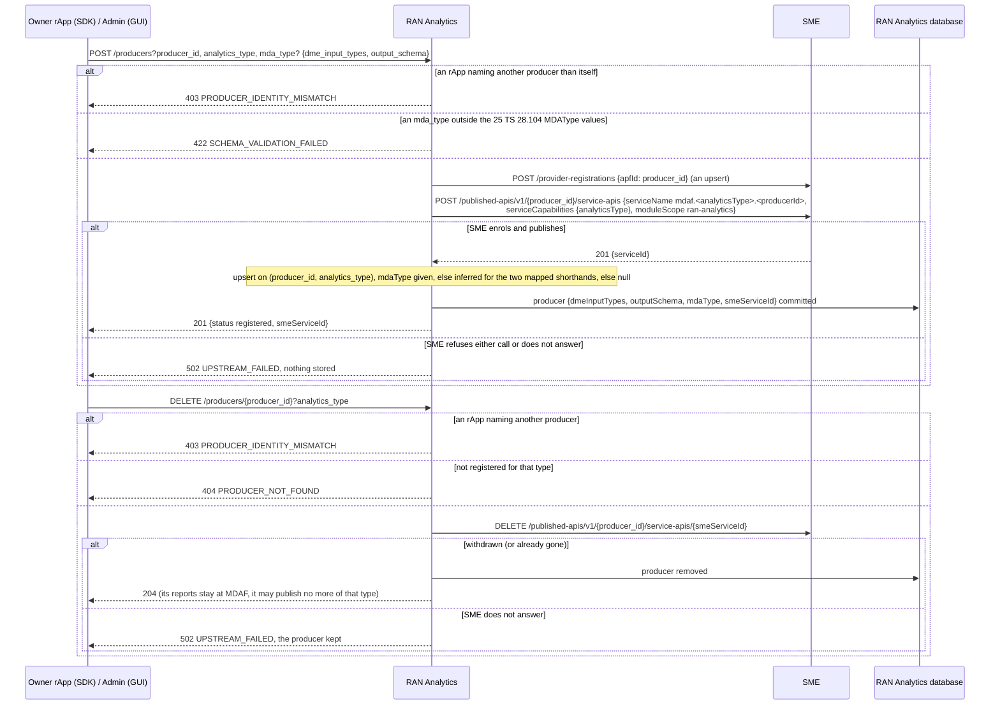
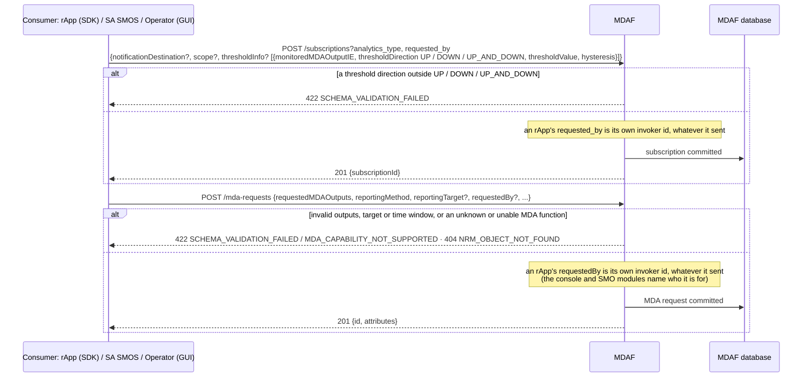
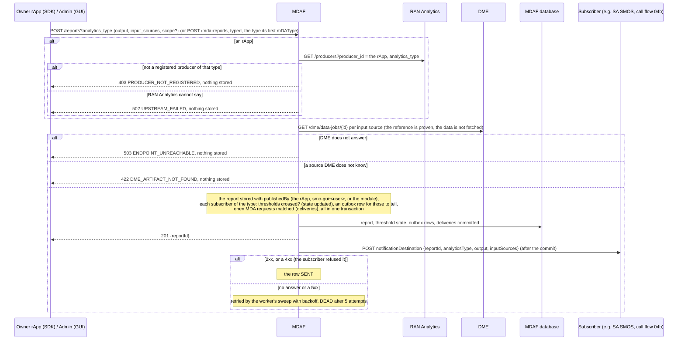
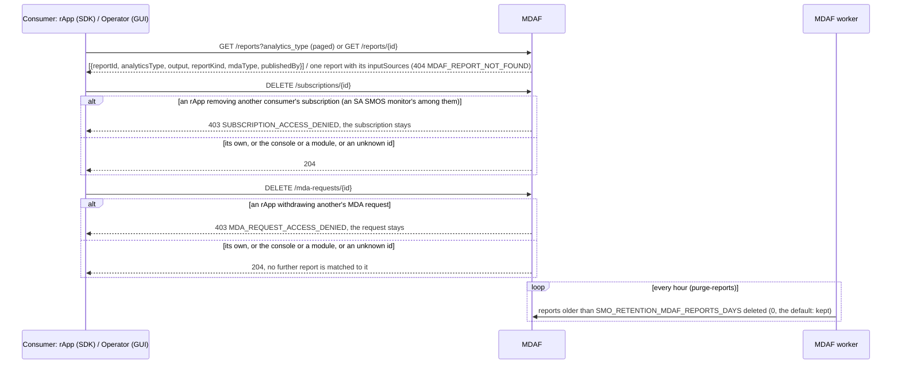

# Call Flow 08: RAN analytics — producer registration, subscriptions, reports and their delivery

How RAN behaviour analytics (TS 28.104 MDA, not a model's own performance, which is MLMF's, call flow 02) go from a producer to its consumers
(RAN Analytics LLD sections 1–2). Two services share the flow: **RAN Analytics** keeps the producer registry and enrols each producer in SME;
**MDAF** stores the reports, holds the subscriptions and delivers to them. An rApp is a producer only for itself, publishes only what it is registered
for, and a subscription or an MDA request belongs to who made it. Four diagrams:

| | Step | Who starts it | Ends with |
|---|---|---|---|
| 08a | Registering (and deregistering) a producer | Owner rApp (SDK), Admin (GUI) | a producer discoverable in SME, or refused with nothing stored |
| 08b | Subscribing, with thresholds | a consumer: an rApp, SA SMOS (call flow 04), Operator (GUI) | a subscription (or a TS 28.104 MDA request) that is the consumer's own |
| 08c | Publishing a report and delivering it | Owner rApp (SDK), Admin (GUI) | the report stored with its publisher and pushed to each subscriber that should hear of it, or refused |
| 08d | Querying, unsubscribing and retention | a consumer, the worker | reports read, a subscription or an MDA request removed, old reports purged |

**As images:** [08a](images/08-ran-analytics-data-production/08a-registering-and-deregistering-a-producer.png) ·
[08b](images/08-ran-analytics-data-production/08b-subscribing-with-thresholds.png) ·
[08c](images/08-ran-analytics-data-production/08c-publishing-a-report-and-delivering-it.png) ·
[08d](images/08-ran-analytics-data-production/08d-querying-unsubscribing-and-retention.png)
(PNG, drawn from the diagrams below by `scripts/render_call_flows.py`).

**How to read the diagrams.** As in call flow 01: an arrow is one call with the inputs that matter, a box on the receiver says what it does with them,
an `alt` block is the outcome (success first, then each failure and what the caller gets). Every call reaches RAN Analytics and MDAF through R1
Termination, which stamps the caller's role (`X-R1-Role`: `rapp` or `internal`) and invoker id; the rules below are for a caller with the rApp role, the
console and SMO modules are trusted to act for others.

## 08a — Registering (and deregistering) a producer

In the console both calls need the **admin** role (`gui-bff/app/rbac.py`). The KPIs page's producer tools register a producer; the console has no
deregister button yet (`OPEN_ITEMS.md` GUI-11.1), so an admin deregisters through the BFF's proxy (`DELETE /api/smo/ran-analytics/producers/{id}`).

**Phase 1:** `dme_input_types` are stored as given, not looked up at DME, and `output_schema` is not checked against the reports the producer publishes
(open item `MDA-SCHEMA`). A producer registered before revision 0056 has no `smeServiceId`; its deregistration withdraws nothing at SME.

## 08b — Subscribing, with thresholds

Without `notificationDestination` a subscription is pull-only (08d). With `thresholdInfo` it is notified only when a report crosses a threshold
(edge-triggered: a crossing fires once, a value back beyond the hysteresis band re-arms it; a metric missing from the report is skipped); without, it is
notified of every report of its type. A destination is checked when a notification is queued (08c): an unsafe one is dropped, the subscription stays.
A TS 28.104 MDA request names the MDA outputs it wants: each report published is matched against the open requests and delivered by their `reportingMethod` (08c).

## 08c — Publishing a report and delivering it

**Phase 1:** delivery is at least once; a subscriber that acts on a notification should read the report back by its id (`GET /reports/{id}`), as SA
SMOS does, rather than trust the pushed copy. A report's `output` is free-form JSON (a typed report's outputs are also flattened into it).

## 08d — Querying, unsubscribing and retention

**Phase 1:** reports are readable by any caller; a report carries no access restriction of its own.

## Decisions this flow depends on

- **Two services, one flow:** RAN Analytics registers producers and enrols them in SME; MDAF (TS 28.104's MDA NRM realization) owns reports, subscriptions
  and delivery. MDAF asks RAN Analytics only to check an rApp publisher (DOC-CF-1.8).
- **A producer is who it says it is** (DOC-CF-1.8): an rApp registers, deregisters and publishes only as itself, for the types it is registered for. A report
  can trigger an automatic configuration write (call flow 04), so an unregistered rApp's report is refused, not stored.
- **A subscription belongs to its maker** (DOC-CF-1.8): an rApp's `requested_by` is its own id and it removes only its own; the console and SMO modules may
  remove any. An MDA request follows the same rule (MDA-REQ-OWNER): an rApp's `requestedBy` is its own id, it withdraws only its own (403
  `MDA_REQUEST_ACCESS_DENIED`), and the console and SMO modules may withdraw any. A request stored before this rule keeps the `requestedBy` its body
  named; an rApp withdraws it only if that is its own id.
- **One SME service per producer and type** (`mdaf.<analyticsType>.<producerId>`): SME service names are unique across producers, so a shared
  `mdaf.<analyticsType>` left a second producer of a type undiscoverable. SME is asked before the producer is stored.
- **`MDAFProducer`'s key is (producer_id, analytics_type)**: one producer may serve several types; registering the same pair again updates it in place.
- **An MDA function is platform configuration** (TS 28.104 `MDAFunction`, `POST`, `PUT`, `DELETE /mdaf/mda-functions(/{id})`): an admin writes it
  through the console's BFF (the **admin** role, `gui-bff/app/rbac.py`), as for the other registries, or a caller with the SMO module role does; the
  gateway does not let an rApp write one (`shared/smo_shared/roles.py`, `/mdaf`), and nothing seeds one. The console lists them (KPIs page) and has no form
  to write one; an admin calls the BFF's proxy. An MDA request (`POST /mdaf/mda-requests`, operator in the console) may name one in `mDAFunctionRef` (404
  `NRM_OBJECT_NOT_FOUND` for an unknown one); the console's request form picks from those that exist.
- **`analyticsType` is a free string**; an optional `mdaType` is checked against TS 28.104's 25 values, inferred for the two shorthands with an unambiguous
  correspondence, else null, never guessed (HISTORY.md SA-MDA-2).
