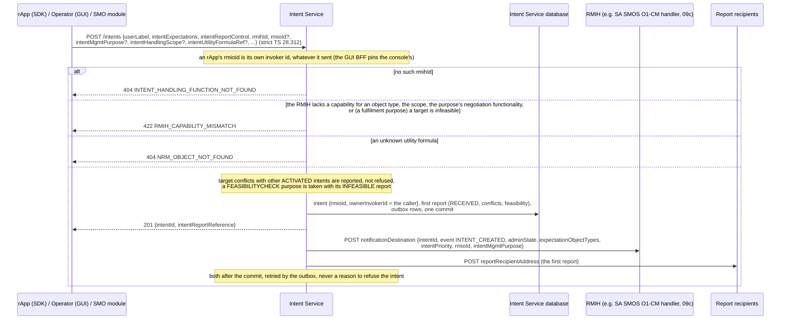
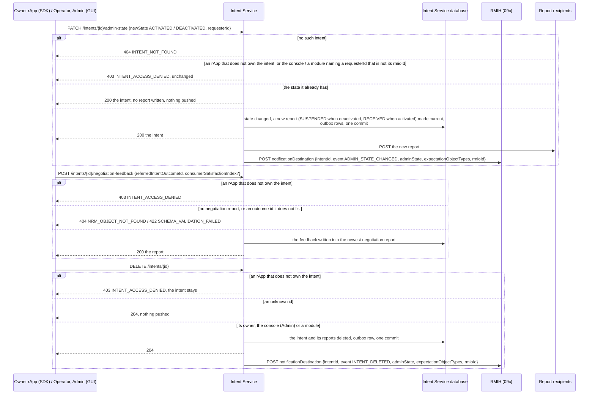
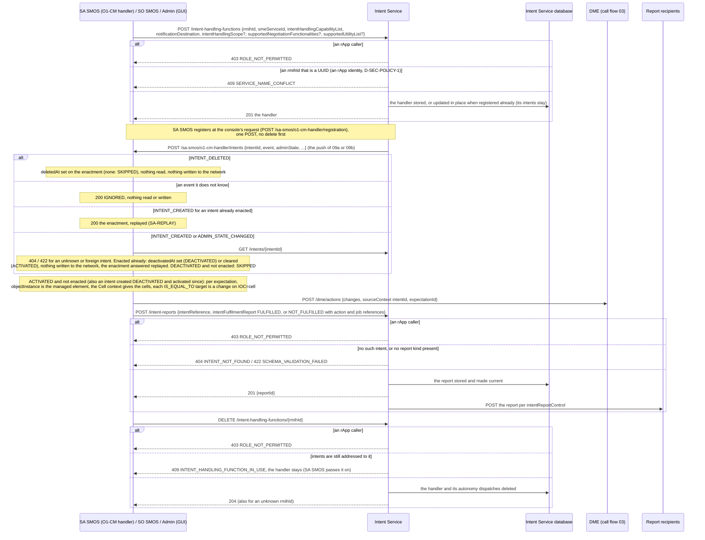
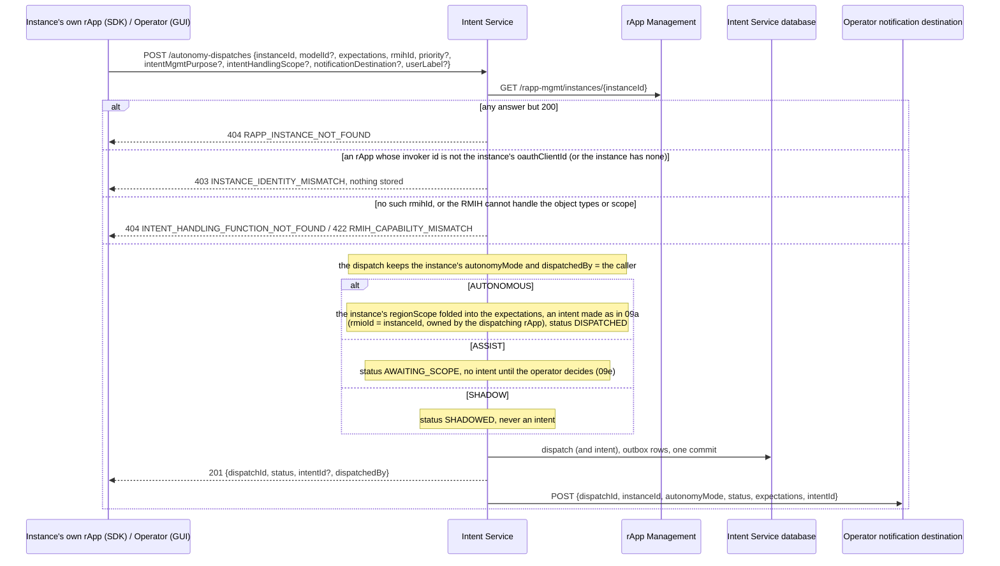
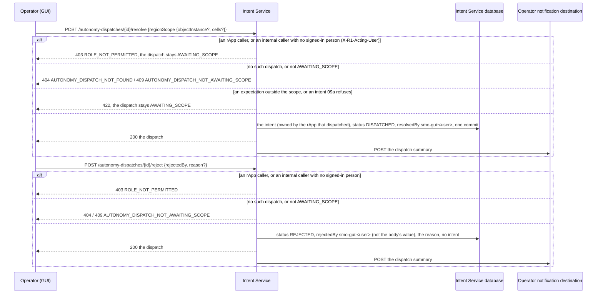

# Call Flow 09: Intents — creating, managing, handling and dispatching them

How a TS 28.312 intent goes from its owner to the function that handles it, and how an AI/ML outcome becomes an intent under the rApp instance's
autonomy mode (Intent Service LLD sections 1–3, `HISTORY.md` OI-6.3). **Intent Service** stores intents, their reports and the handling functions
(RMIHs), and keeps the autonomy dispatches; an **RMIH** (an SMO module: SA SMOS's O1-CM handler, SO SMOS) enacts what an intent asks and reports on it.
An rApp manages only the intents it owns, dispatches only for its own instance, and never registers a handler, publishes a report or decides an ASSIST
dispatch. Five diagrams:

| | Step | Who starts it | Ends with |
|---|---|---|---|
| 09a | Creating an intent | an rApp (SDK), Operator (GUI), an SMO module | an intent owned by its creator, pushed to its RMIH, or refused with nothing stored |
| 09b | Managing an intent: admin state, negotiation feedback, deletion | its owner, Operator / Admin (GUI) | the intent changed or removed, or refused for anyone else |
| 09c | Handlers and their reports | SA SMOS, SO SMOS, Admin (GUI) | a handler registered (or updated in place), an intent enacted and reported on, a handler removed once it has no intents |
| 09d | Requesting an autonomy dispatch | the instance's own rApp (SDK), Operator (GUI) | an intent now (AUTONOMOUS), a dispatch awaiting the operator (ASSIST) or a record only (SHADOW) |
| 09e | Deciding an ASSIST dispatch | Operator (GUI) | an intent in the scope the operator chose, or the dispatch rejected |

**As images:** [09a](images/09-intent-service-intent-flow/09a-creating-an-intent.png) ·
[09b](images/09-intent-service-intent-flow/09b-managing-an-intent-admin-state-negotiation-feedback-dele.png) ·
[09c](images/09-intent-service-intent-flow/09c-handlers-and-their-reports.png) ·
[09d](images/09-intent-service-intent-flow/09d-requesting-an-autonomy-dispatch.png) ·
[09e](images/09-intent-service-intent-flow/09e-deciding-an-assist-dispatch.png)
(PNG, drawn from the diagrams below by `scripts/render_call_flows.py`).

**How to read the diagrams.** As in call flow 01: an arrow is one call with the inputs that matter, a box on the receiver says what it does with them,
an `alt` block is the outcome (success first, then each failure and what the caller gets). Every call reaches Intent Service through R1 Termination,
which stamps the caller's role (`X-R1-Role`: `rapp` or `internal`), its invoker id and, for the console, the signed-in person (`X-R1-Acting-User`,
`smo-gui:<user>`). An rApp's invoker id is its instance's `oauthClientId` (call flow 01). The console and SMO modules are trusted to act for others; the
GUI BFF decides which console user may do what (Operator or Admin).

## 09a — Creating an intent

**Phase 1:** an rApp may address any registered RMIH; Intent Service checks what the RMIH declared it can handle, not whether the rApp may ask it.

## 09b — Managing an intent: admin state, negotiation feedback, deletion

The owner is the invoker that created the intent (`ownerInvokerId`); an intent from before revision 0057 has none and its `rmioId` stands in. The pushes
to the RMIH go after the commit and are retried by the outbox, as in 09a (INTENT-LIFECYCLE-PUSH). A delete push carries everything the handler needs,
because the intent can no longer be read back. A handler answers an `event` it does not know with 2xx and does nothing; SO SMOS registers no handler
route, so a push to it is a 404, which the outbox counts as delivered.

## 09c — Handlers and their reports

**Phase 1:** a module may publish a report for any intent, not only the ones addressed to it, because module invoker ids are not tied to an `rmihId`.

## 09d — Requesting an autonomy dispatch

An intent the AUTONOMOUS path cannot make (an infeasible target, a region-scope conflict) is refused as in 09a and leaves no dispatch behind. The sample
rApps dispatch with their instance's own credentials (call flow 01); a pass run without them is refused, never sent under a shared identity.

## 09e — Deciding an ASSIST dispatch

A region scope bounds what the rApp asked for, never widens it: cells outside the operator's `cells` are dropped, and an expectation left with none is
refused. **Phase 1:** an ASSIST dispatch waits for its operator indefinitely; nothing expires it.

## Decisions this flow depends on

- **Consumer-side selection** (TS 28.312 containment, IntentHandlingFunction *contains* Intent): the creator names one registered RMIH, which must cover
  every expectation object type, the scope, the purpose's negotiation functionality and, for a fulfilment purpose, every target
  (`RMIH_CAPABILITY_MISMATCH`). Expectations are validated against TS 28.312's families (`app/ts28312.py`; OPEN_ITEMS.md SA-INTENT-partial).
- **An intent belongs to its creator** (DOC-CF-1.8): an rApp's `rmioId` is its own invoker id, and only the owner rApp changes, answers for or deletes
  it. The console and SMO modules act for others; the console's `requesterId` must still be the intent's `rmioId` for an admin-state change.
- **Handlers and reports are the SMO's** (D-SEC-POLICY-1, DOC-CF-1.8): an rApp registers no RMIH, publishes no report and deregisters none. Registering
  again updates in place, and a handler with intents is not removed, so no intent disappears under its owner (before, SA SMOS's re-registration deleted
  every intent through the database cascade).
- **An rApp dispatches only for its own instance** (DOC-CF-1.8): Intent Service compares the caller with the instance's `oauthClientId`, read from rApp
  Management; there is no fallback to a shared identity. The autonomy mode is the instance's, fixed at CreateInstance (call flow 01), and copied onto the
  dispatch so a later change never rewrites what happened.
- **An ASSIST decision is a person's** (DOC-CF-1.8): resolve and reject need the console's signed-in user, who is recorded (`resolvedBy`, `rejectedBy`).
- **An autonomy dispatch is not a service order**: it does not go through SO SMOS's dispatch table (call flow 10), which composes operator-driven
  multi-step orders; it calls Intent Service, which owns intent creation, directly.
- **Not taken:** restricting reads (any caller may read any intent or report) and TS 28.312's intent-handling semantics beyond what an RMIH declares
  (conflict resolution, exploration, decomposition are stored as reported, not acted on).
