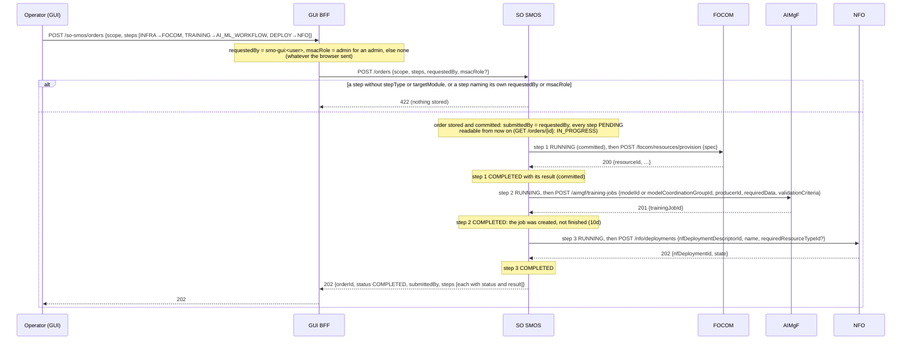
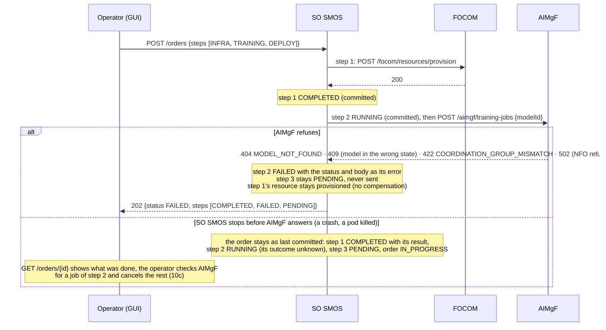
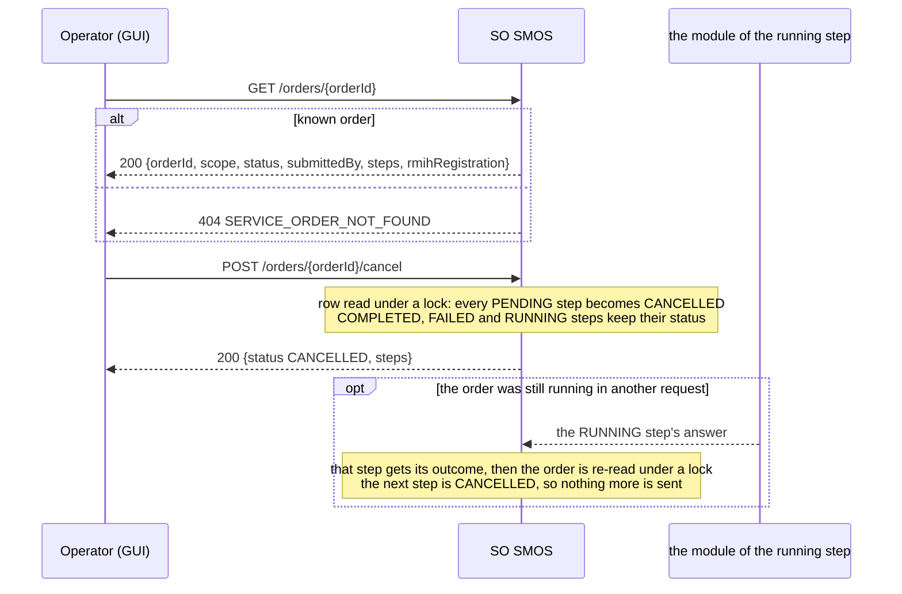
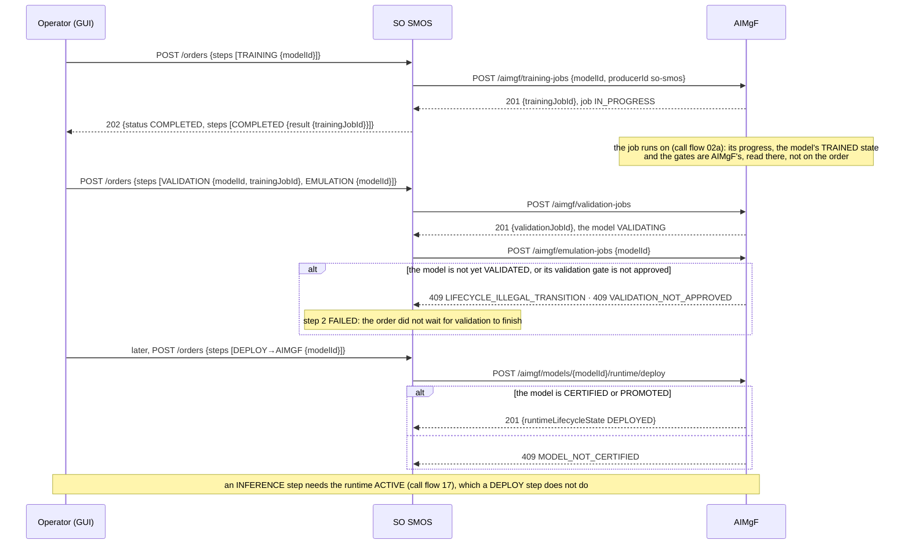

# Call Flow 10: SO SMOS multi-step order — submit, dispatch, fail fast, cancel

How a service order runs in SO SMOS: an ordered list of steps, each one call to another module through the dispatch table (`so-smos/app/dispatch.py`,
SO/SA SMOS LLD section 1). The steps run one after another and the first failure halts the order; nothing already done is undone. An SA SMOS monitor can
target an order (call flow 04): its RECONNECT heals the NF the order's DEPLOY step deployed. Four diagrams:

| | Step | Who starts it | Ends with |
|---|---|---|---|
| 10a | Submit and dispatch (INFRA → TRAINING → DEPLOY) | Operator (GUI) | every step COMPLETED, the order COMPLETED |
| 10b | A step fails, or SO SMOS stops mid-order | a module refuses a step; a crash | the order FAILED (later steps PENDING), or IN_PROGRESS with a step left RUNNING |
| 10c | Read and cancel | Operator (GUI) | the PENDING steps CANCELLED, even while the order runs |
| 10d | AI/ML steps: what COMPLETED means | Operator (GUI) | each AI/ML step COMPLETED once AIMgF accepted it, not when its job finished |

**As images:** [10a](images/10-so-smos-multi-step-infra-training-deploy/10a-submit-and-dispatch-infra-training-deploy.png) ·
[10b](images/10-so-smos-multi-step-infra-training-deploy/10b-a-step-fails-or-so-smos-stops-mid-order.png) ·
[10c](images/10-so-smos-multi-step-infra-training-deploy/10c-read-and-cancel.png) ·
[10d](images/10-so-smos-multi-step-infra-training-deploy/10d-ai-ml-steps-what-completed-means.png)
(PNG, drawn from the diagrams below by `scripts/render_call_flows.py`).

**How to read the diagrams.** As in call flow 01: an arrow is one call with the inputs that matter, a box on the receiver says what it does
with them, an `alt` block is the outcome (success first, then each failure and what the caller gets). In the console, submitting and cancelling an
order need the **operator** role; rApps have no route to SO SMOS.

**The dispatch table.** A step names a `stepType` and a `targetModule`; the pair picks one call:

| (stepType, targetModule) | Call | COMPLETED means |
|---|---|---|
| CONFIG, RAN_NF_OAM | `POST /ran-nf-oam/config-jobs` | the configuration job was accepted (call flow 03) |
| INFRA, FOCOM | `POST /focom/resources/provision` | the resource was provisioned |
| DEPLOY, NFO | `POST /nfo/deployments` | the workload's deployment was started (call flow 15) |
| TRAINING, AI_ML_WORKFLOW | `POST /aimgf/training-jobs` | the training job was created (10d) |
| VALIDATION, AI_ML_WORKFLOW | `POST /aimgf/validation-jobs` | the validation job was created (10d) |
| EMULATION, AI_ML_WORKFLOW | `POST /aimgf/emulation-jobs` | the emulation job was created (10d) |
| DEPLOY, AIMGF | `POST /aimgf/models/{modelId}/runtime/deploy` | the model's runtime was deployed, not yet ACTIVE (call flow 17) |
| INFERENCE, AI_ML_WORKFLOW | `POST /aimgf/models/{modelId}/inference-jobs` | the inference job was created |

## 10a — Submit and dispatch (INFRA → TRAINING → DEPLOY)

A CONFIG step sends RAN NF OAM the order's `requestedBy` and `msacRole`, never values of its own (a step that names them is 422). So an operator writes
configuration through an order as `smo-gui:<user>` with the MSAC role of their console role, as on RAN NF OAM's own config route; another SMO module that
names no submitter writes as `so-smos` with no role.

**Phase 1:** the request stays open while the steps run, and a step does not take its inputs from an earlier step's result: the DEPLOY step needs an
`nfDeploymentDescriptorId` the operator already has, not the resource INFRA just provisioned (`OPEN_ITEMS.md` SO-CHAIN).

## 10b — A step fails, or SO SMOS stops mid-order

A step also fails, the same way, on a pair with no dispatcher (`no dispatcher for (…)`), on a step missing a field its call needs, and when the module
cannot be reached. A failed step is in the 202 body, never an HTTP error of the order.

**Phase 1:** a failed or interrupted order cannot be retried or resumed from the failed step, and nothing finishes a step left RUNNING: the operator
submits a new order with the remaining steps (`OPEN_ITEMS.md` SO-RESUME). Cleaning up what the completed steps made is the operator's.

## 10c — Read and cancel

Cancelling an order with nothing PENDING changes nothing and still answers 200. Cancelling never undoes a COMPLETED step: the provisioned resource,
the job or the deployment stays.

## 10d — AI/ML steps: what COMPLETED means

So a pipeline in one order (TRAINING → VALIDATION → EMULATION → DEPLOY → INFERENCE) fails at its second step: each AI/ML step only starts its job, and
the next needs that job finished and a gate passed. Order the AI/ML work as separate orders, each when AIMgF shows the model ready, or call AIMgF directly
(call flow 02).

**Phase 1:** SO SMOS does not wait for a job it started (`OPEN_ITEMS.md` SO-WAIT).

## Decisions this flow depends on

- Sequential and fail-fast with no compensation (SO/SA SMOS LLD section 1.1): the first failed step halts the order, and what earlier steps made stays.
- The order is saved before its first step and again before and after each one, so it is readable while it runs and a crash leaves a record of what was
  done; a step left RUNNING is the one whose outcome is unknown (DOC-CF-1.8).
- The identity and MSAC role a CONFIG step writes with are the order's submitter, set by the GUI BFF from the console user; a step cannot name its own
  (DOC-CF-1.8).
- Cancel turns only PENDING steps into CANCELLED, and a running order checks for a cancel before each step.
- Every dispatcher goes through `_ensure_ok`: a 4xx or 5xx fails the step instead of being recorded COMPLETED. `("DEPLOY", "NFO")` and `("DEPLOY", "AIMGF")`
  are two keys, so a wrong `targetModule` fails the step instead of reaching the wrong module.
- The AI/ML dispatchers add no rule of their own: each forwards to the AIMgF route of call flows 02 and 17, whose guards apply. SO SMOS calls as an SMO
  module, so AIMgF's rApp ownership rule does not apply to an order.
