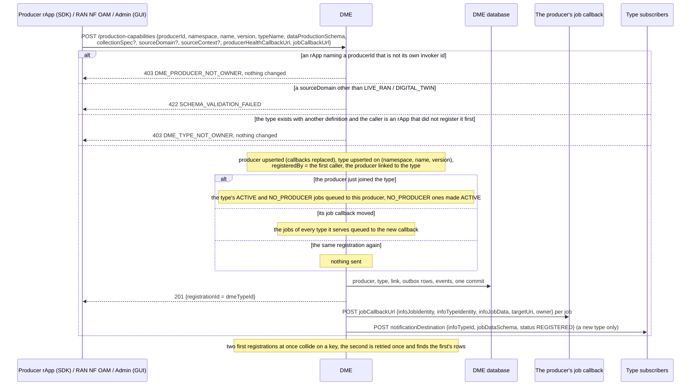
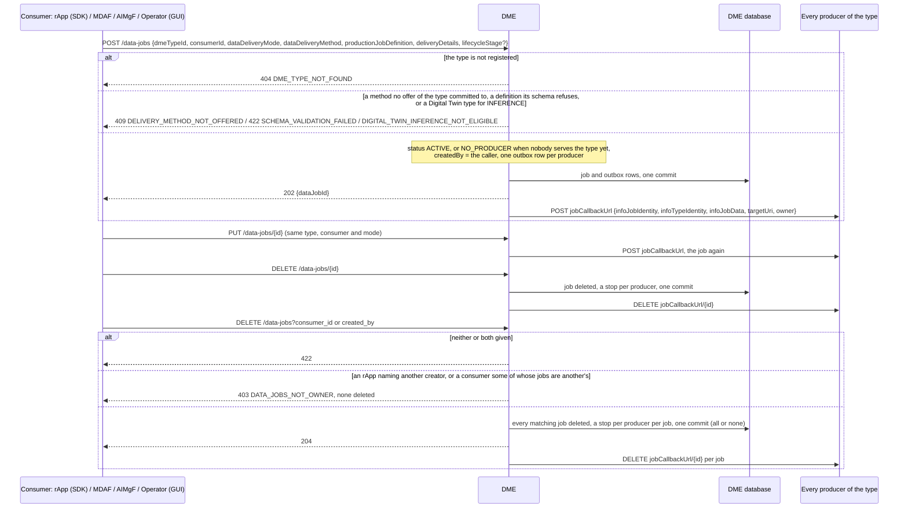
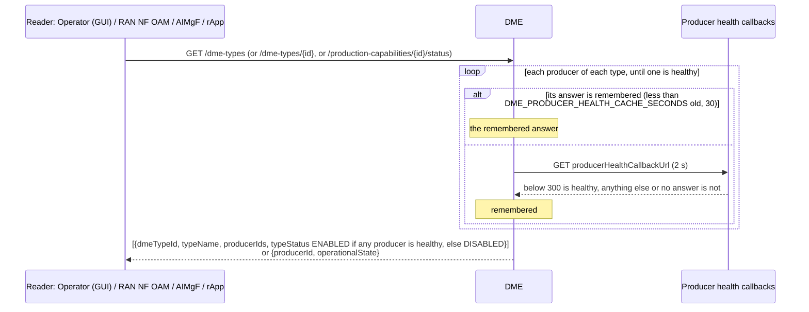
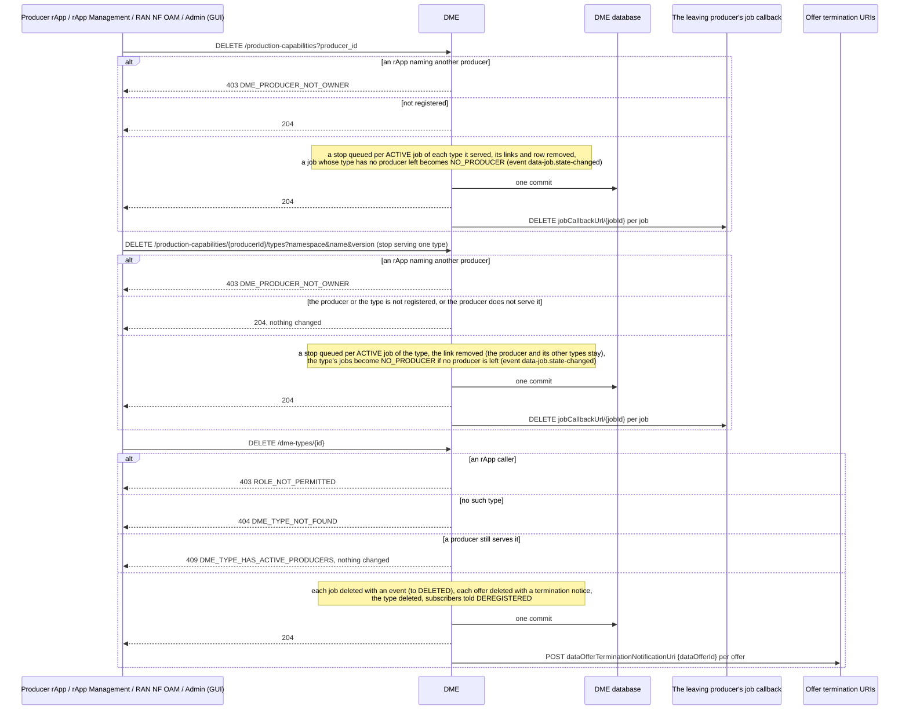

# Call Flow 11: DME producers and types — registering and joining, jobs reaching producers, health, leaving and deleting

How data producers and the data types they serve are kept in DME (Foundational Platform LLD section 3, ICS's `InfoProducer` / `InfoType`, `HISTORY.md`
SA-ICS-1). Producers and types are separate, many to many: a type is one `(namespace, name, version)`, several producers may serve it, and one producer may
serve several types. A consumer's data job is sent to every producer of its type. Four diagrams:

| | Step | Who starts it | Ends with |
|---|---|---|---|
| 11a | Registering a producer and type, and joining a type | a producer rApp (SDK), RAN NF OAM (PM, FM, KPI types), Admin (GUI) | the producer linked to the type and sent the type's open jobs, or refused with nothing changed |
| 11b | Jobs reaching producers | a consumer: an rApp, MDAF, AIMgF, Operator (GUI) | a job sent to every producer of its type, or waiting as NO_PRODUCER |
| 11c | Producer and type health | Operator (GUI), RAN NF OAM, AIMgF, any reader | ENABLED / DISABLED, asked of the producers at most once per 30 s each |
| 11d | A producer leaving, a type being deleted | the producer rApp, rApp Management (instance torn down), RAN NF OAM (one type), Admin (GUI) | the producer's jobs stopped and waiting, or the type, its jobs and offers removed with their owners told |

**As images:** [11a](images/11-dme-producer-type-lifecycle/11a-registering-a-producer-and-type-and-joining-a-type.png) ·
[11b](images/11-dme-producer-type-lifecycle/11b-jobs-reaching-producers.png) ·
[11c](images/11-dme-producer-type-lifecycle/11c-producer-and-type-health.png) ·
[11d](images/11-dme-producer-type-lifecycle/11d-a-producer-leaving-a-type-being-deleted.png)
(PNG, drawn from the diagrams below by `scripts/render_call_flows.py`).

**How to read the diagrams.** As in call flow 01: an arrow is one call with the inputs that matter, a box on the receiver says what it does with them,
an `alt` block is the outcome (success first, then each failure and what the caller gets). Every call reaches DME through R1 Termination, which stamps the
caller's role (`X-R1-Role`: `rapp` or `internal`) and invoker id. Every message DME sends a producer or a subscriber is an outbox row committed with the
change that caused it, sent after the commit and retried (call flow 03's outbox).

## 11a — Registering a producer and type, and joining a type

RAN NF OAM registers itself (`producerId ran-nf-oam`) for `RAN.PMCounters.<type>`, `RAN.FaultRecords` and `RAN.KPI.<name>` before it stores a PM or FM
subscription or publishes a KPI; DME refusing, or not answering, is RAN NF OAM's 502 `UPSTREAM_FAILED` with nothing stored (call flow 20).
**Phase 1:** joining an existing type is open to any producer with the same definition; who serves a type is shown in its `producerIds` (GUI, Data → DME).

## 11b — Jobs reaching producers

A producer that is down is not a failure of the consumer's call: its rows stay in the outbox and are retried (a destination the SSRF guard refuses is
dropped). `DELETE /data-jobs?consumer_id` (or `created_by`) deletes every matching job in one transaction, so a failure part way deletes none (call flow 12a).

## 11c — Producer and type health

A producer serving several types is asked once per read, not once per type. A re-registration or a deregistration forgets the producer's answer.
**Phase 1:** the answer is remembered per DME process, so two replicas may disagree for up to 30 s; `0` asks at every read.

## 11d — A producer leaving, a type being deleted

A job's owner learns of `NO_PRODUCER`, `ACTIVE` again and `DELETED` from the SMO event feed (`org.oran.smo.data-job.state-changed`, docs/EVENTS.md); a
job has no callback of its own. A producer's deregistration, or its withdrawal from one type, never deletes a type: the type stays (`DISABLED` when no
producer is left), its jobs waiting, until a producer joins or the operator deletes it. RAN NF OAM withdraws `RAN.PMCounters.<counter>` and
`RAN.FaultRecords` this way when the last subscription that needs the type goes (call flow 20).

## Decisions this flow depends on

- **Producers and types are separate, many to many** (ICS `InfoProducer` / `InfoType`, `HISTORY.md` SA-ICS-1): registration upserts the producer on
  `producerId` and the type on `(namespace, name, version)` and links them; the same definition again is a join, not a conflict.
- **A producer is who it says it is, and a type's definition is its first registrant's** (SEC-15.10, SEC-15.10b): an rApp registers and deregisters only
  under its own invoker id and may not change a type another registered first.
- **A job is never left believing in a producer that is gone** (DOC-CF-1.8): a leaving producer is told to stop, a job whose type has nobody is
  `NO_PRODUCER`, a producer that joins or moves its callback is sent the open jobs (ICS's `startInfoJobs` on registration).
- **A type is shared, so an rApp does not delete it** (DOC-CF-1.8): the console (Admin) or a module does, only once no producer serves it, and the jobs'
  owners and the offers are told.
- **Health is asked, not assumed, but not at every read** (DOC-CF-1.8): `typeStatus` is ENABLED when any producer answers its health callback, each
  answer remembered for 30 s.
- **A registration RAN NF OAM depends on is checked** (DOC-CF-1.8): it registers before storing the subscription that needs it.
- **A producer may stop serving one type and keep the others** (DOC-CF-1.8, call flow 20c/20d): `DELETE /production-capabilities/{producerId}/types`
  removes that one link, with the same stops and `NO_PRODUCER` as a full deregistration.
- **Not taken:** restricting who may join a type (an open type is how two vendors serve the same data).
