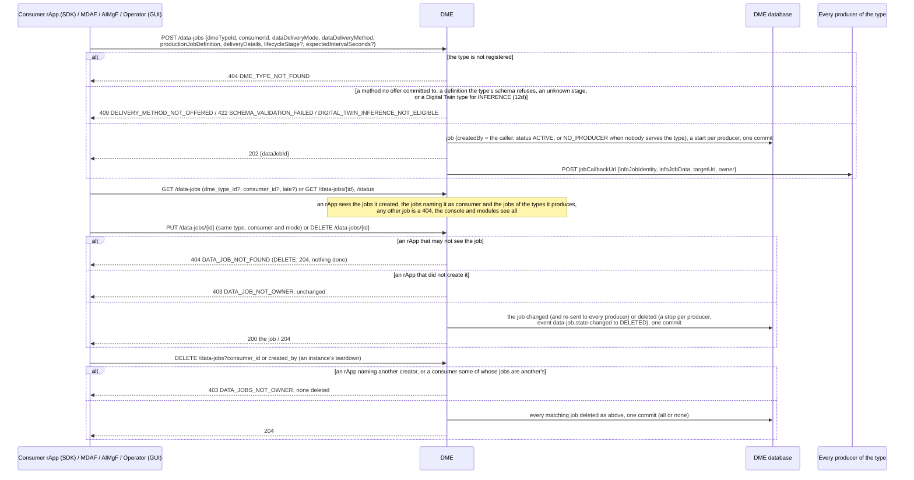
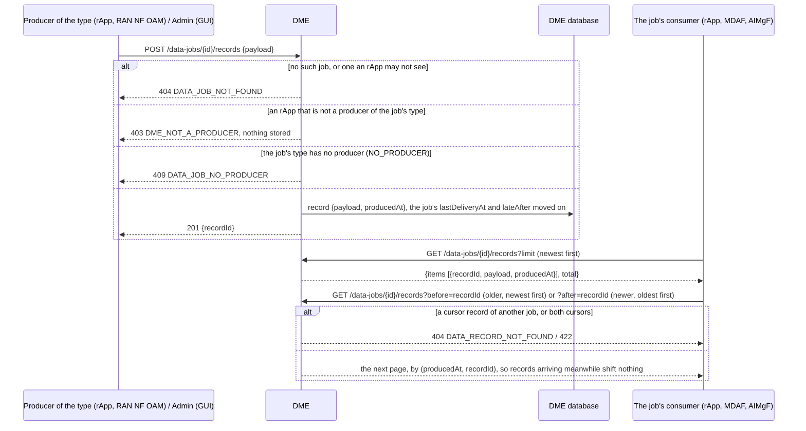
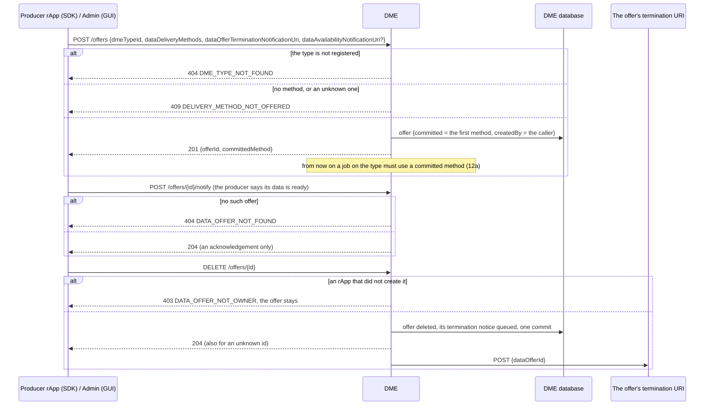
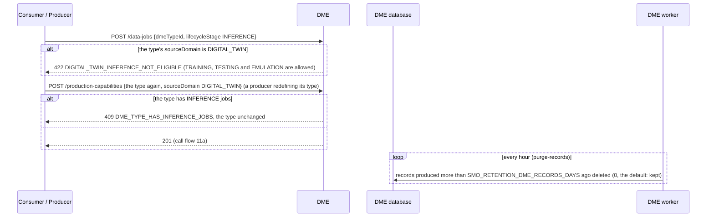

# Call Flow 12: DME data jobs, records and offers — whose they are, how data moves, and which data may feed what

How a consumer's data job, the records a producer delivers to it and a producer's data offer are kept in DME (Foundational Platform LLD section 3, ICS's
`InfoJob`), and the rule that a Digital Twin source never feeds inference (`docs/ARCHITECTURE.md`, "DME source provenance and eligibility"). Producers
and types are call flow 11. A job, its records and an offer belong to who made them: an rApp changes only its own, sees only the jobs it made, consumes
or produces for, and delivers only to a type it produces. Four diagrams:

| | Step | Who starts it | Ends with |
|---|---|---|---|
| 12a | A data job: create, read, change, delete | a consumer rApp (SDK), MDAF, AIMgF, Operator (GUI) | a job sent to its type's producers, changed or deleted by its owner, or refused |
| 12b | Records: delivering and reading | the type's producer (rApp, RAN NF OAM), the job's consumer | a record stored for the job, or refused, and pages of records that do not drift |
| 12c | Data offers | a producer rApp (SDK), Admin (GUI) | an offer committing one delivery method, ended by its maker with the termination notice |
| 12d | Eligibility and retention | a consumer, a producer redefining its type, the DME worker | a Digital Twin kept away from INFERENCE, and records older than the retention purged |

**As images:** [12a](images/12-dme-data-record-lifecycle-eligibility/12a-a-data-job-create-read-change-delete.png) ·
[12b](images/12-dme-data-record-lifecycle-eligibility/12b-records-delivering-and-reading.png) ·
[12c](images/12-dme-data-record-lifecycle-eligibility/12c-data-offers.png) ·
[12d](images/12-dme-data-record-lifecycle-eligibility/12d-eligibility-and-retention.png)
(PNG, drawn from the diagrams below by `scripts/render_call_flows.py`).

**How to read the diagrams.** As in call flow 01: an arrow is one call with the inputs that matter, a box on the receiver says what it does with them,
an `alt` block is the outcome (success first, then each failure and what the caller gets). Every call reaches DME through R1 Termination (`/dme`), which
stamps the caller's role (`X-R1-Role`: `rapp` or `internal`) and invoker id. The rules below hold a caller with the rApp role; the console (whose
operators and admins the GUI BFF tells apart) and SMO modules act for others.

## 12a — A data job: create, read, change, delete

A job's owner learns of `NO_PRODUCER`, `ACTIVE` again and `DELETED` from the SMO event feed (`org.oran.smo.data-job.state-changed`, docs/EVENTS.md).
**Phase 1:** a job created before revision 0045 has no `createdBy`, so only the console or a module may change or delete it.

## 12b — Records: delivering and reading

The SDK's `get_dataset` pages with `before` (it used an offset, and a record arriving between two pages repeated one). A consumer that wants only what is
new reads `after` the last record it saw. **Phase 1:** the payload is stored as it is: the type's `dataProductionSchema` describes a job's definition,
not its records, so DME does not validate records.

## 12c — Data offers

**Phase 1:** DME does not act on an availability notice (it neither pulls the data nor calls `dataAvailabilityNotificationUri`), and an offer's
`dataDeliveryMode` and `productionJobDefinition` are accepted but not kept (`OPEN_ITEMS.md` DME-OFFER-AVAIL). An offer from before revision 0058 has no
creator, so only the console or a module may end it.

## 12d — Eligibility and retention

A type without a `sourceDomain`, or a job without a `lifecycleStage`, is not restricted. The retention removes records only: a job keeps its row and its
newer records. `docs/RETENTION.md` proposes 30 days in the production sample.

## Decisions this flow depends on

- **A job, its records and an offer are their makers'** (DOC-CF-1.8): an rApp changes and deletes only the jobs it created (`createdBy`) and ends only the
  offers it made (`createdBy`, revision 0058); the console and modules act for others. What an rApp may not see is a 404, so a job's existence is not told.
- **Only a producer delivers** (DOC-CF-1.8): an rApp posts records only to a job of a type it produces (call flow 11), and not while the type has no
  producer; a consumer cannot forge its own data, and a junk record cannot keep a stalled job looking on time.
- **Records page by a cursor**, `(producedAt, recordId)`, newest first by default, so records arriving while a consumer reads shift nothing.
- **A Digital Twin never feeds inference** (Wave 3): refused when the job is made, and now also when a type with INFERENCE jobs would become a Digital Twin.
- **Records do not grow for ever unless kept on purpose** (`PR-DB-3`): a retention in days, 0 by default, purged by `dme-worker`.
- **One `/dme` route**: R1 Termination's `/dme-push` and `/dme-pull` aliases are gone; DME never had a route under them.
- **Not taken:** acting on an offer's availability notice, and validating record payloads.
