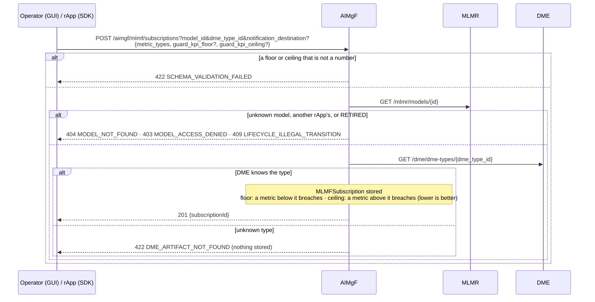
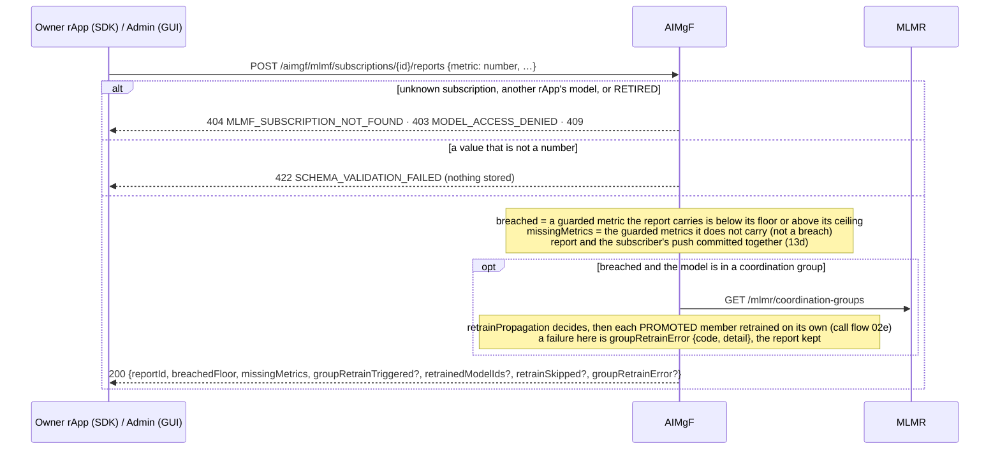
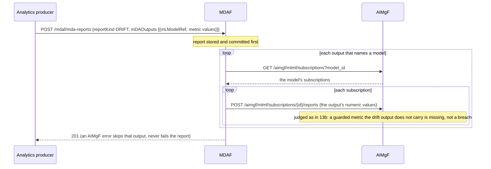
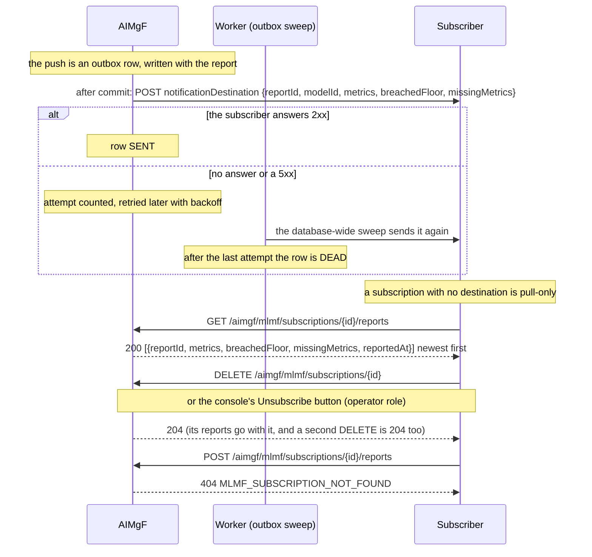

# Call Flow 13: Model performance monitoring (MLMF) — subscribe, report, breach, notify, unsubscribe

How a model's performance is watched in AIMgF's MLMF: a subscription says which metrics of a model to guard and where to push its reports; reports
come from MDAF's drift analysis, from the owner rApp or from an admin; a report that breaches a guard can retrain the model's coordination group
(call flow 02e). Four diagrams:

| | Step | Who starts it | Ends with |
|---|---|---|---|
| 13a | Subscribe | Operator (GUI), an rApp (SDK) | a subscription with its floors and ceilings |
| 13b | Report, breach, group retrain | the owner rApp (SDK), Admin (GUI) | a stored report; a breach may retrain the group |
| 13c | MDAF forwards a drift report | MDAF | one report per subscription of the model |
| 13d | Delivery, a pull subscriber, unsubscribe | AIMgF's outbox; the subscriber, Operator (GUI) to unsubscribe | the push delivered (or retried); the subscription gone |

**As images:** [13a](images/13-mlmf-subscription-lifecycle/13a-subscribe.png) ·
[13b](images/13-mlmf-subscription-lifecycle/13b-report-breach-group-retrain.png) ·
[13c](images/13-mlmf-subscription-lifecycle/13c-mdaf-forwards-a-drift-report.png) ·
[13d](images/13-mlmf-subscription-lifecycle/13d-delivery-a-pull-subscriber-unsubscribe.png)
(PNG, drawn from the diagrams below by `scripts/render_call_flows.py`).

**How to read the diagrams.** As in call flow 01: an arrow is one call with the inputs that matter, a box on the receiver says what it does
with them, an `alt` block is the outcome (success first, then each failure and what the caller gets). In the console, subscribing and unsubscribing
(the MLMF tab's form and its **Unsubscribe** button) need the **operator** role; filing a report by hand is test data and needs **admin**
(`gui-bff/app/rbac.py`).

**Who may act.** An rApp may subscribe to, read, report on and delete the subscriptions of a model it owns (403 `MODEL_ACCESS_DENIED` otherwise; a
model with no owner is open). The console, MDAF and the other SMO modules are not asked. A RETIRED model takes no new subscription or report (409,
call flow 26e).

## 13a — Subscribe

**Phase 1:** the DME type names where the model's performance signal comes from, but AIMgF does not read that data itself: the reports come
from MDAF (13c) and the owner rApp (13b). The destination is checked by the outbox's SSRF guard when a report is sent, not here.

## 13b — Report, breach, group retrain

A model in no group is not retrained by a breach: the subscriber decides what to do with it. `breachedFloor` keeps its name, though a ceiling
breaches it too.

## 13c — MDAF forwards a drift report

Before this, a guarded metric missing from a report counted as 0: a drift report carrying only its own outputs breached every floor of every
subscription of the model, and retrained the model's whole group.

## 13d — Delivery, a pull subscriber, unsubscribe

**Phase 1:** reports are kept until their subscription is deleted; nothing purges old ones (`OPEN_ITEMS.md` AIML-MLMF-RET).

## Decisions this flow depends on

- MLMF watches a model's performance, distinct from MDAF's RAN analytics (AI/ML Workflow LLD section 2); MDAF feeds it drift reports.
- A guard is a floor (higher is better) or a ceiling (lower is better). A breach needs the metric in the report: a report that does not carry a guarded
  metric lists it in `missingMetrics` instead (DOC-CF-1.8).
- A subscription names a model MLMR knows and a DME type DME knows; floors, ceilings and reported values are numbers (DOC-CF-1.8).
- The push goes through the transactional outbox: sent after the report commits, retried by the worker's sweep, never failing the report (PR-MSG-1.7).
- A destination is optional: a pull-only subscriber reads the reports. Unsubscribing twice is not an error.
- A breach retrains a coordination group only through its `retrainPropagation` and only its PROMOTED members, each on its own (call flow 02e).
