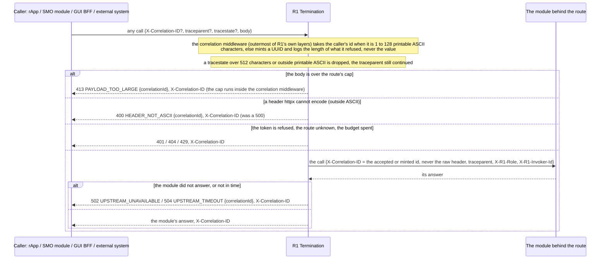
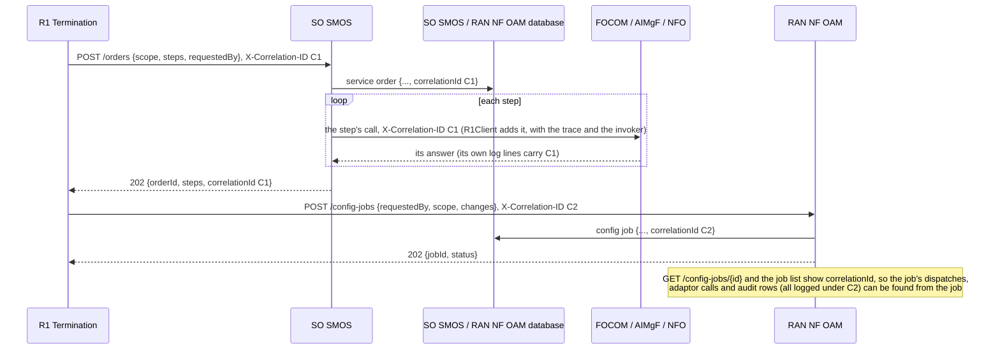
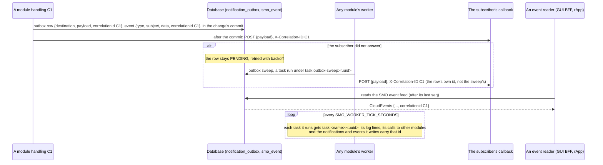
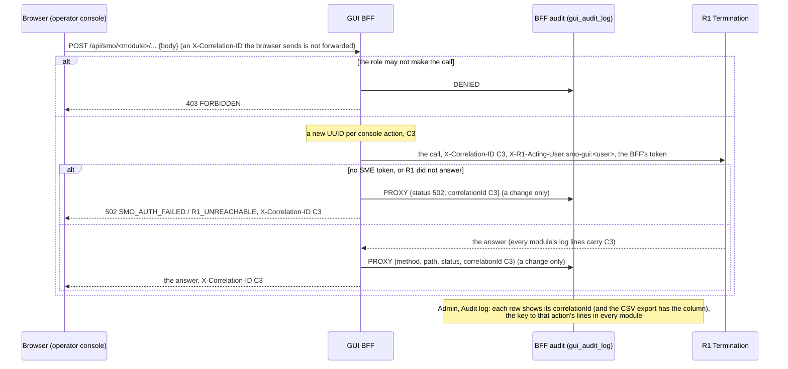

# Call Flow 14: Correlation ids — one id per action, from the gateway through every module, the work that outlives the request, and the console

How one action is tied together across the SMO by an `X-Correlation-ID` (`shared/smo_shared/correlation.py`, "R1 API conventions" in
`docs/ARCHITECTURE.md`): every log line, every call one module makes to another, every notification and event the action causes, and the rows it leaves
behind carry the same id, so an operator who has one id finds everything the action touched. Four diagrams:

| | Step | Who starts it | Ends with |
|---|---|---|---|
| 14a | The gateway: accepting, minting and echoing the id | any caller of R1 Termination (rApp, SMO module, GUI BFF, external system) | one valid id for the request, echoed on every answer (a 413, a 500 and a refusal included) |
| 14b | Service hops and what is stored | the module handling the request (SO SMOS, RAN NF OAM, every other) | each onward call carrying the id, and the service order or config job recording it |
| 14c | Work that outlives the request | the outbox, the worker, the event feed | a notification sent, a task run or an event read with the id of what caused it |
| 14d | The console | an operator in the GUI | an id per console action that the browser cannot choose, kept in the BFF's audit and shown back |

**As images:** [14a](images/14-correlation-id-propagation/14a-the-gateway-accepting-minting-and-echoing-the-id.png) ·
[14b](images/14-correlation-id-propagation/14b-service-hops-and-what-is-stored.png) ·
[14c](images/14-correlation-id-propagation/14c-work-that-outlives-the-request.png) ·
[14d](images/14-correlation-id-propagation/14d-the-console.png)
(PNG, drawn from the diagrams below by `scripts/render_call_flows.py`).

**How to read the diagrams.** As in call flow 01: an arrow is one call with the inputs that matter, a box on the receiver says what it does with them,
an `alt` block is the outcome (success first, then each failure and what the caller gets). The id lives in a context variable for the duration of a
request or a worker task (`get_correlation_id()`); `R1Client`, the outbox and the event bus read it there, so no handler passes it by hand.

## 14a — The gateway: accepting, minting and echoing the id

Every module runs the same middleware, so the rule holds at each hop, not only at the gateway: a module reached directly gets the same check. An error
raised by a route (`framework_error`, a database integrity or range error) carries `correlationId` in its problem body; an unhandled exception, which
Starlette answers outside every middleware, now gets the id back on its 500 too (header and body), from the request's state.

## 14b — Service hops and what is stored

R1 Termination's own audit rows already carried the id (`smo_shared.audit`), as do RAN NF OAM's rApp approvals and decision records.
**Phase 1:** an order or a job from before revision 0059 shows `correlationId` null. A step SO SMOS runs again later (none does today) would still carry
the id of the submit.

## 14c — Work that outlives the request

Every callback a module sends through `smo_shared.webhook` (outbox rows, producer health checks, job stops) carries the id of the request or task it is
sent under. **Phase 1:** a row or event from before revision 0059 has none: such a row goes out under the id of whatever sends it, such an event has no
`correlationid` attribute.

## 14d — The console

The browser never chooses the id: a console action is always the BFF's, and an id that came from a page could be reused to mix one person's action into
another's logs. **Phase 1:** reads are not audited (as before), so their id is only in the logs and on the answer.

## Decisions this flow depends on

- **An id is accepted only when it is short printable ASCII** (DOC-CF-1.8): 1 to 128 characters from `!` to `~`, otherwise a fresh UUID; a non-ASCII id
  made every onward call fail with a 500 (httpx cannot encode it, and the error was not an `httpx.HTTPError`), and a long one bloated every log line.
  The same for `tracestate` (512 characters, W3C's limit).
- **Every answer carries the id** (DOC-CF-1.8): the 413 of the body cap (now inside the correlation middleware), the 500 of an unhandled exception, and
  every problem body (`correlationId`, an RFC 7807 extension member).
- **The id outlives the request** (DOC-CF-1.8, revision 0059): stored on outbox rows and sent with the delivery, on events as the CloudEvents
  `correlationid` attribute (the name smo-teiv uses), on service orders and config jobs; each worker task run gets its own `task:<name>:<uuid>`.
- **The console's id is the BFF's** (DOC-CF-1.8): minted per action, sent to R1, kept in the BFF's audit and shown to the operator; the browser's is ignored.
- **Carried by context, not by parameters**: `R1Client`, the webhook sender, the outbox and the event bus read the context variable, so a handler or a
  dispatcher needs no code to take part.
- **Not in the OpenAPI documents**: a header every route carries is not a per-operation contract element.
- **Not taken:** passing the id on R1 Termination's token introspection calls to SME (they are the gateway's own, one per request, and SME logs them
  under its own id).
