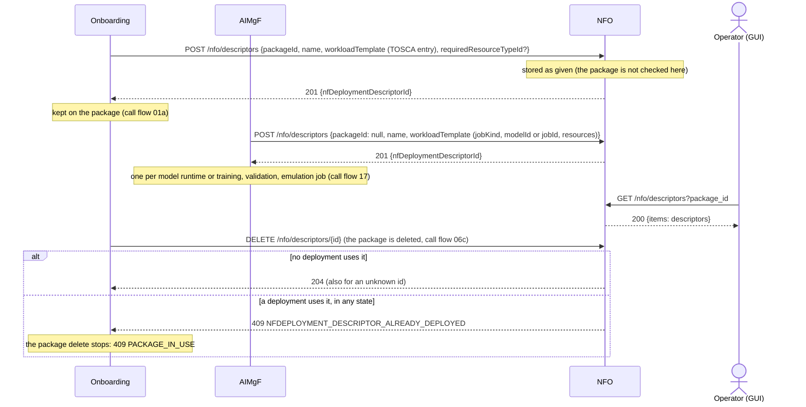
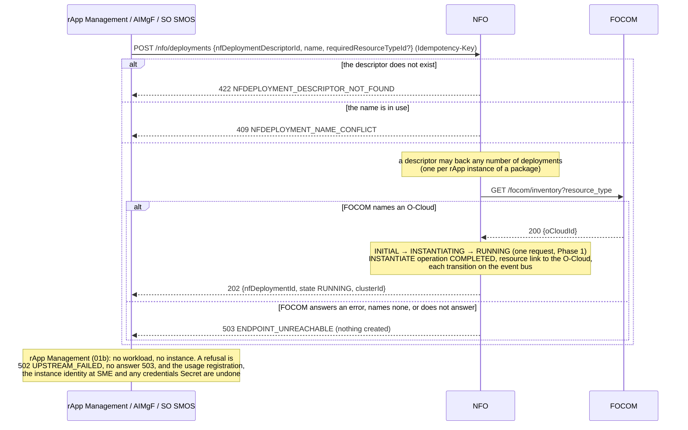
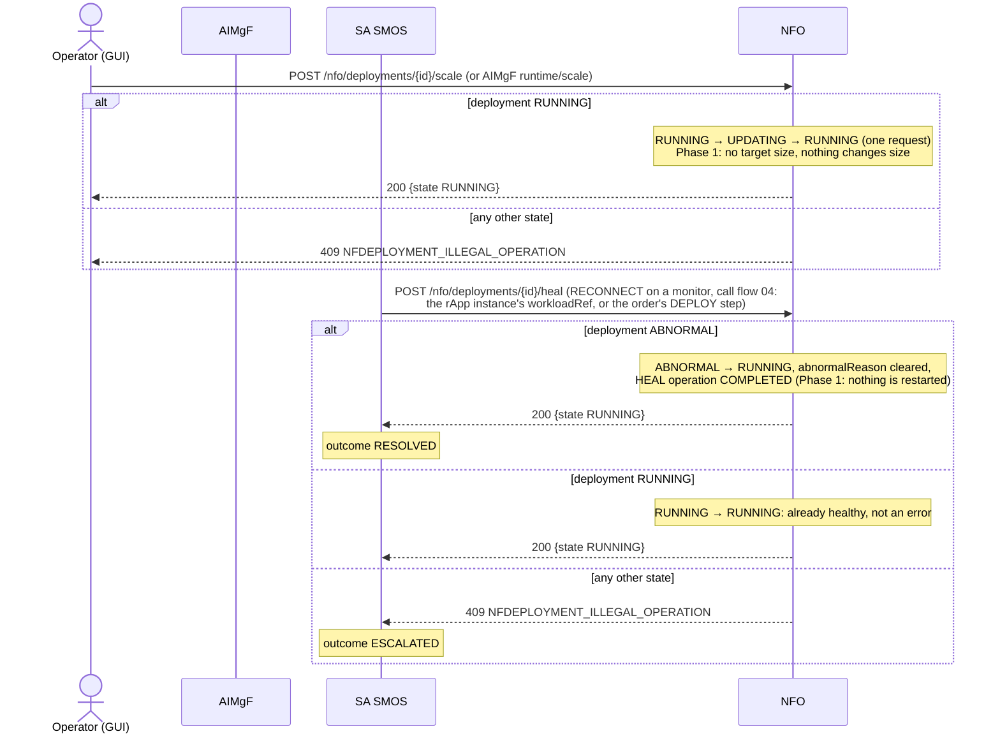
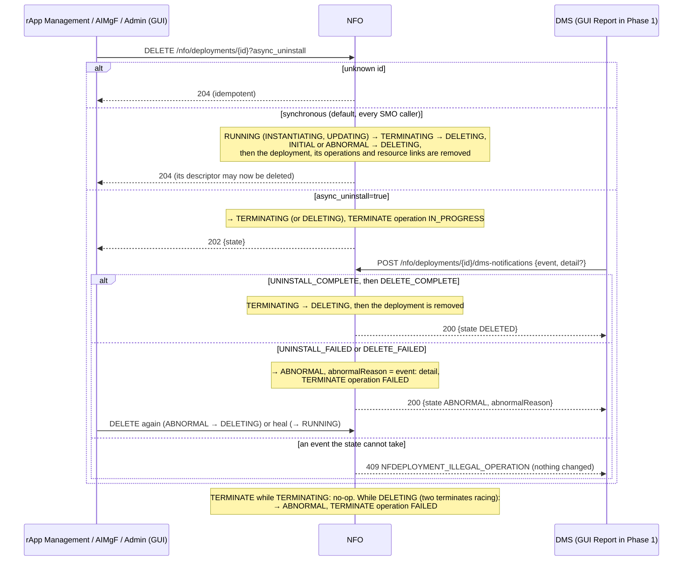
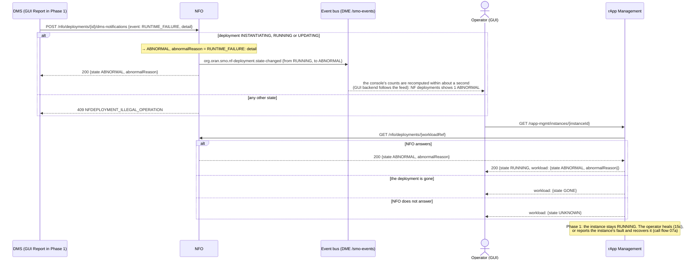

# Call Flow 15: NFO workload lifecycle — descriptor, instantiate, scale, heal, terminate

What NFO (the Network Function Orchestrator, the SMO's O2 DMS-style service) does with a workload: from the descriptor it is made from to the
end of its deployment. Five diagrams:

| | Step | Who starts it | Ends with |
|---|---|---|---|
| 15a | Descriptors | Onboarding, AIMgF | a descriptor (a workload template); deleted when its package is |
| 15b | Instantiate | rApp Management, AIMgF, SO SMOS | a deployment RUNNING on the O-Cloud FOCOM names |
| 15c | Scale and heal | Operator (GUI), AIMgF, SA SMOS | the deployment RUNNING again |
| 15d | Terminate, and the deployment manager's reports | rApp Management, AIMgF, Admin (GUI); the DMS | the deployment gone; ABNORMAL when the DMS reports a failure |
| 15e | A workload that breaks | the DMS | the deployment ABNORMAL, on the event bus and on the rApp instance's page |

**As images:** [15a](images/15-nfo-workload-lifecycle/15a-descriptors.png) ·
[15b](images/15-nfo-workload-lifecycle/15b-instantiate.png) ·
[15c](images/15-nfo-workload-lifecycle/15c-scale-and-heal.png) ·
[15d](images/15-nfo-workload-lifecycle/15d-terminate-and-the-deployment-manager-s-reports.png) ·
[15e](images/15-nfo-workload-lifecycle/15e-a-workload-that-breaks.png)
(PNG, drawn from the diagrams below by `scripts/render_call_flows.py`).

**How to read the diagrams.** As in call flow 01: an arrow is one call with the inputs that matter, a box on the receiver says what it does
with them, an `alt` block is the outcome (success first, then each failure and what the caller gets). *Operator (GUI)* and *Admin (GUI)* stand
for the console's path (GUI → GUI backend, which checks the role → R1 Termination → NFO). In the console, scale and heal need the
**operator** role; terminate and a DMS report need **admin**; the reads are open to every signed-in user.

**Who takes part.** NFO owns descriptors and deployments and their state. Its callers are SMO modules: Onboarding (a package's descriptor),
rApp Management (an rApp instance's workload, call flows 01b and 07), AIMgF (model and job runtimes, call flows 02 and 17), SO SMOS (an order's
DEPLOY step, call flow 10) and SA SMOS (RECONNECT, call flow 04). FOCOM names the O-Cloud a deployment is placed on. *DMS* is the deployment
manager that reports how an uninstall ended or that a workload broke; no real one runs in Phase 1, so the console's **Report** button on a
deployment stands in for it. An rApp and its SDK take no part: R1 Termination refuses an rApp every change under `/nfo`.

## Deployment states

| State | Events out (→ target) | How it is reached |
|---|---|---|
| `INITIAL` | `INSTANTIATE` → `INSTANTIATING`, `TERMINATE` → `DELETING` | the moment of creation; never committed |
| `INSTANTIATING` | `INSTANTIATE_COMPLETE` → `RUNNING`, `TERMINATE` → `TERMINATING`, `RUNTIME_FAILURE` → `ABNORMAL` | Instantiate; never committed (Phase 1) |
| `RUNNING` | `UPDATE` → `UPDATING`, `HEAL` → `RUNNING`, `TERMINATE` → `TERMINATING`, `RUNTIME_FAILURE` → `ABNORMAL` | Instantiate, scale, heal |
| `UPDATING` | `UPDATE_COMPLETE` → `RUNNING`, `TERMINATE` → `TERMINATING`, `RUNTIME_FAILURE` → `ABNORMAL` | scale; never committed (Phase 1) |
| `TERMINATING` | `UNINSTALL_COMPLETE` → `DELETING`, `UNINSTALL_FAILED` → `ABNORMAL`, `TERMINATE` → itself | Terminate |
| `DELETING` | `DELETE_FAILED` → `ABNORMAL`, `TERMINATE` → `ABNORMAL`; `DELETE_COMPLETE` removes the deployment | an uninstall that completed |
| `ABNORMAL` | `HEAL` → `RUNNING`, `TERMINATE` → `DELETING` | a DMS failure report, or a second terminate racing the first |

Every transition is published on the event bus as `org.oran.smo.nf-deployment.state-changed` about the deployment (`docs/EVENTS.md`), and so is
its removal (`to: DELETED`). An operation the state cannot take is **409 `NFDEPLOYMENT_ILLEGAL_OPERATION`**; an unknown deployment is **404
`NFDEPLOYMENT_NOT_FOUND`**. Each Instantiate, Scale, Heal and Terminate is recorded as an LCM operation (`GET /nfo/deployments/{id}/operations`).

## 15a — Descriptors

## 15b — Instantiate

## 15c — Scale and heal

## 15d — Terminate, and the deployment manager's reports

## 15e — A workload that breaks

## What this build does not do yet (Phase 1)

- **No workload runs.** Instantiate, scale, heal and the default terminate complete in the request and touch nothing: the Kubernetes driver
  is `OPEN_ITEMS.md` PR-SB-16. So INSTANTIATING and UPDATING are never seen.
- **Scale takes no target size** (`OPEN_ITEMS.md` OI-7-nfo-scale-size, PR-SB-17).
- **The DMS report is not authenticated as a DMS.** Any SMO module, or an admin through the console, may send it; no real deployment
  manager runs.
- **A broken workload does not fault its rApp instance.** It is visible (15e), but rApp Management does not follow the event bus to move the
  instance to FAULTED by itself (`OPEN_ITEMS.md` OI-7-workload-failure).
- **AIMgF keeps every descriptor it makes** and does not check NFO's answers; that is call flow 17's (DOC-CF-1.5).

## Key decisions this flow depends on

- **A descriptor is a template** (DOC-CF-1.4). It may back any number of deployments, which is how a package has several rApp instances; the
  O2 DMS reference's "a descriptor is deployed once" guard is not kept. The name of a deployment stays unique, and a descriptor cannot be
  deleted while any deployment uses it.
- **No placement on a guess** (DOC-CF-1.4). Instantiate places a workload only on an O-Cloud FOCOM names; when FOCOM cannot say, nothing is
  created (503). FOCOM is always asked, even though Phase 1 has one cluster.
- **No instance without its workload** (DOC-CF-1.4). rApp Management fails CreateInstance when NFO does not instantiate, and undoes what it
  made for the instance.
- **State changes are events** (DOC-CF-1.4). NFO's state machine is given the deployment, so its transitions reach the event bus like rApp
  instances' and packages' do, with no code per route.
- **Terminate is synchronous by default**: every SMO caller expects the deployment gone (and its descriptor free) when the call returns.
  `async_uninstall=true` is how DELETING and the DMS's failure reports are reached (HISTORY.md OI-3-nfo-abnormal).
- **Terminate follows the reference's dispatch**: INITIAL and ABNORMAL are deleted directly, every other live state is uninstalled first,
  a repeat while TERMINATING is a no-op, and one while DELETING is ABNORMAL.
- **Heal is this build's own** (the reference has no Heal): a repair edge from ABNORMAL, and a no-op from RUNNING so a monitor's RECONNECT
  never fails on a healthy workload.
