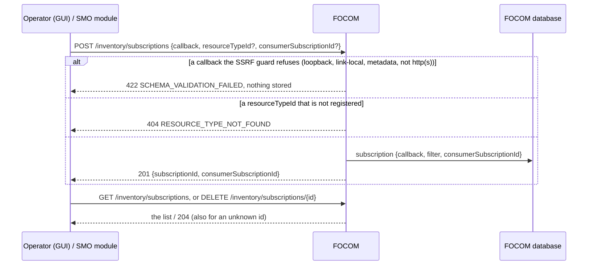
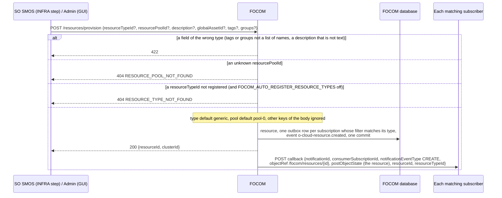
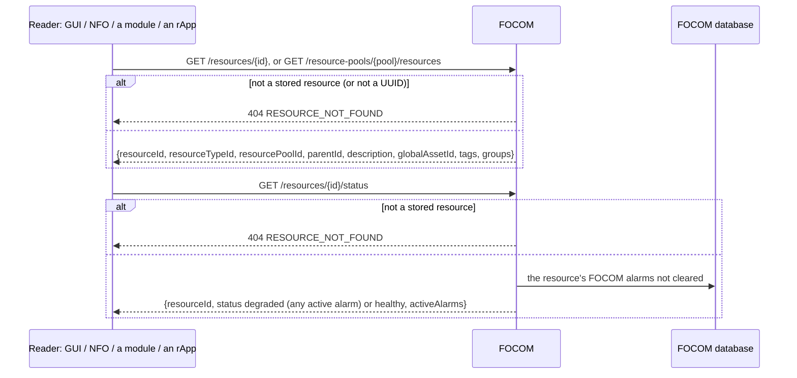
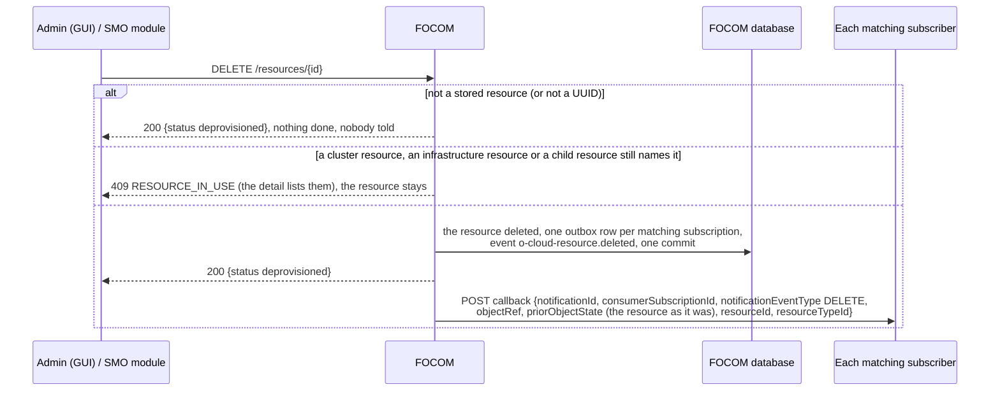

# Call Flow 16: FOCOM inventory resources — subscribing, provisioning and notifying, reading and status, deprovisioning

How an O-Cloud inventory resource is kept in FOCOM (NFO+FOCOM LLD section 4, O2-IMS `Resource` and `InfrastructureInventoryEvent`): a consumer subscribes to
inventory changes, a resource is provisioned into a pool, read with a status taken from its alarms, and deprovisioned once nothing names it; each change is
sent to the matching subscribers and published on the SMO event feed. Call flow 10 uses provisioning as a service order's INFRA step. Four diagrams:

| | Step | Who starts it | Ends with |
|---|---|---|---|
| 16a | Subscribing to inventory changes | Operator (GUI), an SMO module | a subscription with a callback the SSRF guard allows, or refused |
| 16b | Provisioning, and the notifications | SO SMOS (INFRA step), Admin (GUI) | a resource in its pool, every matching subscriber told (`CREATE`), the event published |
| 16c | Reading a resource and its status | any reader (GUI, NFO, a module) | the resource, and `healthy` or `degraded` from its active alarms |
| 16d | Deprovisioning | Admin (GUI), an SMO module | the resource gone and its subscribers told (`DELETE`), or refused while something names it |

**As images:** [16a](images/16-focom-resource-inventory-lifecycle/16a-subscribing-to-inventory-changes.png) ·
[16b](images/16-focom-resource-inventory-lifecycle/16b-provisioning-and-the-notifications.png) ·
[16c](images/16-focom-resource-inventory-lifecycle/16c-reading-a-resource-and-its-status.png) ·
[16d](images/16-focom-resource-inventory-lifecycle/16d-deprovisioning.png)
(PNG, drawn from the diagrams below by `scripts/render_call_flows.py`).

**How to read the diagrams.** As in call flow 01: an arrow is one call with the inputs that matter, a box on the receiver says what it does with them,
an `alt` block is the outcome (success first, then each failure and what the caller gets). Every call reaches FOCOM through R1 Termination (`/focom`);
an rApp may read FOCOM but change nothing in it (R1 refuses), and the GUI BFF lets an admin provision and deprovision and an operator subscribe. Every
notification is an outbox row committed with the change and sent after the commit, retried (call flow 03's outbox).

## 16a — Subscribing to inventory changes

Both used to be accepted: a refused callback had every notification to it dropped at send time, and a filter naming no type never matched. The SSRF guard
runs again when each notification is sent.

## 16b — Provisioning, and the notifications

The notification is O2-IMS's `InfrastructureInventoryEvent`; `objectType`, `resourceId` and `resourceTypeId` are this build's earlier fields, kept for the
subscribers that read them. **Phase 1:** a pool is not tied to a resource type, and FOCOM deploys nothing: a resource is a record of the inventory.

## 16c — Reading a resource and its status

The status was a constant `healthy`, for any id. Utilisation is its own route (`GET /resources/{id}/utilisation`, from the performance records).

## 16d — Deprovisioning

A DELETE of an id that was never stored used to be sent to every subscriber, telling them a resource that never existed was gone; and a resource that a
cluster resource named was deleted under it. **Phase 1:** a deprovisioned resource's alarms stay as they are (history); SO SMOS does not deprovision the
resource of an order that fails or is cancelled (`OPEN_ITEMS.md` SO-CHAIN).

## Decisions this flow depends on

- **A subscription is checked when it is made** (DOC-CF-1.8): the callback against the SSRF guard (422), the filter against the registered types (404).
- **A provision has a typed body** (DOC-CF-1.8): the O2-IMS `Resource` fields, `tags` and `groups` lists of names (a Postgres array, which a wrong shape
  broke), a pool that must exist; other keys are ignored, so a service order's step `spec` carrying more keeps working.
- **A notification is O2-IMS's inventory event** (DOC-CF-1.8): `notificationId`, `objectRef`, `postObjectState` / `priorObjectState`, beside the earlier
  fields; and the same change is on the SMO event feed (`o-cloud-resource.created` / `.deleted`, docs/EVENTS.md).
- **Only a real change is told** (DOC-CF-1.8): deprovisioning an unknown id stays an idempotent 200 but notifies nobody.
- **A resource is not deleted from under what uses it** (DOC-CF-1.8): 409 `RESOURCE_IN_USE` while a cluster, infrastructure or child resource names it,
  as the O2-IMS objects already refuse a delete while named (`_referrers`).
- **Status comes from the resource's alarms** (DOC-CF-1.8), and an unknown resource is a 404.
- **Resource types are closed** (`SA-FOCOM-9`): an unregistered type is refused at provision unless `FOCOM_AUTO_REGISTER_RESOURCE_TYPES` is on; registering
  one twice is 409 `RESOURCE_TYPE_ALREADY_EXISTS` (it was a 422).
- **Not taken:** clearing a deprovisioned resource's alarms, SO SMOS undoing an INFRA step, an owner per subscription (only the console and modules make
  them), and notifications for pools, sites and provisioning requests.
