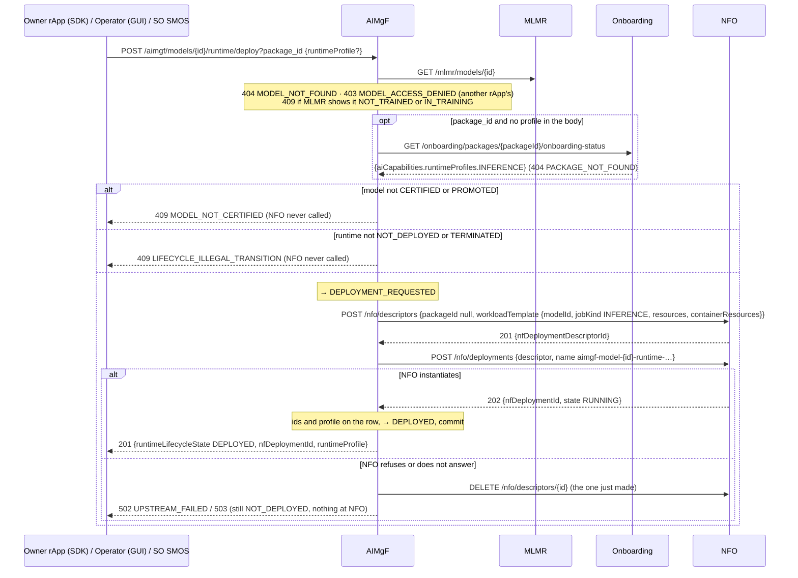
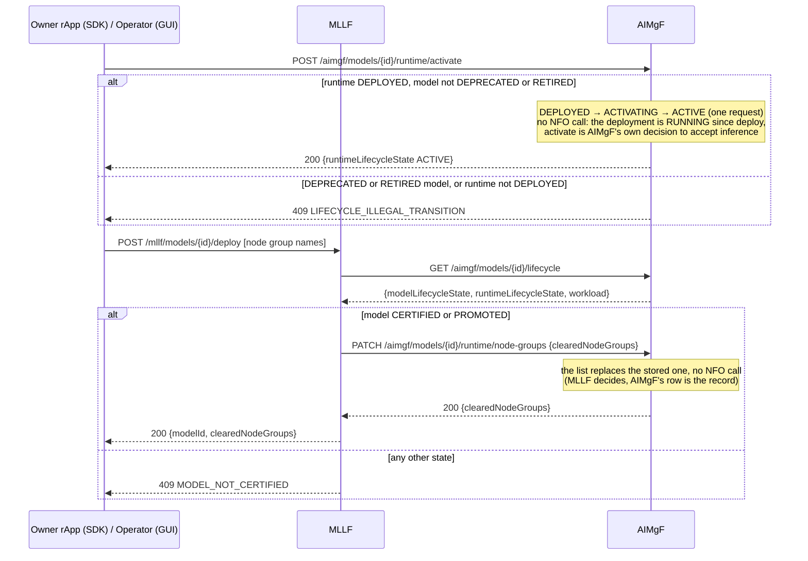
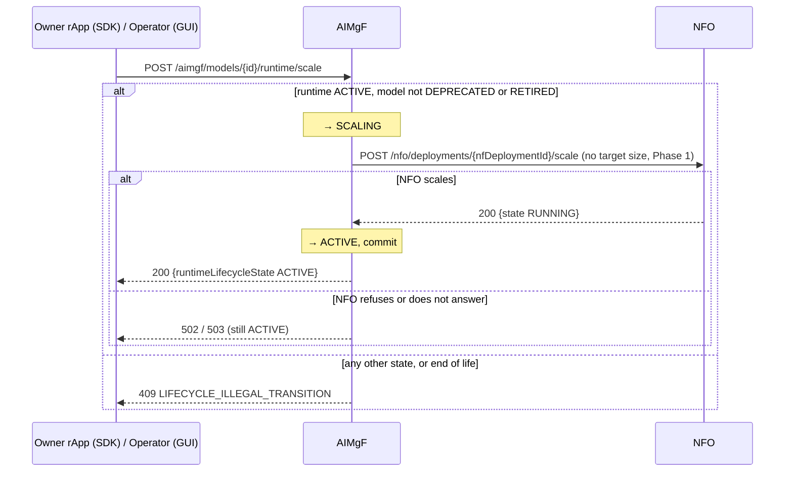
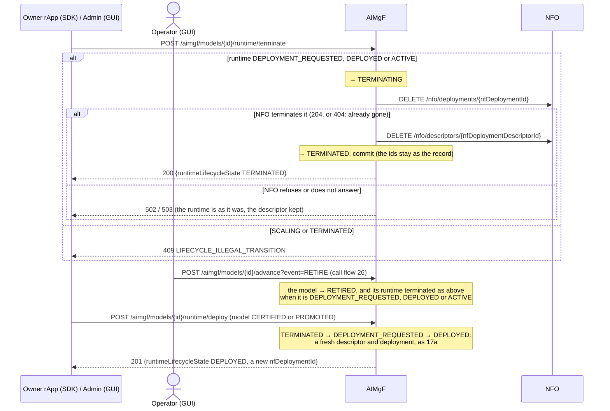
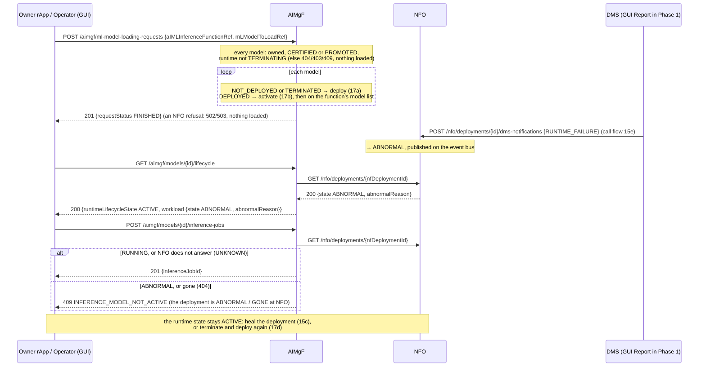

# Call Flow 17: Model runtime lifecycle — deploy, activate, scale, terminate, deploy again

What AIMgF does with a model's **serving runtime**: the NFO workload the model is served from, once it is certified (call flow 02, 26). It
has its own state machine (`RuntimeLifecycle`), independent of the model's certification (`ModelLifecycle`) on the same row. Five diagrams:

| | Step | Who starts it | Ends with |
|---|---|---|---|
| 17a | Deploy | the owner rApp (SDK), Operator (GUI), SO SMOS | runtime DEPLOYED: an NFO descriptor and a RUNNING deployment |
| 17b | Activate, and node groups | the owner rApp, Operator (GUI); MLLF | runtime ACTIVE: inference is accepted; the placement recorded |
| 17c | Scale | the owner rApp, Operator (GUI) | runtime ACTIVE again |
| 17d | Terminate, and deploy again | the owner rApp, Admin (GUI), RETIRE (call flow 26) | runtime TERMINATED, nothing left at NFO; deployable again |
| 17e | Model loading, and a workload that breaks | an ML model loading request or policy; the DMS | runtime ACTIVE for loading; a broken deployment shown and not served |

**As images:** [17a](images/17-model-runtime-lifecycle/17a-deploy.png) ·
[17b](images/17-model-runtime-lifecycle/17b-activate-and-node-groups.png) ·
[17c](images/17-model-runtime-lifecycle/17c-scale.png) ·
[17d](images/17-model-runtime-lifecycle/17d-terminate-and-deploy-again.png) ·
[17e](images/17-model-runtime-lifecycle/17e-model-loading-and-a-workload-that-breaks.png)
(PNG, drawn from the diagrams below by `scripts/render_call_flows.py`).

**How to read the diagrams.** As in call flow 01: an arrow is one call with the inputs that matter, a box on the receiver says what it does
with them, an `alt` block is the outcome (success first, then each failure and what the caller gets). *Owner rApp (SDK)* is the rApp that
registered the model (`sdk.lifecycle.deploy_runtime`, `activate_runtime`, `scale_runtime`, `terminate_runtime`); *Operator (GUI)* and *Admin
(GUI)* stand for the console's path. In the console, deploy, activate and scale need the **operator** role, terminate **admin**.

**Who takes part.** AIMgF owns the runtime and its state. MLMR says whether the model exists and who owns it: another rApp is refused every
runtime route (403 `MODEL_ACCESS_DENIED`; the console and SMO modules are not asked). NFO holds the workload (call flow 15). MLLF decides on
which node groups the model is placed. SO SMOS deploys a runtime as a step of an order (call flow 10).

## Runtime states

| State | Events out (→ target) | Route |
|---|---|---|
| `NOT_DEPLOYED` | `REQUEST_DEPLOYMENT` → `DEPLOYMENT_REQUESTED` | deploy |
| `DEPLOYMENT_REQUESTED` | `DEPLOYMENT_COMPLETE` → `DEPLOYED`, `REQUEST_TERMINATION` → `TERMINATING` | (deploy, same request) |
| `DEPLOYED` | `ACTIVATE` → `ACTIVATING`, `REQUEST_TERMINATION` → `TERMINATING` | activate, terminate |
| `ACTIVATING` | `ACTIVATION_COMPLETE` → `ACTIVE` | (activate, same request) |
| `ACTIVE` | `REQUEST_SCALE` → `SCALING`, `REQUEST_TERMINATION` → `TERMINATING` | scale, terminate |
| `SCALING` | `SCALE_COMPLETE` → `ACTIVE` | (scale, same request) |
| `TERMINATING` | `TERMINATION_COMPLETE` → `TERMINATED` | (terminate, same request) |
| `TERMINATED` | `REQUEST_DEPLOYMENT` → `DEPLOYMENT_REQUESTED` | deploy (again) |

Each route fires both of its events in one request, so the -ING states are never seen. An event the state cannot take is **409
`LIFECYCLE_ILLEGAL_TRANSITION`**. An NFO call that is refused is **502 `UPSTREAM_FAILED`** (NFO's title in the detail), one NFO does not answer
**503 `ENDPOINT_UNREACHABLE`**; either way nothing is committed, so the runtime stays in the state it was in.

## 17a — Deploy

## 17b — Activate, and node groups

## 17c — Scale

## 17d — Terminate, and deploy again

## 17e — Model loading, and a workload that breaks

## What this build does not do yet (Phase 1)

- **No model is served from the workload.** NFO starts nothing (call flow 15), so an inference job is run by its caller and reported back
  (`inference-jobs/{id}/resolve`), and the deployment is a record; the Kubernetes driver is `OPEN_ITEMS.md` PR-SB-16.
- **Scale takes no target size** (`OPEN_ITEMS.md` OI-7-nfo-scale-size, PR-SB-17).
- **No approval for runtime transitions** beyond certification: whether deploy, activate, scale and terminate need an operator's decision is
  open (`OPEN_ITEMS.md` OI-6.1-runtime-gate).
- **A broken workload does not move the runtime's state.** It is shown and not served (17e), but AIMgF does not follow NFO's events to change
  `RuntimeLifecycle` by itself (`OPEN_ITEMS.md` OI-7-workload-failure).

## Key decisions this flow depends on

- **Nothing is recorded that NFO did not do** (DOC-CF-1.5). Every NFO answer is checked: a refused deploy keeps no descriptor, a refused
  scale or terminate leaves the runtime as it was. The job runtimes of training, validation and emulation (call flow 02) follow the same rule
  when they start; when they end, the job ends whatever NFO answers, and a deployment NFO did not remove stays named on the job.
- **A descriptor lives as long as its deployment** (DOC-CF-1.5): AIMgF deletes the descriptor it made right after the deployment is terminated,
  for the serving runtime and every job runtime.
- **A terminated runtime is deployed again** (DOC-CF-1.5), under the same certification check, with a fresh descriptor and deployment; a
  loading request does the same for a TERMINATED model.
- **The owner drives its runtime** (DOC-CF-1.5): R1 Termination lets an rApp deploy, activate, scale and terminate, and AIMgF refuses another
  rApp's model. The console's roles are the operator's and the admin's.
- **Inference follows the workload** (DOC-CF-1.5): a deployment NFO reports ABNORMAL or no longer has is not served; when NFO does not answer,
  inference is not stopped by that alone.
- **Two state machines on one row.** Retraining a PROMOTED model does not take its runtime down, and a runtime can be scaled or terminated
  without touching the certification; a DEPRECATED model's ACTIVE runtime keeps serving (call flow 26), a RETIRED one is terminated.
- **The certification check comes before NFO**, so a premature or duplicate deploy never creates anything at NFO.
- **Activate and node groups are AIMgF's own records**: the deployment is RUNNING once deploy returns, and MLLF owns the placement decision.
- **Runtime profiles** size every runtime: `workloadTemplate.resources` from the explicit profile or the package's manifest
  (`runtimeProfiles.INFERENCE`), mapped to Kubernetes requests and limits (`containerResources`, PR-RAPP-2.1).
