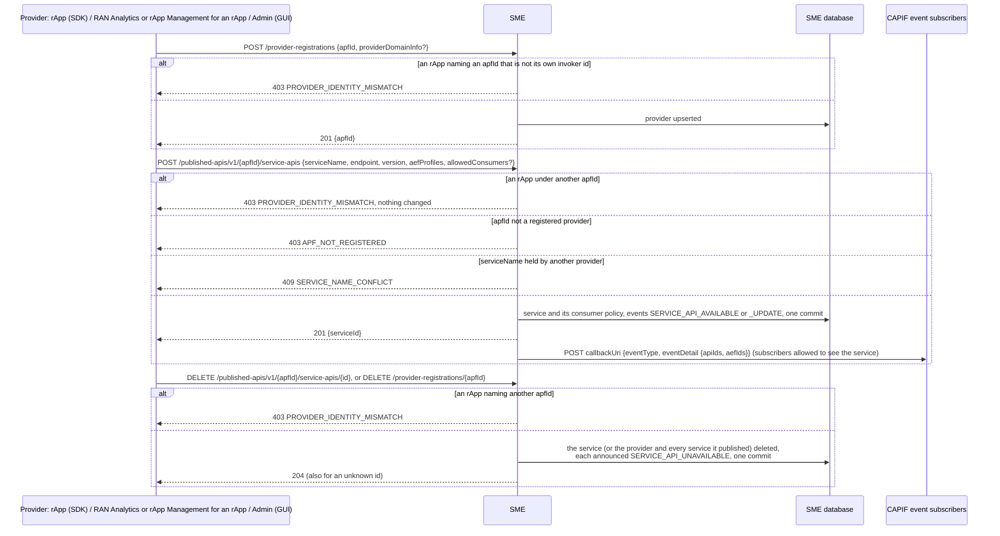
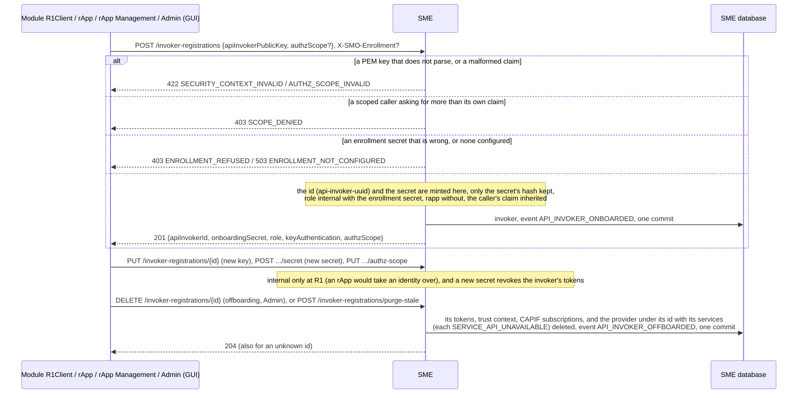
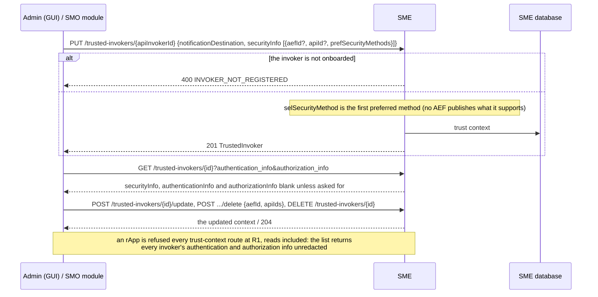
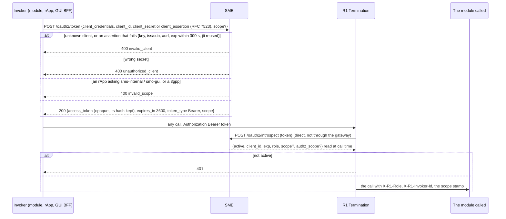
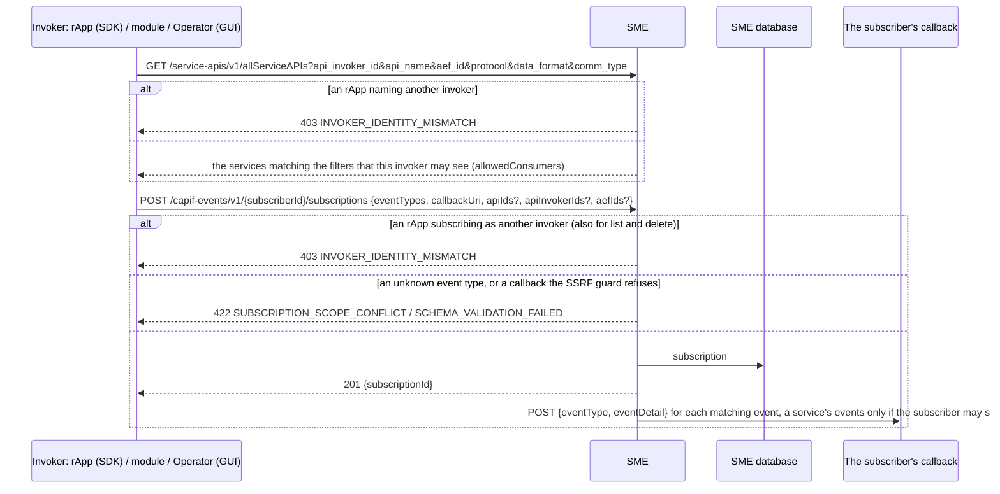

# Call Flow 18: SME security — providers and publishing, invokers, trust contexts, tokens and introspection, discovery and events

How SME, the CAPIF core of this SMO (TS 29.222; `HISTORY.md` OI-2-oauth2, OI-5-sme-provider-enrolment, SA-SME-1, SA-SME-2), keeps who is who: a provider
publishes services, an invoker is onboarded and given tokens, a trust context records how an invoker is secured, a token is introspected by R1 Termination on
every call, and an invoker discovers services and subscribes to their events. Call flow 01 abbreviates this as "obtain an OAuth2 token". Five diagrams:

| | Step | Who starts it | Ends with |
|---|---|---|---|
| 18a | Providers and publishing | an rApp (SDK), RAN Analytics or rApp Management for an rApp, Admin (GUI) | a provider and its services, each change announced, or refused when an rApp names another |
| 18b | Invokers: onboarding, key, secret, offboarding | every module's `R1Client`, an rApp, rApp Management, Admin (GUI) | an invoker with a server-minted id and secret, or one removed with everything it made |
| 18c | Trust contexts | Admin (GUI), an SMO module | an invoker's security methods recorded, read redacted, never by an rApp |
| 18d | Tokens and introspection | any invoker; R1 Termination on every call | a token for a checked scope, and its role, scope and claim at every call |
| 18e | Discovery and events | an rApp (SDK), a module, Operator (GUI) | the services an invoker may see, and their events, for itself only |

**As images:** [18a](images/18-sme-trusted-invokers-lifecycle/18a-providers-and-publishing.png) ·
[18b](images/18-sme-trusted-invokers-lifecycle/18b-invokers-onboarding-key-secret-offboarding.png) ·
[18c](images/18-sme-trusted-invokers-lifecycle/18c-trust-contexts.png) ·
[18d](images/18-sme-trusted-invokers-lifecycle/18d-tokens-and-introspection.png) ·
[18e](images/18-sme-trusted-invokers-lifecycle/18e-discovery-and-events.png)
(PNG, drawn from the diagrams below by `scripts/render_call_flows.py`).

**How to read the diagrams.** As in call flow 01: an arrow is one call with the inputs that matter, a box on the receiver says what it does with them,
an `alt` block is the outcome (success first, then each failure and what the caller gets). Calls reach SME through R1 Termination, which stamps the caller's
role (`X-R1-Role`: `rapp` or `internal`) and invoker id, except the token endpoint (reached without a token) and R1's own introspection. An rApp acts at SME
only as itself, its invoker id; the console and the SMO modules act for others. Every event SME sends is an outbox row committed with the change.

## 18a — Providers and publishing

An rApp could register, publish under, replace and delete any provider's services, a service name included; a deleted provider's services stayed
discoverable. RAN Analytics (call flow 08) and rApp Management (call flow 01) register providers for an rApp as SMO modules, so they are not held to it.

## 18b — Invokers: onboarding, key, secret, offboarding

An offboarded invoker's subscriptions and published services used to outlive it. **Phase 1:** the number of invokers one rApp may onboard is not limited.

## 18c — Trust contexts

An rApp could read every trust context, including the list that returns each invoker's authentication and authorization info unredacted.

## 18d — Tokens and introspection

An rApp could introspect any token it held through the gateway and learn its client, role and scope; only R1 needs the route, so it is no longer open to
an rApp at R1. **Phase 1:** tokens are opaque and server-tracked (no IdP signs JWTs), and introspection is unauthenticated on the internal network, as
`/bootstrap` is.

## 18e — Discovery and events

Both trusted the id the caller named, so an rApp could see a service restricted to another invoker, or its events, by naming that invoker.

## Decisions this flow depends on

- **An rApp acts at SME only as itself** (DOC-CF-1.8): the apfId it registers, publishes and deregisters under, the invoker it discovers for and the
  subscriber it subscribes as must be its invoker id (403 `PROVIDER_IDENTITY_MISMATCH` / `INVOKER_IDENTITY_MISMATCH`); the console and the SMO modules act for
  others, as RAN Analytics and rApp Management do for an rApp.
- **Nothing outlives what it belongs to** (DOC-CF-1.8): a deleted provider takes its services (announced `SERVICE_API_UNAVAILABLE`), an offboarded invoker
  its tokens, trust context, subscriptions and provider.
- **What only the platform needs, an rApp cannot reach** (DOC-CF-1.8): introspection (R1 calls SME directly) and the trust contexts; as before, an invoker's
  key, secret and claim and the trust-context changes.
- **The server mints identity** (TS 29.222): the invoker id and the secret come from SME; the enrollment secret alone makes an invoker `internal`.
- **A scope is checked before a token is issued**, and an rApp never gets an internal scope (PR-SEC-14).
- **Opaque tokens, introspected**: no IdP signs JWTs in this build.
- **Not taken:** a real AEF security-method catalog (`selSecurityMethod` stays the first preference), signed JWT tokens, authenticating introspection
  itself, and a limit on how many invokers one rApp onboards.
