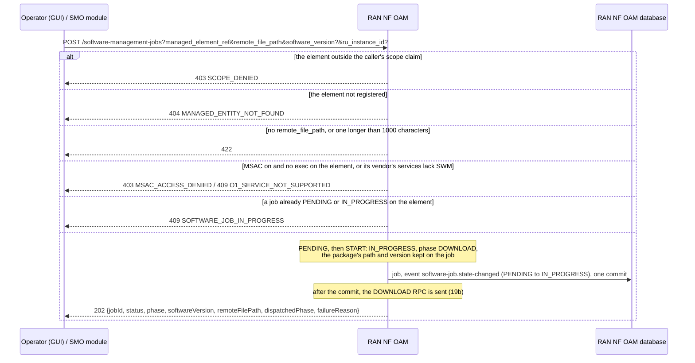
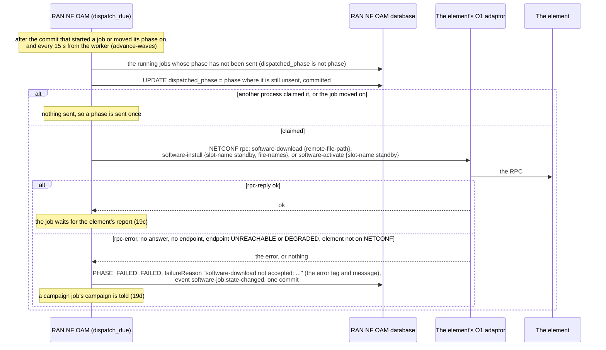
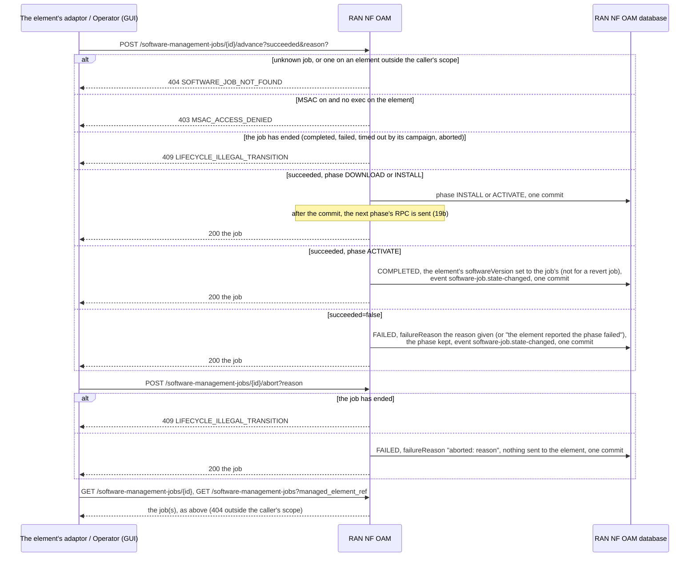
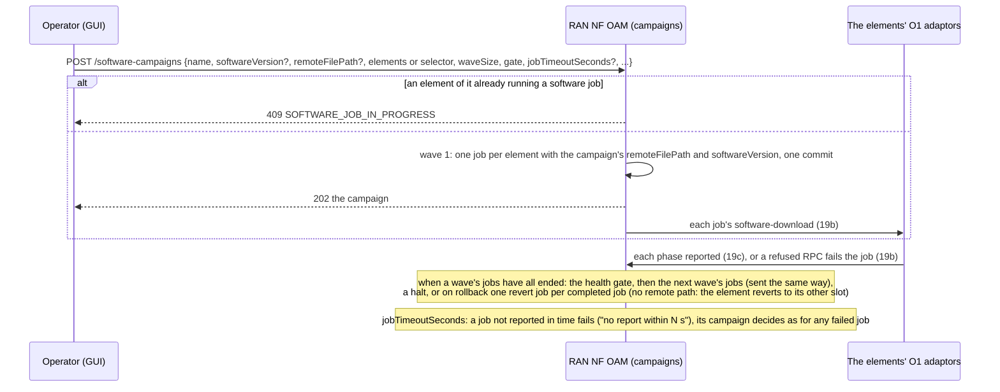

# Call Flow 19: Software management job — starting, sending each phase to the element, failure and abort, campaigns

How RAN NF OAM updates the software of one element (HISTORY.md SA-O1-3): a software management job runs the O-RAN WG4 M-Plane software management RPCs
(`o-ran-software-management.yang`: `software-download`, `software-install`, `software-activate`) against the element through its O1 adaptor, one phase at a
time, and the element reports each phase's outcome (the M-Plane's `download-event`, `install-event`, `activation-event`). Four diagrams:

| | Step | Who starts it | Ends with |
|---|---|---|---|
| 19a | Starting a job | Operator (GUI), an SMO module, a campaign wave | a running job for a package on a registered element, one at a time, or refused |
| 19b | Each phase sent to the element | RAN NF OAM after each commit, its worker as a backstop | the phase's RPC sent once, accepted, or the job failed with the element's reason |
| 19c | Reports, failure, abort, reading | the element's adaptor, Operator (GUI) | a job moved on, completed (its version recorded on the element) or failed with a reason |
| 19d | Jobs of a software campaign | a campaign (PR-MGT-15) | each wave's jobs sent and reported the same way, the campaign told of each end |

**As images:** [19a](images/19-software-management-job-lifecycle/19a-starting-a-job.png) ·
[19b](images/19-software-management-job-lifecycle/19b-each-phase-sent-to-the-element.png) ·
[19c](images/19-software-management-job-lifecycle/19c-reports-failure-abort-reading.png) ·
[19d](images/19-software-management-job-lifecycle/19d-jobs-of-a-software-campaign.png)
(PNG, drawn from the diagrams below by `scripts/render_call_flows.py`).

**How to read the diagrams.** As in call flow 01: an arrow is one call with the inputs that matter, a box on the receiver says what it does with them,
an `alt` block is the outcome (success first, then each failure and what the caller gets). Calls reach RAN NF OAM through R1 Termination (or the GUI BFF).
A job has a `status` (`PENDING`, `IN_PROGRESS`, `COMPLETED`, `FAILED`) and a `phase` (`DOWNLOAD`, `INSTALL`, `ACTIVATE`): the phase of a failed job stays at
the phase that failed. Every status change is published as `org.oran.smo.software-job.state-changed` in the same commit (`docs/EVENTS.md`).

## 19a — Starting a job

The package was never named, so the element was told nothing to download, and nothing was sent to it at all: an operator advanced a job that only existed in
the SMO. An unknown element made a job, and two jobs could run on one element at once.

## 19b — Each phase sent to the element

The RPC goes over the endpoint's transport: SSH or TLS through the NETCONF session (its pinned host keys for SSH), HTTP to the adaptor's NETCONF bridge.
**Phase 1:** the install always targets the `standby` slot and names the last segment of the remote path as the file. An element reached over RESTCONF is
not sent software RPCs (`PROTOCOL_NOT_SUPPORTED`). The adaptor's report of a phase's completion comes as a call to `advance` (19c), not as a NETCONF
notification RAN NF OAM subscribes to.

## 19c — Reports, failure, abort, reading

Anyone who could reach the route could advance a job (no MSAC check), a failure kept no reason, a completed job left the element's recorded version as it
was, and a job whose element never reported could only be left running. A failed job is not retried: a new job is started (the GUI's retry does that with
the same package).

## 19d — Jobs of a software campaign

The campaign's jobs were sent nothing either, and a busy element was refused as `SERVICE_NAME_CONFLICT`. A campaign's own lifecycle (waves, gates, halts,
rollback order, notifications) is unchanged and described in `ran-nf-oam/README.md` (PR-MGT-15, MGT-15.7).

## Decisions this flow depends on

- **A job names its package and is sent to the element** (DOC-CF-1.8): `remote_file_path` is required, and each phase's RPC is sent to the element's O1
  adaptor after the commit that made it due, claimed so that it is sent once however many replicas run; the worker sends any phase not yet claimed (a crash after the claim and before
  the send leaves the phase claimed and unsent until the campaign's timeout or an abort, `OPEN_ITEMS.md` OAM-SWM-RESEND).
- **The element reports, the SMO does not guess**: a phase completes when the element (its adaptor) reports it through `advance`; a refused or unreachable RPC
  fails the job at once with the element's reason.
- **One job at a time per element, on a registered element** (DOC-CF-1.8): 409 `SOFTWARE_JOB_IN_PROGRESS`, 404 `MANAGED_ENTITY_NOT_FOUND`.
- **Reporting is as guarded as starting** (DOC-CF-1.8): MSAC `exec` on the element for start, advance and abort.
- **A completed job is the element's version** (DOC-CF-1.8): the element's `softwareVersion` is set when a job naming a version completes; every status change
  is on the event feed.
- **`phase` and `status` are separate**: a failed job's phase is the one that failed, and one `PHASE_FAILED` event fails any phase.
- **The vendor's services decide** (call flow 21): an element whose vendor does not implement SWM is refused `O1_SERVICE_NOT_SUPPORTED`.
- **`ru_instance_id`** is kept on the job, as the MnS hierarchy workbook asks for RU-level reuse of the RPCs.
- **Not taken:** subscribing to the element's NETCONF notifications (the adaptor reports through `advance`), choosing a slot other than `standby`, checksum or
  signature checks of the package in the SMO, and software RPCs over RESTCONF.
