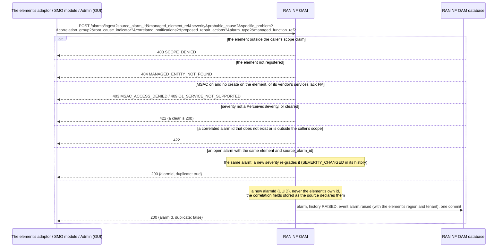
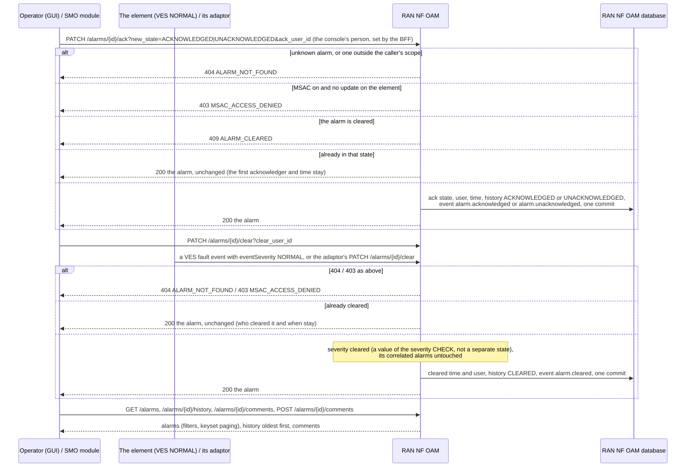
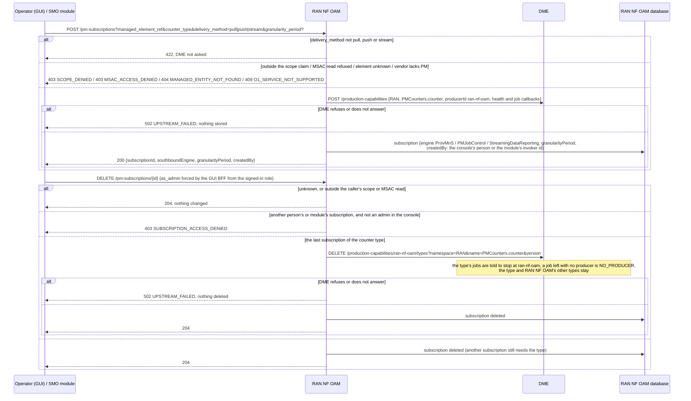
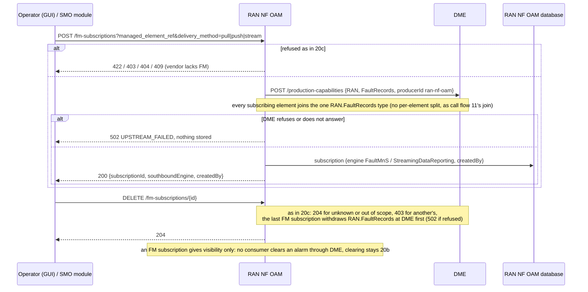

# Call Flow 20: Alarms and PM / FM subscriptions — raising, acknowledging and clearing, and subscribing an element's measurements and alarms

How RAN NF OAM keeps an element's alarms (TS 28.111 fault NRM, TS 28.532 FaultMnS; HISTORY.md SA-RANOAM-5, SA-RANOAM-6, MGT-8) and how a PM or FM
subscription makes RAN NF OAM the DME producer of an element's measurements or alarms (TS 28.550 PM job control; HISTORY.md SA-RANOAM-7, OI-6.7). Call flow 03
mentions alarm ids and call flow 11 the many-producers-one-type join; this flow walks both topics in full. Four diagrams:

| | Step | Who starts it | Ends with |
|---|---|---|---|
| 20a | Raising an alarm | the element (its adaptor, or a VES event), an SMO module, Admin (GUI test data) | a new alarm, or the open one it repeats, announced; or refused |
| 20b | Acknowledging and clearing | Operator (GUI), an SMO module; a VES `NORMAL` event or the adaptor for a clear | the alarm acknowledged or cleared once, recorded in its history and announced |
| 20c | PM subscription | Operator (GUI), an SMO module | RAN NF OAM the DME producer of `RAN.PMCounters.<counter>`, withdrawn with the last subscription |
| 20d | FM subscription | Operator (GUI), an SMO module | RAN NF OAM the DME producer of `RAN.FaultRecords`, withdrawn with the last subscription |

**As images:** [20a](images/20-alarm-pm-subscription-lifecycle/20a-raising-an-alarm.png) ·
[20b](images/20-alarm-pm-subscription-lifecycle/20b-acknowledging-and-clearing.png) ·
[20c](images/20-alarm-pm-subscription-lifecycle/20c-pm-subscription.png) ·
[20d](images/20-alarm-pm-subscription-lifecycle/20d-fm-subscription.png)
(PNG, drawn from the diagrams below by `scripts/render_call_flows.py`).

**How to read the diagrams.** As in call flow 01: an arrow is one call with the inputs that matter, a box on the receiver says what it does with them,
an `alt` block is the outcome (success first, then each failure and what the caller gets). Calls reach RAN NF OAM through R1 Termination, which stamps the
caller's role, invoker id and scope claim, and for the console the signed-in person (`X-R1-Acting-User`). An rApp may not raise, acknowledge, clear or
subscribe (R1's allow-list); it reads alarms, and an element's alarms through DME once FM is subscribed. Every alarm change writes a history row and an event
(`org.oran.smo.alarm.*`, `docs/EVENTS.md`) in the same commit.

## 20a — Raising an alarm

The VES listener (`POST /ves/eventListener/v7`, when enabled) raises the same way from a `fault` event: an open alarm of the same condition is updated, not
repeated. The ingest used to check nothing about its caller, made a second open alarm when a source retried, took `cleared` as a new already-cleared alarm
(the open one stayed open) and stored correlated ids that named nothing. **Phase 1:** RAN NF OAM does no root-cause analysis: the correlation is the
source's; `GET /alarms/{id}/correlated` adds a same-element-in-a-window heuristic.

## 20b — Acknowledging and clearing

A second acknowledgement replaced the user and kept the first time, a second clear overwrote who cleared it and when (with no history row), a cleared
alarm could still be acknowledged, and acknowledgements were not on the event feed.

## 20c — PM subscription

A subscription is a DME-producer registration with the job-control field worth keeping (`granularityPeriod`), not a clause-8 PM job. A bad delivery
method used to register at DME and then fail at the database; an unsubscribe never told DME, so consumers kept making jobs RAN NF OAM would never feed; and
anyone who could see a subscription could delete it.

## 20d — FM subscription

## Decisions this flow depends on

- **An alarm is the element's, kept by RAN NF OAM**: its id is minted here (a fleet of elements' own ids would collide), and the correlation fields are the
  source's declaration.
- **A raise is checked like any change to the element** (DOC-CF-1.8): scope, a registered element, MSAC `create`; a correlated alarm must exist and be
  visible to the caller.
- **One open alarm per element and source id** (DOC-CF-1.8): a repeat is the same alarm (`duplicate: true`), re-graded if its severity changed, as the VES
  path already did; a clear is a clear, never a new row raised cleared.
- **Acknowledging and clearing happen once** (DOC-CF-1.8): repeating either changes nothing, and a cleared alarm is not acknowledged (409 `ALARM_CLEARED`).
- **Every change is announced**: raised, acknowledged, unacknowledged and cleared on the event feed, with the element's region and tenant; a re-grade is
  in the history only.
- **Clearing never cascades**: a cleared root cause leaves its correlated alarms as they are.
- **A subscription is a DME producer registration**: DME is asked first, and its refusal is a 502 with nothing stored (call flow 11a); the last
  subscription of a type withdraws the type at DME first (`DELETE /production-capabilities/{producerId}/types`, new in DME), so no consumer waits on a
  producer that will never send.
- **A subscription is its maker's** (DOC-CF-1.8): `createdBy` is the console's person or the module's invoker id; only they, or an admin in the console,
  delete it. A subscription made before revision 0061 has no maker and is anyone's who may see it.
- **The vendor's services decide** (call flow 21): an element whose vendor does not implement FM or PM is refused `O1_SERVICE_NOT_SUPPORTED`.
- **Not taken:** RAN NF OAM's own root-cause analysis, a clause-8 PM job (schedule, priority, reporting period), a per-element DME type for alarms, an rApp
  raising or clearing alarms, and refusing a duplicate subscription (two subscriptions of the same element and counter are allowed).
