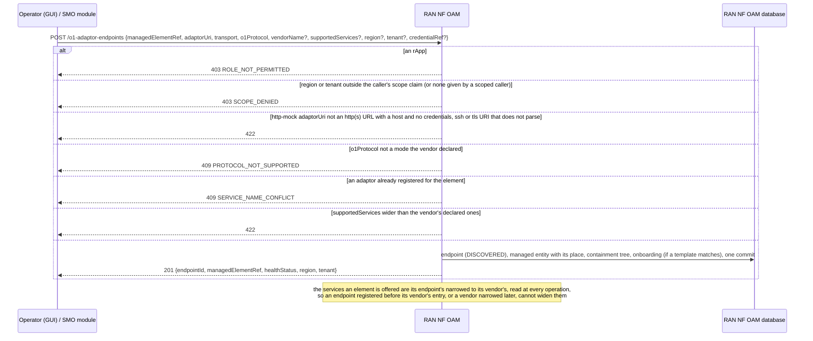
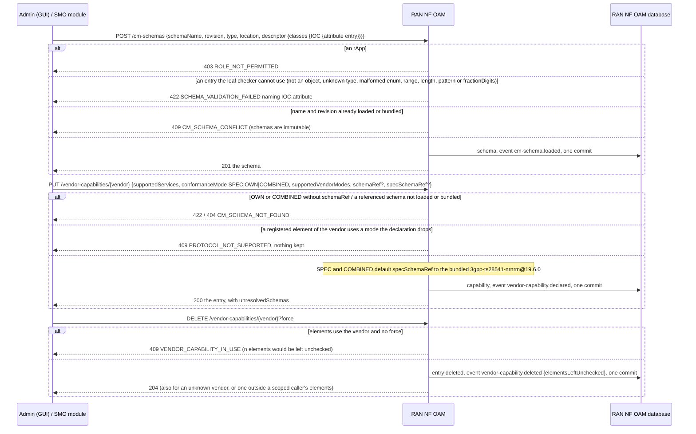
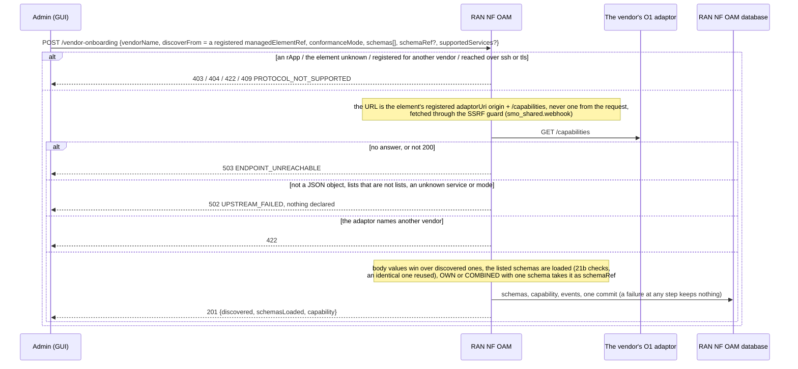
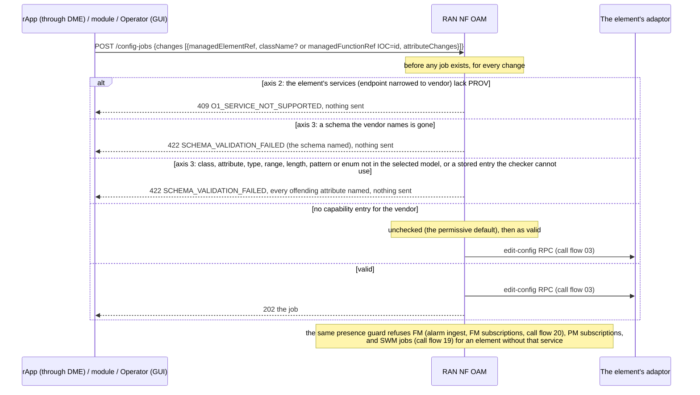

# Call Flow 21: O1 vendor onboarding — elements, schemas, the vendor's capability, and the two checks on every O1 operation

RAN NF OAM's vendor capability registry (`ran-nf-oam/app/vendors.py`; "O1 vendor onboarding" in `docs/ARCHITECTURE.md`, Wave 9 in `docs/STANDARDS.md`)
makes onboarding a RAN vendor (or a Digital Twin) data, not code: an element is registered behind its O1 adaptor, the vendor's data-model descriptor is
loaded, and its capability is declared (by hand, or discovered from a registered adaptor). Two generic checks then read the registry on every O1 operation:
the **axis-2 presence guard** (does the element's vendor implement this MnS service) and the **axis-3 schema check** (do the class, attribute and value exist in
the data model the vendor's conformance mode selects). Four diagrams:

| | Step | Who starts it | Ends with |
|---|---|---|---|
| 21a | Registering an element | Operator (GUI), an SMO module | an element behind its adaptor, inside the caller's scope, its services no wider than its vendor's |
| 21b | Schemas and the vendor's capability | Admin (GUI), an SMO module | a checked descriptor loaded, a capability declared, each change published |
| 21c | Onboarding from a registered adaptor | Admin (GUI) | the adaptor's declaration read from its registered origin, checked, schemas loaded, the capability declared in one commit |
| 21d | The two checks on a CM write | an rApp through DME, a module, Operator (GUI) | a write refused before anything is sent, or dispatched |

**As images:** [21a](images/21-o1-vendor-onboarding/21a-registering-an-element.png) ·
[21b](images/21-o1-vendor-onboarding/21b-schemas-and-the-vendor-s-capability.png) ·
[21c](images/21-o1-vendor-onboarding/21c-onboarding-from-a-registered-adaptor.png) ·
[21d](images/21-o1-vendor-onboarding/21d-the-two-checks-on-a-cm-write.png)
(PNG, drawn from the diagrams below by `scripts/render_call_flows.py`).

**How to read the diagrams.** As in call flow 01: an arrow is one call with the inputs that matter, a box on the receiver says what it does with them,
an `alt` block is the outcome (success first, then each failure and what the caller gets). Calls reach RAN NF OAM through R1 Termination, which stamps the
caller's role and scope claim; an rApp may only read the registry (R1's allow-list, and each write route refuses the rApp role itself). Registry changes are
published on the event feed (`org.oran.smo.vendor-capability.*`, `org.oran.smo.cm-schema.loaded`, `docs/EVENTS.md`).

## 21a — Registering an element

The element used to be registerable by anyone who reached the route, anywhere (no scope check), at any URL, and its own service list won over its
vendor's for ever. **Phase 1:** there is no route to deregister or move an endpoint; a re-registration is 409.

## 21b — Schemas and the vendor's capability

A malformed descriptor entry used to load and then make every later CM write touching it a 500, with no way to replace the schema; an rApp could load a
schema under a name an admin would need (`POST /cm-schemas` had no role check, only R1's allow-list); deleting a used entry silently switched off both checks
for every tenant's elements of the vendor; and no registry change was announced.

## 21c — Onboarding from a registered adaptor

An adaptor answer that was not a JSON object, or named an unknown service or mode, was a 500. An adaptor that omits `vendorName` is taken as the named
vendor's.

## 21d — The two checks on a CM write

A vendor entry whose schema was missing (a loaded one removed, a bundled one dropped by a later release) was quietly unchecked under SPEC, and refused every
class under COMBINED; it now refuses with the schema named, and `GET /vendor-capabilities` lists it in `unresolvedSchemas`.

## Decisions this flow depends on

- **What conformance mode means**: `SPEC` the spec descriptor only (default `3gpp-ts28541-nrnrm@19.6.0`, generated from `specs/5G_APIs/TS28541_NrNrm.yaml`),
  `OWN` the vendor's only, `COMBINED` the spec's with the vendor's named augments; values are checked against the entry's type and constraints
  (`leafcheck.py`).
- **How a change's class is found**: `className`, else the last RDN of `managedFunctionRef`; a change naming no class must name attributes some class defines.
- **The registry is per vendor; an endpoint may only narrow it** (DOC-CF-1.8): the services in force are the endpoint's intersected with the vendor's, at
  every operation, not only at registration.
- **No registry, no check**: an element whose vendor has no entry skips both checks, so a deployment that registers none works unchanged; deleting a used
  entry therefore needs `force` (DOC-CF-1.8).
- **A schema the registry names is there, or writes stop** (DOC-CF-1.8): fail closed with the schema named rather than unchecked.
- **Descriptors are checked when loaded** (DOC-CF-1.8), because a loaded schema is immutable.
- **Only the operator or a module changes the registry or registers an element** (SEC-15.7b, DOC-CF-1.8), inside its scope claim.
- **Discovery never fetches a caller-chosen URL**, and its answer is checked like any input (DOC-CF-1.8).
- **A refused write never reaches the adaptor**: the pre-check runs before a `WriteConfigJob` exists, and DME passes the 4xx back to the rApp.
- **Not taken:** deregistering or moving an endpoint, vetting the adaptor address for CM dispatch beyond its scheme and host (the registrant is the
  operator or a module), a YANG front end for the ingestion script, and transports beyond NETCONF (HTTP bridge, SSH, TLS) and RESTCONF.
