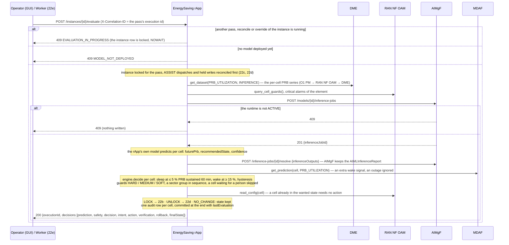
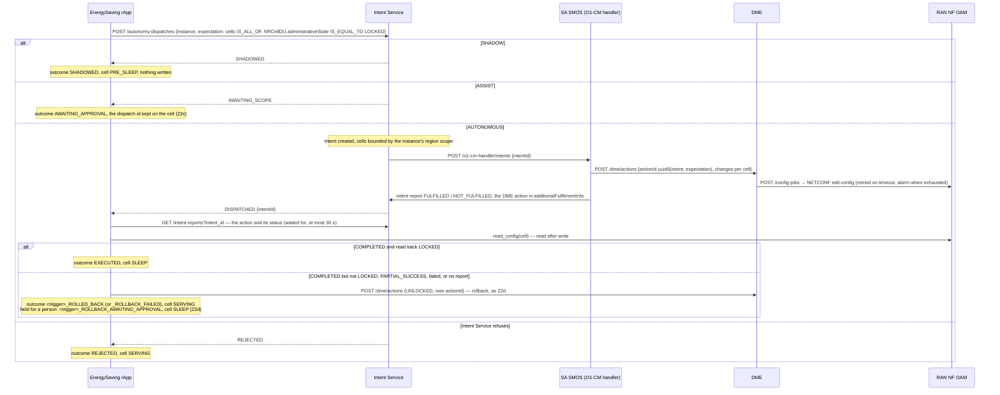
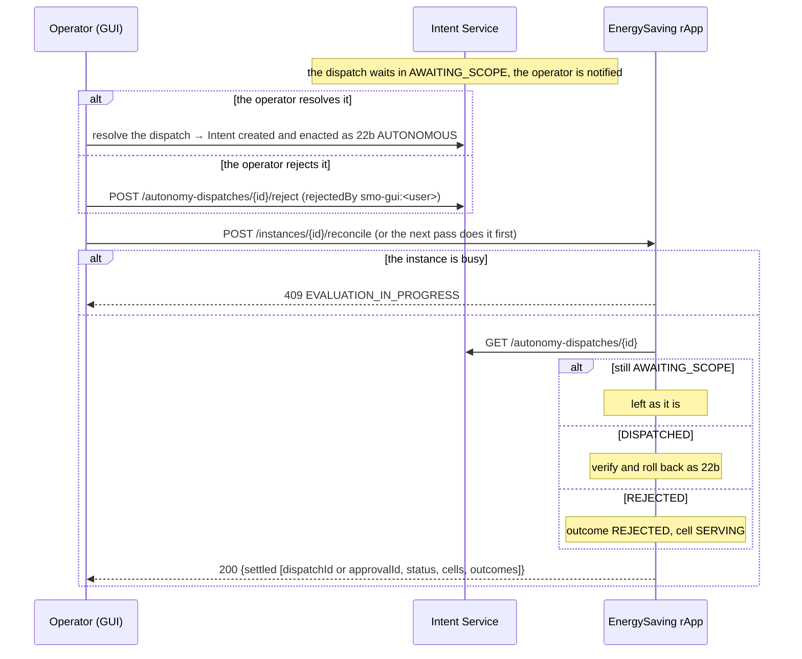
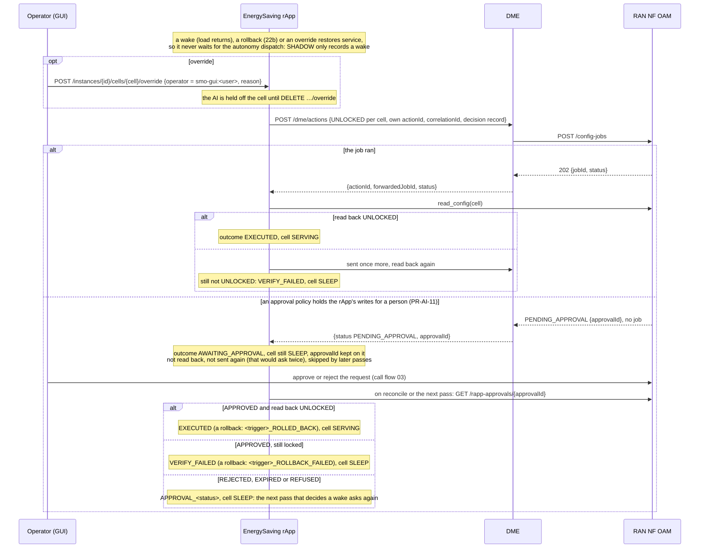
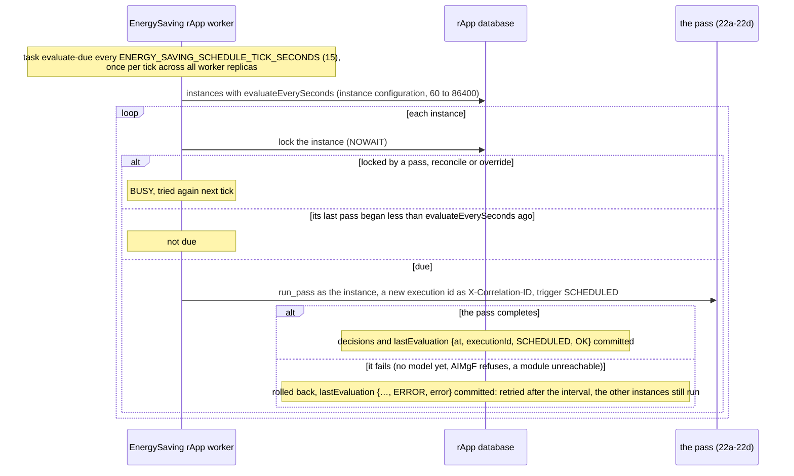

# Call Flow 22: EnergySaving rApp — the closed loop: predict, guard, lock or wake, verify, roll back

The EnergySaving rApp (`samples/energy-saving-rapp/`, Wave 10.1 in `docs/STANDARDS.md`) sleeps lightly used cells through O1 and wakes them before load
returns. It uses O1 PM data and the R1 control plane only: no A1, Near-RT RIC, xApp or E2. Training, validation, emulation, certification and deployment
of its model come first; they are call flows 02 and 17, driven by the rApp through the SDK. Five diagrams:

| | Step | Who starts it | Ends with |
|---|---|---|---|
| 22a | One pass: inputs, prediction, guards, decision | Operator (GUI) "Evaluate now", or the worker (22e) | a decision per cell, one audit row each |
| 22b | LOCK through the autonomy dispatch | the pass, for a cell to sleep | SHADOWED, AWAITING_APPROVAL (ASSIST), or locked and verified, or rolled back |
| 22c | ASSIST: the operator decides, the rApp reconciles | Operator (GUI) in Intent Service; then "Reconcile" or the next pass | the lock enacted or not |
| 22d | Wake and override: straight to DME | the pass, for a cell to wake; Operator (GUI) override | unlocked and verified, or held for a person (PR-AI-11) |
| 22e | The scheduled pass | the rApp's worker | a pass every `evaluateEverySeconds` per instance |

**As images:** [22a](images/22-energy-saving-closed-loop/22a-one-pass-inputs-prediction-guards-decision.png) ·
[22b](images/22-energy-saving-closed-loop/22b-lock-through-the-autonomy-dispatch.png) ·
[22c](images/22-energy-saving-closed-loop/22c-assist-the-operator-decides-the-rapp-reconciles.png) ·
[22d](images/22-energy-saving-closed-loop/22d-wake-and-override-straight-to-dme.png) ·
[22e](images/22-energy-saving-closed-loop/22e-the-scheduled-pass.png)
(PNG, drawn from the diagrams below by `scripts/render_call_flows.py`).

**How to read the diagrams.** As in call flow 01: an arrow is one call with the inputs that matter, a box on the receiver says what it does
with them, an `alt` block is the outcome (success first, then each failure and what the caller gets). The rApp reaches every module through R1
Termination with the SDK, as its instance (call flow 01c). In the console the rApp's page offers "Evaluate now", "Reconcile approvals", the override
and its release; they need the **operator** role, and the override is recorded as the signed-in user.

## 22a — One pass: inputs, prediction, guards, decision

**Phase 1:** the prediction is computed by the rApp's own model; AIMgF records the inference job and its report, it does not run the model (the
runtime is a placeholder workload, call flow 17).

## 22b — LOCK through the autonomy dispatch

**Phase 1:** the rApp waits up to 30 s for SA SMOS's fulfilment report; SA SMOS enacts inside the push it receives, so the report is normally there at
once. A report that never comes counts as not enacted and the cells are rolled back.

## 22c — ASSIST: the operator decides, the rApp reconciles

## 22d — Wake and override: straight to DME

**Phase 1:** a wake that a person rejects is asked for again by the next pass that decides it; nothing keeps the rApp from asking each pass while load
stays high.

## 22e — The scheduled pass

An instance with no `evaluateEverySeconds` is evaluated only by "Evaluate now". The instance's page shows its interval and how its last pass went.

## Decisions this flow depends on

- **Only PRE_SLEEP → SLEEP and SLEEP → SERVING write to O1** (decision D-3). SERVING, PRE_SLEEP and SLEEP are the rApp's own states; the 60-minute sustain
  is measured on the samples' timestamps, so a decision does not depend on how often passes run.
- **The actuator is set per instance** (D-2): `NRCellDU.administrativeState` LOCKED/UNLOCKED, verified on the same attribute; or
  `CESManagementFunction.energySavingControl`, verified on `energySavingState`.
- **Only a LOCK goes through the autonomy dispatch.** A LOCK reduces service, so the autonomy modes govern it. A wake, a rollback or an override restores
  service and goes straight to DME in AUTONOMOUS and ASSIST, each with its own `actionId` (a replay is IGNORED) and the pass's correlation id. A write that
  an approval policy holds for a person is waited for, never sent again (DOC-CF-1.8).
- **One pass at a time per instance.** A pass, a reconcile and an override lock the instance row (`SELECT … FOR UPDATE NOWAIT`); a second one is 409
  EVALUATION_IN_PROGRESS at once, and the worker skips the instance for a tick (DOC-CF-1.8).
- **The loop closes by itself when asked to:** `evaluateEverySeconds` in the instance configuration makes the rApp's worker (`energy-saving-rapp-worker`,
  the same image, `python -m smo_shared.worker`) run a pass that often (DOC-CF-1.8).
- **The region scope bounds a dispatch's cells; it never adds to them** (Intent Service `_scoped`).
- **Guards hold whatever the model's confidence.** HARD: emergency cell, coverage-critical cell, last awake cell of its sector group, incident zone.
  MEDIUM: a neighbour above 80 % PRB; an active critical alarm on the cell, on a neighbour it hands its traffic to, or on the element as a whole. SOFT:
  unlocked less than 30 minutes ago. Guard data are RAN NF OAM cell attributes (D-5, W9-06).
- **The audit trail** (`GET /instances/{id}/decisions`) has one row per cell per pass, Prediction → Safety → Decision → Intent → Action → Verification →
  Rollback → Final state, joined to the platform's records by id (dispatch, intent, DME action, RAN NF OAM job, approval).
