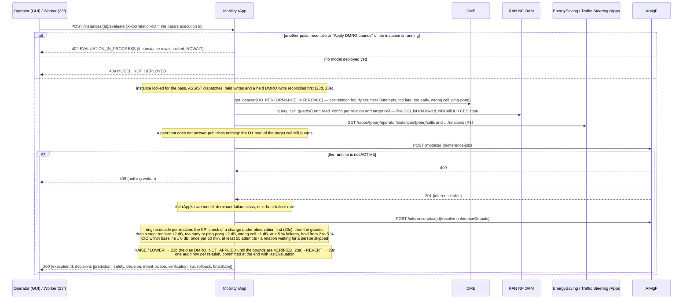
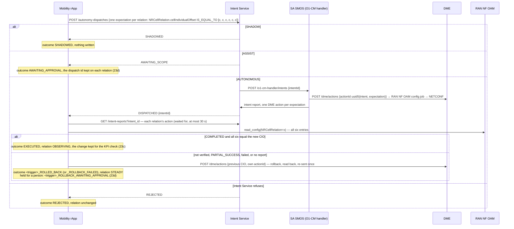
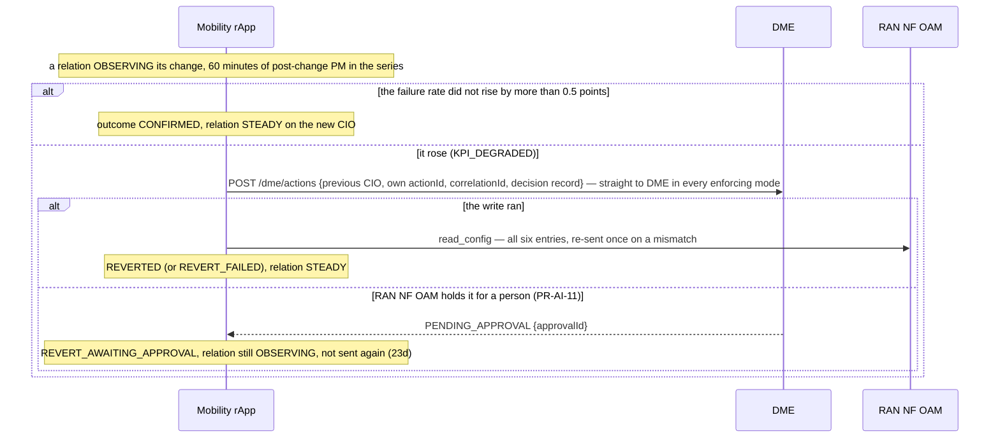
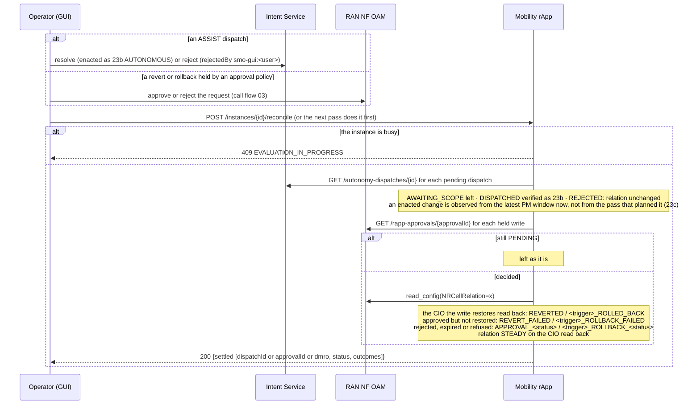
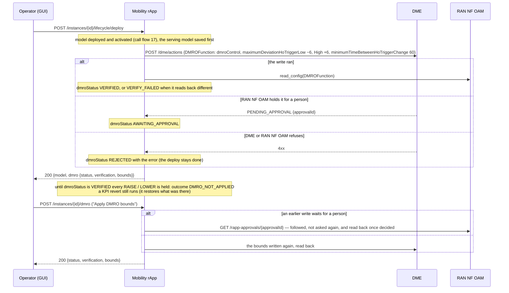
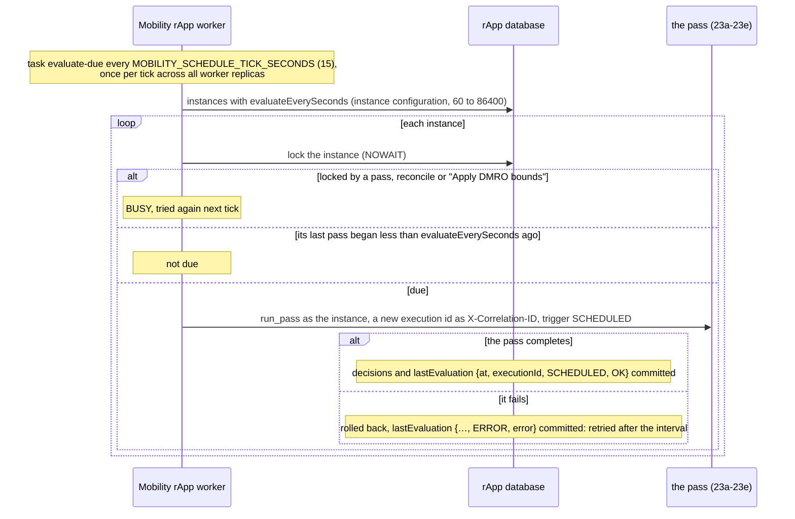

# Call Flow 23: Mobility Optimization rApp — the closed loop: classify, predict, guard, step the CIO, verify, check the KPI

The Mobility Optimization rApp (`samples/mobility-optimization-rapp/`, Wave 10.2 in `docs/STANDARDS.md`) tunes each neighbour relation's Cell Individual
Offset (CIO) from O1 handover PM. Like the EnergySaving rApp (call flow 22) it uses the R1 control plane only: no A1, Near-RT RIC, xApp or E2. Training,
validation, emulation, certification and deployment of its model come first (call flows 02 and 17). Six diagrams:

| | Step | Who starts it | Ends with |
|---|---|---|---|
| 23a | One pass: inputs, classification, prediction, guards, decision | Operator (GUI) "Evaluate now", or the worker (23f) | a decision per relation, one audit row each |
| 23b | A CIO step through the autonomy dispatch | the pass, for a relation to change | SHADOWED, AWAITING_APPROVAL (ASSIST), or changed and verified (OBSERVING), or rolled back |
| 23c | The KPI check, an hour later | the next pass after 60 minutes of post-change PM | CONFIRMED, or reverted straight through DME |
| 23d | ASSIST, and reverts and rollbacks held for a person | Operator (GUI) in Intent Service or RAN NF OAM; then "Reconcile" or the next pass | the change enacted or not; the held write settled |
| 23e | The DMRO bounds | deploy; Operator (GUI) "Apply DMRO bounds" | the bounds VERIFIED, or every CIO change held |
| 23f | The scheduled pass | the rApp's worker | a pass every `evaluateEverySeconds` per instance |

**As images:** [23a](images/23-mobility-optimization-closed-loop/23a-one-pass-inputs-classification-prediction-guards-decisio.png) ·
[23b](images/23-mobility-optimization-closed-loop/23b-a-cio-step-through-the-autonomy-dispatch.png) ·
[23c](images/23-mobility-optimization-closed-loop/23c-the-kpi-check-an-hour-later.png) ·
[23d](images/23-mobility-optimization-closed-loop/23d-assist-and-reverts-and-rollbacks-held-for-a-person.png) ·
[23e](images/23-mobility-optimization-closed-loop/23e-the-dmro-bounds.png) ·
[23f](images/23-mobility-optimization-closed-loop/23f-the-scheduled-pass.png)
(PNG, drawn from the diagrams below by `scripts/render_call_flows.py`).

**How to read the diagrams.** As in call flow 01: an arrow is one call with the inputs that matter, a box on the receiver says what it does
with them, an `alt` block is the outcome (success first, then each failure and what the caller gets). The rApp reaches every module through R1
Termination with the SDK, as its instance (call flow 01c). In the console the rApp's page offers "Evaluate now", "Reconcile approvals" and "Apply DMRO
bounds"; they need the **operator** role.

## 23a — One pass: inputs, classification, prediction, guards, decision

The guards leave a relation alone when `isHOAllowed=false`, when its source or target is an EMERGENCY cell or in an incident zone, when the target cell
is asleep on O1 or in the EnergySaving rApp's SLEEP or PRE_SLEEP state or less than 30 minutes past a wake, and while the Traffic Steering rApp observes a
CIO step on it (`MLB_OBSERVING`). Every guard that blocks is named in the decision's reason.

**Phase 1:** the prediction is computed by the rApp's own model; AIMgF records the inference job and its report, it does not run the model.

## 23b — A CIO step through the autonomy dispatch

## 23c — The KPI check, an hour later

The hour starts when the change was made: for AUTONOMOUS the pass that dispatched it, for ASSIST the latest PM window when reconcile found it enacted, so windows measured while it waited for the operator do not count as its effect.

**Phase 1:** the check happens on the first pass after the hour; without a schedule (23f) that pass waits for someone to press "Evaluate now".

## 23d — ASSIST, and reverts and rollbacks held for a person

## 23e — The DMRO bounds

An instance deployed before this build has no recorded status: its changes are held until "Apply DMRO bounds" verifies the bounds.

## 23f — The scheduled pass

An instance with no `evaluateEverySeconds` is evaluated only by "Evaluate now". Choose an interval well under an hour (900 s, say), so a change is
confirmed or reverted soon after its 60 minutes are up.

## Decisions this flow depends on

- **The actuator is the per-relation CIO, bounded by DMRO** (D10.2-1). `NRCellRelation.cellIndividualOffset` is a TS 28.541 QOffsetRange list: the rApp
  writes all six entries with one value and reads all six back. The gNB's `DMROFunction` bounds (−6/+6 dB, 60 minutes between changes) keep its own MRO in
  the same envelope; until they are verified the rApp changes no CIO (DOC-CF-1.8).
- **Classified MRO plus regression** (D10.2-2): the dominant failure class sets the direction, a persistence-anchored regression predicts the next hour's
  failure rate; a one-hour spike after a healthy hour is predicted to partly revert, so it stays in the hold zone.
- **Bounds and pacing** (D10.2-4a): baseline ± 6 dB (`AT_BOUND`), steps of at most 2 dB, at most once per 60 minutes, at least 50 attempts.
- **KPI-verified revert** (D10.2-4b): OBSERVING for 60 minutes of post-change PM, then CONFIRMED or reverted (a rise of more than 0.5 points). A revert
  restores the earlier state, so it goes straight to DME in every enforcing mode; one held for a person is waited for, never sent again (DOC-CF-1.8).
- **Coordination** (D10.2-4c, D10.4-1): no change aims at a sleeping or just-woken target cell; a relation the Traffic Steering rApp observes is held. The
  rApp reads its peers' published states over R1 and never writes them.
- **One pass at a time per instance** (DOC-CF-1.8): a pass, a reconcile and "Apply DMRO bounds" lock the instance row; a second is 409.
- **The loop closes by itself when asked to** (DOC-CF-1.8): `evaluateEverySeconds` makes the rApp's worker (`mobility-optimization-rapp-worker`) run a
  pass that often.
- **The audit trail** (`GET /instances/{id}/decisions`) has one row per relation per pass, Prediction → Safety → Decision → Intent → Action → Verification →
  KPI → Rollback → Final state.
