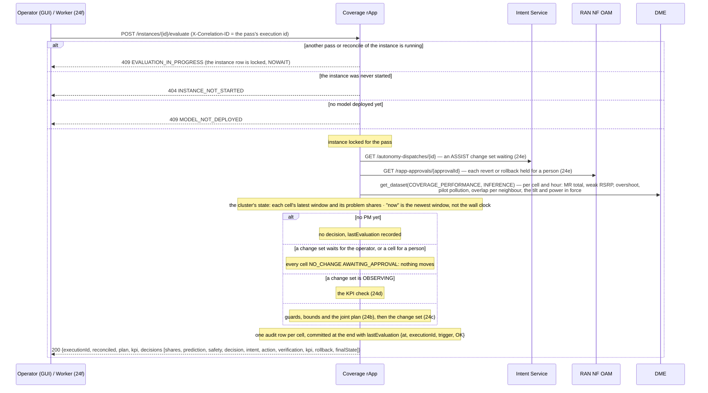
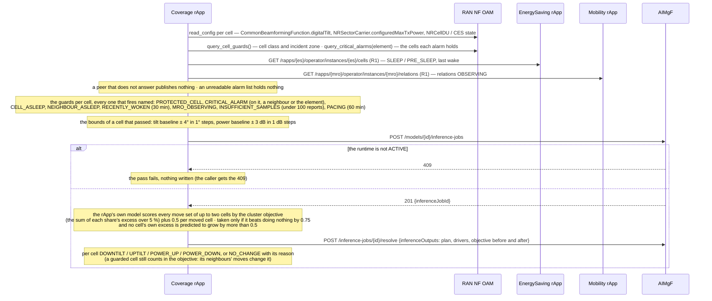
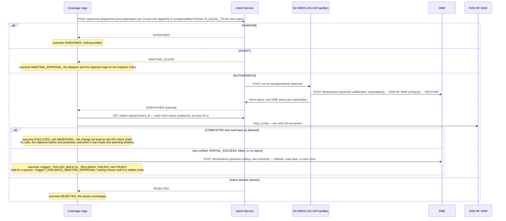
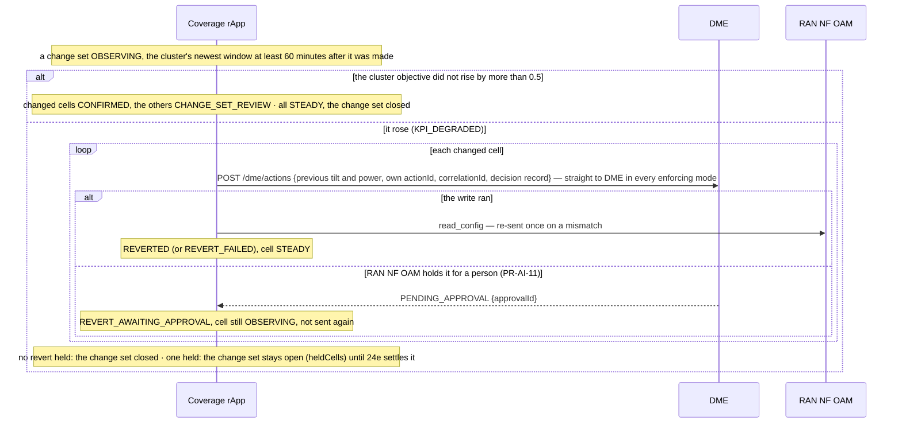
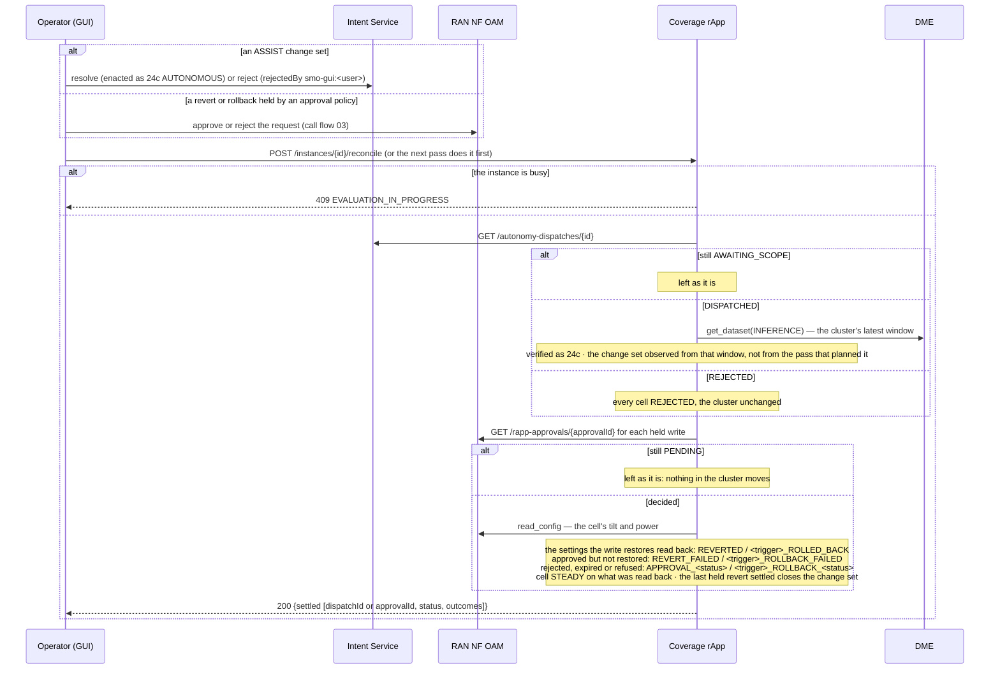
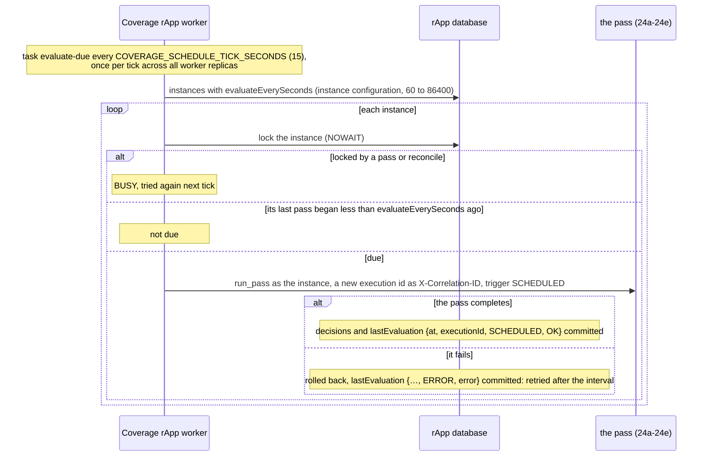

# Call Flow 24: Coverage Optimization rApp — the closed loop: guard, plan jointly, move tilt and power, verify, check the KPI

The Coverage Optimization rApp (`samples/coverage-optimization-rapp/`, Wave 10.3 in `docs/STANDARDS.md`) tunes a cluster of cells' digital tilt and
transmit power, jointly, from O1 coverage PM. Like call flows 22 and 23 it uses the R1 control plane only: no A1, Near-RT RIC, xApp or E2. Training (on
history in which tilt and power varied), validation, emulation, certification and deployment of its model come first (call flows 02 and 17). Six diagrams:

| | Step | Who starts it | Ends with |
|---|---|---|---|
| 24a | One pass: inputs, the cluster's state, which branch runs | Operator (GUI) "Evaluate now", or the worker (24f) | a decision per cell, one audit row each |
| 24b | The guards and bounds, and the joint plan | the pass, when no change set is open | at most two cells, one step each, or nothing |
| 24c | A change set through the autonomy dispatch | the pass, for a plan that moves cells | SHADOWED, AWAITING_APPROVAL (ASSIST), or changed and verified (OBSERVING), or rolled back |
| 24d | The KPI check of the change set, an hour later | the next pass after 60 minutes of post-change PM | CONFIRMED, or every changed cell reverted straight through DME |
| 24e | ASSIST, and reverts and rollbacks held for a person | Operator (GUI) in Intent Service or RAN NF OAM; then "Reconcile approvals" or the next pass | the change set enacted or not; the held write settled |
| 24f | The scheduled pass | the rApp's worker | a pass every `evaluateEverySeconds` per instance |

**As images:** [24a](images/24-coverage-optimization-closed-loop/24a-one-pass-inputs-the-cluster-s-state-which-branch-runs.png) ·
[24b](images/24-coverage-optimization-closed-loop/24b-the-guards-and-bounds-and-the-joint-plan.png) ·
[24c](images/24-coverage-optimization-closed-loop/24c-a-change-set-through-the-autonomy-dispatch.png) ·
[24d](images/24-coverage-optimization-closed-loop/24d-the-kpi-check-of-the-change-set-an-hour-later.png) ·
[24e](images/24-coverage-optimization-closed-loop/24e-assist-and-reverts-and-rollbacks-held-for-a-person.png) ·
[24f](images/24-coverage-optimization-closed-loop/24f-the-scheduled-pass.png)
(PNG, drawn from the diagrams below by `scripts/render_call_flows.py`).

**How to read the diagrams.** As in call flow 01: an arrow is one call with the inputs that matter, a box on the receiver says what it does
with them, an `alt` block is the outcome (success first, then each failure and what the caller gets). The rApp reaches every module through R1
Termination with the SDK, as its instance (call flow 01c). In the console the rApp's page offers "Evaluate now" and "Reconcile approvals"; they need the
**operator** role.

## 24a — One pass: inputs, the cluster's state, which branch runs

**Phase 1:** there is one change set at a time for the whole cluster: while one waits, is observed or is held, no other cell moves.

## 24b — The guards and bounds, and the joint plan

**Phase 1:** the plan is computed by the rApp's own model; AIMgF records the inference job and its report, it does not run the model.
An alarm list that cannot be read holds no cell, so the loop does not stop when the alarm query is down.

## 24c — A change set through the autonomy dispatch

## 24d — The KPI check of the change set, an hour later

The hour starts when the change set was made: for AUTONOMOUS the window the pass planned it on, for ASSIST the latest PM window when reconcile found it
enacted, so windows measured while it waited for the operator do not count as its effect.

**Phase 1:** the check happens on the first pass after the hour; without a schedule (24f) that pass waits for someone to press "Evaluate now".

## 24e — ASSIST, and reverts and rollbacks held for a person

## 24f — The scheduled pass

An instance with no `evaluateEverySeconds` is evaluated only by "Evaluate now". Choose an interval well under an hour (900 s, say), so a change set is
confirmed or reverted soon after its 60 minutes are up.

## Decisions this flow depends on

- **Tilt plus transmit power** (D10.3-1). `CommonBeamformingFunction.digitalTilt` is in tenths of a degree, positive meaning downtilt;
  `NRSectorCarrier.configuredMaxTxPower` is in dBm in this build. One knob moves per cell per change, and each write is read back.
- **Joint neighbour optimisation** (D10.3-2). The model has 12 learned sensitivities (three problem shares × own tilt, own power, neighbours' tilt,
  neighbours' power); neighbour effects are weighted by the measured overlap, so pilot pollution is treated at its source.
- **Bounds and pacing** (D10.3-4a): tilt baseline ± 4° in 1° steps, power baseline ± 3 dB in 1 dB steps, a cell at most once per 60 minutes, a window
  needs at least 100 measurement reports.
- **KPI-verified revert of the whole change set** (D10.3-4b): while a set is OBSERVING nothing else moves; after 60 minutes of post-change PM the measured
  cluster objective is compared with its value before the change, and if it is worse by more than 0.5 every changed cell is reverted straight through DME.
  A revert held for a person is waited for, never sent again, and keeps the set open (DOC-CF-1.8).
- **Coordination** (D10.3-4c): a cell is held when it or a neighbour is asleep, when it or a neighbour woke less than 30 minutes ago, and when the Mobility
  rApp observes one of its relations. Both peers are read over R1, never written.
- **Protected cells** (D10.3-4d): EMERGENCY and incident-zone cells never move; a critical alarm on a cell holds it and its neighbours, one that names no
  cell holds the whole element.
- **One pass at a time per instance** (DOC-CF-1.8): a pass and a reconcile lock the instance row; a second is 409.
- **The loop closes by itself when asked to** (DOC-CF-1.8): `evaluateEverySeconds` makes the rApp's worker (`coverage-optimization-rapp-worker`) run a
  pass that often.
- **The audit trail** (`GET /instances/{id}/decisions`) has one row per cell per pass, Shares → Joint plan → Safety → Decision → Intent → Action →
  Verification → KPI → Rollback → Final state. The rApp's page shows the latest row per cell and each cell's excess trend.
