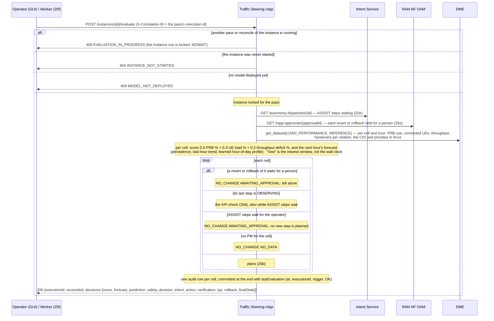
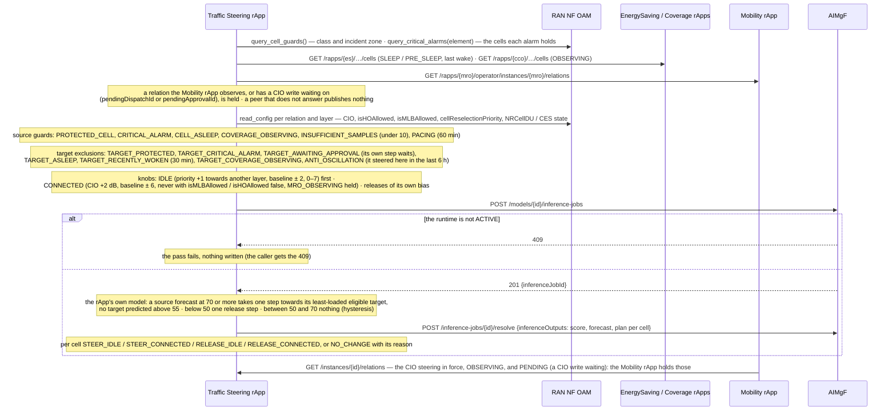
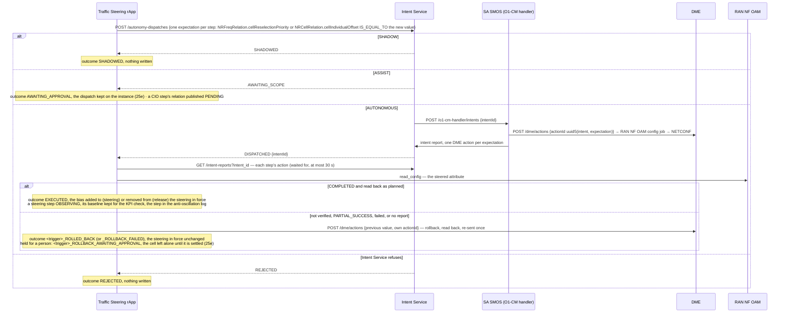
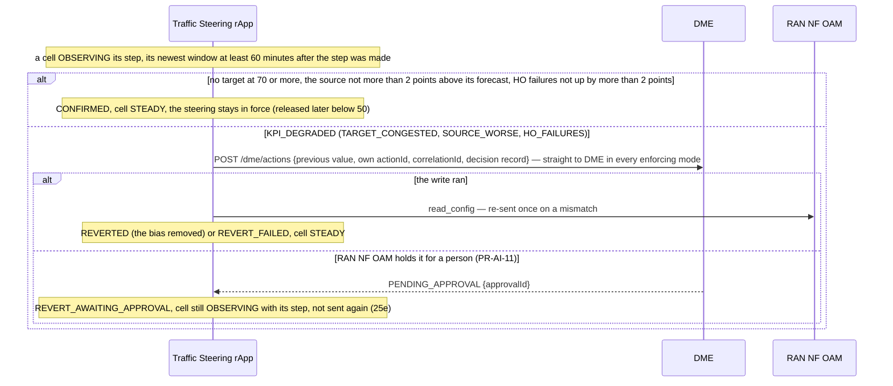
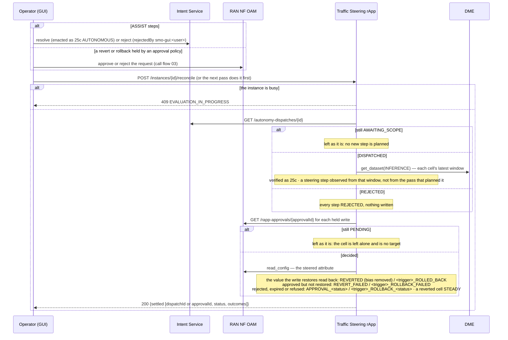
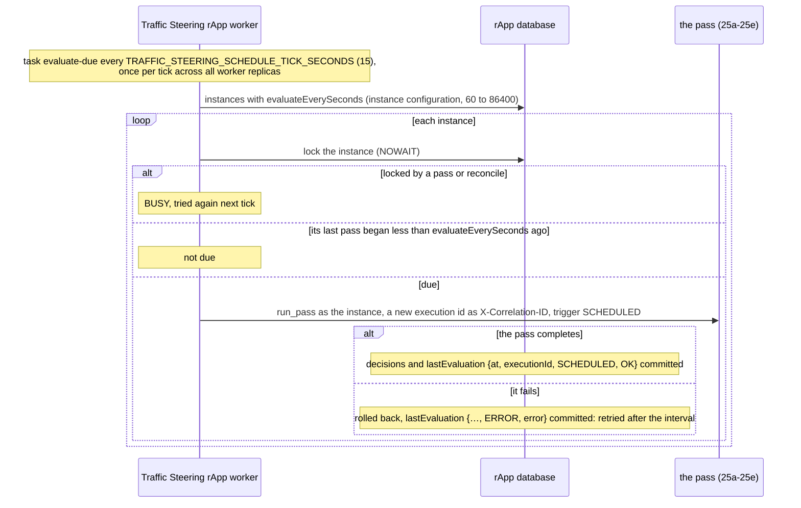

# Call Flow 25: Traffic Steering rApp — the closed loop: score, forecast, guard, steer idle or connected UEs, verify, check the KPI

The Traffic Steering rApp (`samples/traffic-steering-rapp/`, Wave 10.4 in `docs/STANDARDS.md`) moves load off congested cells: idle UEs by the cell's
reselection priority towards another frequency layer, connected UEs by a neighbour relation's cell individual offset (CIO), which it shares with the
Mobility rApp (call flow 23). Like call flows 22–24 it uses the R1 control plane only: no A1, Near-RT RIC, xApp or E2. Training (on history in which
the biases varied), validation, emulation, certification and deployment of its model come first (call flows 02 and 17). Six diagrams:

| | Step | Who starts it | Ends with |
|---|---|---|---|
| 25a | One pass: inputs, score and forecast, what each cell does | Operator (GUI) "Evaluate now", or the worker (25f) | a decision per cell, one audit row each |
| 25b | The guards, the target options and the pairwise plan; the shared CIO | the pass, for each cell that may plan | at most one step per source cell, or nothing |
| 25c | A step through the autonomy dispatch | the pass, for the steps planned | SHADOWED, AWAITING_APPROVAL (ASSIST), or enacted and verified (a steering step OBSERVING), or rolled back |
| 25d | The KPI check of a step, an hour later | the next pass after 60 minutes of post-change PM | CONFIRMED, or reverted straight through DME |
| 25e | ASSIST, and reverts and rollbacks held for a person | Operator (GUI) in Intent Service or RAN NF OAM; then "Reconcile approvals" or the next pass | the step enacted or not; the held write settled |
| 25f | The scheduled pass | the rApp's worker | a pass every `evaluateEverySeconds` per instance |

**As images:** [25a](images/25-traffic-steering-closed-loop/25a-one-pass-inputs-score-and-forecast-what-each-cell-does.png) ·
[25b](images/25-traffic-steering-closed-loop/25b-the-guards-the-target-options-and-the-pairwise-plan-the-.png) ·
[25c](images/25-traffic-steering-closed-loop/25c-a-step-through-the-autonomy-dispatch.png) ·
[25d](images/25-traffic-steering-closed-loop/25d-the-kpi-check-of-a-step-an-hour-later.png) ·
[25e](images/25-traffic-steering-closed-loop/25e-assist-and-reverts-and-rollbacks-held-for-a-person.png) ·
[25f](images/25-traffic-steering-closed-loop/25f-the-scheduled-pass.png)
(PNG, drawn from the diagrams below by `scripts/render_call_flows.py`).

**How to read the diagrams.** As in call flow 01: an arrow is one call with the inputs that matter, a box on the receiver says what it does
with them, an `alt` block is the outcome (success first, then each failure and what the caller gets). The rApp reaches every module through R1
Termination with the SDK, as its instance (call flow 01c). In the console the rApp's page offers "Evaluate now" and "Reconcile approvals"; they need the
**operator** role.

## 25a — One pass: inputs, score and forecast, what each cell does

## 25b — The guards, the target options and the pairwise plan; the shared CIO

**Phase 1:** the plan is computed by the rApp's own model; AIMgF records the inference job and its report, it does not run the model. An alarm list that
cannot be read holds no cell, so the loop does not stop when the alarm query is down.

## 25c — A step through the autonomy dispatch

## 25d — The KPI check of a step, an hour later

The hour starts when the step was made: for AUTONOMOUS the window the pass planned it on; for ASSIST the cell's latest PM window when reconcile found it
enacted, so windows measured while it waited for the operator do not count as its effect (pacing and the anti-oscillation log start there too). A step
under observation is checked even while other steps wait for the operator.

**Phase 1:** the check happens on the first pass after the hour; without a schedule (25f) that pass waits for someone to press "Evaluate now".

## 25e — ASSIST, and reverts and rollbacks held for a person

## 25f — The scheduled pass

An instance with no `evaluateEverySeconds` is evaluated only by "Evaluate now". Choose an interval well under an hour (900 s, say), so a step is confirmed
or reverted soon after its 60 minutes are up.

## Decisions this flow depends on

- **Idle first, then connected** (D10.4-1). For a target on another frequency layer the source's `NRFreqRelation.cellReselectionPriority` towards that
  layer is raised by one (baseline ± 2, 0–7): idle UEs move with no handover risk. The relation's `cellIndividualOffset` is raised by 2 dB for a target on
  the same layer, or once the idle knob is at its bound. Steering is released the same way once the source is below 50.
- **Shared CIO** (D10.4-1, DOC-CF-1.8): the Mobility and Traffic Steering rApps keep the CIO in one envelope (baseline ± 6 dB, the DMRO bounds). Each
  publishes the relations it observes or has a CIO write waiting on, and holds those of the other; Traffic Steering releases only the bias it put on a
  relation itself, and never biases a relation with `isMLBAllowed` or `isHOAllowed` false.
- **Score, forecast and pairwise plan** (D10.4-2): a source forecast at 70 or more takes one step towards its least-loaded eligible neighbour, the
  transfer predicted from the learned fraction per step, no target above 55; nothing changes between 50 and 70.
- **Bounds and pacing** (D10.4-4a): one step per cell per pass, at least 60 minutes between changes on a cell, at least 10 PM samples per window.
- **KPI-verified revert** (D10.4-4b): after 60 minutes a step is reverted straight through DME when a target became congested, the source ended more than
  2 points above its own no-steering forecast, or (a CIO step) the relation's handover failure rate rose by more than 2 points. A revert held for a person
  is waited for, never sent again (DOC-CF-1.8).
- **Coordination** (D10.4-4c): a source is held if asleep or in a Coverage change set; a neighbour is no target if asleep, pre-sleep, less than 30 minutes
  past a wake, in a Coverage change set, or waiting for its own held write.
- **Protected cells and anti-oscillation** (D10.4-4d): EMERGENCY and incident-zone cells are neither sources nor targets; a critical alarm on a cell holds
  it as a source and excludes it as a target, one that names no cell holds the element; a cell that steered load here in the last 6 hours is no target.
- **One pass at a time per instance** (DOC-CF-1.8): a pass and a reconcile lock the instance row; a second is 409.
- **The loop closes by itself when asked to** (DOC-CF-1.8): `evaluateEverySeconds` makes the rApp's worker (`traffic-steering-rapp-worker`) run a pass
  that often.
- **The audit trail** (`GET /instances/{id}/decisions`) has one row per cell per pass, Score / forecast → Safety and excluded targets → Plan → Intent →
  Action → Verification → KPI → Rollback → Final state. The rApp's page shows the latest row per cell and the steering in force.
