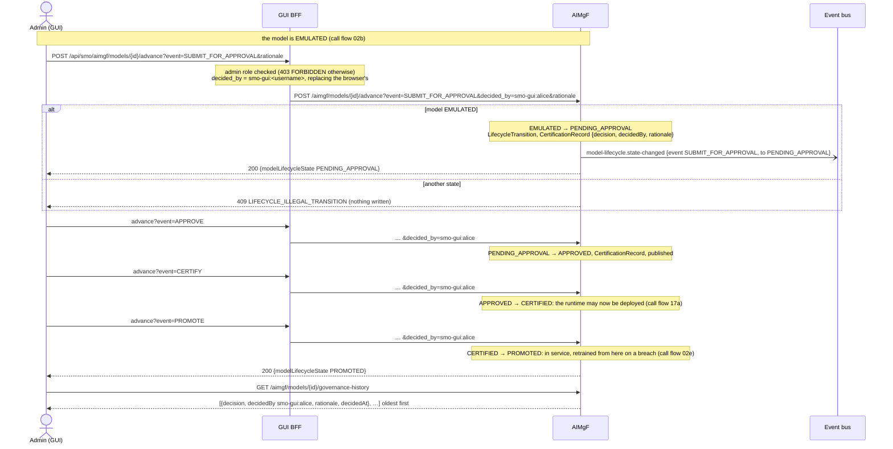
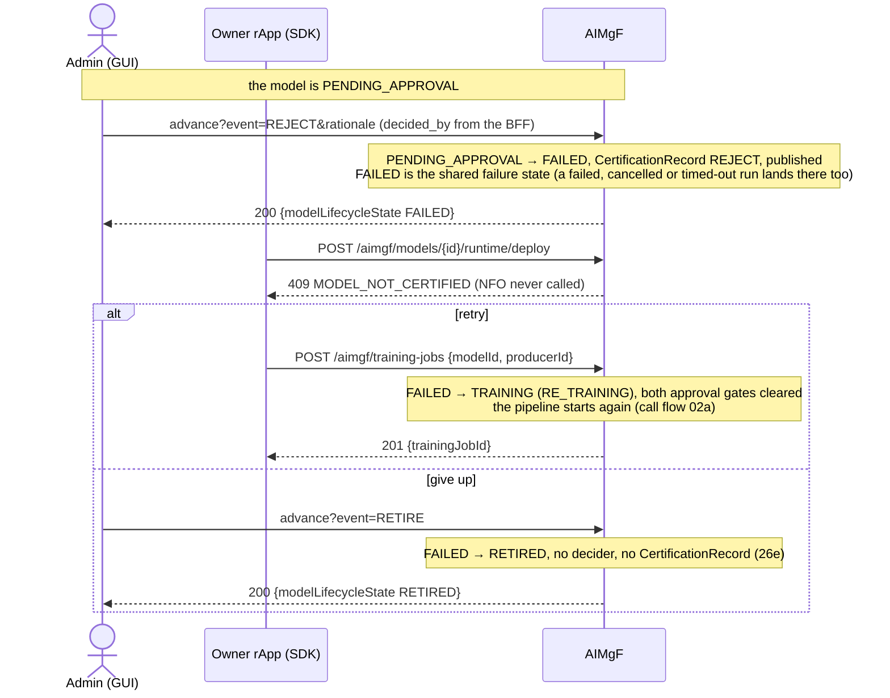
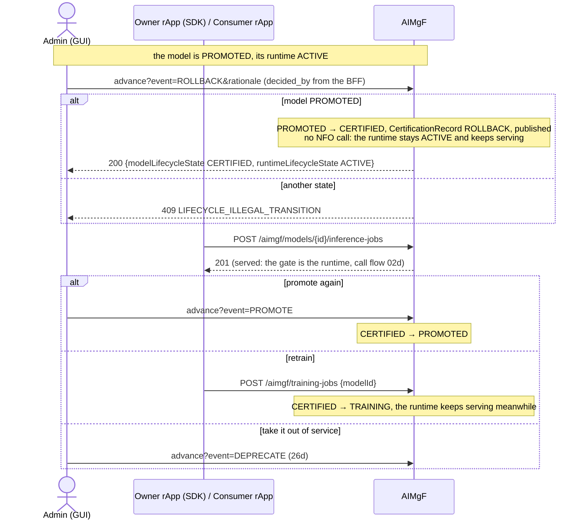
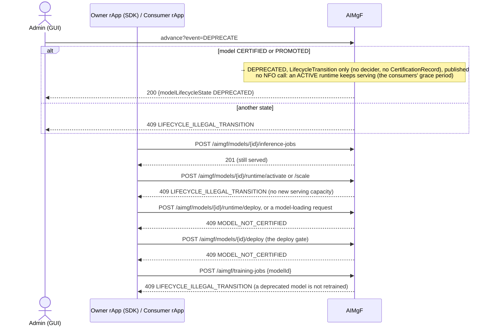
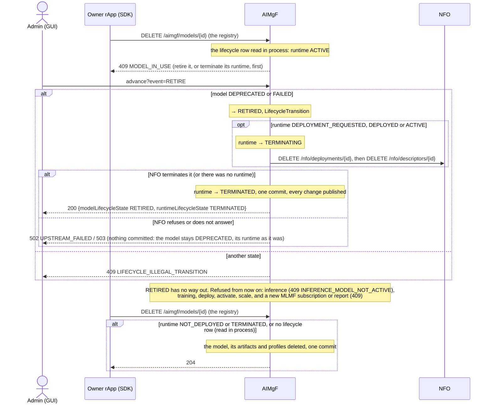

# Call Flow 26: Model governance and end of life — submit, approve, certify, promote, roll back, deprecate, retire

The decisions people take about an AI/ML model once its runs are done (call flow 02): the governance path to `PROMOTED`, the ways back out of
it, and the end of the model's life. Five diagrams:

| | Step | Who decides | Ends with |
|---|---|---|---|
| 26a | Submit, approve, certify, promote | Admin (GUI) | model PROMOTED, each decision recorded under the admin who took it |
| 26b | Reject, then retry or retire | Admin (GUI) | model FAILED, then TRAINING again or RETIRED |
| 26c | Roll back | Admin (GUI) | model CERTIFIED again, its runtime still serving |
| 26d | Deprecate | Admin (GUI) | model DEPRECATED: still serving, nothing new allowed |
| 26e | Retire, and deleting the model | Admin (GUI); the owner rApp or an admin deletes | model RETIRED, its runtime gone, the model deletable |

**As images:** [26a](images/26-model-governance-and-end-of-life/26a-submit-approve-certify-promote.png) ·
[26b](images/26-model-governance-and-end-of-life/26b-reject-then-retry-or-retire.png) ·
[26c](images/26-model-governance-and-end-of-life/26c-roll-back.png) ·
[26d](images/26-model-governance-and-end-of-life/26d-deprecate.png) ·
[26e](images/26-model-governance-and-end-of-life/26e-retire-and-deleting-the-model.png)
(PNG, drawn from the diagrams below by `scripts/render_call_flows.py`).

**How to read the diagrams.** As in call flow 01: an arrow is one call with the inputs that matter, a box on the receiver says what it does
with them, an `alt` block is the outcome (success first, then each failure and what the caller gets). *Admin (GUI)* is the console's path
through its backend (the GUI BFF); *Owner rApp (SDK)* is the rApp that registered the model.

**One route for every decision.** `POST /aimgf/models/{id}/advance?event&decided_by&rationale` fires the governance events (`SUBMIT_FOR_APPROVAL`,
`APPROVE`, `REJECT`, `CERTIFY`, `PROMOTE`, `ROLLBACK`, and the two training gates of call flow 02b) and the end-of-life events (`DEPRECATE`,
`RETIRE`), and nothing else:

- An rApp is refused, 403 `ROLE_NOT_PERMITTED`: the decisions are people's. The gateway does not let an rApp reach the route either.
- A job-driven event (`CREATE_TRAINING`, `TRAINING_COMPLETE`, …) or an unknown one is 422 `SCHEMA_VALIDATION_FAILED`, naming the job route that fires it.
- A governance event needs `decided_by` (422 `GOVERNANCE_DECIDER_REQUIRED`). **In the console the GUI backend sets it to `smo-gui:<username>` of the
  signed-in user**, whatever the browser sent, so the record names who decided. `DEPRECATE` and `RETIRE` need none.
- An event the model's state cannot take is 409 `LIFECYCLE_ILLEGAL_TRANSITION`.

The console lets only an **admin** fire the governance and end-of-life events; the two training gates are the **operator**'s.

**What each decision leaves behind.** Every transition writes a `LifecycleTransition` (`GET /aimgf/models/{id}/lifecycle-history?fsm=MODEL`). A
governance decision also writes a `CertificationRecord` with the decider and rationale (`GET /aimgf/models/{id}/governance-history`). Every change of
the model's state and of its runtime's is published on the event bus as `org.oran.smo.model-lifecycle.state-changed` (subject: the model id; `data.machine`
says which, `ModelLifecycleState` or `RuntimeLifecycleState`; `docs/EVENTS.md`), so the console's counts follow it and an rApp can watch its models.

## What each model state allows

| Model state | Start training | Deploy (the runtime, the deploy gate, model loading) | Activate, scale | Inference on an ACTIVE runtime | MLMF subscribe, report |
|---|---|---|---|---|---|
| `REGISTERED`, `FAILED` | yes | 409 `MODEL_NOT_CERTIFIED` | yes | yes | yes |
| `TRAINING` | yes (supersedes the run) | 409 `MODEL_NOT_CERTIFIED` | yes | yes | yes |
| `TRAINED` … `APPROVED` | 409 | 409 `MODEL_NOT_CERTIFIED` | yes | yes | yes |
| `CERTIFIED`, `PROMOTED` | yes | yes | yes | yes | yes |
| `DEPRECATED` | 409 | 409 `MODEL_NOT_CERTIFIED` | 409 | yes (grace period) | yes |
| `RETIRED` | 409 | 409 `MODEL_NOT_CERTIFIED` | 409 | 409 `INFERENCE_MODEL_NOT_ACTIVE` | 409 |

A model that served before a retrain keeps its runtime through the retrain and through its failure: the two state machines are independent, so a
`TRAINING`, mid-pipeline or `FAILED` model can have an ACTIVE runtime. A runtime can be terminated in any model state (call flow 17d).

## 26a — Submit, approve, certify, promote

One admin may take every step. A second person for approve and promote is not built (`OPEN_ITEMS.md` AIML-GOV-2P).

## 26b — Reject, then retry or retire

## 26c — Roll back

**Phase 1:** a rollback moves the model's certification back, not its artifact. There are no model versions, so there is no earlier version to
serve again: the runtime keeps what it serves (`OPEN_ITEMS.md` AIML-VER). A group retrain on a breach (call flow 02e) passes over a
rolled-back model, as it retrains only PROMOTED members.

## 26d — Deprecate

TS 28.105 has no deprecated or retired model state: its only serving control is the inference function's `activationStatus` and loading. This
build reads deprecation as "still works, no new use" and keeps RETIRE the one point where serving stops. A deprecated model cannot be
un-deprecated: it is retired, and a replacement is registered.

## 26e — Retire, and deleting the model

What a retired or deleted model leaves: AIMgF keeps the model's lifecycle row, its jobs, reports, certification records and MLMF subscriptions as
history (no foreign key reaches them from the registry's model, revision 0022). An inference function or a loading policy that lists the
model keeps it in its list. Deleting a model is not a lifecycle event: nothing is published for it.

## Decisions this flow depends on

- One route carries every governance and end-of-life decision, and only those; job-driven events fire only from their job routes, so no
  approval gate can be skipped and no stage moves without the job behind it (HISTORY.md OI-6.1, OI-2-governance-bypass).
- People decide, not rApps (SEC-15.1). The console records the signed-in user as the decider (DOC-CF-1.7); a call from an SMO module names its own.
- `ModelLifecycle` and `RuntimeLifecycle` are independent: `ROLLBACK`, `DEPRECATE` and a retrain leave the runtime alone. `RETIRE` is the one decision
  that stops serving, through the same teardown as `runtime/terminate` (call flow 17d).
- The deploy gate is CERTIFIED or PROMOTED, for the runtime, the deploy gate route and model loading alike, so a rolled-back model stays deployable.
- A retrain re-enters at TRAINING from REGISTERED, CERTIFIED, PROMOTED or FAILED and clears both training gates (call flow 02).
- Every change of either state machine is published on the event bus (DOC-CF-1.7).
- A model whose runtime is deployed cannot be deleted from the registry: deleting it would leave an NFO workload nobody could terminate (DOC-CF-1.7).
