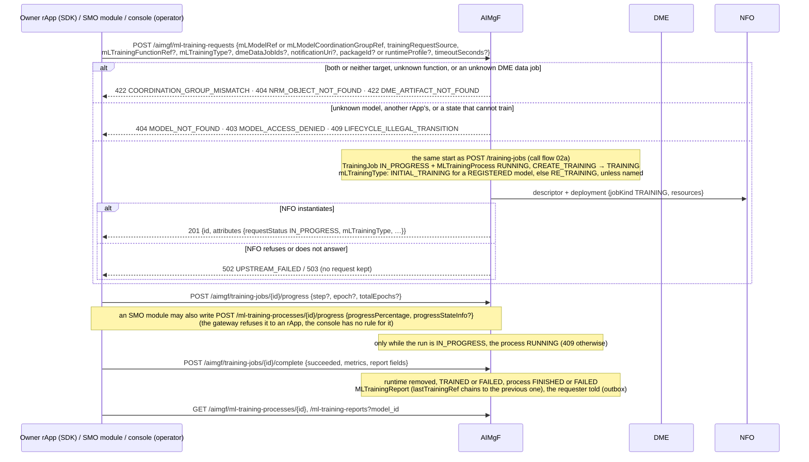
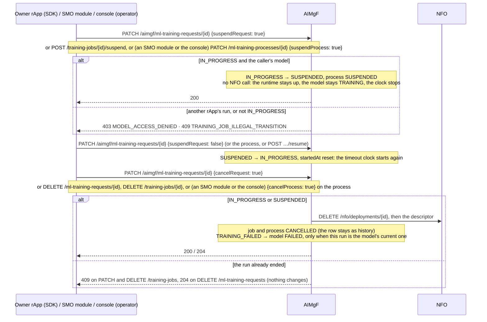
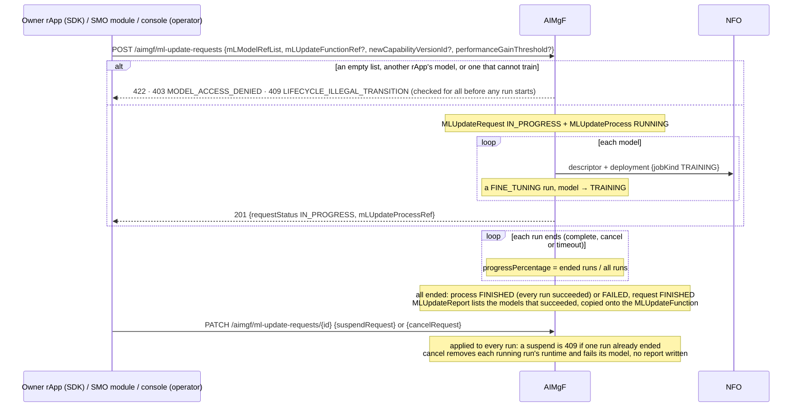
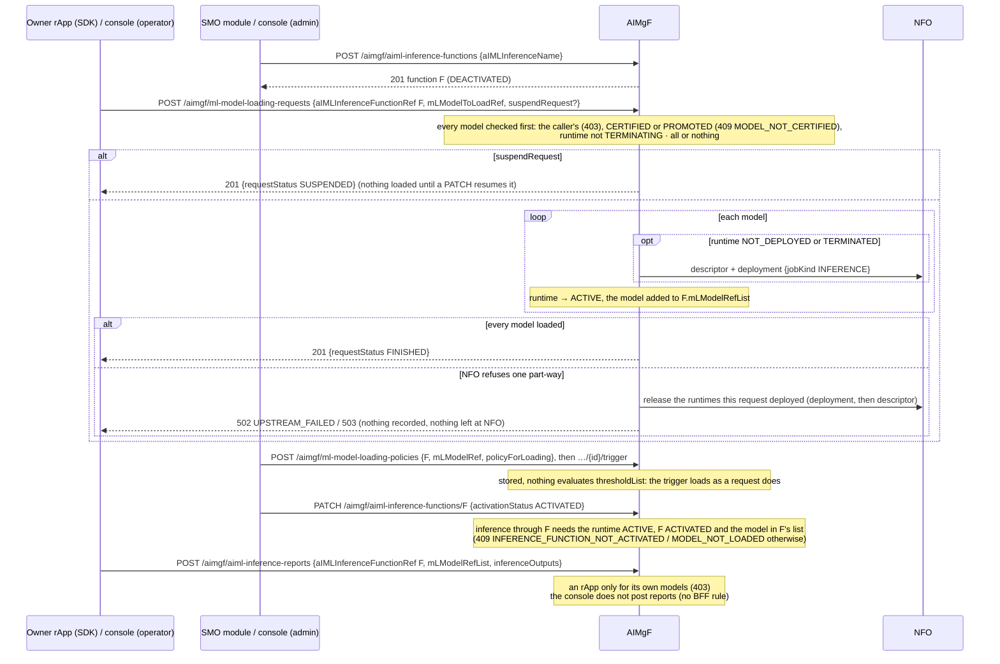
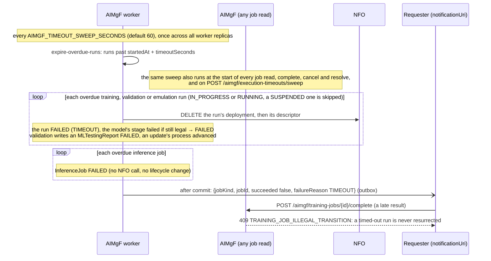

# Call Flow 27: TS 28.105 provisioning resources — training, update and loading requests, and execution timeouts

AIMgF exposes the TS 28.105 AI/ML NRM objects it owns as REST resources with the spec's attribute names (the `nrm.py` of each capability package of `aimgf/app/`, `docs/STANDARDS.md`). They are
not a second bookkeeping layer: an `MLTrainingRequest` *is* a training job and an `MLTestingRequest` *is* a validation job, started by the same code as
`POST /training-jobs` and `/validation-jobs` (call flow 02). So the lifecycle gate, the approval gates, the NFO runtime and the timeout are the same whichever
route a caller takes. Five diagrams:

| | Step | Who starts it | Ends with |
|---|---|---|---|
| 27a | Training request, process and report | the owner rApp (SDK), an SMO module, the console (operator) | a run IN_PROGRESS, then FINISHED or FAILED with its report |
| 27b | Suspend, resume, cancel | the owner rApp, an SMO module, the console (operator) | the run SUSPENDED, IN_PROGRESS again, or CANCELLED |
| 27c | ML update (fine-tuning several models) | the owner rApp, an SMO module, the console (operator) | one FINE_TUNING run per model, then an update report |
| 27d | Model loading, by request or policy | the owner rApp or the console (operator) for a request; an SMO module or the console (admin) for a function or policy | each model's runtime ACTIVE and on the inference function |
| 27e | Execution timeouts | the AIMgF worker; any job read | every overdue run FAILED, its runtime gone |

**As images:** [27a](images/27-ts28105-provisioning-resources/27a-training-request-process-and-report.png) ·
[27b](images/27-ts28105-provisioning-resources/27b-suspend-resume-cancel.png) ·
[27c](images/27-ts28105-provisioning-resources/27c-ml-update-fine-tuning-several-models.png) ·
[27d](images/27-ts28105-provisioning-resources/27d-model-loading-by-request-or-policy.png) ·
[27e](images/27-ts28105-provisioning-resources/27e-execution-timeouts.png)
(PNG, drawn from the diagrams below by `scripts/render_call_flows.py`).

**How to read the diagrams.** As in call flow 01: an arrow is one call with the inputs that matter, a box on the receiver says what it does
with them, an `alt` block is the outcome (success first, then each failure and what the caller gets).

**Who may act.** An rApp may create and act on requests only for models it owns (403 `MODEL_ACCESS_DENIED`, call flow 02): training, testing, update and
loading requests, their cancel and suspend, and the inference reports it posts. The gateway does not let an rApp write the inference functions, the
loading policies or the processes (`shared/smo_shared/roles.py`, `/aimgf`); an SMO module does. The console makes them from the AI/ML page's
**TS 28.105 provisioning** tab (GUI-11.2), with the role the BFF's rules give each (`gui-bff/app/rbac.py`):

| Console write | Minimum role |
|---|---|
| `POST` and `PATCH` (suspend, resume, cancel) of training, testing, update and loading requests | operator, as `POST /training-jobs` (call flow 02) |
| `PATCH /ml-training-processes/{id}` (suspend, resume, cancel; also priority and termination conditions, which the page does not send) | operator |
| `POST` and `PATCH` (activate, deactivate) of AI/ML inference functions | admin (platform configuration) |
| `POST /ml-model-loading-policies` and `POST .../{id}/trigger` | admin |
| `POST /ml-training-processes/{id}/progress` | no rule: the training runtime's report, refused to every console role |
| `DELETE` of training requests, inference functions and loading policies | no rule |

Every console role (viewer up) reads all of them. The console reaches AIMgF as the console (role `internal`, no `X-R1-On-Behalf-Of`), so the
ownership rule does not ask it, as for its training jobs (`tests_integration/test_model_ownership.py`).

**Status words (from the code):**

| Resource | Values | Notes |
|---|---|---|
| `MLTrainingRequest.requestStatus` (the job's status) | `IN_PROGRESS`, `SUSPENDED`, `FINISHED`, `FAILED`, `CANCELLED` | start and cancel are synchronous: no `NOT_STARTED` or `CANCELLING` |
| `MLTrainingProcess.progressStatus.status` | `RUNNING`, `SUSPENDED`, `FINISHED`, `FAILED`, `CANCELLED` | follows the job |
| `MLTestingRequest.requestStatus` | `IN_PROGRESS`, `SUSPENDED`, `FINISHED`, `CANCELLED` | the outcome is the `MLTestingReport` |
| `MLUpdateRequest` / `MLUpdateProcess` | `IN_PROGRESS` … `CANCELLED` / `RUNNING` … `FAILED` | the request is `FINISHED` even when the process `FAILED` |
| `MLModelLoadingRequest.requestStatus` | `SUSPENDED`, `FINISHED`, `CANCELLED` | loading is synchronous |

## 27a — Training request, process and report

**Phase 1:** the run's NFO workload is a placeholder: the owner rApp trains and reports progress and the result itself (call flow 02a). TS 28.105 has no
attribute for runtime sizing or a timeout, so the request takes the same vendor extensions as `/training-jobs` (`packageId`, `runtimeProfile`,
`timeoutSeconds`), as it does `dmeDataJobIds` and `notificationUri`.

## 27b — Suspend, resume, cancel

A testing request is suspended, resumed and cancelled the same way through `PATCH /ml-testing-requests/{id}`; its cancel fires VALIDATION_FAILED (model FAILED).

## 27c — ML update (fine-tuning several models)

An update request takes no runtime profile or timeout, so its runs are unsized and use the deployment-wide timeout.

## 27d — Model loading, by request or policy

A loading request is cancelled or suspended with `PATCH /ml-model-loading-requests/{id}`; an rApp only for its own models (403), the console (operator) for any. Loading uses AIMgF's own
runtime steps (call flow 17), not MLLF, so no node groups are set and no runtime profile is sent. **Phase 1:** there is no unload: cancelling a request
does not remove what it loaded (`OPEN_ITEMS.md` AIML-UNLOAD), and nothing in the platform evaluates a loading policy; an SMO module or an admin in the
console triggers it.

## 27e — Execution timeouts

`timeoutSeconds` is fixed when a run starts: the request's value, else `AIMGF_TIMEOUT_<KIND>_SECONDS`, else training 1800, validation 900, emulation 1800,
inference 5. Before the worker, only a job read swept, so a run nobody read never timed out and its NFO workload ran on.

## Decisions this flow depends on

- One start path: the TS 28.105 requests, `/training-jobs`, the MLMF group retrain and the ML update all start runs through `_start_training` (and testing
  through `_start_validation`), so every run gets the same gates, runtime, process and timeout (HISTORY.md OI-6.1, OI-6.2).
- Suspend and resume flip the run's status only: no NFO call, no lifecycle change; a suspended run never times out, and resuming restarts its clock.
- Every cancel goes through `_cancel_training_job`: runtime removed, run and process CANCELLED, the model FAILED when the run is its current one.
- An update is checked whole before any run starts, then finishes when every run has ended; its report lists only the models that succeeded.
- Loading is checked whole before any runtime moves, and a run that fails part-way releases what it deployed (DOC-CF-1.8).
- Timeouts are enforced by the AIMgF worker on a schedule, and by every job read (DOC-CF-1.8).
- The console makes the TS 28.105 writes too (HISTORY.md GUI-11.2, which follows GUI-RBAC-GAPS): the requests and the process controls are an
  operator's, as `/training-jobs` and `/validation-jobs`, which start the same runs; the inference functions, the loading policies and a policy's trigger
  are an admin's; a process's progress report is the training runtime's and the console has no rule for it.
- The ownership rule covers every request an rApp can reach, their cancel and suspend, and the inference reports it posts (DOC-CF-1.6, DOC-CF-1.8).
