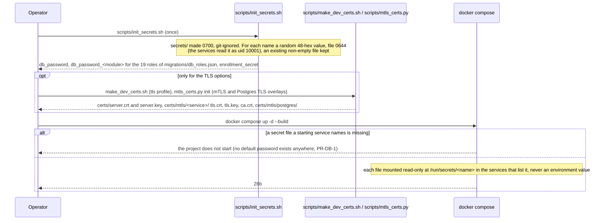
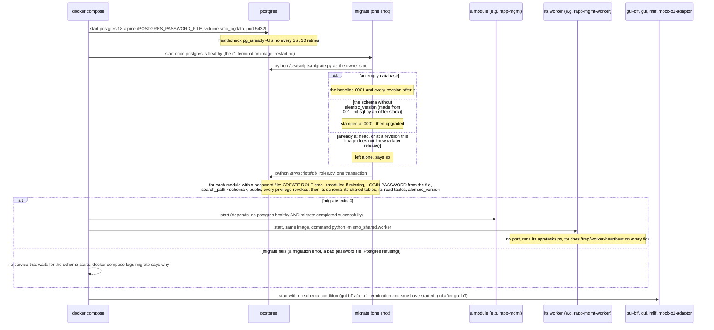
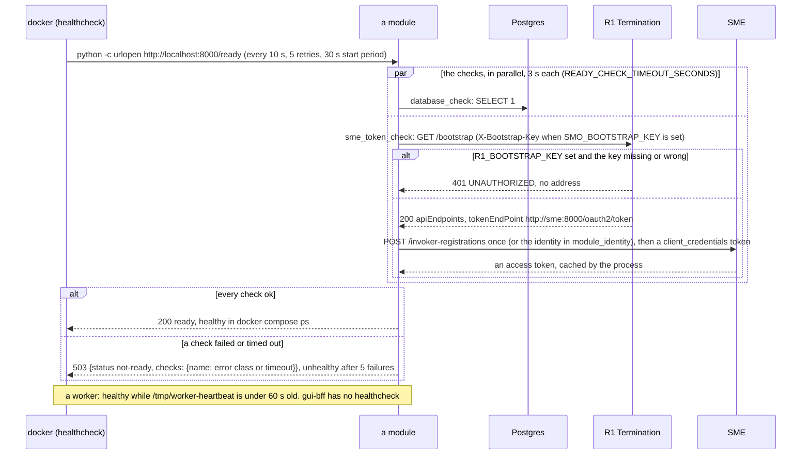
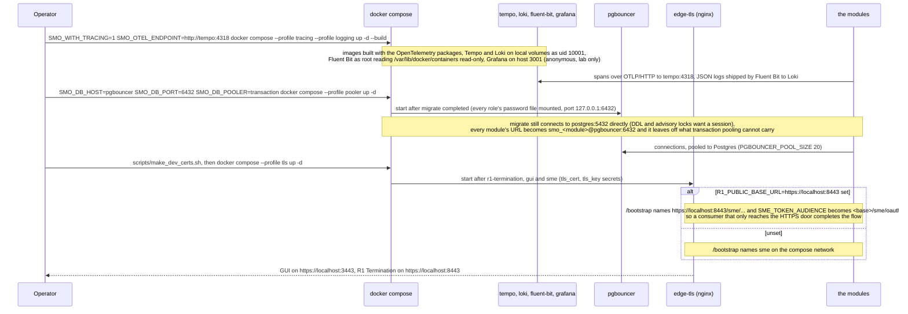
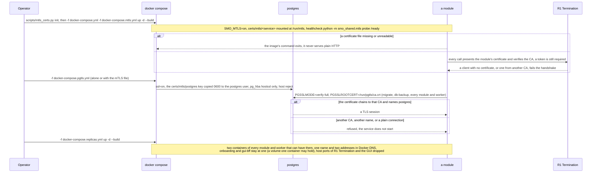

# Call Flow 28: Docker compose — start-up order, the `migrate` service, secrets, readiness, and the profiles and overlays

How the SMO comes up on one machine from `docker-compose.yml` (SMO Design v1.3 section 4; `HISTORY.md` PR-OPS-1.5, PR-SEC-4.3, PR-DB-2.6, PR-ST-7): the
secret files are made once, Postgres starts, the one-shot `migrate` service brings the schema to this release and makes the per-module roles, and only
then do the modules and their workers start, each answering `/ready` when its database and SME answer. The profiles (`tracing`, `logging`, `pooler`, `tls`,
`backup`) and the override files (`docker-compose.mtls.yml`, `docker-compose.pgtls.yml`, `docker-compose.replicas.yml`) change that picture in a few
places. Call flow 29 is the same stack on Kubernetes. Five diagrams:

| | Step | Who starts it | Ends with |
|---|---|---|---|
| 28a | Secrets and certificates before the first start | Operator | the files under `secrets/` (and, for the TLS options, `certs/`) that compose mounts, or a stack that refuses to start |
| 28b | Bringing the stack up | Operator (`docker compose up -d --build`) | Postgres healthy, the schema at head, the roles made, every module and worker started; or no module started |
| 28c | Readiness, and the bootstrap key | docker (healthchecks) | each service `healthy` or `unhealthy` in `docker compose ps`; with `R1_BOOTSTRAP_KEY` set, every caller presents it |
| 28d | The profiles: tracing, logging, pooler, tls | Operator (`--profile ...`) | Tempo, Loki, Fluent Bit and Grafana; every module through PgBouncer; an HTTPS door on 3443 and 8443 |
| 28e | The overlays: mutual TLS, Postgres TLS, two replicas | Operator (`-f docker-compose.<x>.yml`) | services that refuse a client without a certificate, a Postgres that refuses plain connections, two containers per module |

**As images:** [28a](images/28-docker-compose-deployment/28a-secrets-and-certificates-before-the-first-start.png) ·
[28b](images/28-docker-compose-deployment/28b-bringing-the-stack-up.png) ·
[28c](images/28-docker-compose-deployment/28c-readiness-and-the-bootstrap-key.png) ·
[28d](images/28-docker-compose-deployment/28d-the-profiles-tracing-logging-pooler-tls.png) ·
[28e](images/28-docker-compose-deployment/28e-the-overlays-mutual-tls-postgres-tls-two-replicas.png)
(PNG, drawn from the diagrams below by `scripts/render_call_flows.py`).

**How to read the diagrams.** As in call flow 01: an arrow is one call or one action with what matters in it, a box on the receiver says what it does, an
`alt` block is the outcome (success first, then each failure and what the operator sees). "docker compose" stands for the Compose engine acting on
`depends_on` conditions and healthchecks. Every service built from the shared `Dockerfile` runs as uid 10001 with no capability, `no-new-privileges` and a
read-only root filesystem (the `x-hardening` anchor), and gets 30 s (`stop_grace_period`) to finish, longer than uvicorn's own 20 s drain. Each path is
proven by a job of `.github/workflows/smo-tests.yml`, named under its diagram.

## 28a — Secrets and certificates before the first start

What each service is given is narrow: Postgres and `migrate` get the owner's `db_password` (`migrate` also every role's file, so it can set the roles);
each module gets only its own `db_password_<module>` (`SMO_DATABASE_PASSWORD_FILE`; `SMO_DATABASE_URL` names the role `smo_<module>` and carries no
password); every SMO module gets `enrollment_secret` (`SMO_ENROLLMENT_SECRET_FILE`, what makes it `internal` at SME, PR-SEC-14), and the four sample rApps
and their workers do not (`SMO_IDENTITY_KIND: rapp`). The GUI backend's secrets (`GUI_JWT_SECRET`, `GUI_ADMIN_PASSWORD`, ...) come from the shell or `.env`;
left empty, the JWT key is random per boot and an admin password is written to `/data/initial-admin-password` in its volume. `docs/SECRETS.md` is the
inventory and the rotation runbooks. Proven by `compose-e2e` ("docker-compose.yml is structurally valid" fails on a `POSTGRES_PASSWORD:` value or
`smo:smo@` in the rendered file; "Rotate the database password").

## 28b — Bringing the stack up

`migrate` is the only writer of the schema (PR-OPS-1.5, `docs/adr/0001-schema-migrations.md`): no module creates a table, and Postgres no longer runs
`001_init.sql` itself. Running it again is safe (`docker compose run --rm migrate` is how a rotated role password is set). The conditions are on start only:
a module whose process exits is not restarted, because no SMO service has a `restart` policy (only `pgbouncer`, `db-backup` and the observability
containers do). `mllf` and `mock-o1-adaptor` have no database; `gui-bff` keeps its users in SQLite on the `gui_bff_data` volume. Proven by `compose-e2e`:
"The migrate service ran and the database is at the migration head" (exit 0 and `alembic_version` equals the repository's head), "Every service up, R1
gate answers" (`scripts/compose_e2e.py`), "Every module with a role runs as it, and each role can use its schema and nothing else", then the runbook replay
(`tests_integration/test_demo_runbook.py`, DEMO_RUNBOOK.md §2–§27; its §0 is the three commands of 28a and 28b).

## 28c — Readiness, and the bootstrap key

Which checks a service runs: SME and FOCOM the database only; R1 Termination, the sample rApps and `mock-o1-adaptor` none (ready as soon as they answer);
MLLF the SME token only; every other module both. So a module is `healthy` only once R1 Termination and SME answer, although its `depends_on` names only
Postgres and `migrate`. Compose does not route by health: `/ready` is what `docker compose ps` and an operator read, and the gate the chart's readiness probe
uses (call flow 29b).

**The bootstrap key.** `R1_BOOTSTRAP_KEY` (PR-SEC-9.3) makes `GET /bootstrap` ask for `X-Bootstrap-Key`. Compose passes the same value as
`SMO_BOOTSTRAP_KEY` to every service that discovers through `/bootstrap`: every module and its worker (`dme`, `onboarding`, `mlmr`, `mdaf` and
`intent-service` and the `dme` and `mdaf` workers included since DOC-CF-3), the four sample rApps, and `gui-bff`, whose client
(`gui-bff/app/smo_client.py`) sends it when it discovers SME's token endpoint. SME and FOCOM do not discover through `/bootstrap` and need none. A service
given a wrong key gets 401, no token, and its `/ready` stays 503. With the key unset (the default) the header is not asked for. **Phase 1:** no CI job
starts the stack with the key set (open item `BOOTSTRAP-KEY-LANE`); `tests_integration/test_helm_bootstrap.py` checks that every service that mounts the enrollment secret (every SMO
caller of `/bootstrap`) and `gui-bff` are given it, in compose and in the chart.

## 28d — The profiles: tracing, logging, pooler, tls

Each profile is off by default and adds containers without changing the base services, except the variables the operator sets with it. The observability
files are the chart's own (`deploy/helm/smo/files/observability/`), so compose and Kubernetes run the same configuration. Under the pooler, PgBouncer
depends on `migrate` only, and the modules do not wait for it: a module that starts first fails `/ready` until PgBouncer answers. The `backup` profile
(`db-backup`, `scripts/dr_backup.sh --loop`) is call flow DOC-CF-3.5's. Proven by `obs-stack` (`scripts/obs_smoke.py`: a trace in Tempo, a log line in
Loki, Grafana's data sources), `compose-pooler` (every module's URL is the pooler's, `scripts/pooler_check.py`, the runbook replay through PgBouncer) and
`compose-e2e` ("TLS edge (profile tls, PR-SEC-1)" and "/bootstrap behind the TLS edge (PR-SEC-1.6)").

## 28e — The overlays: mutual TLS, Postgres TLS, two replicas

Not part of mutual TLS by design: `mock-o1-adaptor` (its emit routes answer 502 under the overlay, as RAN NF OAM wants a certificate), the GUI's nginx and
`gui-bff` (a client of R1 with a certificate), the observability containers, and the `tls` edge, which forwards plain HTTP and does not work with the
overlay. Through PgBouncer with Postgres TLS, set `SMO_DB_SSLMODE=disable` for the services (the pooler serves no TLS) and PgBouncer verifies Postgres
itself. **Phase 1:** the certificates are a development CA (`scripts/mtls_certs.py`, 90 days, the CA key on the same machine); a deployment brings its own
issuance. Proven by `compose-mtls` (`scripts/compose_mtls_check.py`, the runbook over mTLS, a renewal with three services recreated while the gateway
answers), `compose-pgtls` (`pg_stat_ssl`, `scripts/pg_tls_check.py`, `migrate` refused with another CA) and `compose-replicas` (two running containers per
service, the runbook replayed across them).

## Decisions this flow depends on

- **No password anywhere but a file** (PR-SEC-4.3, PR-DB-1): `scripts/init_secrets.sh` makes them, compose mounts them as secrets, the variables are the
  `*_FILE` forms; a missing file stops the stack rather than falling back to a default.
- **The schema is the `migrate` service's alone** (PR-OPS-1.5): Alembic, idempotent, run before any module; a failed migration leaves the stack down with
  the reason in `docker compose logs migrate`, never half migrated under running modules.
- **Each module connects as its own role** (PR-DB-2.6): `smo_<module>` with its own password file, made and re-granted by `scripts/db_roles.py` on every
  `migrate` run; the owner's password reaches only Postgres, `migrate` and `db-backup`.
- **Readiness is the dependencies, liveness is the process** (PR-ST-7): `/ready` checks the database and the SME token, `/live` nothing; a worker's health
  is its heartbeat file.
- **The enrollment secret marks an SMO module** (PR-SEC-14): every module and its worker mount it, an rApp never does.
- **Everything extra is opt in**: tracing, logging, the pooler, the TLS edge, mutual TLS, Postgres TLS and replicas are profiles or override files; the
  default stack does not change with them.
- **Not taken:** a `restart` policy on the SMO services, a `depends_on` on R1 Termination or SME for the modules, waiting on PgBouncer's health.
