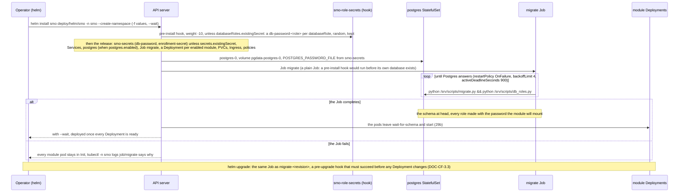
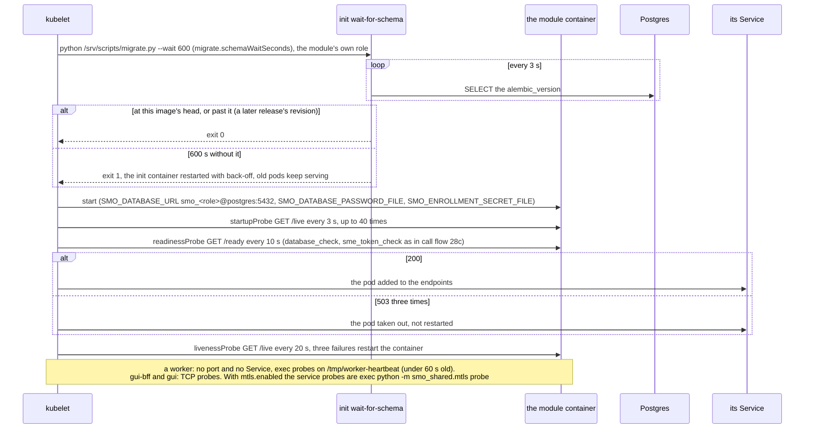
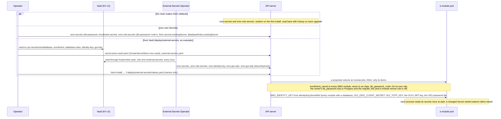
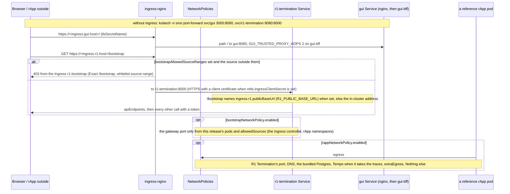
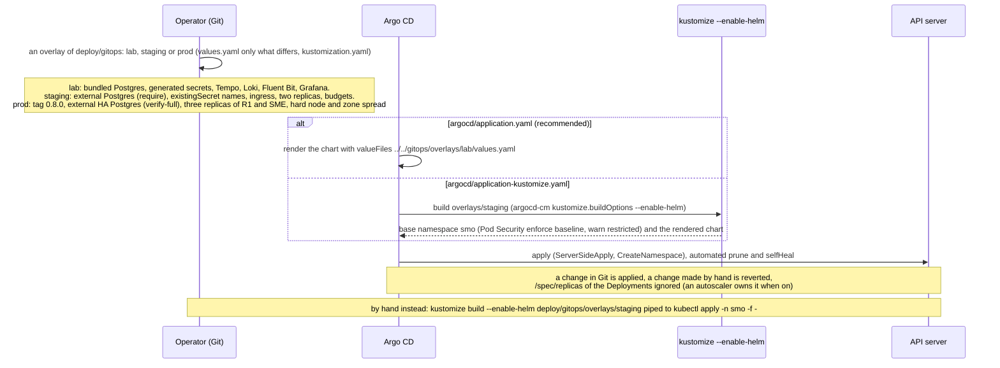

# Call Flow 29: Kubernetes with the Helm chart — install, readiness, secrets, exposure, and the GitOps overlays

How the SMO is installed on a cluster from `deploy/helm/smo` (chart 0.8.0, Kubernetes 1.27 or later; `HISTORY.md` PR-OPS-2, PR-OPS-3, PR-OPS-6,
PR-SEC-4.7): the chart's Secrets are made or named, the bundled Postgres starts, a migrate Job brings the schema to the release and makes the per-module
roles, and every module's pod waits in an init container until the schema is there before its probes take it into service. The same stack as
`docker-compose.yml` (call flow 28): `tests_integration/test_helm_chart.py` keeps each module's image, secrets and environment equal in both. Five diagrams:

| | Step | Who starts it | Ends with |
|---|---|---|---|
| 29a | Installing the chart | Operator (`helm install`), Argo CD | the Secrets, Postgres, the migrate Job and one Deployment per module applied; the release ready, or stuck in `Init` with the reason in the Job |
| 29b | A pod starts: the schema wait and the probes | the kubelet | a pod in its Service's endpoints, or held out of them, or restarted |
| 29c | Secrets: generated, your own, or from Vault | Operator, the chart, External Secrets | each pod with only the files it needs under `/run/secrets`; `bootstrapKeySecretRef` gives the gateway and every caller the bootstrap key |
| 29d | Reaching it: ingress and the NetworkPolicies | Operator (values), an rApp, a browser | the GUI and R1 Termination behind an ingress, `/bootstrap` limited by source, rApps limited to R1 |
| 29e | The GitOps overlays and Argo CD | Operator (Git), Argo CD | a cluster kept equal to an overlay of `deploy/gitops/` |

**As images:** [29a](images/29-kubernetes-helm-deployment/29a-installing-the-chart.png) ·
[29b](images/29-kubernetes-helm-deployment/29b-a-pod-starts-the-schema-wait-and-the-probes.png) ·
[29c](images/29-kubernetes-helm-deployment/29c-secrets-generated-your-own-or-from-vault.png) ·
[29d](images/29-kubernetes-helm-deployment/29d-reaching-it-ingress-and-the-networkpolicies.png) ·
[29e](images/29-kubernetes-helm-deployment/29e-the-gitops-overlays-and-argo-cd.png)
(PNG, drawn from the diagrams below by `scripts/render_call_flows.py`).

**How to read the diagrams.** As in call flow 01: an arrow is one call or one action with what matters in it, a box on the receiver says what it does, an
`alt` block is the outcome (success first, then each failure and what the operator sees). "API server" stands for Kubernetes and its controllers. The
chart wants a namespace of its own: its Services are named as in compose (`sme`, `dme`, `postgres`, ...), which is how the modules and the GUI's nginx
address each other, so one release per namespace. Every pod runs as uid 10001 (Postgres as 70) with no capability, no privilege escalation, a read-only
root filesystem and no service account token. Each path is proven by a job named under its diagram (`.github/workflows/smo-tests.yml` unless another
workflow is named).

## 29a — Installing the chart

The database is the bundled one-pod Postgres by default, for a lab or trial; `postgres.enabled=false` with `postgres.external.host` (a comma-separated
list with `targetSessionAttrs: read-write` finds the primary after a failover) points every URL at your own, and `migrate.py` and `db_roles.py` then need
an owner that may create roles. Images are `<image.registry>/<image.prefix><module>:<appVersion>`; Postgres and the observability images are pinned by
digest under their own keys, which is where a mirror goes (`deploy/mirror/images.txt` is the list CI pulls through its GHCR mirror, `docs/MIRROR.md`).
`helm uninstall` keeps the Postgres volume and `smo-role-secrets`: a reinstall on them finds the same passwords. Proven by `helm` ("helm install (the
migration Job runs, every pod waits for the schema, every pod becomes ready)", the database at the head revision, `scripts/compose_e2e.py` and
`compose_e2e_roles.py` run inside the cluster, "helm upgrade rolls every module with the old pods serving") and `postgres-ha` (a three-instance
CloudNativePG cluster behind `postgres.external`, a primary killed while writes go on).

## 29b — A pod starts: the schema wait and the probes

A module never serves on an older schema, and a failed migration shows as pods held in `Init` rather than as a half-working platform. Rolling updates add
one pod before removing one (`maxSurge: 1`, `maxUnavailable: 0`); `onboarding` and `gui-bff` hold a volume and use `Recreate`. A service pod sleeps 5 s
in `preStop` so the endpoint update wins the race with `SIGTERM`, inside a 30 s grace period. As in compose, `/ready` needs SME's token through R1
Termination, so a module is in its Service only once R1 Termination and SME answer. Placement spreads each module's pods over nodes (`placement.mode`
soft by default); disruption budgets and autoscalers are off and are made only for a module that runs, or may scale to, more than one pod. Proven by
`helm` (every pod `Running` or `Completed` after the upgrade, "Two replicas of every module that can have them"), `smo-ha-kind.yml` and
`smo-upgrade-kind.yml` (node drains and pod kills on three nodes, upgrade and rollback).

## 29c — Secrets: generated, your own, or from Vault

The password in `smo-secrets` is the one the Postgres role was created with: changing it in a Secret or in Vault does not change the role, which is the
rotation runbook of `docs/SECRETS.md`. **The bootstrap key.** `bootstrapKeySecretRef` (`name`, `key`
default `bootstrap-key`) names a Secret of your own: the chart passes it as `R1_BOOTSTRAP_KEY` to R1 Termination and as `SMO_BOOTSTRAP_KEY` to every
other module, worker and `gui-bff` (not to the static GUI), from the Secret (`secretKeyRef`), so the key is in neither the values nor the Deployments; unset,
nothing is passed and `/bootstrap` asks for no key. Rotating it is a change of the Secret and a rollout restart of every Deployment.
**Phase 1:** the External Secrets example has not been applied to a cluster or run against Vault. Proven by `helm` ("A pod of the rApps does not hold the
enrollment secret", "Every module with a role runs as it", the owner's password absent from each module pod, "rApp credentials reach a Secret") and
`tests_integration/test_external_secrets_example.py` (every name and key it makes is one the chart reads).

## 29d — Reaching it: ingress and the NetworkPolicies

Ingress is off by default and an Ingress is rendered only for a host that is set. A NetworkPolicy selects pods and ports, not paths, so the per-path
control for `/bootstrap` is the second Ingress (ingress-nginx annotations only) and the gateway's own key (29c); both policies need a CNI that enforces
them, and with none the objects are accepted and do nothing. With `mtls.enabled` every `service` module serves HTTPS and wants a certificate from the CA
(cert-manager Certificates with `mtls.certManager.enabled`, or a `<module>-mtls` Secret each); a pod whose Secret is missing stays in `ContainerCreating`.
`postgres.tls` is for a new install only: switched on in a running release, the pre-upgrade migrate Job meets a Postgres that still serves plain and the
upgrade stops. Proven by the render tests `tests_integration/test_helm_bootstrap.py`, `test_helm_rapp.py`, `test_mtls.py` and `test_pg_tls.py` (run with
`helm` in the `helm` job). **Phase 1:** no CI job runs an ingress controller or a CNI that enforces policies.

## 29e — The GitOps overlays and Argo CD

No overlay holds a secret: staging and prod name `smo-secrets` and `smo-role-secrets`, to be created before the first sync (29c), and every host and
address is a placeholder. Argo CD and Kustomize's `helmCharts` both render the chart with `helm template`, not `helm install`: there `lookup` finds no
live Secret (the chart's own comment in `templates/secrets.yaml` says so) and `.Release.IsInstall` is true, so the generated secrets of the lab overlay
are new random values at each render and the migrate Job is always the plain Job `migrate`, never the `pre-upgrade` hook that `application.yaml` and
`deploy/gitops/README.md` describe. **Phase 1:** a sync by Argo CD on a cluster has not been tried (`OPEN_ITEMS.md` OPS-6.2). Proven by
`tests_integration/test_gitops.py` (paths exist, every key an overlay sets exists in the chart's `values.yaml`, no key named like a credential) and the
`helm` job's step "GitOps overlays build, and the observability stack renders" (`kustomize build --enable-helm` of all three overlays).

## Decisions this flow depends on

- **One chart, the compose stack's modules** (PR-OPS-2.2): one template renders every module from `modules` and `moduleDefaults`; a test keeps the
  images, secrets and environment equal to `docker-compose.yml`.
- **The schema before the pods** (PR-OPS-3): a migrate Job (plain on install, `pre-upgrade` hook on upgrade) and a `wait-for-schema` init container in
  every pod with a database; the expand/contract rule lets old pods run on the new schema during a roll.
- **Secrets as files, made once and kept** (PR-SEC-4.3, PR-DB-2.6): `smo-secrets` and the hook `smo-role-secrets` are generated once and read back on
  every upgrade, or named (`existingSecret`) and never touched; a pod mounts only its own items.
- **Readiness is the dependencies** (PR-ST-7): `/ready` with the database and the SME token takes a pod in and out of its Service; `/live` restarts it.
- **Exposure is opt in**: ingress, the bootstrap Ingress, the gateway and rApp NetworkPolicies, mutual TLS and Postgres TLS are off until set.
- **Git as the source of truth** (PR-OPS-6): overlays of values over the chart, Argo CD with prune and self-heal, secrets out of band.
- **Not taken:** a pre-install hook for the migration (the bundled database would not exist yet), a sync-wave ordering for Argo CD, a way to mount an extra
  Secret into the module pods, a CronJob for the GUI audit purge, and a ServiceMonitor for the alert rules.
