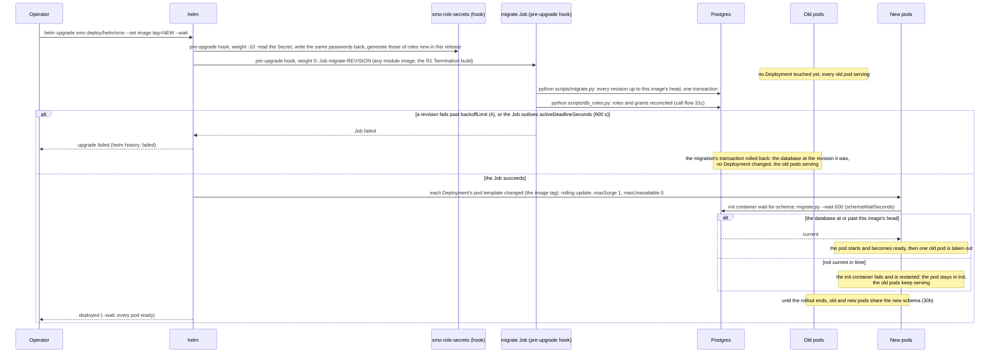
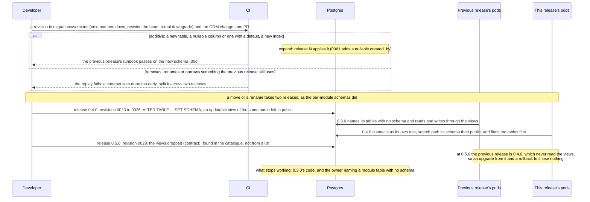
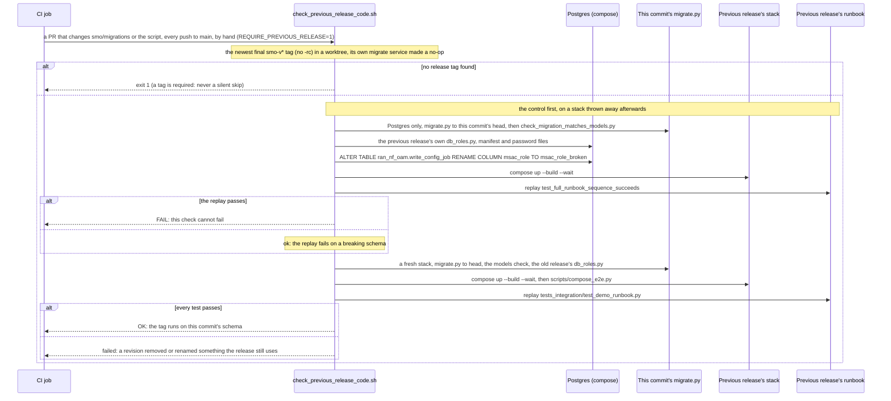
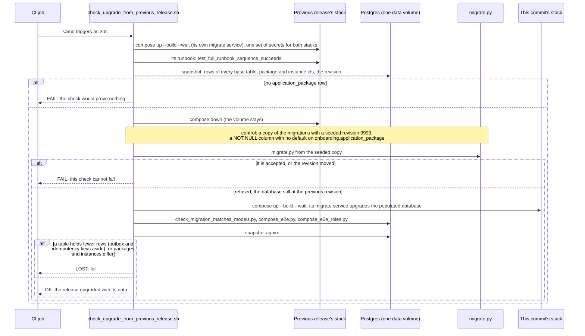
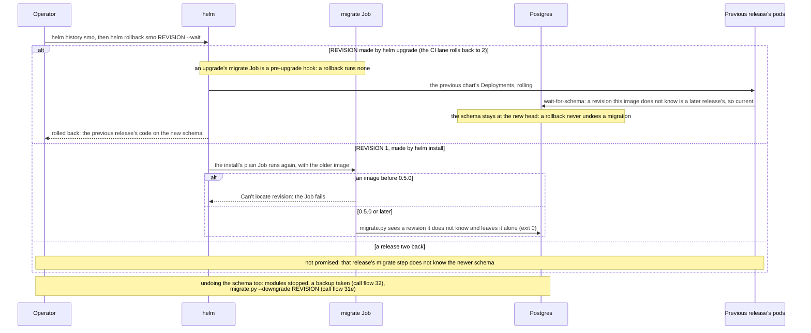

# Call Flow 30: Upgrade and rollback — a rolling upgrade, expand and contract, the previous release's code on the new schema, and going back

How the SMO moves from one release to the next while it keeps serving, and how it goes back (`OPEN_ITEMS.md` DOC-CF-3.3; `PR-OPS-3`, `PR-OPS-5`,
`PR-OPS-10.5`, `PR-V-10`, `PR-V-11`, `HISTORY.md` OPS-UPGRADE-LANE). Every module image, the shared library and the Alembic history are one release (`docs/RELEASES.md`), and the schema
is one history applied by one job, never by the services (`docs/adr/0001-schema-migrations.md`). Call flow 31 is the migration and the roles on their own,
call flow 32 the backup to take before an upgrade. Five diagrams:

| | Step | Who starts it | Ends with |
|---|---|---|---|
| 30a | A rolling upgrade with Helm | Operator (`helm upgrade`) | the schema at the new head, then every module rolled with the old pods serving; or the upgrade aborted with nothing touched |
| 30b | Expand, then contract | a developer writing a revision | an additive revision in release N, the removal in release N+1 (`0023` to `0025`, then `0029`) |
| 30c | The previous release's code on the new schema | CI job "Previous release's code runs on the new schema" | the newest release's runbook passing on this commit's head, and failing on a schema broken on purpose |
| 30d | An upgrade that keeps the data | CI job "Upgrade from the previous release keeps its data" | the previous release's rows upgraded by this commit's `migrate`; a revision that breaks on rows refused |
| 30e | Rolling back | Operator (`helm rollback`) | the previous release's code on the new schema; the schema itself undone only by hand (call flow 31e) |

**Until 1.0** the converged rewrite keeps nothing for 0.9.0 (`docs/RELEASES.md`, "Until 1.0: rewrite mode"): 30b does not apply, and the CI jobs of 30c and 30d and the
kind lane's job `upgrade` print a notice naming `scripts/rewrite_mode.json` and pass without running. Plan task S8.8 switches them back on at 1.0; this flow
describes them as they run from then.

**As images:** [30a](images/30-upgrade-and-rollback/30a-a-rolling-upgrade-with-helm.png) ·
[30b](images/30-upgrade-and-rollback/30b-expand-then-contract.png) ·
[30c](images/30-upgrade-and-rollback/30c-the-previous-release-s-code-on-the-new-schema.png) ·
[30d](images/30-upgrade-and-rollback/30d-an-upgrade-that-keeps-the-data.png) ·
[30e](images/30-upgrade-and-rollback/30e-rolling-back.png)
(PNG, drawn from the diagrams below by `scripts/render_call_flows.py`).

**How to read the diagrams.** As in call flow 01: an arrow is one call or command with the inputs that matter, a box says what the receiver does with
them, an `alt` block is the outcome (success first, then each failure and what the caller sees). "Old pods" are the release being replaced, "new pods" the
one being installed; during a rolling upgrade both run against one database at once, which is why every schema change must leave the old code working.
Docker compose does not roll: its `migrate` service runs first and every service waits for it (`service_completed_successfully`), so a compose upgrade
stops the old services and starts the new ones on the same volume, as `scripts/check_upgrade_from_previous_release.sh` does (30d).

## 30a — A rolling upgrade with Helm

The migrate Job is a hook only on upgrade. On `helm install` it is a plain Job named `migrate` (the bundled database is part of the same release, so a
pre-install hook would run before it exists) and the pods wait for it in `wait-for-schema` (`deploy/helm/smo/templates/migrate.yaml`). On Postgres
every lock the migration takes waits at most `SMO_MIGRATE_LOCK_TIMEOUT_MS` (5 s by default; MIGRATE-LOCK-HOLD): a revision that cannot get one fails,
the transaction rolls back and lets go of the locks the earlier revisions took on other modules' tables, and the Job tries again after a pause of 1 s
doubling to 10 s, up to `SMO_MIGRATE_LOCK_ATTEMPTS` (10) times. So a lock another session holds slows the running release's reads by a few seconds
at a time instead of stalling them until the Job's deadline. The role Secret
is a hook too, so an upgrade from a chart that had no roles finds it before the Job mounts it. Only pods whose template changes restart: the bundled
Postgres pod keeps the labels release 0.4.0 rendered, so an upgrade never restarts the database (`deploy/helm/smo/README.md`, "What restarts on
`helm upgrade`"). Onboarding and the GUI backend hold a volume and use `Recreate`, so they stop for a moment.

CI proves the failure branch: in "From smo-vX.Y.Z, upgrade then roll back" (`.github/workflows/smo-upgrade-kind.yml`, V-11; X.Y.Z is the newest
release) a transaction holds an exclusive lock on a table the newest revision alters, the Job runs with `backoffLimit=0` and `activeDeadlineSeconds=60`,
and the step checks that `helm upgrade` failed, every Deployment kept its generation, the database kept its revision and its columns, indexes and
constraints, and the old release's runbook passes; then the same upgrade runs to the end under a light load (`scripts/load_run.py`, judged by
`scripts/upgrade_load_verdict.py`). The lane reads both at run time with `scripts/upgrade_lane_targets.py`: the releases from the newest final `smo-v*`
tags, as `scripts/check_previous_release_code.sh` does, and the table from the revisions the upgrade runs (the newest revision's first table that the
database already has). The Helm lane in `smo-tests.yml` ("helm upgrade rolls every module with the old pods serving, and the database stays") does the
same upgrade without the lock. **Phase 1:** the kind lane runs nightly, by hand and on a pull request that changes its paths, and is not a required
check; it starts from the newest release (gated: at most 1 % errors on the routes that stay up and two on any one of them, the package list, which rolls
with Recreate, at most 25 % of its own calls) and from the one before it (report only).

## 30b — Expand, then contract

The rule is in `smo/CLAUDE.md`, "Schema changes are revisions", and in `docs/RELEASES.md`: a revision is additive when the previous release's code runs
on the new schema, and that is a MINOR bump; anything else is a MAJOR bump or an expand/contract split over two MINOR releases (`PR-OPS-5`). Revisions
are written by hand, never autogenerated (ADR 0001, decision 4), and `001_init.sql` and released revisions are never edited.

`0029` is the first contract revision (`migrations/README.md`). Its downgrade makes the views again. The retired A1 tables that `0029` left for 0.4.0's
`a1-related` module were to go "in the revision after this release" (`CHANGELOG.md`, 0.5.0) and are still in the schema at head `0061`.

## 30c — The previous release's code on the new schema

The previous release's `migrate` service is replaced because it does not know the newer revisions; its own `db_roles.py` still makes the roles its
modules log in as, which is what an old pod in the middle of a rolling upgrade has. On a pull request that does not touch the schema the job passes
without running.

## 30d — An upgrade that keeps the data

This is the operator's side of 30c: a revision that works on an empty schema but not on rows fails here, not in production. Not done: the old runbook
is not replayed a second time, and the data check counts rows and compares ids, not every column. The `migration-postgres` job runs the lighter version
on every pull request (the previous commit's schema upgraded to this one, call flow 31d), and the volume lane (`.github/workflows/smo-db-volume.yml`)
times the upgrade from the newest tag's revision over a loaded database (`scripts/upgrade_at_volume.py`, budget 300 s).

## 30e — Rolling back

"From smo-vX.Y.Z, upgrade then roll back" (the newest release) proves the first branch: it installs that release, upgrades it once with the same release
again (so the history has revision 2), upgrades to the checkout, rolls back to 2, and checks that the image is the release's, every pod is ready, the
runbook passes and the audit chain verifies. The lane of the release before it upgrades only: rolling back to it is not supported. `smo-role-secrets` keeps the password of a role the newer release removed
(`a1-related`), because the older chart still mounts it.

## Decisions this flow depends on

- **One job migrates, the services never do** (ADR 0001, decision 6): N replicas must not race to alter the schema. On Helm it is the pre-upgrade hook,
  so a failed migration aborts the upgrade before any pod changes.
- **A pod never starts on an older schema** (`PR-OPS-3.2`): `wait-for-schema` blocks until the database is at or past its image's head; past it is
  allowed, because the previous release must run on the next one's schema.
- **Expand, then contract** (`smo/CLAUDE.md`, `PR-OPS-5`): within a MINOR release a revision is additive; a removal waits a release, and CI proves the
  previous release's code still runs (30c) and its data survives (30d).
- **A rollback changes code, not the schema**: `helm rollback` leaves the schema at the new head; a downgrade is a separate, stopped, backed-up step.
- **The rollback is promised to the release before only**; an upgrade is supported from the two releases before (`docs/RELEASES.md`, criterion 1).
- **Not taken:** migrations at service start-up, blue/green databases, an automatic schema downgrade on `helm rollback`, and per-module migration
  histories (ADR 0001, decision 2).
