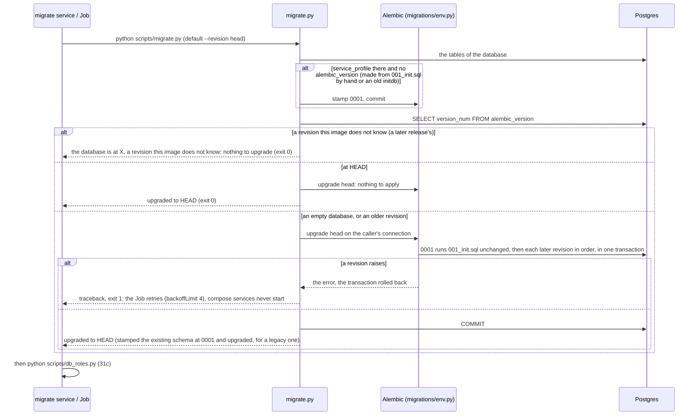
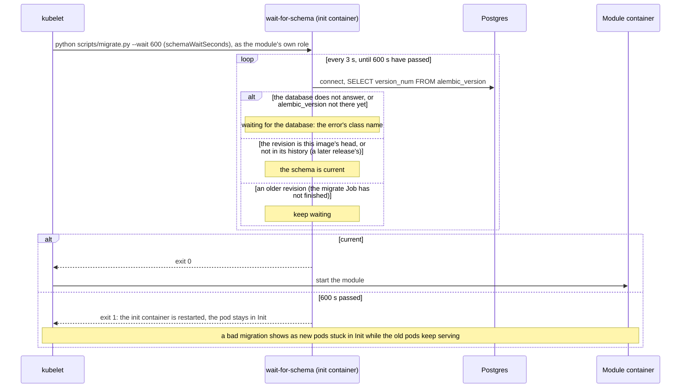
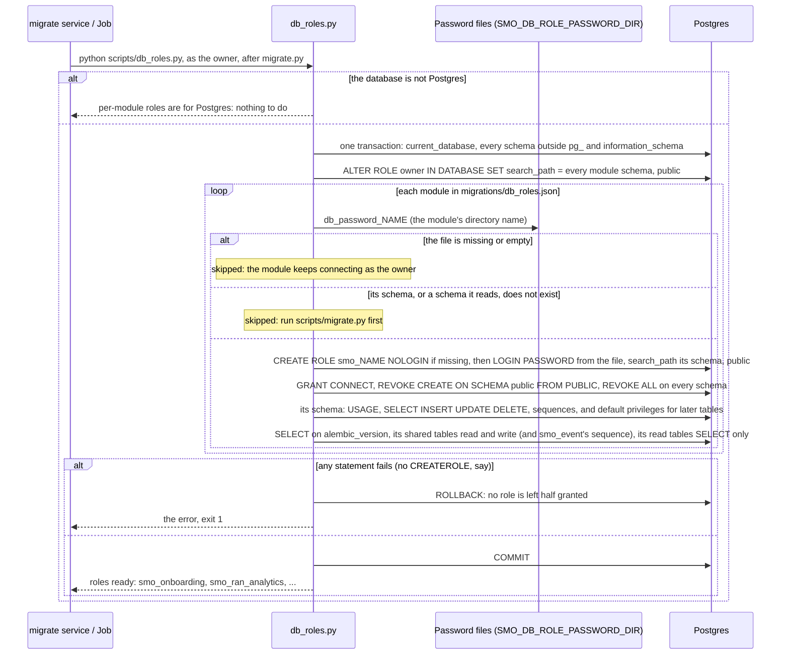
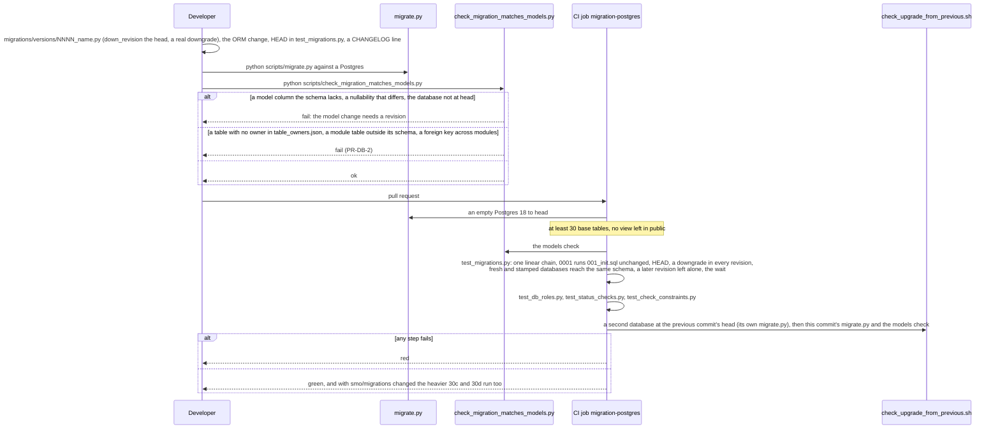
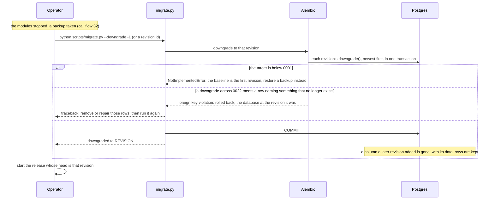

# Call Flow 31: Schema migration on its own — Alembic to head, the wait for the schema, roles and grants, proving a revision, undoing one

What `scripts/migrate.py` and `scripts/db_roles.py` do to the database, whoever runs them (`OPEN_ITEMS.md` DOC-CF-3.4; `PR-OPS-1`, `PR-OPS-3.2`,
`PR-DB-2.6`, `PR-V-17`). The schema of every module is one Alembic history in `migrations/` (`docs/adr/0001-schema-migrations.md`): revisions written
by hand, a baseline `0001` that runs `migrations/001_init.sql` unchanged, no autogenerate. Compose's one-shot `migrate` service and the chart's migrate
Job run the same command, `python /srv/scripts/migrate.py && python /srv/scripts/db_roles.py`. Call flow 30 puts this inside an upgrade. Five diagrams:

| | Step | Who starts it | Ends with |
|---|---|---|---|
| 31a | Bringing the database to head | compose `migrate`, the Helm migrate Job, an operator | the database at this image's head, stamped first if it was made from `001_init.sql`; or left alone when it is newer |
| 31b | Waiting for the schema | every module pod's `wait-for-schema` init container | the module started on a schema at or past its head, or the pod held in Init |
| 31c | Roles and grants | the same `migrate` service or Job, after 31a | one login role per module with a password file, granted its schema and the shared tables it is listed for, and nothing else |
| 31d | Writing and proving a revision | a developer; the CI job `migration-postgres` | a revision, its model, its tests and the upgrade from the previous commit, all green |
| 31e | Undoing a revision | Operator, in a maintenance window | the database at an earlier revision, or refused whole and left where it was |

**As images:** [31a](images/31-schema-migration/31a-bringing-the-database-to-head.png) ·
[31b](images/31-schema-migration/31b-waiting-for-the-schema.png) ·
[31c](images/31-schema-migration/31c-roles-and-grants.png) ·
[31d](images/31-schema-migration/31d-writing-and-proving-a-revision.png) ·
[31e](images/31-schema-migration/31e-undoing-a-revision.png)
(PNG, drawn from the diagrams below by `scripts/render_call_flows.py`).

**How to read the diagrams.** As in call flow 01: an arrow is one call or command with the inputs that matter, a box says what the receiver does with
them, an `alt` block is the outcome (success first, then each failure and what the caller sees). Both scripts take the database from `SMO_DATABASE_URL`
(or its `*_FILE` forms) and run as the owner (`smo`); compose's `migrate` always connects to Postgres directly, never through PgBouncer, because DDL wants
a session. "HEAD" is the newest revision of the image running the script (`0061` today; `tests_integration/test_migrations.py` holds it).

## 31a — Bringing the database to head

Running it twice is a no-op and never stamps again (`test_migrating_twice_is_a_no_op_and_never_restamps`). The later-revision branch exists for the
rollback of call flow 30e: a `helm rollback` to the install's revision re-runs that release's plain Job against the newer schema, and before 0.5.0 that
ended in "Can't locate revision". Other options: `--revision R` stops at R, `--current` prints the revision, `--downgrade` is 31e, `--wait` is 31b.

**Phase 1:** `migrate.py` takes no lock of its own: one migration at a time comes from running it in one Job (a Helm hook) or one compose service,
never in the services (ADR 0001, decision 6). On compose a failed `migrate` shows as services that do not start; `docker compose logs migrate` says why.

## 31b — Waiting for the schema

The role can read `alembic_version` because `db_roles.py` grants it SELECT on that table and nothing more in `public` unless listed (31c). Compose
has no init container: `depends_on: migrate: service_completed_successfully` does the same job before any service starts.

## 31c — Roles and grants

Every privilege is revoked and granted again on each run, so a table a later revision adds is covered at once and a shared table taken out of the
manifest is taken away. That is why an upgrade whose `CHANGELOG.md` entry says "re-run `scripts/db_roles.py`" (a worker newly needing `periodic_run`,
a module newly writing `smo_event`) needs nothing more than the `migrate` service or Job. The one cross-module read is explicit: R1 Termination (a role,
no schema) gets SELECT on `ran_nf_oam.rapp_kill`. The owner's own search path lists the module schemas, which keeps a release with
`databaseRoles.enabled=false` working since `0029` dropped the views in `public`.

The password file is the only place a password is kept: rotating one is writing a new file and running the script again, then restarting the module
(`docs/SECRETS.md`). On Helm the files come from `smo-role-secrets` (a pre-install and pre-upgrade hook, weight -10). **Phase 1:** the owner must have
`CREATEROLE`; a managed Postgres admin often has not, and then the roles are made by hand from the SQL in the script. The grants are only as right
as the manifest: 0.8.0 shipped without `periodic_run` and `smo_event` for `smo_mdaf` (`CHANGELOG.md`, known issue, with the GRANT to run by hand).

## 31d — Writing and proving a revision

The models check covers presence and nullability only, the two bug classes found by hand before it existed, not column types. The previous-commit
upgrade catches a revision that works only on a fresh database (a column the previous schema already has, a constraint old rows break); the one with real
rows from the previous release is call flow 30d. The step-by-step rule is `smo/CLAUDE.md`, "Schema changes are revisions".

## 31e — Undoing a revision

`helm rollback` never does this (call flow 30e). CI walks the whole chain down and back up over a loaded database, one revision at a time, and fails
when a step fails or a table loses rows: `scripts/downgrade_with_data.py`, step "The whole chain down and up again over the data (V-17)" of
`.github/workflows/smo-db-volume.yml`. `test_migrations.py` also proves that `0022`'s downgrade refuses an orphan row and leaves the database where it was.

## Decisions this flow depends on

- **Alembic, one history for the whole schema** (ADR 0001, decisions 1 and 2): one ordered sequence applied once by one job; module ownership shows in
  the file name and the schema.
- **The baseline is `001_init.sql`, unchanged** (decision 3): a database made from the file is stamped at `0001`, never re-created.
- **No autogenerate** (decision 4): the revisions are the schema; `check_migration_matches_models.py` is the safety net.
- **A newer schema is not an error**: `migrate.py` leaves it alone and `--wait` takes it as current, so the previous release runs on it (call flow 30).
- **Roles are reconciled, not migrated** (`PR-DB-2.6`): `db_roles.py` is idempotent, runs after every migration, and a module without a password file
  keeps connecting as the owner.
- **Not taken:** migrations at service start-up, per-module migration histories, and a downgrade of the baseline (a restore does that job).
