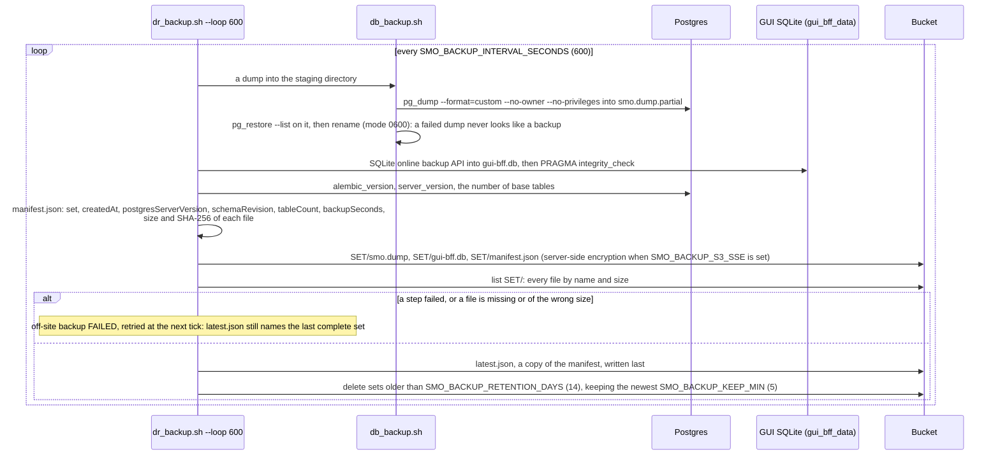
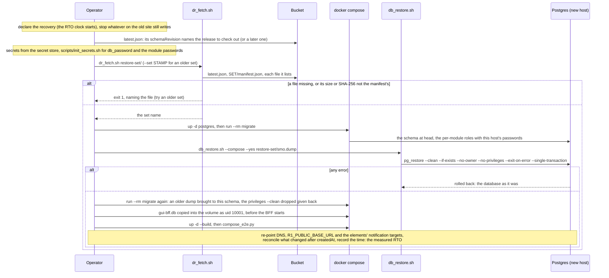
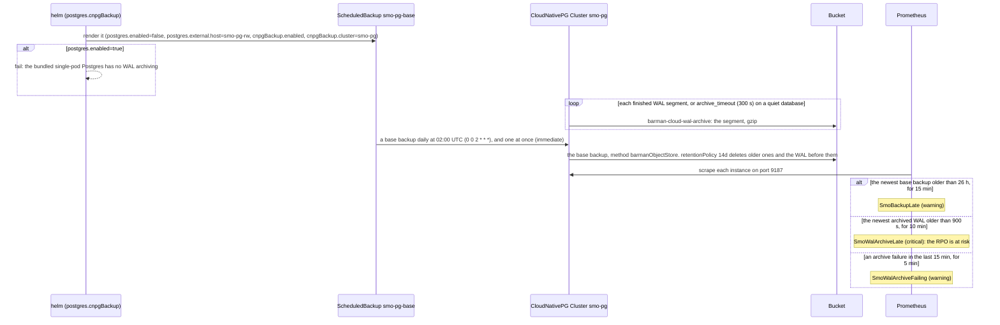
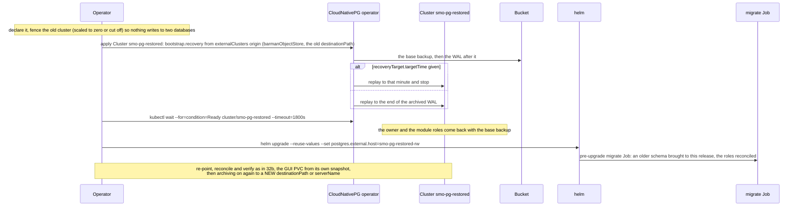
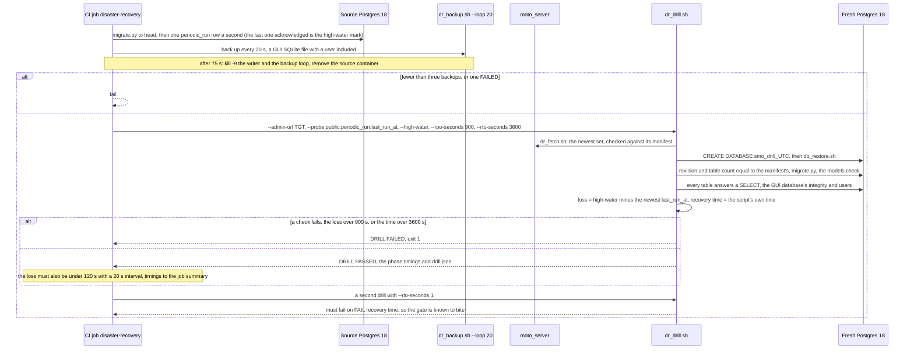
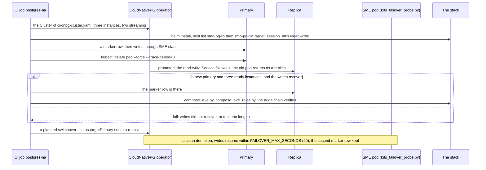

# Call Flow 32: Backup, restore and disaster recovery — the off-site copy, the restore, WAL archiving and recovery to a minute, the drill, a primary failover

How the SMO's data survives the loss of the site that runs it, how much is lost and how long recovery takes (`OPEN_ITEMS.md` DOC-CF-3.5; `PR-HA-6`,
`PR-DB-6`, `PR-DB-7`, `PR-HA-3`). The targets are **RPO 15 minutes** and **RTO 1 hour** (`docs/DISASTER_RECOVERY.md`, which holds the full runbook and
the drill log). Two mechanisms, chosen by where Postgres runs: a scheduled `pg_dump` shipped to an S3-compatible bucket (compose, a host, any Postgres),
and continuous WAL archiving with CloudNativePG (Kubernetes). Replication is not a backup (`docs/adr/0003-postgres-ha.md`): 32f is there to show the
difference. Six diagrams:

| | Step | Who starts it | Ends with |
|---|---|---|---|
| 32a | An off-site backup every ten minutes | the compose `db-backup` service, or cron on a host | a checked set and `latest.json` in the bucket, older sets pruned; or `latest.json` left on the last good set |
| 32b | Restoring on compose or a host | Operator (the runbook, mechanism A) | the newest set restored, migrated to this release and its roles, the stack answering |
| 32c | WAL archiving and base backups on CloudNativePG | the Cluster's `barmanObjectStore`, the chart's `ScheduledBackup` | every WAL segment and a daily base backup in the bucket, three alerts watching them |
| 32d | Recovering a new cluster to a chosen minute | Operator (the runbook, mechanism B) | a new cluster at the minute asked for, the chart pointed at it |
| 32e | The drill | CI job "Off-site backup, kill, restore into a fresh Postgres - RPO 15 min, RTO 1 h", or an operator | `DRILL PASSED` with the measured loss and recovery time, or `DRILL FAILED` |
| 32f | A primary failover | CI job "Postgres HA (CloudNativePG, three instances) and a primary failover" | a replica promoted, writes going on, nothing committed lost |

**As images:** [32a](images/32-backup-restore-and-disaster-recovery/32a-an-off-site-backup-every-ten-minutes.png) ·
[32b](images/32-backup-restore-and-disaster-recovery/32b-restoring-on-compose-or-a-host.png) ·
[32c](images/32-backup-restore-and-disaster-recovery/32c-wal-archiving-and-base-backups-on-cloudnativepg.png) ·
[32d](images/32-backup-restore-and-disaster-recovery/32d-recovering-a-new-cluster-to-a-chosen-minute.png) ·
[32e](images/32-backup-restore-and-disaster-recovery/32e-the-drill.png) ·
[32f](images/32-backup-restore-and-disaster-recovery/32f-a-primary-failover.png)
(PNG, drawn from the diagrams below by `scripts/render_call_flows.py`).

**How to read the diagrams.** As in call flow 01: an arrow is one call or command with the inputs that matter, a box says what the receiver does with
them, an `alt` block is the outcome (success first, then each failure and what the caller sees). "The bucket" is any S3-compatible store reached with the
AWS CLI (`scripts/dr_s3.sh`: `SMO_BACKUP_S3_BUCKET`, `SMO_BACKUP_S3_PREFIX`, `SMO_BACKUP_S3_ENDPOINT`, `SMO_BACKUP_S3_SSE`). A set is
`PREFIX/<UTC stamp>/{smo.dump, gui-bff.db, manifest.json}`; `PREFIX/latest.json` is a copy of the newest complete set's manifest. Secrets are never in a
backup: they come from the operator's secret store, and `SMO_IDENTITY_KEY` must be kept apart from the dump or the restored module identities cannot be read.

## 32a — An off-site backup every ten minutes

The worst-case loss is the interval plus `backupSeconds` plus the upload: 600 s leaves 300 s inside the 15 minutes. Two failed runs in a row breach the
RPO and nothing alerts on it yet: watch `docker compose logs db-backup`. The image (`backup/Dockerfile`) is Postgres 18's plus the AWS CLI, so `pg_dump`
is never older than the server; the script is mounted, not copied. **Phase 1:** the chart has no backup CronJob (the backup image is published with each release as `smo-backup`, without the script),
so the bundled single-pod Postgres or a non-CloudNativePG external one on Kubernetes is backed up by running `dr_backup.sh` from a host or a job of the
operator's; the GUI's SQLite on a PVC is not copied on Kubernetes at all. Onboarded packages (`smo_packages`) are not in Postgres and not in the set.

## 32b — Restoring on compose or a host

A dump carries no roles (they are cluster-wide) and, with `--no-owner --no-privileges`, no grants: `migrate` makes both (call flow 31c), which is why it
runs before and after the restore. Newer code upgrades an older dump; older code cannot read a newer schema. What happened between the set's `createdAt`
and the disaster is gone: an rApp instance created then is unknown, a CM job may have changed the network without a record (compare the network with the
SMO), outbox notifications may be sent twice or lost.

## 32c — WAL archiving and base backups on CloudNativePG

The loss is about `archive_timeout` plus the upload, whatever the database's size, and recovery can stop at any minute (32d). The chart makes neither the
operator nor the Cluster (ADR 0003: the operator is cluster-scoped, a prerequisite like the ingress controller): copy
`deploy/helm/smo/ci/cnpg-cluster-backup.yaml`, which also gives the owner `CREATEROLE` for `db_roles.py`. The three runbooks are in `docs/runbooks/`.
**Phase 1:** proved on `moto_server`, a stand-in for S3, on one instance, at the pinned operator 1.25.1; MinIO or AWS S3 have not been used.

## 32d — Recovering a new cluster to a chosen minute

CloudNativePG refuses to archive into a path that already holds another timeline's WAL, hence the new path. CI job "CloudNativePG archives the WAL, and
a new cluster recovers to a chosen minute" (`cnpg-wal-archive`, `.github/workflows/smo-dr.yml`, weekly and on a change to the example) runs exactly this:
100 rows, a base backup, 50 rows, the minute noted, 25 rows, `pg_switch_wal()`; the new cluster must hold 100, 50 and 0 and be ready inside an hour. It
also reads the three metrics the alerts of 32c use from a real instance.

## 32e — The drill

`dr_drill.sh` times fetch, restore, schema checks and smoke; the runbook budgets the rest (15 minutes to decide and provision, 30 to fetch and restore,
15 to re-point and verify). By hand it runs against any scratch Postgres, never production. **Phase 1:** the CI drill proves the mechanism and the gates at small size on moto; `docs/RELEASES.md` criterion 4 needs a full drill from
an off-site copy at a representative size on a spare host, and that row of the drill log is still open.

## 32f — A primary failover

A failover keeps the database when a node is lost, and copies a bad `DELETE` as faithfully as a good write: only 32a to 32d bring back data that is gone.
The driver takes several hosts and `target_session_attrs=read-write` (ADR 0003, decision 4); the lane lists the read-only Service first so the driver
must skip it. Compose stays single-node.

## Decisions this flow depends on

- **RPO 15 minutes, RTO 1 hour** (`docs/DISASTER_RECOVERY.md`, decided October 2026); a target counts as met only from a drill at the real size.
- **Two mechanisms by where Postgres runs**: a verified dump shipped every 600 s on compose or a host, continuous WAL archiving on CloudNativePG;
  compose does not archive WAL (it would need a shipper, a base backup cycle and a recovery procedure of its own).
- **A set is complete before it is named**: checked by name and size after the upload, `latest.json` written last, every file checked by SHA-256 on fetch.
- **Restore into a fresh database, then migrate**: one transaction, roles and grants made again by `migrate`, an older dump upgraded by the newer code.
- **Secrets stay out of the backup**, `SMO_IDENTITY_KEY` included; the bucket is private, encrypted server-side, and locked against a compromised host.
- **Replication is not a backup** (ADR 0003): HA through an operator or a managed service behind `postgres.external.*`, tested with CloudNativePG.
- **Not taken:** the operator or its Cluster in the chart (ADR 0003). **Not covered yet** (`docs/DISASTER_RECOVERY.md`, section 2): point-in-time
  recovery on compose, a backup CronJob in the chart, client-side encryption, a second bucket in another region (geo-redundancy is `HA-7`, after 1.0.0).
