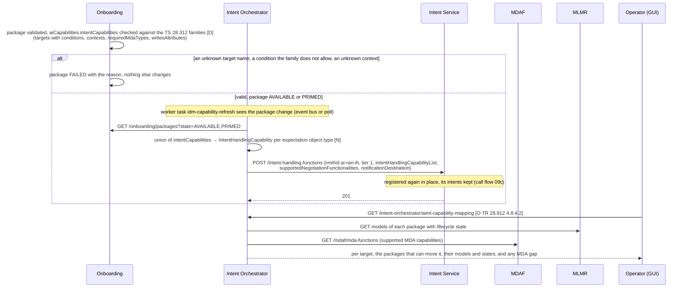
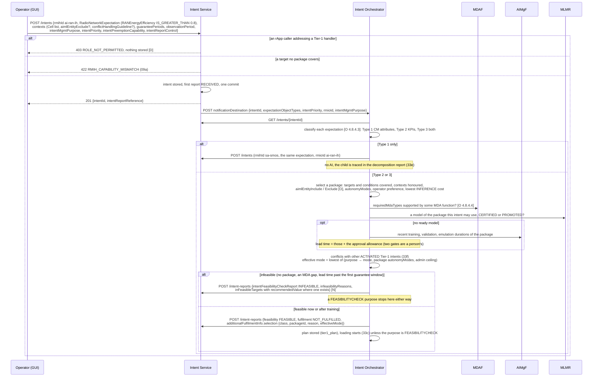
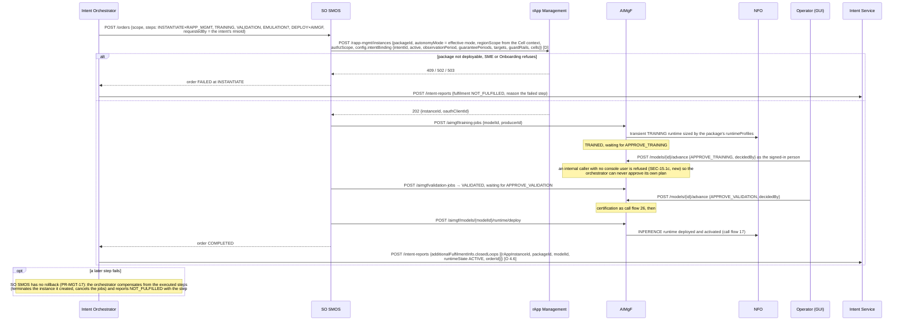
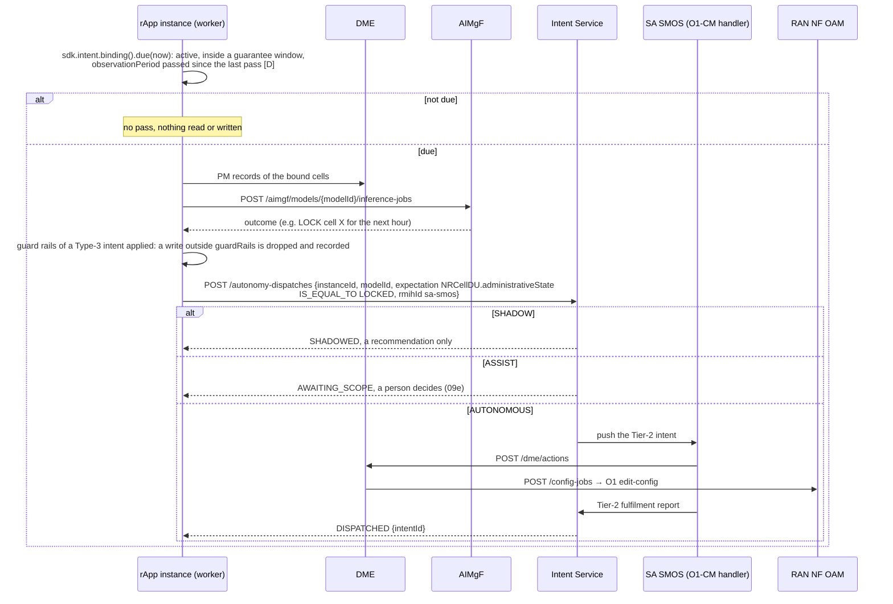
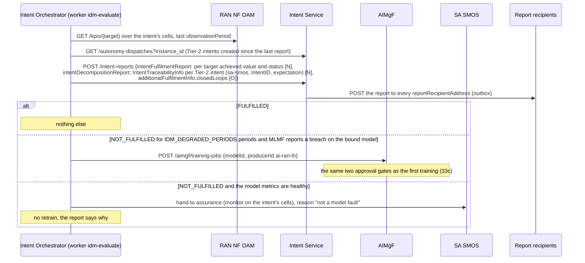
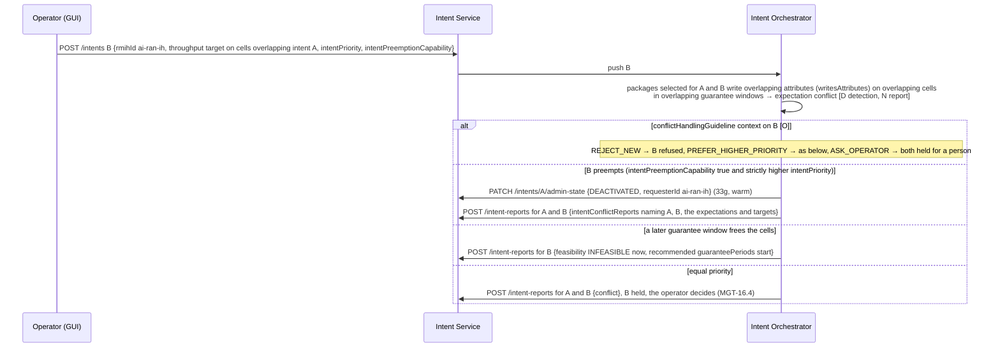
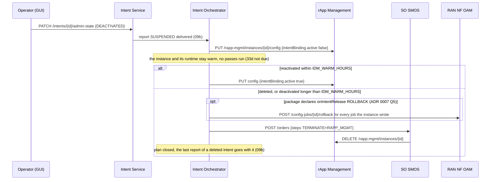

# Call Flow 33: Intent-driven AI-RAN — a Tier-1 intent chooses, loads, runs and reports on the AI closed loop

> **Proposed, not built** ([ADR 0007](../adr/0007-intent-driven-ai-ran-tier-1-intent.md), October 2026). Every participant named **Intent Orchestrator**,
> every route under `/intent-orchestrator`, the SO SMOS steps `INSTANTIATE` / `TERMINATE` × `RAPP_MGMT`, the manifest key `intentCapabilities` and the
> instance configuration key `intentBinding` are design, not code. The other participants and routes exist today and behave as their call flows say.

How an operator's declared outcome (a TS 28.312 `Intent` with `RadioNetworkExpectation` KPI targets) decides **what** runs (which rApp package and
model, or no AI at all), **when** (instance creation, training, deployment, inference passes, removal), **how far** (SHADOW, ASSIST or AUTONOMOUS)
and what is **reported** (fulfilment, traceability, conflicts, closed loops). The **Intent Orchestrator** is a Tier-1 intent handling function (RMIH
`ai-ran-ih`); it plans and decides. **SO SMOS** executes the plan as an order. **Intent Service** stores both tiers and delivers every report. The
existing Tier-2 path of call flows 09d and 22b (rApp → autonomy dispatch → intent → SA SMOS O1-CM handler → DME) is unchanged and runs underneath.

Tags as in ADR 0007: **[N]** TS 28.312, **[O]** TR 28.912 study recommendation, **[D]** this project's design.

Seven diagrams:

| | Step | Who starts it | Ends with |
|---|---|---|---|
| 33a | Capabilities: packages declare, the orchestrator registers | Onboarding (a package becomes AVAILABLE) | `ai-ran-ih` registered with the union of what packages can move; a capability mapping report readable |
| 33b | Creating a Tier-1 intent: classify, select, check | Operator (GUI) | a plan with a class, a package and an effective autonomy mode, and a feasibility report, or the intent refused |
| 33c | Loading: the plan becomes an order | the Intent Orchestrator | an rApp instance bound to the intent, its model trained, approved twice by a person, deployed and active |
| 33d | Running: passes inside the guarantee windows | the rApp's worker, reading its binding | Tier-2 intents enacted (or waiting, or shadowed), each traced to its Tier-1 parent |
| 33e | Assurance: fulfilment per observation period, retrain on both signals | the orchestrator's worker | a fulfilment report with achieved values, and a retrain only when the KPI and the model both say so |
| 33f | Conflict between two Tier-1 intents | a second intent, or a re-plan | the conflict reported on both, resolved by guideline, priority and preemption, a later window or refusal |
| 33g | Deactivate, delete, unload | Operator (GUI) | passes stopped (warm), or the instance terminated after the warm period |

**As images:** [33a](images/33-intent-driven-ai-ran-tier-1/33a-capabilities-packages-declare-the-orchestrator-registers.png) ·
[33b](images/33-intent-driven-ai-ran-tier-1/33b-creating-a-tier-1-intent-classify-select-check.png) ·
[33c](images/33-intent-driven-ai-ran-tier-1/33c-loading-the-plan-becomes-an-order.png) ·
[33d](images/33-intent-driven-ai-ran-tier-1/33d-running-passes-inside-the-guarantee-windows.png) ·
[33e](images/33-intent-driven-ai-ran-tier-1/33e-assurance-fulfilment-per-observation-period-retrain-on-b.png) ·
[33f](images/33-intent-driven-ai-ran-tier-1/33f-conflict-between-two-tier-1-intents.png) ·
[33g](images/33-intent-driven-ai-ran-tier-1/33g-deactivate-delete-unload.png)
(PNG, drawn from the diagrams below by `scripts/render_call_flows.py`).

**How to read the diagrams.** As in call flow 01: an arrow is one call with the inputs that matter, a box on the receiver says what it does with
them, an `alt` block is the outcome (success first, then each failure and what the caller gets). Every module reaches another through R1 Termination
(`R1Client`), which stamps the caller's role and invoker id. The orchestrator is an `internal` caller. An rApp may never address `ai-ran-ih`.

## 33a — Capabilities: packages declare, the orchestrator registers

The capability the orchestrator declares is only what some onboarded package can do, so Intent Service's own capability check (call flow 09a, 422
`RMIH_CAPABILITY_MISMATCH`) refuses a fulfilment intent no package could serve before the orchestrator sees it.

## 33b — Creating a Tier-1 intent: classify, select, check

| `intentMgmtPurpose` [N] | Derived mode [D] | After 33b |
|---|---|---|
| `FEASIBILITYCHECK` | none | report only, no loop |
| `FEASIBILITYCHECK_WITH_RECOMMENDATIONS`, `EXPLORATION` | SHADOW | loop runs, outcomes recorded as recommendations |
| `FULFILMENT_WITH_NEGOTIATION` | ASSIST | loop runs, each outcome waits for a person (09e) |
| `FULFILMENT_WITHOUT_NEGOTIATION` | AUTONOMOUS | loop runs, outcomes enacted within the region scope |

The effective mode is never above the package's declared `autonomyModes` or the admin's ceiling for that package and region (default SHADOW).

## 33c — Loading: the plan becomes an order

A ready model (33b) skips the training, validation and certification steps. Approval waits have no timeout of the orchestrator's own: the
lead-time estimate in 33b already counted them, and a feasibility report is re-published if the first guarantee window is missed.

## 33d — Running: passes inside the guarantee windows

The wake and the operator override of an energy-saving cell (call flow 22d) still go straight to DME, as a safety path that never waits on planning. 33e
counts their writes in the fulfilment of the Tier-1 intent.

## 33e — Assurance: fulfilment per observation period, retrain on both signals

Bound models are not members of an auto-retrain coordination group (ADR 0007 Q7), so an MLMF breach alone does not retrain them.

## 33f — Conflict between two Tier-1 intents

A preempted intent is deactivated and reported, never deleted, so its owner can reactivate it when the other ends.

## 33g — Deactivate, delete, unload

## Decisions this flow depends on

- **Two tiers** (ADR 0007, 3a): the Tier-1 handler decides; the Tier-2 path of call flows 09 and 22 enacts, unchanged. Each Tier-2 intent is traced to
  its Tier-1 parent with `IntentTraceabilityInfo` [N].
- **The orchestrator is SMO framework infrastructure, not an rApp** (ADR 0007, 4.1): an rApp registers no handler and may not address one of Tier 1,
  because a Tier-1 intent starts other rApps.
- **Intent decides what, when and how far; people keep governance** (ADR 0007, 4.12): the two approval gates, certification, placement, onboarding and
  the safeguards (kill switch, approval policy, limits, authz scope) are never driven by an intent. An internal caller cannot send a governance event
  without a signed-in person.
- **Autonomy only goes down** (ADR 0007, 4.8): the intent's purpose can lower the mode below the package's declared modes and the admin's ceiling, never
  raise it.
- **Retraining needs both signals** (ADR 0007, 4.11): a KPI miss with a healthy model is an assurance matter, not a training one.
- **TM Forum stays outside** (ADR 0007, 3.2): the Tier-1 entry is the 3GPP intent MnS. A TMF921 front is a translator in `PR-NB-5`.
- **Not taken:** sharing one rApp instance between intents (ADR 0007 Q4), machine-learned decomposition, natural-language intents, and A1 as an
  actuation path (Phase 2).
