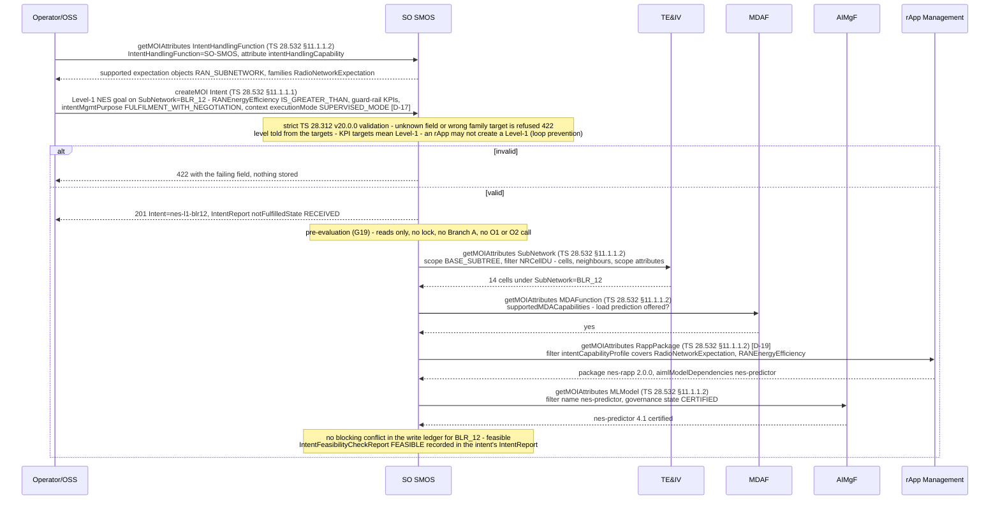
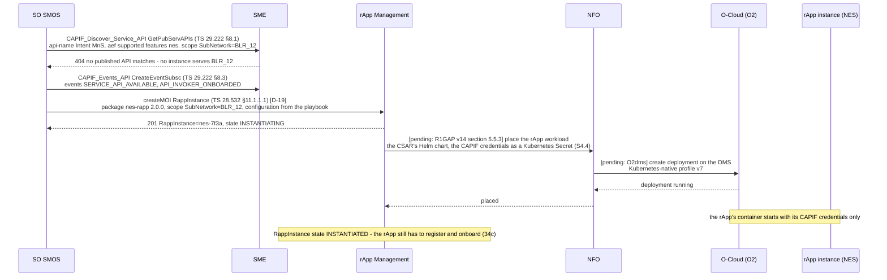
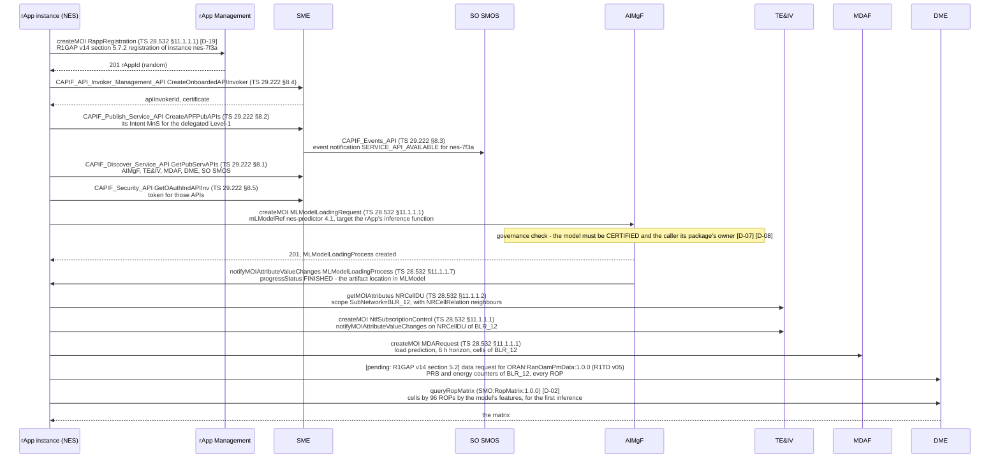
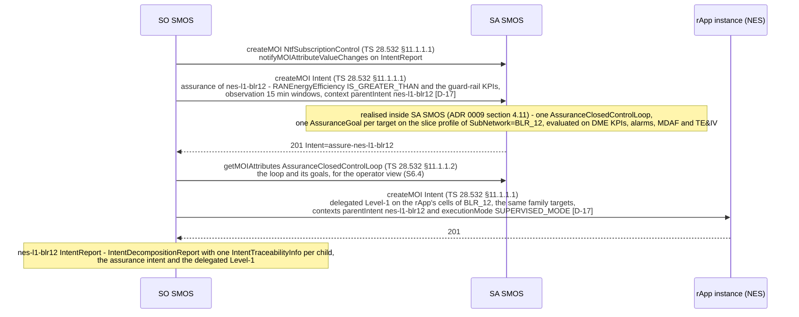
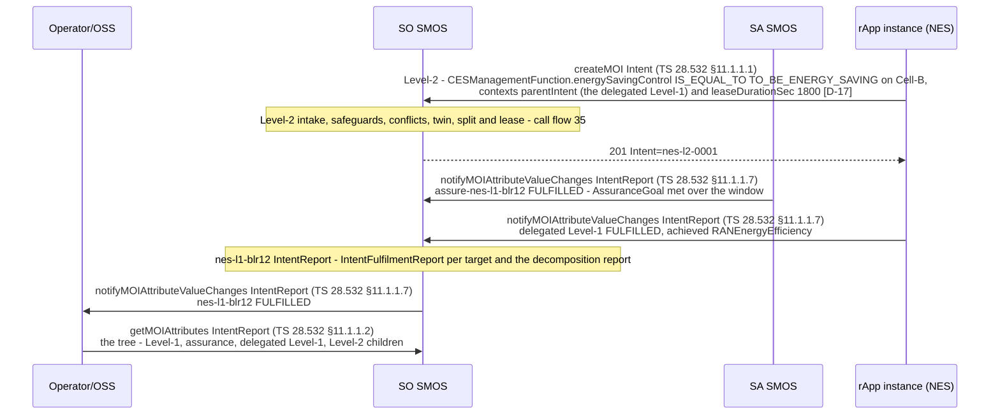

# Call Flow 34: Level-1 intake and an on-demand rApp — strict intake, pre-evaluation, selection, instantiation, CAPIF, model, data, assurance, the Level-2 and the reports

**Target design, not built.** This flow is what the converged rewrite builds (plan task S0.9; `docs/plan/CONVERGED_REWRITE_PLAN.md`); the code still runs
as call flows 01–27 describe until the PR-CONV rows named at the end land. The architecture is [ADR 0008](../adr/0008-converged-architecture.md), the
intent model [ADR 0009](../adr/0009-intent-model-ts28312.md), AI/ML [ADR 0010](../adr/0010-aimgf-absorbs-mlmr-mllf.md) and the interfaces
[ADR 0011](../adr/0011-standard-interfaces-only.md). Every message is an operation of the schema bundle (`specs/smo-schema-bundle/`), checked by
`tests_integration/test_call_flow_operations.py`.

An operator (or an OSS) asks for a goal, not a change: a TS 28.312 v20.0.0 Level-1 intent with KPI targets on SubNetwork `BLR_12`. SO SMOS checks it,
finds out whether it can be met without touching the network, picks an rApp that can serve it, has rApp Management start one (NFO places it on the
O-Cloud), lets the rApp join through CAPIF, load its model and get its data, hands the goal's assurance to SA SMOS, and delegates a scoped Level-1 intent
to the rApp. The rApp answers with a Level-2 intent (call flow 35 enacts it); fulfilment comes back as intent reports. Eleven steps in five diagrams:

| Step | What happens | Diagram |
|---:|---|---|
| 1 | The operator or OSS creates the Level-1 intent at SO SMOS; strict TS 28.312 validation | 34a |
| 2 | Pre-evaluation: feasibility and the `IntentHandlingCapability`; no network write (G19) | 34a |
| 3 | rApp selection by capability | 34b |
| 4 | Instantiation through rApp Management | 34b |
| 5 | NFO places the rApp's runtime on the O-Cloud over O2dms | 34b |
| 6 | The rApp registers (R1GAP §5.7.2), onboards to CAPIF and discovers its peers (S1.16) | 34c |
| 7 | The rApp's model is loaded in AIMgF (`MLModelLoadingRequest`) | 34c |
| 8 | The rApp's data through a DME R1TD data type | 34c |
| 9 | SO SMOS hands assurance to SA SMOS as a TS 28.312 intent and delegates a scoped Level-1 intent to the rApp | 34d |
| 10 | The rApp submits its Level-2 intent | 34e |
| 11 | Fulfilment comes back as intent reports, up to the operator | 34e |

**As images:** [34a](images/34-level1-intake-and-on-demand-rapp/34a-intake-and-pre-evaluation.png) ·
[34b](images/34-level1-intake-and-on-demand-rapp/34b-selection-instantiation-and-placement.png) ·
[34c](images/34-level1-intake-and-on-demand-rapp/34c-registration-capif-model-and-data.png) ·
[34d](images/34-level1-intake-and-on-demand-rapp/34d-assurance-hand-off-and-delegation.png) ·
[34e](images/34-level1-intake-and-on-demand-rapp/34e-the-level-2-and-the-reports.png)
(PNG, drawn from the diagrams below by `scripts/render_call_flows.py`).

**How to read the diagrams.** An arrow between two participants is one standard operation, written `<operation> <class> (<spec> <clause>)`: the
ProvMnS operations of TS 28.532 v19.2.0 on a class the receiving module's contract lists, a TS 29.222 CAPIF API, or a bundle path's `operationId`. A
project-defined step carries its ADR 0011 section 6 id (`[D-19]`); a step whose O-RAN API is not yet in `specs/` is marked `[pending: ...]` with the
interface the bundle's `x-smo-pending` names. A dashed arrow is the answer. Every call between modules and from an rApp crosses R1 Termination (ADR 0008
section 3.2) with a CAPIF token; R1 Termination is left out of the drawings to keep them readable. The participants are the fourteen services of ADR 0008
plus the operator or OSS, the rApp instance, the O-DU/O-CU (O1) and the O-Cloud (O2). DNs follow the bundle's one DN set (R13): `SubNetwork=BLR_12`,
intents under `IntentHandlingFunction=SO-SMOS`.

## 34a — Intake and pre-evaluation

The intent arrives as a ProvMnS `createMOI` on SO SMOS's `Intent` class, in the one URI form of D5. SO SMOS validates it with the strict TS 28.312
v20.0.0 models (`extra="forbid"`, the five expectation-family files): the level is told from the targets (KPI targets on `RAN_SUBNETWORK`: Level-1), not
from a field. Pre-evaluation answers TS 28.312 §4.6.2 feasibility from what the SMO already knows — topology from TE&IV, the MDA types MDAF offers,
certified models in AIMgF, capable rApp packages in rApp Management and the write ledger — and never calls Branch A, takes a lock or reaches O1 or O2
(G19, S5.15). The operator may ask for the handler's capability first.

When the purpose is `FEASIBILITYCHECK` or `EXPLORATION`, the flow stops here: the report carries `infeasibilityReasons` (or recommendations) and nothing
else happens (ADR 0009 section 4.6). A purpose of `FULFILMENT_WITH_NEGOTIATION` caps the effective autonomy at `SUPERVISED_MODE`, whatever the
`executionMode` context asks.

## 34b — Selection, instantiation and placement

SO SMOS's playbook (S5.3) selects by capability, not by name: the package's ASD `intentCapabilityProfile` (S4.1) must cover the intent's expectation
family and targets, and its `aimlModelDependencies` must name a certified model. If no running instance already serves `BLR_12` (asked through CAPIF
discovery), SO SMOS creates one. rApp Management places the workload through NFO, which consumes O2dms; neither the R1GAP §5.5.3 O2 deployment
management API nor O2dms is in `specs/` yet, so both arrows are marked pending (`specs/smo-schema-bundle/openapi/modules/nfo.yaml`).

The instance's random `rAppId` is not given here: R1GAP v14 §5.7.2 returns it when the rApp registers (G16, S4.8). FOCOM's O2ims capacity check before
placement is the direction document's step 5 (HLD §5.1); the plan places it in Stage 4 (S4.5) and it is not drawn.

## 34c — Registration, CAPIF, model and data

The rApp comes up with nothing but its CAPIF credentials. It registers with rApp Management (R1GAP v14 §5.7.2, the `RappRegistration` class until the
R1AP API is in `specs/`), onboards as a CAPIF API invoker, publishes the Intent MnS it serves for the delegated Level-1 (as an API provider) and finds its
peers by discovery (S1.16): no static routing table. It then asks AIMgF to load its model (TS 28.105 `MLModelLoadingRequest`; AIMgF refuses a model that
is not certified, D-07) and gets its data: topology from TE&IV, a load prediction from MDAF and PM data from DME through an R1TD data type.

The two DME arrows are the two data paths ADR 0011 allows: the normative R1TD type `ORAN:RanOamPmData:1.0.0` through the R1GAP §5.2 data services
(their R1AP API is pending in `dme.yaml`) and the one [D] type, the ROP matrix (D-02), which keeps an analytics read to one call.

## 34d — Assurance hand-off and delegation

SO SMOS reaches SA SMOS only through TS 28.312 intents (S5.17): it creates an assurance intent carrying the Level-1 goal's KPI targets and guard rails.
SA SMOS realises it inside itself as a TS 28.536 v19.1.0 `AssuranceClosedControlLoop` with `AssuranceGoal`s, scoped through the RAN subnetwork's slice
profile (the default slice when none is configured; R19). SO SMOS does not create the ACCL; anyone may read it. SO SMOS then delegates a Level-1 intent
scoped to the rApp's cells, on the IntentHandlingFunction the rApp published, and records the delegation in the parent's decomposition report.

## 34e — The Level-2 and the reports

The rApp's only write path is a Level-2 intent to SO SMOS (D14): CM targets `<IOC>.<attribute> IS_EQUAL_TO value`, the parent link and a lease. Call flow
35 is what SO SMOS does with it. Fulfilment travels up as intent reports: SA SMOS reports on the assurance intent, the rApp on its delegated Level-1, and SO
SMOS folds both into the operator's Level-1 report.

A report of `NOT_FULFILLED` from SA SMOS starts SO SMOS's playbook step for the goal (re-plan, roll back through call flow 35's rollback, or report up);
two consecutive rollbacks demote the rApp's autonomy (call flow 37).

## Where the direction documents differ

| HLD §5.1 (Sequence Flow 1) says | What this flow does | Why |
|---|---|---|
| SO SMOS matches the profile against `rapp_mgmt.csar_catalog` | SO SMOS reads `RappPackage` through ProvMnS | One writer per table, no cross-module SQL (ADR 0008 section 3.4) |
| The rApp "pulls its model from `aiml_wf.model_moi_doc`" | `MLModelLoadingRequest` at AIMgF, governance gate first | ADR 0010; TS 28.105 |
| SME fires "ServiceNotFound" and a "Service Ready" event | CAPIF discovery answers with no match; SO SMOS subscribes to CAPIF events | TS 29.222 has no ServiceNotFound event |
| Step 11 sets `IntentFulfilmentInfo` to IN_PROGRESS (ACKNOWLEDGED) | `NOT_FULFILLED` with `notFulfilledState` RECEIVED | TS 28.312 v20.0.0 has no IN_PROGRESS (ADR 0009 section 5 row 2) |
| No pre-evaluation and no assurance at Level-1 | Pre-evaluation (G19) and an assurance intent to SA SMOS | ADR 0009 sections 4.8 and 4.11 |

## Standards used

Clause numbers are those of the specification releases `specs/README.md` records; the repository carries the OpenAPI files, not the specification text,
so clauses other than the TS 28.532 operations and the TS 29.222 APIs are given by section of the class, not re-read.

| Standard | Version | Used for |
|---|---|---|
| TS 28.532 ProvMnS (§11.1.1.1 createMOI, §11.1.1.2 getMOIAttributes, §11.1.1.7 notifyMOIAttributeValueChanges) | 19.2.0 | Every class operation |
| TS 28.312 Intent MnS: `Intent`, `IntentReport`, `IntentHandlingFunction`, feasibility (§4.6.2) | 20.0.0 | Level-1, delegation, assurance intent, reports |
| TS 28.536 `AssuranceClosedControlLoop`, `AssuranceGoal` | 19.1.0 | SA SMOS's realisation of the assurance intent |
| TS 28.104 `MDAFunction`, `MDARequest` | 20.0.0 | Feasibility, load prediction |
| TS 28.105 `MLModel`, `MLModelLoadingRequest`, `MLModelLoadingProcess` | 19.5.0 | Model readiness and loading |
| TS 28.622 / 28.623 `SubNetwork`, `NtfSubscriptionControl`; TS 28.541 `NRCellDU` | 19.7.0 / 19.6.0 | Topology reads, subscriptions |
| TS 29.222 CAPIF (§8.1 discover, §8.2 publish, §8.3 events, §8.4 invoker management, §8.5 security) | 20.0.0 | Onboarding, discovery, tokens |
| O-RAN R1GAP v14 §5.7.2 (registration), §5.2 (data), §5.5.3 (O2 deployment) | 14.00 | Registration; data and placement are pending |
| O-RAN R1TD | v05 | `ORAN:RanOamPmData:1.0.0` |
| O-RAN O2dms Kubernetes-native profile | v7 | Placement (pending) |
| ADR 0011 [D]: D-02, D-07, D-08, D-17, D-19 | – | ROP matrix, model governance and owner, generic contexts, rApp classes |

## What the code does today

None of this runs yet. Today an operator's intent goes to Intent Service (call flow 09), SO SMOS runs ordered service-order steps (call flow 10), an rApp
is instantiated by hand through rApp Management (call flow 01), registers at SME, loads its model through MLMR and MLLF (call flow 02) and writes through
autonomy dispatch or DME `/actions`, not a Level-2 intent. The rows that build this flow: **PR-CONV-S5.1** (Intent Service into SO SMOS), **S5.2**
(Level-1 intake), **S5.3** (playbooks and selection), **S5.15** (pre-evaluation), **S4.1** (ASD `intentCapabilityProfile`), **S4.2** (`RappInstance`
over ProvMnS), **S4.3** (warm start), **S4.4** and **S4.9** (NFO's O2dms driver, O2 detail), **S4.8** (registration), **S1.12** and **S1.16** (SME as the CAPIF core function),
**S2.7** (model loading in AIMgF), **S3.8**, **S3.9** (DME data types and the ROP matrix), **S5.8** and **S5.17** (SA SMOS through intents), **S7.1**
(SDK v2).
