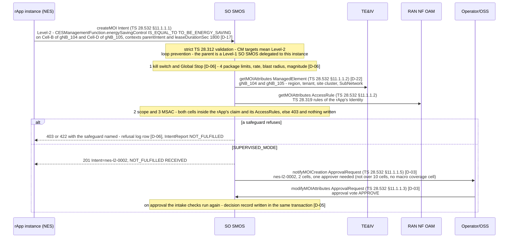
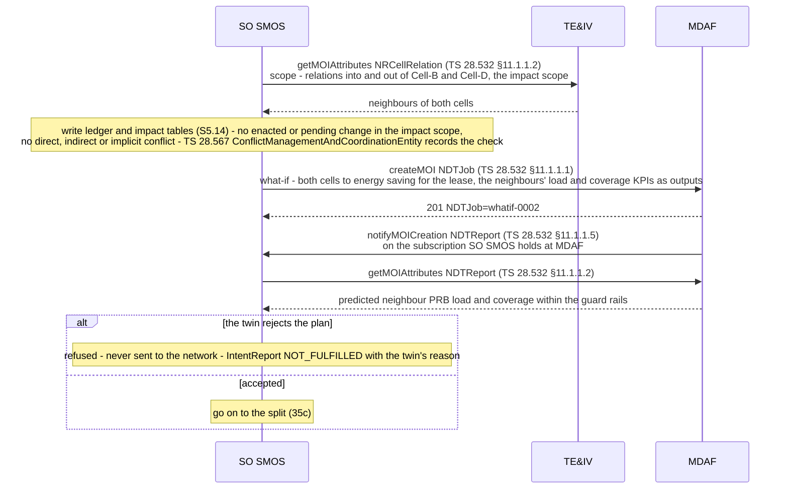
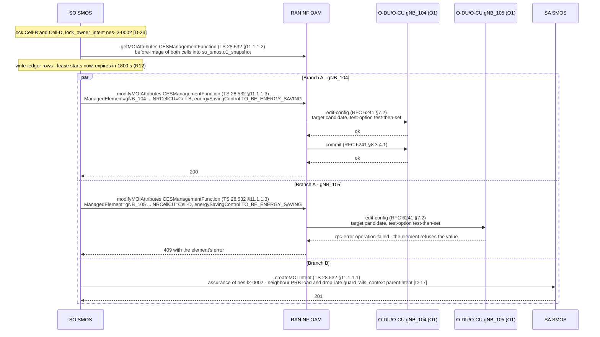
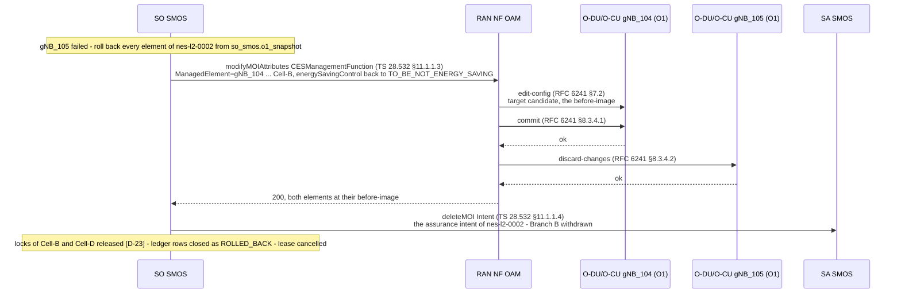
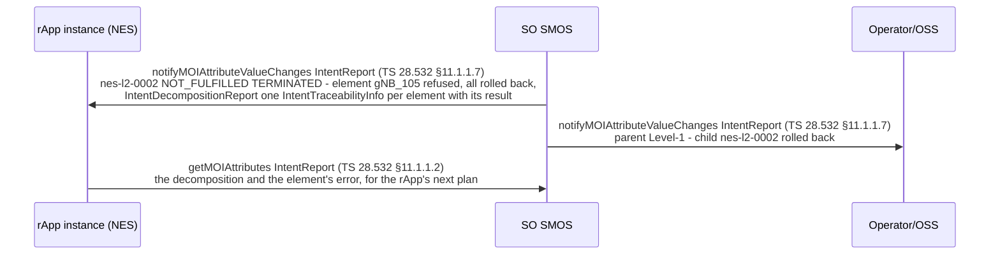

# Call Flow 35: Level-2 parallel split and rollback — intake safeguards, conflict check, twin what-if, the split per O-DU/O-CU, one failure, all rolled back

**Target design, not built.** What SO SMOS does with a Level-2 intent (plan task S0.9; [ADR 0009](../adr/0009-intent-model-ts28312.md) sections 4.3–4.10;
[ADR 0011](../adr/0011-standard-interfaces-only.md)). The code still runs as call flows 03 and 09 describe until the PR-CONV rows named at the end land.
Every message is an operation of the schema bundle (`specs/smo-schema-bundle/`), checked by `tests_integration/test_call_flow_operations.py`.

The NES rApp of call flow 34 asks for two cells to sleep: Cell-B on `ManagedElement=gNB_104` and Cell-D on `ManagedElement=gNB_105`, through the TS
28.541 `CESManagementFunction` of each cell (R18), with a lease of 1800 s. The instance runs in `SUPERVISED_MODE`, so a person approves. SO SMOS checks
every safeguard, the write ledger and the twin, then splits: Branch A writes each element in parallel through RAN NF OAM's ProvMnS facade, Branch B
hands assurance to SA SMOS. gNB_105 refuses its change, so both elements go back to their snapshots and the intent is reported `NOT_FULFILLED`. Seven
steps in five diagrams:

| Step | What happens | Diagram |
|---:|---|---|
| 1 | The Level-2 intent arrives, with its parent and a lease | 35a |
| 2 | Intake safeguards: kill switch and limits (D-06), scope as TS 28.319 AccessRules (ADR 0005), approval when SUPERVISED (D-03) | 35a |
| 3 | Conflict check against the write ledger and the impact tables (S5.14) | 35b |
| 4 | The digital-twin what-if: a TS 28.561 `NDTJob` (D18) | 35b |
| 5 | Decomposition per O-DU/O-CU: parallel `modifyMOIAttributes` through RAN NF OAM, then O1 NETCONF test-then-set; Branch B to SA SMOS | 35c |
| 6 | One element fails, so every element rolls back from its snapshot | 35d |
| 7 | `IntentReport` NOT_FULFILLED with the `IntentDecompositionReport` | 35e |

**As images:** [35a](images/35-level2-parallel-split-and-rollback/35a-arrival-and-intake-safeguards.png) ·
[35b](images/35-level2-parallel-split-and-rollback/35b-conflict-check-and-the-twin.png) ·
[35c](images/35-level2-parallel-split-and-rollback/35c-the-parallel-split.png) ·
[35d](images/35-level2-parallel-split-and-rollback/35d-one-element-fails-everything-rolls-back.png) ·
[35e](images/35-level2-parallel-split-and-rollback/35e-the-report.png)
(PNG, drawn from the diagrams below by `scripts/render_call_flows.py`).

**How to read the diagrams.** As in call flow 34: an arrow is one standard operation `<operation> <class> (<spec> <clause>)`, a project-defined step
carries its ADR 0011 id, a dashed arrow is the answer, and every call crosses R1 Termination (not drawn). Steps inside SO SMOS (the write ledger, the cell
lock table, the snapshot store `so_smos.o1_snapshot`) are notes, not messages: they are one module's own tables (one writer per table, ADR 0008 section 3.4).

## 35a — Arrival and intake safeguards

The intent is checked strictly (TS 28.312 v20.0.0), then for loop prevention: a Level-2 intent must name, in its `parentIntent` context, a Level-1
intent SO SMOS delegated to this same instance. The safeguards run in ADR 0009 section 4.5's order, before anything is written; each refusal writes a
refusal-log row (D-06) and a `NOT_FULFILLED` report. The rApp's scope is its CAPIF token's claims checked against TS 28.319 `AccessRule`s and the ADR 0005
scope attributes TE&IV keeps on each `ManagedElement` (D-22). In `SUPERVISED_MODE` the intent waits for a person: nothing is locked or written while it
waits, and its lease has not started (R12).

An approval that lapses (EXPIRE or REJECT at its own timeout) writes nothing and reports `NOT_FULFILLED`. A change to more than 10 cells or to a macro
coverage cell needs two distinct people (the two-person rule of Part 2 §9.4, S6.7).

## 35b — Conflict check and the twin

SO SMOS sees every network write (D14), so it checks the intent against the **write ledger** of enacted and pending changes and the **impact tables** of
R1ServCnfMtgt v01.00 [O]: Impact Map (which attributes and KPIs a change moves), Impact Scope (the cell, its `NEIGHBOR_CELL` relations from TE&IV and
its coverage overlay), Impact Time (how long until the effect shows). Call flow 36 is the case where a conflict is found. Then, for a NES or MRO change,
the twin: a TS 28.561 `NDTJob` on MDAF's `NDTFunction` (S7.11 places the twin in RAN Analytics, now MDAF); a plan the twin rejects is never sent.

## 35c — The parallel split

SO SMOS takes the cell locks (its `CellLock` class, D-23), reads each element's before-image into its snapshot store, writes the ledger rows, and only
then starts the lease (R12): the clock runs from the change, not from the filing or the approval. Branch A is one `modifyMOIAttributes` per O-DU/O-CU,
sent in parallel to RAN NF OAM's ProvMnS facade, which keeps its job engine behind it (K8) and writes each element over O1 NETCONF with
`test-then-set` into the candidate datastore, then `commit`. Branch B is the assurance intent to SA SMOS for this Level-2: both branches, or neither.

## 35d — One element fails, everything rolls back

The split is all or nothing: one refused element puts every element back. gNB_104 had committed, so RAN NF OAM writes its before-image back the same way;
gNB_105 never committed, so its candidate is discarded. Branch B is withdrawn, the locks are released and the ledger rows closed. A rollback that itself
fails leaves the lock held and raises an alarm for a person (the lock table shows `lock_state` and its owner).

## 35e — The report

The Level-2 intent is reported `NOT_FULFILLED` with the reason, and its `IntentDecompositionReport` lists what happened to each element; the parent
Level-1's report gets the same child result, so the operator sees it in the intent tree (S6.4).

## Where the direction documents differ

| HLD §5.2 (Sequence Flow 2) and §6.1 say | What this flow does | Why |
|---|---|---|
| The Level-2 carries `intentLevel=LEVEL_2_RESOURCE_ACTUATION` and "NRM attribute deltas" | CM targets `<IOC>.<attribute> IS_EQUAL_TO`; the level told from the targets | TS 28.312 has no `intentLevel` (R1) |
| NES writes `administrativeState` SHUTTING_DOWN and `ssbPowerOffset` | `CESManagementFunction.energySavingControl` | R18 |
| SO SMOS checks the lock in `common_teiv_nrm.moi_store` | The cell lock is SO SMOS's own `CellLock` (D-23) | One writer per table; S0.5 |
| Branch B is `createMOI(AssuranceClosedControlLoop)` on SA SMOS | A TS 28.312 assurance intent; SA SMOS builds the ACCL itself | S5.17, ADR 0009 section 4.11 |
| No safeguards, conflicts or twin before the split; the HLD text has 7 steps, its figure 9 | Safeguards, conflicts and the twin before the split; 7 steps here | ADR 0009 sections 4.5, 4.9, 4.10 and section 8 |

## Standards used

Clause numbers as in call flow 34 (the TS 28.532 operations, RFC 6241 sections; the classes by their specification).

| Standard | Version | Used for |
|---|---|---|
| TS 28.532 ProvMnS (§11.1.1.1–§11.1.1.5, §11.1.1.7) | 19.2.0 | Every class operation and notification |
| TS 28.312 `Intent`, `IntentReport`, `IntentDecompositionReport` | 20.0.0 | The Level-2, the assurance intent, the report |
| TS 28.541 `CESManagementFunction`, `NRCellRelation`; TS 28.622 `ManagedElement` | 19.6.0 / 19.7.0 | The change, the impact scope, the scope attributes |
| TS 28.319 `AccessRule` (MSAC) | 19.0.0 | Scope and authorisation at intake |
| TS 28.567 `ConflictManagementAndCoordinationEntity` | 20.0.0 | The conflict check's model |
| TS 28.561 `NDTJob`, `NDTReport` | 20.0.0 | The twin what-if |
| RFC 6241 NETCONF (§7.2 edit-config with test-then-set, §8.3.4.1 commit, §8.3.4.2 discard-changes) on the published YANG of `yang/modules.txt` | – | O1 writes and the rollback |
| O-RAN R1ServCnfMtgt | v01.00 [O] | Write ledger, impact tables |
| ADR 0011 [D]: D-03, D-05, D-06, D-17, D-22, D-23 | – | Approval, decision record, safeguards, contexts, scope attributes, cell locks |

## What the code does today

Today an rApp writes through autonomy dispatch (call flow 09), which SA SMOS's O1-CM handler turns into DME `/actions`, or through RAN NF OAM's
`/config-jobs` with the safeguards of call flow 03 (kill switch, limits, scope, approval, decision record); there is no lease, no twin, no write ledger,
and no split across O1 and assurance. The rows that build this flow: **PR-CONV-S5.4** (Level-2 intake with every safeguard), **S5.6** (snapshot and
parallel split), **S5.7** (leases), **S5.14** (write ledger and conflict management), **S7.11** (the twin), **S3.2** (cell locks), **S3.3** (RAN NF OAM's
ProvMnS facade), **S3.14** (the SON functions), **S1.14** (TS 28.319 AccessRules), **S5.9** and **S3.12** (the old write paths deleted), **S6.7**
(the two-person rule).
