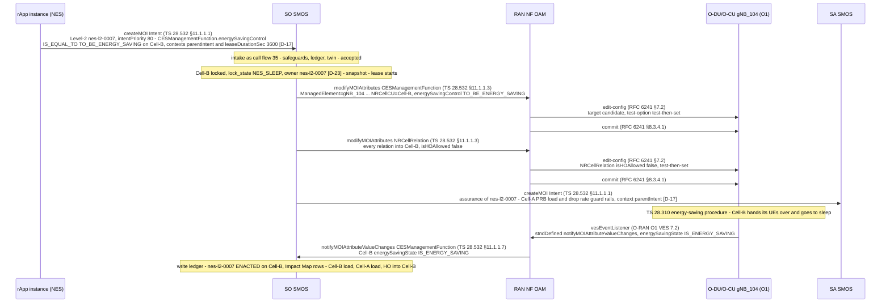
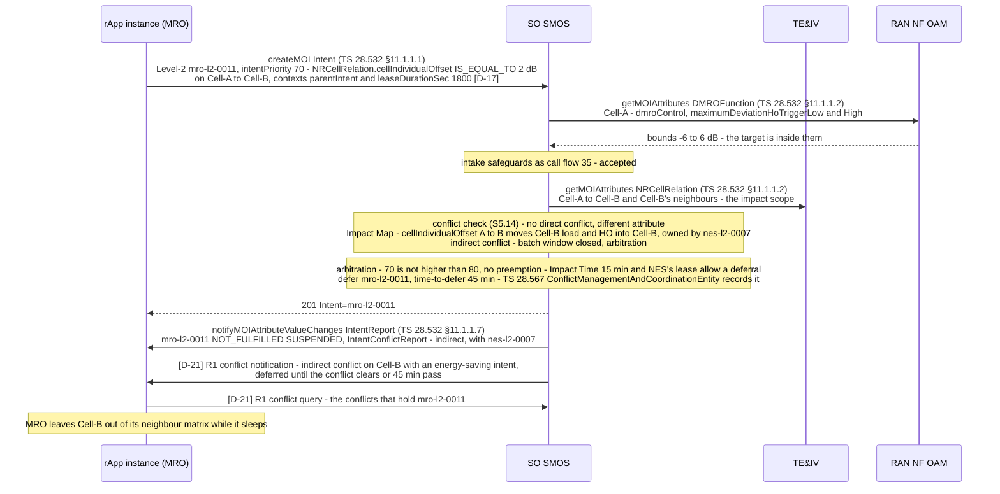
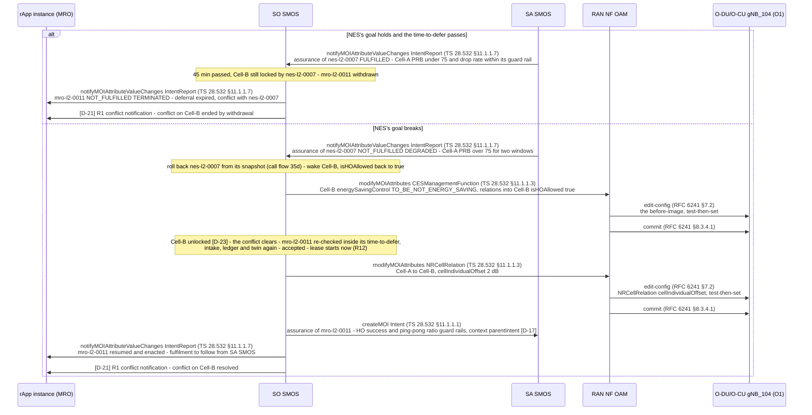

# Call Flow 36: NES vs MRO arbitration on cluster 12 — an indirect conflict through the Impact Map, MRO deferred, the conflict over R1, SA SMOS decides what happens next

**Target design, not built.** Conflict management in SO SMOS (plan tasks S0.9 and S5.14; [ADR 0009](../adr/0009-intent-model-ts28312.md) sections 4.2 and
4.9; [ADR 0011](../adr/0011-standard-interfaces-only.md) D-21). The code still runs as call flows 22 and 23 describe until the PR-CONV rows named at the
end land. Every message is an operation of the schema bundle (`specs/smo-schema-bundle/`), checked by `tests_integration/test_call_flow_operations.py`.

Cluster 12 is `SubNetwork=BLR_12`. The NES rApp puts capacity cell Cell-B (on `ManagedElement=gNB_104`) to sleep through its TS 28.541
`CESManagementFunction`; the gNB carries out the TS 28.310 energy-saving procedure itself. While Cell-B sleeps, the MRO rApp asks for a cell individual
offset on the relation Cell-A → Cell-B that would steer handovers into Cell-B, within the bounds of `DMROFunction` (TS 28.313 distributed MRO). The two
intents write different attributes, so there is no direct conflict, but their impacts overlap on Cell-B's load: an **indirect** conflict, found through
the Impact Map. NES's intent has priority 80 and holds the cell, MRO's has 70 and may not preempt, so the arbitration rules **defer** MRO with a
time-to-defer; the conflict goes to the MRO rApp over R1 (D-21, because R1ServCnfMtgt is a technical report [O]). SA SMOS's evaluation of NES's goal
then decides whether the deferred MRO change runs or is withdrawn. Three diagrams:

| | Step | Ends with |
|---|---|---|
| 36a | NES's Level-2 is enacted on Cell-B | Cell-B in energy saving, locked by NES's intent, handovers into it barred |
| 36b | MRO's Level-2 arrives: the indirect conflict, arbitration, deferral, the R1 conflict notification | MRO's intent suspended with a time-to-defer |
| 36c | SA SMOS evaluates NES's goal; the deferred change runs or is withdrawn | MRO's change enacted, or MRO's intent terminated |

**As images:** [36a](images/36-nes-vs-mro-arbitration/36a-nes-s-level-2-is-enacted-on-cell-b.png) ·
[36b](images/36-nes-vs-mro-arbitration/36b-mro-s-level-2-the-indirect-conflict-and-the-deferral.png) ·
[36c](images/36-nes-vs-mro-arbitration/36c-sa-smos-decides-the-deferred-change-runs-or-is-withdrawn.png)
(PNG, drawn from the diagrams below by `scripts/render_call_flows.py`).

**How to read the diagrams.** As in call flow 34. The intake steps of call flow 35 (safeguards, approval, twin) run for both intents and are a note here.

## 36a — NES's Level-2 is enacted on Cell-B

SO SMOS enacts NES's intent as in call flow 35 and, as part of NES's playbook, bars handovers into the sleeping cell (`isHOAllowed` false on the
relations into Cell-B, S5.5). The gNB itself moves Cell-B into energy saving per TS 28.310 and reports the `energySavingState` it reached; RAN NF OAM
passes that on to its subscribers.

## 36b — MRO's Level-2: the indirect conflict and the deferral

MRO's target sits within the `DMROFunction` bounds (`maximumDeviationHoTrigger` low and high), so it passes intake. The conflict check finds no direct
conflict (a different attribute), but the Impact Map puts `cellIndividualOffset` on Cell-A → Cell-B on Cell-B's load and handover attempts, which NES's
enacted change also owns: an indirect conflict. The arbitration rules decide: NES (80) holds the cell and MRO (70) is not higher, so MRO may not preempt;
because the Impact Time and NES's remaining lease allow it, MRO is **deferred**, not refused. MRO's intent keeps its own administrative state (only its
owner changes it) and is reported `NOT_FULFILLED` / `SUSPENDED` with the conflict. Had MRO's intent also targeted Cell-A → Cell-C, that part would have
been enacted and only the Cell-B part deferred (partial filtering, `TARGET_CELL_IN_NES_SLEEP`).

## 36c — SA SMOS decides: the deferred change runs or is withdrawn

SA SMOS evaluates NES's assurance intent over its windows (DME KPIs, alarms, MDAF, TE&IV). If NES's guard rails hold, Cell-B stays asleep and MRO's
change waits; if the time-to-defer passes first, MRO's intent is withdrawn. If they break, SO SMOS rolls NES back (Cell-B wakes), the conflict clears,
and the deferred MRO change is re-checked and enacted.

## Where the direction documents differ

| HLD §6.3 says | What this flow does | Why |
|---|---|---|
| NES sets `lock_state='NES_SLEEP_LOCKED'` in `common_teiv_nrm.moi_store` | The lock is SO SMOS's `CellLock` (D-23) | One writer per table (ADR 0008 section 3.4; S0.5) |
| NES puts Cell-B into SHUTTING_DOWN | `CESManagementFunction.energySavingControl`; the gNB runs the TS 28.310 procedure | R18 |
| MRO writes CIO, `a3Offset` and `timeToTrigger` freely | `cellIndividualOffset` only, inside the `DMROFunction` bounds; `a3Offset` and `timeToTrigger` are not NRM attributes | G4, S0.5 |
| A competing MRO sub-delta into Cell-B is rejected | It is deferred with a time-to-defer when the impact time allows, and rejected only if the deferral expires | ADR 0009 section 4.9 (D17) |
| TE&IV emits the topology notification to MRO | SO SMOS sends the R1 conflict notification (D-21); TE&IV still notifies its subscribers of the relation change | R1ServCnfMtgt [O], ADR 0011 |

## Standards used

Clause numbers as in call flow 34.

| Standard | Version | Used for |
|---|---|---|
| TS 28.532 ProvMnS (§11.1.1.1–§11.1.1.3, §11.1.1.7) | 19.2.0 | Every class operation and notification |
| TS 28.312 `Intent`, `IntentReport`, `IntentConflictReport`; `intentPriority`, `intentPreemptionCapability` | 20.0.0 | Both intents, the arbitration, the reports |
| TS 28.541 `CESManagementFunction`, `NRCellRelation` (`cellIndividualOffset`, `isHOAllowed`), `DMROFunction` | 19.6.0 | The two changes and MRO's bounds |
| TS 28.310 energy-saving procedure | – | The gNB's own transition into and out of energy saving |
| TS 28.313 distributed SON (MRO) | – | `DMROFunction` bounds |
| TS 28.567 `ConflictManagementAndCoordinationEntity` | 20.0.0 | The coordination entity's record of the conflict |
| O-RAN R1ServCnfMtgt (Impact Map, Impact Time, Impact Scope, defer) | v01.00 [O] | Detection and arbitration; the R1 conflict service is D-21 |
| O-RAN O1 VES 7.2 (`vesEventListener`) | – | The gNB's energy-saving state |
| RFC 6241 NETCONF (§7.2, §8.3.4.1) | – | O1 writes |
| TS 28.536 via a TS 28.312 assurance intent | 19.1.0 | SA SMOS's evaluation |
| ADR 0011 [D]: D-17, D-21, D-23 | – | Contexts, R1 conflict query and notification, cell locks |

## What the code does today

Today the energy-saving and mobility samples coordinate by reading each other's operator APIs over R1 (`/cells`, `/relations`) and by guards inside
each rApp (call flows 22, 23); Intent Service reports target conflicts but does not resolve them, and there is no write ledger, Impact Map or deferral.
The rows that build this flow: **PR-CONV-S5.14** (conflict management, write ledger, impact tables, R1 conflict query and subscribe), **S5.5**
(arbitration, `isHOAllowed` on relations into a sleeping cell), **S5.6** and **S5.7** (split and leases), **S3.2** (cell locks), **S3.14** (the SON
functions and DMRO bounds), **S5.8** (SA SMOS evaluation), **S7.2** and **S7.3** (the NES and MRO rApps on SDK v2).
