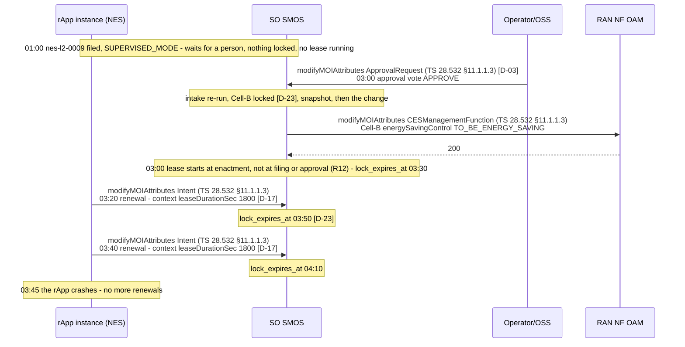
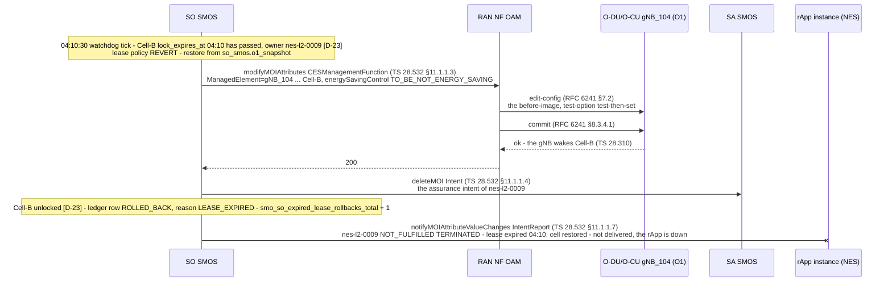
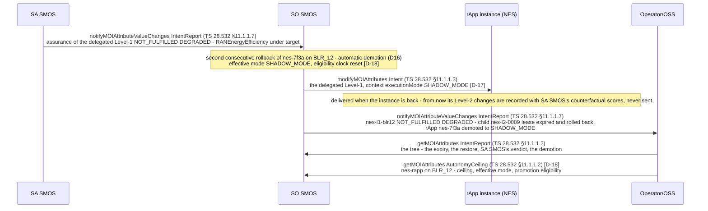

# Call Flow 37: Lease expiry and demotion — the rApp stops renewing, the watchdog reverts the cell, SA SMOS reports, SO SMOS demotes, the operator sees why

**Target design, not built.** The dead-man's switch on every Level-2 change and automatic demotion (plan tasks S0.9, S5.7 and S5.10;
[ADR 0009](../adr/0009-intent-model-ts28312.md) sections 4.3, 4.6 and 4.7; [ADR 0011](../adr/0011-standard-interfaces-only.md) D-17, D-18, D-23). The code
has no lease today (see the end). Every message is an operation of the schema bundle (`specs/smo-schema-bundle/`), checked by
`tests_integration/test_call_flow_operations.py`.

The NES rApp's Level-2 intent put Cell-B to sleep with a lease of 1800 s. The rApp renews the lease while it still wants the cell asleep, then crashes and
stops renewing. SO SMOS's lease watchdog finds the expired lock and puts Cell-B back from its snapshot, as the lease policy says. SA SMOS reports the
goal `NOT_FULFILLED`; with the rollback of call flow 35 this is the instance's second rollback in a row, so SO SMOS demotes its autonomy to
`SHADOW_MODE` on its own (D16). The operator sees the expiry, the rollback and the demotion in the intent's reports. Three diagrams:

| | Step | Ends with |
|---|---|---|
| 37a | The lease clock and the renewals, then the crash | a lease that starts at enactment (R12), renewed twice, then no renewal |
| 37b | The watchdog reverts the cell | Cell-B at its before-image, the lock released, the intent `NOT_FULFILLED` / `TERMINATED` |
| 37c | SA SMOS reports, SO SMOS demotes, the operator sees it | the instance in `SHADOW_MODE`; promotion again only by two people |

**As images:** [37a](images/37-lease-expiry-and-demotion/37a-the-lease-clock-and-the-renewals-then-the-crash.png) ·
[37b](images/37-lease-expiry-and-demotion/37b-the-watchdog-reverts-the-cell.png) ·
[37c](images/37-lease-expiry-and-demotion/37c-sa-smos-reports-so-smos-demotes-the-operator-sees-it.png)
(PNG, drawn from the diagrams below by `scripts/render_call_flows.py`).

**How to read the diagrams.** As in call flow 34.

## 37a — The lease clock and the renewals, then the crash

The intent ran in `SUPERVISED_MODE` and waited two hours for its approval. Nothing was locked or written while it waited, so the lease did not run: it
starts when SO SMOS makes the change (R12), and `lock_expires_at` on the cell's lock is the lease's expiry. The rApp renews by rewriting the
`leaseDurationSec` context with `modifyMOIAttributes` on its intent (the SDK v2 does it in the background, S7.1); each renewal moves the expiry.

A renewal is refused when the intent is no longer enacted (rolled back or terminated) or when the rApp is killed (kill switch, Global Stop: D-06); a
renewal can never raise `leaseDurationSec` above 3600.

## 37b — The watchdog reverts the cell

Every 30 s, under the single-runner lock (one runner across SO SMOS's replicas, K9), the watchdog reads the cell locks whose `lock_expires_at` has
passed. The lease policy of a Level-2 intent is to restore the snapshot: SO SMOS writes the before-image back through RAN NF OAM as in call flow 35d,
withdraws the Level-2's assurance intent, releases the lock and reports the intent `NOT_FULFILLED` / `TERMINATED` with the reason. The metric
`smo_so_expired_lease_rollbacks_total` counts it.

The cell is restored within one watchdog period after expiry (S5.7's done-when). If the restore itself fails, the lock stays held, RAN NF OAM raises an
alarm and the operator is asked to act: the cell is never left in a state no intent owns.

## 37c — SA SMOS reports, SO SMOS demotes, the operator sees it

SA SMOS keeps assuring the Level-1 goal the rApp was delegated (call flow 34d). With Cell-B awake and the rApp gone, energy efficiency falls below the
target and SA SMOS reports the goal `NOT_FULFILLED` / `DEGRADED`. For this instance on `BLR_12` that is the second rollback in a row (the first was call
flow 35's), so SO SMOS demotes it to `SHADOW_MODE` automatically (D16; also on PSI above 0.25 or on Global Stop). Demotion needs no person; promotion
back does: eligibility is measured again (7 days without a counterfactual violation) and two distinct people approve (S5.10, S6.7).

## Where the direction documents differ

| Part 2 §6.1 and §4 say | What this flow does | Why |
|---|---|---|
| `lock_expires_at` is written into `common_teiv_nrm.moi_store` and the watchdog scans that table | The lock and its expiry are SO SMOS's `CellLock` (D-23) | One writer per table; S0.5 |
| The renewal is `PATCH /ProvMnS/v18/Intent={id}` | `modifyMOIAttributes` on `Intent` in the one ProvMnS form of D5 | R2 |
| The lease runs from the intent's submission | From enactment | R12 |
| Promotion is automatic once eligible (Part 2 §4) | Eligibility only; promotion by two people. Demotion is automatic | R11, D16 |

## Standards used

Clause numbers as in call flow 34.

| Standard | Version | Used for |
|---|---|---|
| TS 28.532 ProvMnS (§11.1.1.2–§11.1.1.4, §11.1.1.7) | 19.2.0 | Renewals, the restore, withdrawal, reports |
| TS 28.312 `Intent`, `IntentReport` (`NOT_FULFILLED` with `notFulfilledState` TERMINATED and DEGRADED) | 20.0.0 | The Level-2, the Level-1, the reports |
| TS 28.541 `CESManagementFunction`; TS 28.310 | 19.6.0 | The restore and the gNB's wake-up |
| TS 28.536 via a TS 28.312 assurance intent | 19.1.0 | SA SMOS's verdict |
| RFC 6241 NETCONF (§7.2, §8.3.4.1) | – | The O1 restore |
| ADR 0011 [D]: D-03, D-17, D-18, D-23 | – | Approval, `leaseDurationSec` and `executionMode`, the autonomy ceiling and demotion, the cell lock |

## What the code does today

There is no lease: an rApp's change stays until the rApp itself reverts it (the samples' own revert logic, call flows 22–25), and a crashed rApp leaves
its cells as they are. Autonomy is the instance's `autonomyMode` in rApp Management, changed only by a person. The rows that build this flow:
**PR-CONV-S5.7** (leases, the watchdog, the metric), **S5.10** (autonomy modes, automatic demotion, two-person promotion), **S3.2** (the cell lock table),
**S5.6** (snapshots), **S5.8** (SA SMOS evaluation), **S5.13** (the single-runner lock across replicas), **S7.1** (lease renewal in SDK v2), **S6.4**
(the intent operations view), **S6.7** (the two-person rule).
