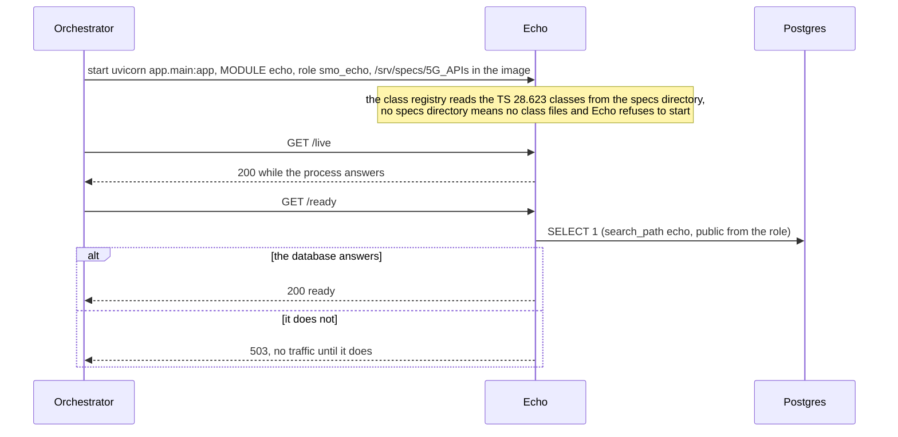
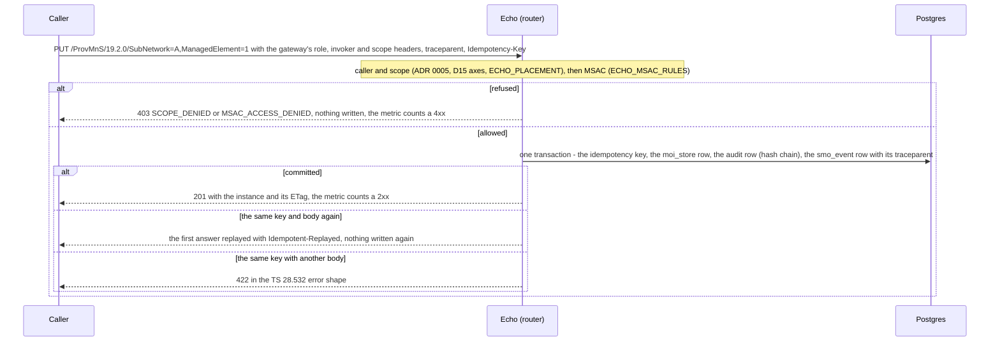
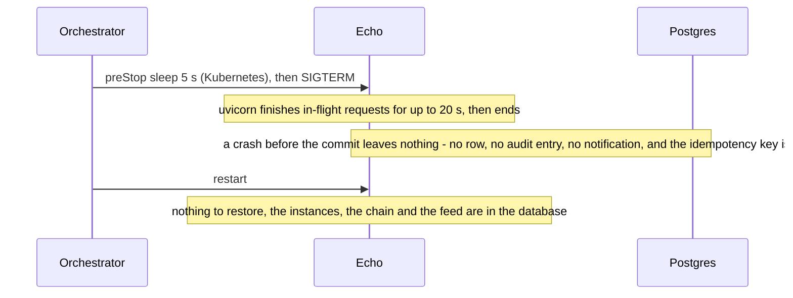

# Echo: lifecycle

Echo is the reference ProvMnS module (plan task S1.6): the shared router of `smo_shared.mns` on SubNetwork and ManagedElement, and nothing else. It
keeps its instances in `echo.moi_store` (revision 0066), publishes a notification for every change on the event bus, and has no worker. It is not in
R1 Termination's routing table until S1.7 and S1.8, and is off by default (compose profile `echo`, `modules.echo.enabled: false`). What its route
does is in [`../README.md`](../README.md). Three diagrams:

| | Step | Who starts it | Ends with |
|---|---|---|---|
| a | Starting and becoming ready | the orchestrator (compose, Kubernetes) | a replica that answers `/live`, and `/ready` once its database answers |
| b | A write (createMOI, modifyMOIAttributes, deleteMOI) | a caller of ProvMnS | the change, its audit row and its notification committed together, or a refusal that changed nothing |
| c | Stopping, crashing and recovering | the orchestrator, a crash | nothing to recover: every write is one transaction |

**How to read the diagrams.** As in the call flows: an arrow is one call with the inputs that matter, a box on the receiver says what it does with
them, an `alt` block is the outcome (success first, then each failure and what the caller gets).

## a — Starting and becoming ready

Echo calls no other module, so readiness is the database only. The migrate job made schema `echo` and its `moi_store` (revision 0066) before any
replica starts.

## b — A write

A read follows the same first two steps. A DN outside the caller's reach answers 404 `MOI_NOT_FOUND`, as if it did not exist, and the instances a
scoped read reaches below the base are filtered.

## c — Stopping, crashing and recovering

A caller that got no answer repeats the request with the same `Idempotency-Key`: a committed create is replayed, an uncommitted one runs again.

## Configuration it reads

| Variable | Default | What it changes |
|---|---|---|
| `ECHO_PLACEMENT` | empty | where each DN is for the scope claim (DN prefix to region, tenant, site cluster) |
| `ECHO_MSAC_RULES` | empty | the TS 28.319 AccessRules of each caller it manages |
| `SMO_DATABASE_URL`, `SMO_DATABASE_PASSWORD_FILE` | set by compose and the chart | the database and role `smo_echo` |
| `SMO_EVENT_BUS` | `table` | where the notifications go |

## Decisions this module depends on

- **All behaviour is the shared library's** (S1.1 to S1.5): Echo adds settings, not logic.
- **Off by default**: a reference and test module with no operator function ([`../README.md`](../README.md#15-design-decisions)).
- **Reached through R1 only after S1.7 and S1.8**: the last condition of milestone M1.
