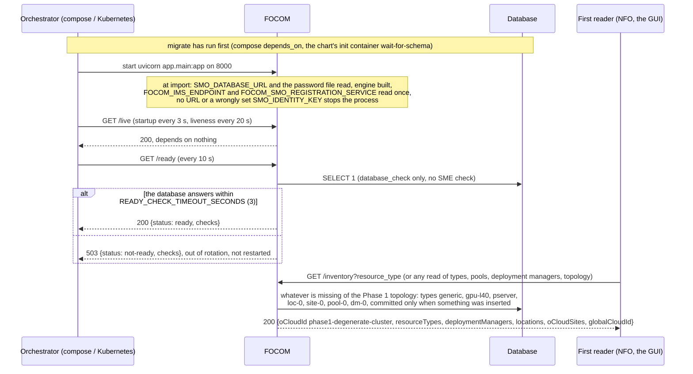
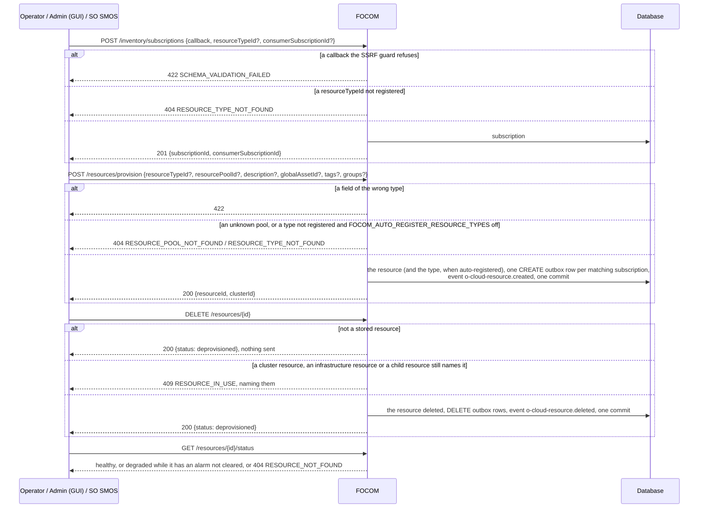
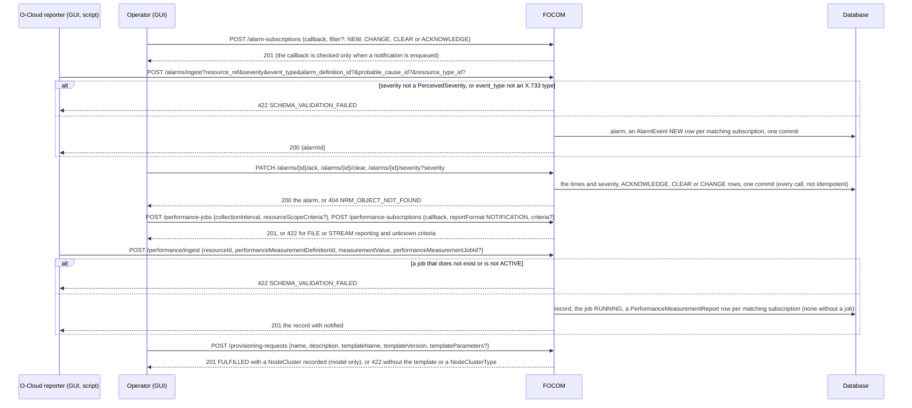
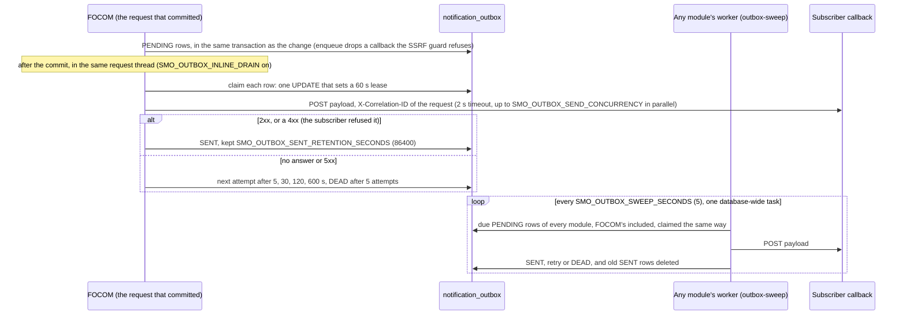
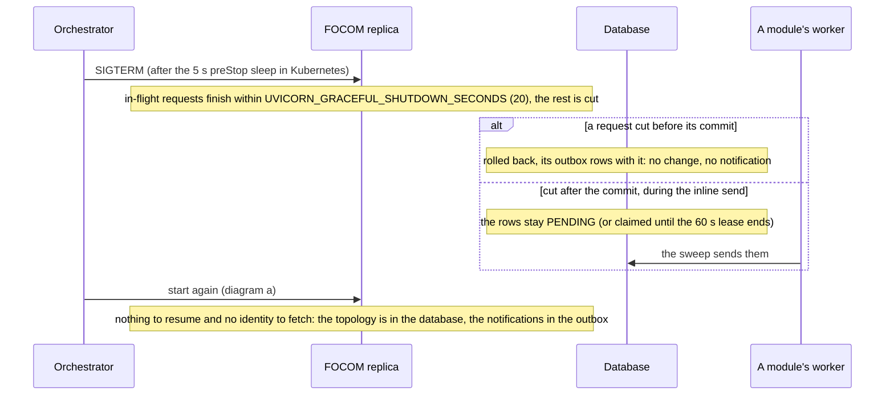

# FOCOM: lifecycle

FOCOM (the O-Cloud management service, O2-IMS) keeps the O-Cloud inventory: resource types, locations, sites, pools, deployment managers and resources,
the infrastructure alarms and performance records, the O2-IMS cluster and provisioning objects, and the subscriptions told about their changes. It is
served behind R1 Termination at `/focom`, keeps its tables (`resource_type`, `resource_pool`, `resource`, `ocloud_alarm`, `o2ims_object` and the
subscription tables, among others) in the database schema `focom` and connects as the role `smo_focom`. The design is in its
[README](../README.md); the inventory flows are call flow [16](../../docs/call-flows/16-focom-resource-inventory-lifecycle.md). This document follows the
module itself. Five diagrams:

| | Step | Who starts it | Ends with |
|---|---|---|---|
| a | Starting and becoming ready | the orchestrator; the first read | a replica that answers `/ready` 200, the Phase 1 topology seeded on first use |
| b | Inventory: subscribing, provisioning, deprovisioning | NFO, SO SMOS, Operator and Admin (GUI) | a resource in its pool or gone, its subscribers' notifications in the outbox |
| c | Alarms, performance and provisioning requests | the O-Cloud's reporter (GUI, a script), Operator (GUI) | the record stored and the matching subscribers' notifications in the outbox |
| d | Notifications: the outbox and who retries | the commit of b or c; any module's worker | each notification sent, retried, or DEAD |
| e | Stopping, crashing and recovering | the orchestrator, a crash | requests finished or rolled back, notifications still owed sent by a worker |

**How to read the diagrams.** As in call flow 01: an arrow is one call with the inputs that matter, a box on the receiver says what it does with them,
an `alt` block is the outcome (success first, then each failure and what the caller gets). Every call reaches FOCOM through R1 Termination; an rApp may
read but change nothing under `/focom` (R1 refuses it). FOCOM calls no other module: what leaves it are notifications to subscribers' callbacks, each
an outbox row committed with the change.

## a — Starting and becoming ready

FOCOM has no identity at SME: it makes no call over R1, so it never registers an invoker or asks for a token (its database role is not even granted
`module_identity`), although compose mounts the enrollment secret. It registers nothing and seeds nothing at start: the Phase 1 topology is inserted by
the first read that needs it (D-DEPLOY-FOCOM-1), so every replica and every restart find it in place. Two first reads racing on an empty database can
both insert the same keys; the loser answers 500 and a retry succeeds. NFO reads `oCloudId` here at every instantiate (call flow 15b).

## b — Inventory: subscribing, provisioning, deprovisioning

The notification is O2-IMS's `InfrastructureInventoryEvent` (one `notificationId` for every subscriber of the same change); its delivery is diagram d.
Defaults are `generic` for the type and `pool-0` for the pool. Locations, sites and pools are created and deleted under `/locations`, `/o-cloud-sites`
and `/resource-pools` (422 while something still sits in them); `pool-0` deleted when empty is seeded again by the next read. `GET /topology` exports
types, pools, deployment managers and resources in the TEIV shape. **Phase 1:** one degenerate cluster; nothing is built on an O-Cloud.

## c — Alarms, performance and provisioning requests

The alarms here are the infrastructure's (host, node, cluster); RAN-function alarms belong to RAN NF OAM (call flow 20). The O2-IMS artifact, cluster
and infrastructure objects (`/artifact-resources`, `/node-clusters`, `/cluster-resources`, `/infrastructure-resources` and their types) are stored
records with reference checks, created and deleted on request; no notification comes from them. **Phase 1:** nothing collects measurements or
alarms (they are ingested), `reportInterval` and the other reporting settings are stored but a report goes out as soon as a matching record arrives,
and a provisioning request deploys no cluster.

## d — Notifications: the outbox and who retries

A notification exists exactly when its change was committed (PR-MSG-1.8): a request that rolls back leaves no row, and an unreachable subscriber never
fails a request (it costs the request at most the 2 s send). FOCOM has no worker of its own: every retry, and every row whose first send was cut, is
sent by the shared `outbox-sweep` of whichever module's worker is running (`rapp-mgmt-worker`, `dme-worker`, `ran-nf-oam-worker` and others; one claim
for the whole database, PR-MSG-2). Delivery is at least once: a row claimed by a process that died is due again when its lease ends.

## e — Stopping, crashing and recovering

Any number of replicas can serve: every route reads and writes the database in one transaction, and the outbox claim keeps two replicas from sending
the same row. FOCOM's tables are not versioned, so two concurrent writes to the same alarm both succeed, the last one winning. With no worker running
at all, a notification whose first send failed waits in the outbox until one is. **Phase 1:** a subscriber that is down longer than about 13 minutes
(the five attempts) loses the notification: DEAD rows are kept but never resent.

## Configuration it reads

| Variable | Default | What it changes |
|---|---|---|
| `SMO_DATABASE_URL`, `SMO_DATABASE_PASSWORD_FILE` | none (required) | the database and the role `smo_focom` |
| `FOCOM_AUTO_REGISTER_RESOURCE_TYPES` | empty (off) | `true`, `1` or `yes`: provisioning an unknown `resourceTypeId` registers it instead of 404; read per call |
| `FOCOM_IMS_ENDPOINT` | `/focom` | `infrastructureManagementServicesEndPoint` in `GET /inventory`; read at start |
| `FOCOM_SMO_REGISTRATION_SERVICE` | `http://r1-termination:8000` | `smoRegistrationService` in `GET /inventory` (https with mTLS on); read at start |
| `SMO_OUTBOX_INLINE_DRAIN` | `true` | `false`: no send after the commit, only the workers' sweep sends |
| `SMO_OUTBOX_SEND_CONCURRENCY` | `8` | notifications one drain sends in parallel |
| `SMO_OUTBOX_SENT_RETENTION_SECONDS` | `86400` | how long a SENT row is kept for the delivery log |
| `SMO_EVENT_BUS` | `table` | where `o-cloud-resource.created` and `.deleted` go (`off` publishes nothing) |
| `READY_CHECK_TIMEOUT_SECONDS` | `3` | how long the `/ready` database check may take |
| `UVICORN_WORKERS`, `UVICORN_GRACEFUL_SHUTDOWN_SECONDS` | `1`, `20` | processes per container, and how long a stop lets requests finish |

## Decisions this module depends on

- **Phase 1 is one degenerate O-Cloud**, seeded lazily by the reads, never at start (D-DEPLOY-FOCOM-1).
- **Resource types are closed** (SA-FOCOM-9): an unknown type is refused unless auto-registration is switched on.
- **Every notification is an outbox row committed with its change** and retried by the workers' shared sweep (PR-MSG-1.8, PR-MSG-2).
- **An inventory subscription's callback is checked when it is made** (call flow 16a); a resource still named by another object is not deprovisioned,
  and an unknown one sends nothing (call flow 16d).
- **FOCOM's alarms and performance are the infrastructure's**, O2-IMS shaped (SA-FOCOM-6); its cluster and provisioning objects are model-only (SA-FOCOM-7).
- **Liveness depends on nothing, readiness on the database only** (PR-ST-7); the schema belongs to the migration (PR-OPS-1.5), the role to
  `db_roles.py` (PR-DB-2.6).
