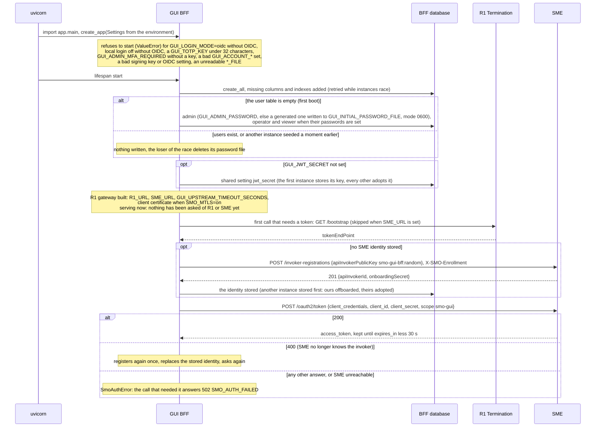
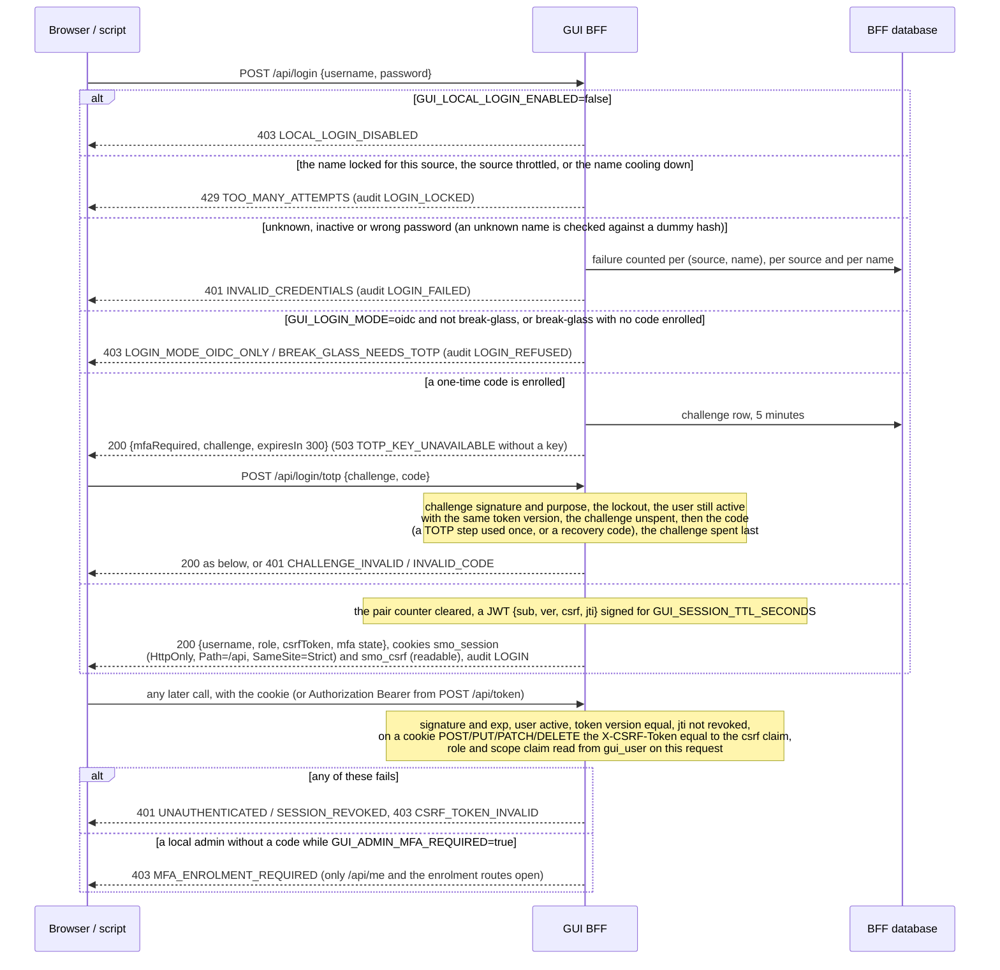
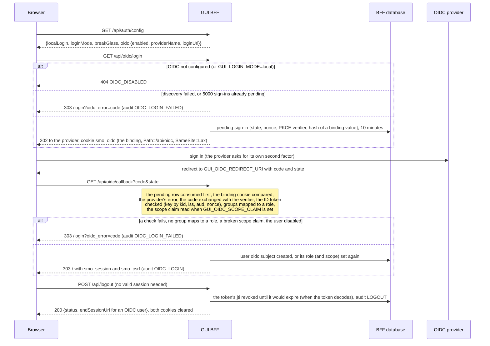
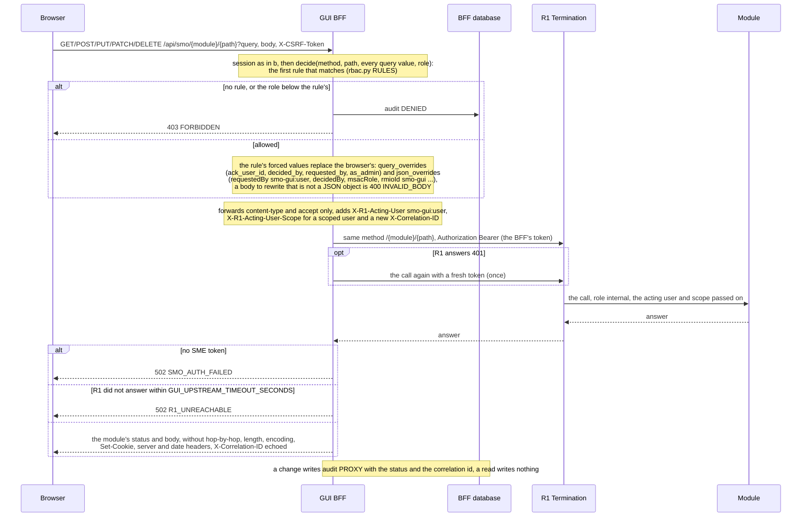
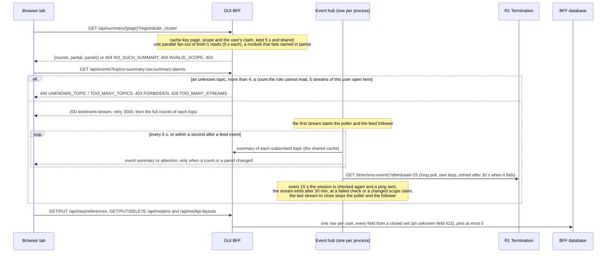
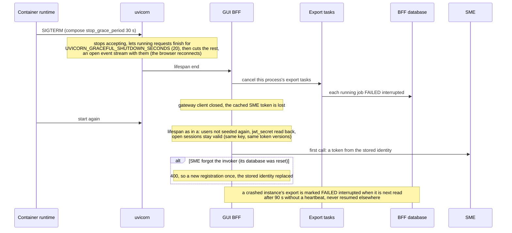

# GUI backend (gui-bff): lifecycle

The GUI backend (BFF) is the only API the browser talks to: it keeps the console's users, roles and audit log in its own small database, issues the
session, checks every call against its permission table and forwards the allowed ones to R1 Termination with its own SME token. Its design is in
[`../README.md`](../README.md); this document follows one BFF process from start to stop. Six diagrams:

| | Step | Who starts it | Ends with |
|---|---|---|---|
| a | Starting and becoming ready | the container (uvicorn) | users seeded, the signing key agreed, the R1 gateway built; the SME identity made on the first call that needs it |
| b | Local sign-in, the one-time code and the session check | a person at the sign-in page, a script (`/api/token`) | the session cookies (or a Bearer token), a challenge, or a refusal |
| c | OIDC sign-in and sign-out | a person ("Sign in with ...") | the session cookies after the provider's callback; a revoked session at logout |
| d | A call through the proxy | any page of the console | the module's answer, or the BFF's own 403 / 502, a change audited |
| e | Counts, the event stream and preferences | the shell of an open tab | counts pushed when they change; per-user settings stored |
| f | Stopping and recovering | SIGTERM, a restart, an SME reset | export jobs ended `FAILED`, sessions and identity read back from the database |

**How to read the diagrams.** As in [call flow 01](../../docs/call-flows/01-rapp-onboarding-to-deployment.md): an arrow is one call with the inputs that
matter, a box on the receiver says what it does with them, an `alt` block is the outcome (success first, then each failure and what the caller gets).
*Browser* is the console's code (or a script); the console's nginx in front of the BFF forwards `/api/...` unchanged and is not drawn. Every audit row
is one row of `gui_audit_log`, written in its own commit.

## a — Starting and becoming ready

The BFF has no `/live` or `/ready` of its own. Compose gives it no healthcheck, and the Helm chart runs it as `kind: static` with a TCP probe on its
port: it is "ready" as soon as uvicorn listens. Everything that touches the SMO is lazy, so a BFF whose R1 or SME is down still starts, signs people in
and writes its audit log; only the pages that read the SMO fail (502). The SME identity is one row in the BFF database, shared by every instance on that
database (PR-ST-5); the token is cached per process, and refreshes are serialised by a lock.

**Phase 1:** the default `GUI_DATABASE_URL` is a SQLite file on one volume, so the chart runs one replica. Several instances need one shared database
(and `GUI_ADMIN_PASSWORD` set, so seeding does not race on generated passwords).

## b — Local sign-in, the one-time code and the session check

`POST /api/token` (form `grant_type=password`, `username`, `password`, `otp`) runs the same checks and lockout and answers a Bearer token of the same
lifetime, which needs no CSRF header; an account with a one-time code must send `otp`. A session ends without a session list: a password change, a
password reset, a deactivation and `POST /api/admin/users/{name}/revoke-sessions` bump the user's `token_version`, which every session token carries; a
role or scope change needs nothing, because both are read from the table on every request.

## c — OIDC sign-in and sign-out

A person removed from every mapped group, or whose scope claim no longer reads, also loses the sessions already open: the callback bumps the user's
token version before it refuses. The provider's discovery document and signing keys are cached per process (keys for an hour, refetched at most every
30 s for an unknown `kid`). An OIDC user has no password (`UNUSABLE_HASH`) and enrols no one-time code here.

## d — A call through the proxy

The permission table is an allow-list: a route with no rule is unreachable from the console, and machine-to-machine routes are left out on purpose.
The correlation id is minted here, never taken from the browser ([call flow 14d](../../docs/call-flows/14-correlation-id-propagation.md)). A rApp's
own page takes a second road, `/api/rapps/{instance}/operator/{route}`: only a route its package's `operatorUi` declares is allowed (403
`UNDECLARED_ROUTE`, `RAPP_READ_ONLY`, `FORBIDDEN`, 413, 422), a change is audited `RAPP_ACTION` before and after it is sent, and the call goes to R1's
`/rapps/{instanceId}/operator/...` with a 65 s timeout. `GET /api/modules/status` probes R1 and the fifteen modules in parallel and always answers 200.

## e — Counts, the event stream and preferences

A tile reads a total, never a list, and fifty open tabs on one page cost one fan-out per 5 s. The event feed is only a cue to recompute sooner; a
feed that cannot be read leaves the 5 s poll carrying the streams. Exports (`POST /api/exports`) are the one other background work: an asyncio task in
the accepting instance pages its source into `gui_export_chunk` rows with a heartbeat per page (at most 3 active jobs per user, files kept 24 h).

**Phase 1:** the stream cap (5 per user) and the poller are per process; several instances each count their own.

## f — Stopping and recovering

Users, revoked sessions, challenges, pending OIDC sign-ins, the SME identity, the generated signing key, the audit log, exports and preferences are in
the database and survive; the SME token, the summary cache, the streams and the provider's keys are per process and do not. Audit retention is a
command, not a task: `python -m app.retention` (cron, or `kubectl exec`) deletes rows older than `GUI_AUDIT_RETENTION_DAYS`.

## Configuration it reads

| Variable | Default | What it changes |
|---|---|---|
| `R1_URL` | `http://r1-termination:8000` | Where every SMO call, the module health probe and `/bootstrap` go |
| `SME_URL` | empty: discovered from R1's `/bootstrap` | The SME base for registration and the token endpoint |
| `SMO_ENROLLMENT_SECRET[_FILE]` | empty | Sent at registration so SME records the BFF as `internal` (compose mounts it as a secret) |
| `SMO_MTLS`, `SMO_MTLS_CERT_FILE`, `_KEY_FILE`, `_CA_FILE` | `off`, `/run/mtls/...` | The BFF's calls to R1 and SME present its certificate; `http://` peers become `https://`; read once at start |
| `GUI_DATABASE_URL` | `sqlite:///./gui-bff.db` (compose: `/data/gui-bff.db`) | The BFF's own store; one shared database for several instances |
| `GUI_JWT_SECRET` | empty: generated once and stored in the database | The HS256 session key; changing it signs everyone out |
| `GUI_JWT_ALGORITHM`, `GUI_JWT_PRIVATE_KEY_FILE`, `GUI_JWT_PREVIOUS_KEY_FILES` | `HS256`, empty, empty | RS256 / ES256 sessions with a published key set; a bad combination stops the start |
| `GUI_SESSION_TTL_SECONDS` | `28800` | How long a session (and a `/api/token` token) lasts |
| `GUI_COOKIE_SECURE` | `true` | The Secure flag of the two cookies |
| `GUI_ADMIN_PASSWORD`, `GUI_OPERATOR_PASSWORD`, `GUI_VIEWER_PASSWORD`, `GUI_INITIAL_PASSWORD_FILE` | empty, empty, empty, `./initial-admin-password` | First-boot seeding only |
| `GUI_LOCAL_LOGIN_ENABLED`, `GUI_LOGIN_MODE` | `true`, `both` | Who may use the password form; checked against the OIDC settings at start |
| `GUI_OIDC_ENABLED` and the other `GUI_OIDC_*` | `false` | OIDC sign-in: issuer, client, redirect URI, group-to-role map, default role, scope claim, timeout |
| `GUI_TOTP_KEY[_FILE]`, `GUI_ADMIN_MFA_REQUIRED` | empty, `false` | One-time codes for local accounts; admins forced to enrol |
| `GUI_TRUSTED_PROXY_HOPS` | `1` | Which `X-Forwarded-For` entry is the client, for the lockout and the source throttle |
| `GUI_ACCOUNT_MAX_FAILURES`, `_WINDOW_SECONDS`, `_COOLDOWN_SECONDS`, `_COOLDOWN_MAX_SECONDS` | `20`, `600`, `60`, `300` | The per-name cool-down; a nonsense set stops the start |
| `GUI_UPSTREAM_TIMEOUT_SECONDS` | `30` | How long a proxied call waits for R1 |
| `GUI_HEALTH_TIMEOUT_SECONDS` | `3` | How long each module probe of `/api/modules/status` waits |
| `GUI_AUDIT_RETENTION_DAYS`, `GUI_AUDIT_EXPORT_DIR` | `0`, empty | What `python -m app.retention` deletes, and where it writes it first |

## Decisions this module depends on

- **The BFF is the authority, the browser never reaches R1** (gui-bff README 1.5): an allow-list of rules, first match wins, role read from the table
  on every request; identity fields forced from the session (`query_overrides`, `json_overrides`).
- **The BFF is an SMO module at SME** (PR-SEC-14): it registers with the enrollment secret and asks for `smo-gui`; R1 sees the BFF, and the person
  travels in `X-R1-Acting-User` (SEC-15.8) with their scope claim in `X-R1-Acting-User-Scope` (GUI-5).
- **Sessions are signed tokens, ended by version or by `jti`** (PR-SEC-5 for the keys; logout records the `jti`, PR-SEC-7.5 for revoke-sessions).
- **Two layers of second factor** (PR-SEC-7): the provider's for OIDC users (PR-SEC-6), a one-time code for local accounts and the break-glass account.
- **Sign-in throttling by pair, source and name** (SEC-15.11, SEC-15.11b).
- **One shared database for every instance** (PR-ST-5): seeding, the generated key and the SME identity are written once and adopted by the others.
- **Counts, not lists, and pushed** (GUI-9.1, GUI-1.5 for the event feed cue); **exports as jobs in the database** (GUI-9.5b).
- **One correlation id per console action** ([call flow 14d](../../docs/call-flows/14-correlation-id-propagation.md)); **a rApp's page only on its
  declared routes** (PR-GUI-8).
- **Retention by command, not by worker** (PR-DB-3.6): the BFF does not install `smo_shared` and has no worker.
