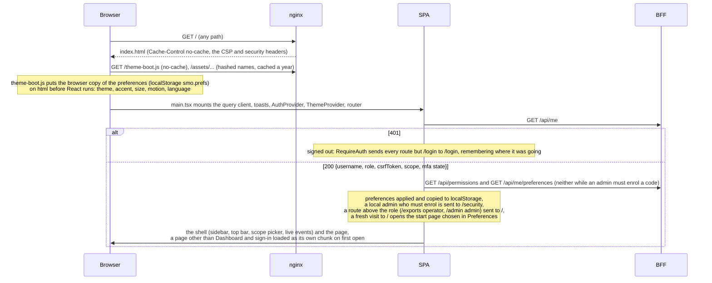
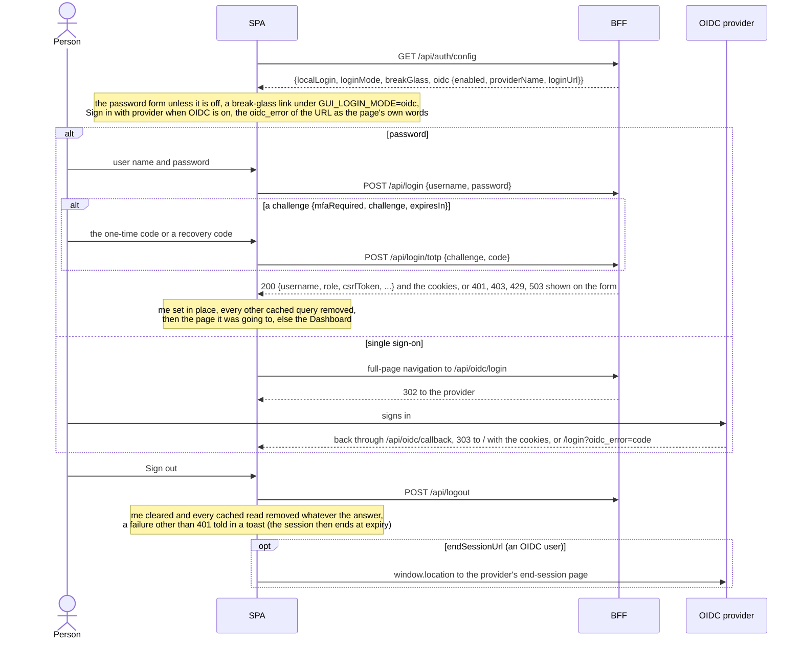
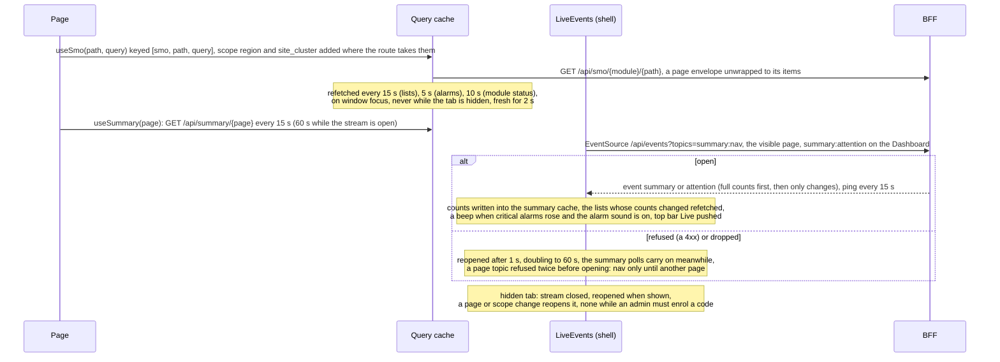
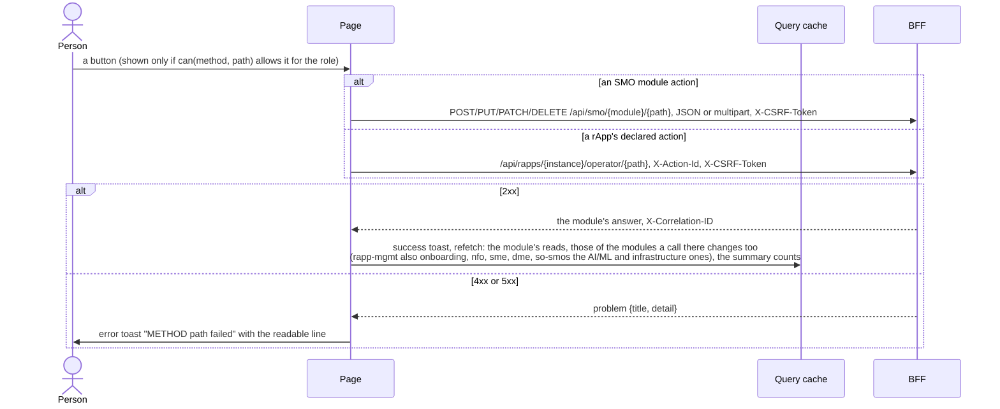
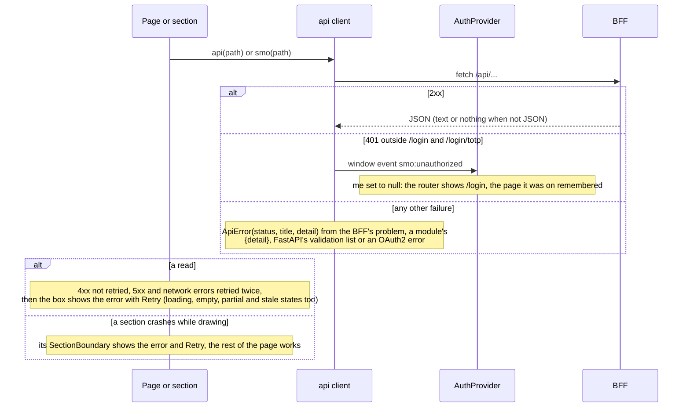

# Operator console (gui): lifecycle

The console is a single-page app (React, React Query, React Router) served by an unprivileged nginx, which also forwards `/api/...` to the GUI backend.
The browser talks to nothing else: every read and every action goes to the BFF ([`../../gui-bff/docs/lifecycle.md`](../../gui-bff/docs/lifecycle.md)),
which checks it and calls the SMO. Pages, roles and security: [`../README.md`](../README.md). This document follows one browser tab from loading to
closing. Five diagrams:

| | Step | Who starts it | Ends with |
|---|---|---|---|
| a | Loading the console | a person opening the console's URL | the shell drawn for the signed-in user, or the sign-in page |
| b | Signing in and out | a person at the sign-in page or in the sidebar | the session in the BFF's cookies, every cached read of the last user dropped |
| c | Reading data: polling and the event stream | every open page, the shell | tables and counts kept fresh while the tab is visible |
| d | Actions through the BFF | a button of a page, or of a rApp's declared page | a toast, and only the reads the action can have changed refetched |
| e | Errors and a lost session | any failed call, a crashed section | one readable line per error, a retry where it can help, the sign-in page on a 401 |

**How to read the diagrams.** As in [call flow 01](../../docs/call-flows/01-rapp-onboarding-to-deployment.md): an arrow is one call with the inputs
that matter, a box on the receiver says what it does with them, an `alt` block is the outcome (success first, then each failure and what the page
shows). *nginx* is the console's own container (`nginx.conf`); *BFF* stands for the GUI backend and everything behind it. Every `/api/...` call is
same-origin with `credentials: same-origin`, so the session cookie rides along, and every POST, PUT, PATCH and DELETE echoes the readable `smo_csrf`
cookie as `X-CSRF-Token`.

## a — Loading the console

The console has no build-time setting of its own: no API address is baked in, because every call is a relative `/api/...` path. Where `/api/` goes is
nginx's (`gui-bff:8000`, read timeout 60 s, body up to 50 MiB for package and artifact uploads, buffering off for `/api/events`); in development the
Vite server forwards it to `GUI_BFF_URL` (default `http://localhost:8090`). The CSP allows scripts, styles, fonts and connections from `self` only,
which is why the theme script is a file and the fonts are self-hosted. `/api/permissions` is the BFF's own rule table: the SPA evaluates the same
rules to decide which buttons to show, and the BFF checks every call again.

## b — Signing in and out

A 401 on the two sign-in routes is a form error; anywhere else it means the session ended (e). Removing the cached queries at sign-in and sign-out
means the next person at the same browser never sees the last one's data. The password change dialog (`POST /api/me/password`) and the Account
security page (`/api/me/totp...`, `/api/me/sign-ins`) are ordinary BFF calls.

## c — Reading data: polling and the event stream

The polls are the floor and the stream the fast path: a tile reads a summary count from the BFF (5 s cache shared by every user) rather than a list,
and while the stream is open the counts arrive pushed and the summary is read only once a minute as a safety net. The BFF ends a stream after 30 minutes
and the browser reconnects on its own. The scope picker (`?region=`, `?site_cluster=`) narrows every route that takes it and scopes every stream topic.

## d — Actions through the BFF

The rApp actions refresh the rApp's declared reads and those of rApp Management and RAN NF OAM; a `502 UPSTREAM_UNAVAILABLE` from R1 adds a hint that
the rApp's operator API is not reachable. What the console forces into a request (who acknowledged, who decided) is set by the BFF, not by the page.

## e — Errors and a lost session

A 403 `MFA_ENROLMENT_REQUIRED` cannot happen in normal use, because the route guard sends such an admin to Account security first; a 403 `FORBIDDEN`
on an action means the SPA's copy of the rules and the BFF disagreed, and the BFF wins. A module that does not answer shows as a partial count
("—", with the module named) rather than a failed page.

## Configuration it reads

| Setting | Default | What it changes |
|---|---|---|
| nginx `location /api/` | `proxy_pass http://gui-bff:8000`, read timeout 60 s, body 50 MiB | Where every call goes, how long one may take, the largest upload |
| nginx `location = /api/events` | buffering off, read timeout 3600 s | That pushed events reach the browser at once |
| `security-headers.conf` | CSP `default-src 'self'` and the rest | What the page may load and connect to |
| `GUI_BFF_URL` (Vite dev and preview only) | `http://localhost:8090` | The BFF a developer's console talks to |
| Polling cadences (`POLL` in `src/api/hooks.ts`) | lists 15 s, alarms 5 s, status 10 s, summary 15 s, inventory 60 s | How fresh a page is without the stream |
| `localStorage` `smo.prefs` | the BFF's defaults | The first paint's theme, size and language before `/api/me/preferences` answers |

## Decisions this module depends on

- **The browser talks only to the BFF, same origin** (gui README "Security"): no CORS, no token in the page, the session in an HttpOnly cookie with
  double-submit CSRF.
- **The SPA hides, the BFF decides** (`src/auth/permissions.fixture.json` is the BFF's table; `test_rbac.py` fails on drift).
- **Counts, not lists, and pushed** (SCALE.md P7, the stream; P8, targeted invalidation; P10, the explicit loading, empty, error, partial and stale
  states).
- **A second factor before anything else for a local admin** (PR-SEC-7.8); **single sign-on with RP-initiated logout** (PR-SEC-6).
- **A sign-out that the server did not confirm still signs out here** (GUI-10.7); **the scope picker** (GUI-9.3).
