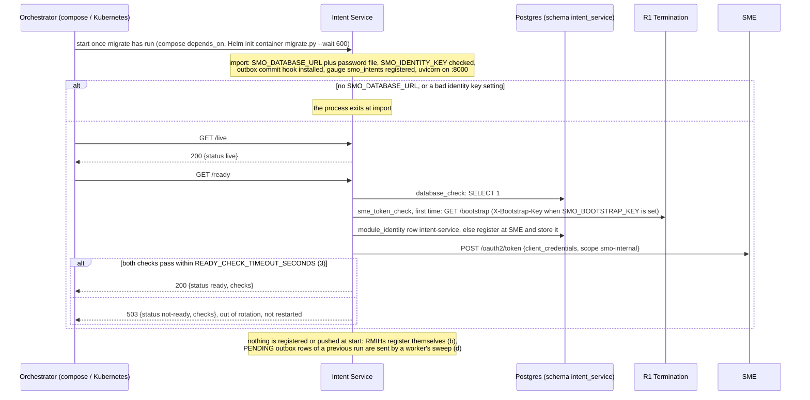
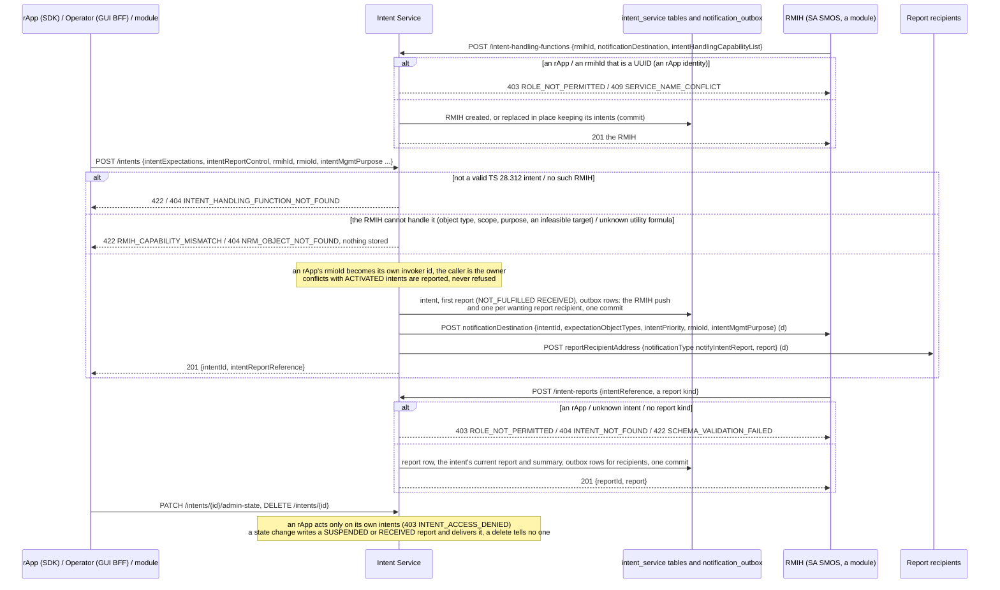
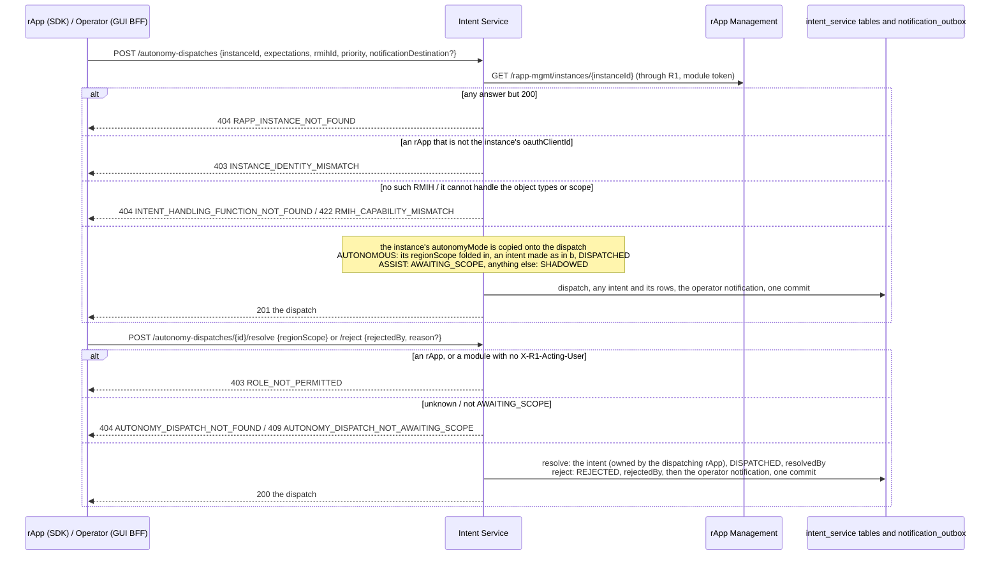
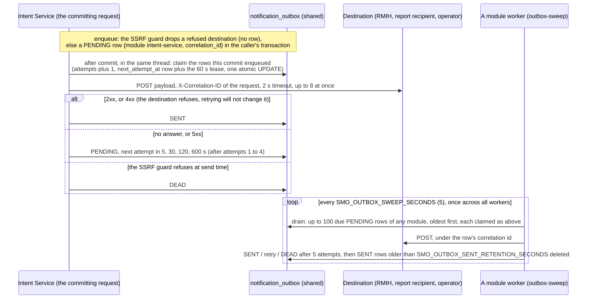
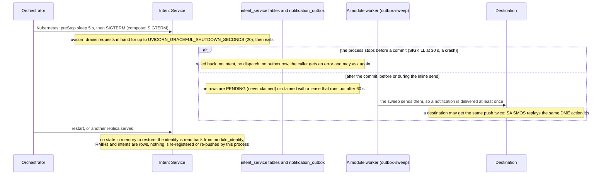

# Intent Service: lifecycle

Intent Service keeps TS 28.312 intents, the intent handling functions (RMIHs) they are addressed to, their reports and the rApp autonomy dispatches that turn
an inference outcome into an intent. It enacts nothing: it validates, stores and tells others, through its notification outbox. It is reached at the R1
prefix `/intent-service`, keeps `intent`, `intent_report`, `intent_handling_function`, `intent_utility_formula` and `autonomy_dispatch` in the database
schema `intent_service` (login role `smo_intent_service`, which may also use the shared `notification_outbox` and `module_identity`), and has no worker or
scheduled task of its own. Design record: [`../README.md`](../README.md). Five diagrams:

| | Step | Who starts it | Ends with |
|---|---|---|---|
| a | Starting and becoming ready | the orchestrator (docker compose, Kubernetes) | a replica answering `/ready` 200; nothing registered |
| b | Intents, reports and their notifications | an rApp (SDK), Operator / Admin (GUI BFF), SA SMOS or another module | the change and its notifications committed together |
| c | Autonomy dispatches | the instance's rApp (SDK), Operator (GUI BFF) | an intent (AUTONOMOUS), a dispatch awaiting the operator (ASSIST) or a record (SHADOW) |
| d | Delivering notifications: the outbox | the commit that enqueued; a module worker's sweep | each row SENT once, retried with backoff, or DEAD |
| e | Stopping, crashing and recovering | the orchestrator, a crash | nothing half-stored, every committed notification still delivered |

**How to read the diagrams.** As in call flow 01: an arrow is one call with the inputs that matter, a box on the receiver says what it does with them,
an `alt` block is the outcome (success first, then each failure and what the caller gets). Calls reach Intent Service through R1 Termination, which checks
the token and stamps the caller's role (`X-R1-Role`), invoker id and, for the console, the signed-in person (`X-R1-Acting-User`). Notifications leave
straight from Intent Service (or a worker) to the destination a caller gave; its one outbound R1 call is the rApp Management read of c.

## a — Starting and becoming ready

The SME identity and probes are the shared ones, described for SO SMOS in [its lifecycle](../../so-smos/docs/lifecycle.md) (a). Intent Service needs a
token only for the rApp Management read of c, but `/ready` asks for one all the same, so a replica that cannot reach SME is taken out of rotation even
for the intent routes that need no token.

## b — Intents, reports and their notifications

Every route that changes something enqueues its notifications before its one `db.commit()` (PR-MSG-1.9): the intent and the rows that announce it exist
together or not at all. A deregistration (`DELETE /intent-handling-functions/{id}`) is 409 `INTENT_HANDLING_FUNCTION_IN_USE` while intents are addressed to the
RMIH. Who may do what is [call flow 09](../../docs/call-flows/09-intent-service-intent-flow.md) (09a, 09b, 09c). **Phase 1:** the RMIH push is a notification,
not a request for an answer: an RMIH that never reports leaves the intent RECEIVED.

## c — Autonomy dispatches

A refused intent (an infeasible target, a cell outside the region scope: 422) rolls back the whole request, so an AUTONOMOUS dispatch never exists without
its intent and an ASSIST one stays AWAITING_SCOPE. Each call makes a new dispatch: there is no idempotency key. Details in
[call flow 09](../../docs/call-flows/09-intent-service-intent-flow.md) (09d, 09e).

## d — Delivering notifications: the outbox

Two things follow for this module. The inline send runs before the request answers, so `POST /intents` waits for its pushes (each bounded by 2 s), and
an RMIH that takes longer than 2 s to answer is counted as no answer and sent the intent again. And every retry is made by another module's worker:
Intent Service runs none (compose's `dme-worker`, `ran-nf-oam-worker`, `aimgf-worker`, `mdaf-worker`, `rapp-mgmt-worker` and the Helm workers all run the
sweep unless `SMO_OUTBOX_SWEEP=false`); without any worker a failed push is never retried. `GET /metrics` shows the backlog as
`smo_outbox_rows{module="intent-service",status}` and `smo_outbox_oldest_pending_age_seconds`. Correlation ids: [call flow 14](../../docs/call-flows/14-correlation-id-propagation.md) (14c).

## e — Stopping, crashing and recovering

Replicas share only the database. The atomic claim means two replicas, or a replica and a worker, never send the same row at the same time; the
`smo_intents{admin_state}` gauge is cached per process for `SMO_BUSINESS_METRICS_TTL_SECONDS`, so aggregate it across replicas with `max`. An intent's
reports and its RMIH reference are rows, so a restart changes nothing a reader sees.

## Configuration it reads

| Variable | Default | What it changes |
|---|---|---|
| `SMO_DATABASE_URL` (or `_FILE`), `SMO_DATABASE_PASSWORD_FILE` | none: the process does not start | The database; compose and Helm connect as `smo_intent_service` |
| `R1_GATEWAY_URL` | `http://r1-termination:8000` | The bootstrap and the rApp Management read (compose does not set it, the default applies) |
| `SMO_HTTP_TIMEOUT_SECONDS` | 30 | How long the rApp Management read of an autonomy dispatch may take |
| `SMO_OUTBOX_INLINE_DRAIN` | true | `false`: nothing is sent after the commit, every notification waits for a worker's sweep |
| `SMO_OUTBOX_SEND_CONCURRENCY` | 8 | How many rows one drain sends at once |
| `SMO_OUTBOX_SWEEP`, `SMO_OUTBOX_SWEEP_SECONDS`, `SMO_OUTBOX_SENT_RETENTION_SECONDS` | on, 5, 86400 | Read by the workers that retry this module's rows, and how long SENT rows are kept |
| `SMO_BUSINESS_METRICS_TTL_SECONDS` | 15 | How long the `smo_intents` and outbox gauges are cached before the database is queried again |
| `SMO_BOOTSTRAP_KEY`, `SMO_ENROLLMENT_SECRET_FILE`, `SMO_INVOKER_ID` / `_SECRET` | unset | The SME identity, as for every module ([SO SMOS lifecycle](../../so-smos/docs/lifecycle.md)) |
| `SMO_IDENTITY_KEY` (or `_FILE`), `SMO_IDENTITY_PREVIOUS_KEY` | unset | Encrypts the stored invoker secret; a bad setting stops the process at start |
| `MODULE` | `intent-service` (set by the image) | The `module` of its outbox rows and its identity's key in `module_identity` |
| `READY_CHECK_TIMEOUT_SECONDS` | 3 | How long `/ready` waits for the database and SME checks |
| `UVICORN_WORKERS`, `UVICORN_GRACEFUL_SHUTDOWN_SECONDS` | 1, 20 | Server processes per container, and the drain on SIGTERM |

## Decisions this module depends on

- **Notifications are outbox rows in the change's transaction** (PR-MSG-1.2 to 1.4, PR-MSG-1.9): sent after the commit, retried by any worker's sweep
  (PR-MSG-2), at least once.
- **Consumer-side selection** (TS 28.312 containment, call flow 09a): the creator names one registered RMIH, which must cover the intent; conflicts are
  reported, not refused.
- **Handlers and reports are the SMO's** (D-SEC-POLICY-1, DOC-CF-1.8): an rApp registers no RMIH and publishes no report; registering again updates in
  place, and an RMIH with intents is not removed (call flow 09c).
- **An intent belongs to its creator, a dispatch to its instance's rApp** (DOC-CF-1.8, call flows 09b, 09d), and **an ASSIST decision is a signed-in
  person's** (09e).
- **The autonomy mode is the instance's** (HISTORY.md OI-6.3): read from rApp Management at each dispatch and copied onto it.
- **One SME identity per module** (PR-ST-4), **separate liveness and readiness** (PR-ST-7), **its own schema and role** (PR-DB-2.6, revision 0024).
