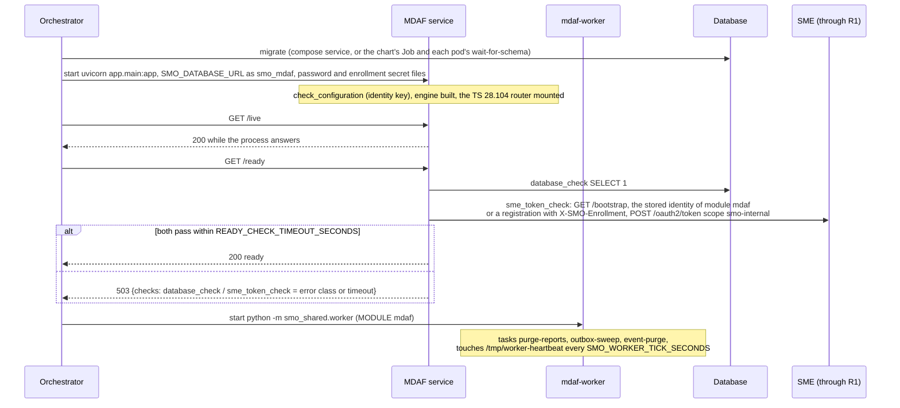
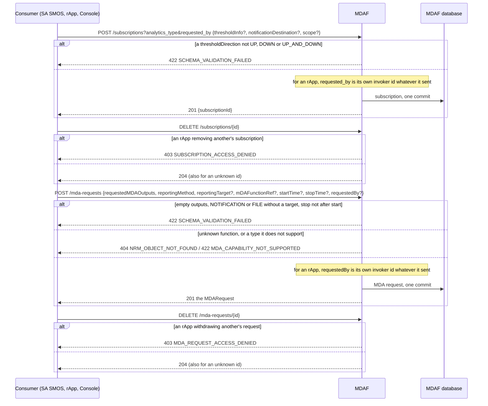
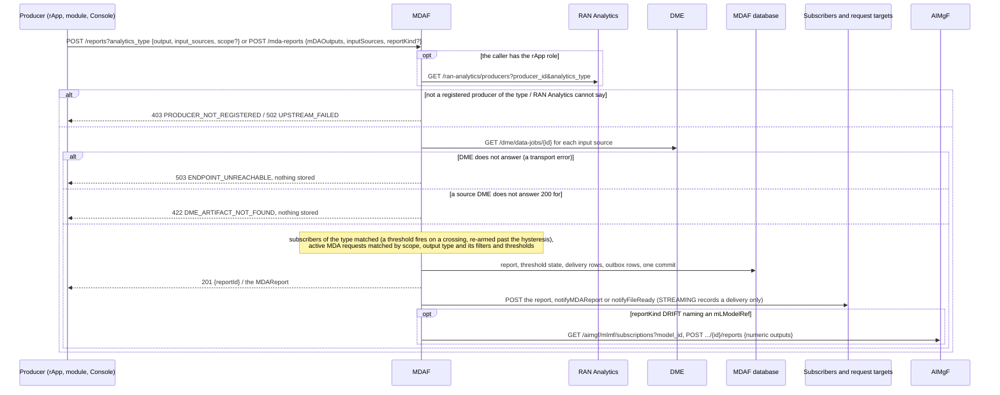
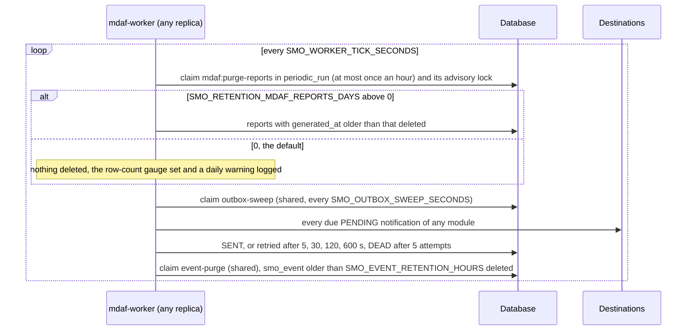
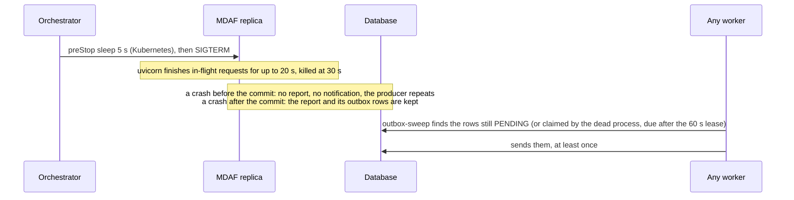

# MDAF: lifecycle

MDAF, the Management Data Analytics Function, stores analytics reports and delivers them: to the subscribers of a report's analytics type and to the
open TS 28.104 MDA requests a report satisfies; a drift report that names a model is also passed to that model's MLMF subscriptions at AIMgF. It is
reached at the R1 prefix `/mdaf` through R1 Termination, keeps its tables in the database schema `mdaf` (role `smo_mdaf`, which also uses the shared
`module_identity`, `notification_outbox`, `periodic_run` and `smo_event`), and runs as two processes from one image: the HTTP service and the worker
`mdaf-worker`. What each route does is in [`../README.md`](../README.md). Five diagrams:

| | Step | Who starts it | Ends with |
|---|---|---|---|
| a | Starting and becoming ready | the orchestrator (compose, Kubernetes) | a ready replica and a worker ticking |
| b | Subscriptions and MDA requests | consumers: SA SMOS, rApps, the console | a subscription with its thresholds, an MDA request with its reporting method |
| c | Publishing a report | a producer rApp (SDK), an SMO module, the console | the report stored and every notification it causes committed with it, then sent |
| d | The worker | `mdaf-worker` on its own | old reports purged, every pending notification sent |
| e | Stopping, crashing and recovering | the orchestrator, a crash | what is re-sent and what is lost |

**How to read the diagrams.** As in the call flows: an arrow is one call with the inputs that matter, a box on the receiver says what it does with them,
an `alt` block is the outcome (success first, then each failure and what the caller gets). Calls reach MDAF through R1 Termination, which stamps the caller's
role and invoker id. MDAF's calls to DME, RAN Analytics and AIMgF go back through R1 with MDAF's own token. Notifications to subscribers and request targets
are outbox rows committed with the report (`smo_shared.outbox`) and sent after the commit, straight to the destination (not through R1).

## a — Starting and becoming ready

MDAF registers nothing at SME but its own invoker (shared by its replicas, PR-ST-4). The SME check is in readiness because a report cannot be accepted
without asking DME about its sources (c). The worker makes no call through R1 and asks SME for nothing.

## b — Subscriptions and MDA requests

A notification destination is not checked when it is stored: the outbox's SSRF guard drops an unsafe one when a report is queued, and the subscription
stays. A subscription with no destination is a polling consumer (`GET /reports`, `GET /reports/{id}`). Subscribing and thresholds are
[call flow 08b](../../docs/call-flows/08-ran-analytics-data-production.md); SA SMOS's monitor subscription is [call flow 04a](../../docs/call-flows/04-closed-loop-assurance.md).

## c — Publishing a report

The report and every notification it causes are one transaction (PR-MSG-1.8): nothing is sent for a report that did not commit. The drift forwarding
runs after the commit, on MDAF's own account (no `X-R1-On-Behalf-Of`, so AIMgF's owner rule does not judge the publisher), and is best effort: AIMgF down skips it and never fails the publish ([call flow 13c](../../docs/call-flows/13-mlmf-subscription-lifecycle.md)).
Publishing is [call flow 08c](../../docs/call-flows/08-ran-analytics-data-production.md). DME not answering is 503 `ENDPOINT_UNREACHABLE`, with nothing
stored. **Phase 1:** STREAMING has no transport.

## d — The worker

The outbox sweep and the event purge are one task for the whole database, claimed by whichever module's worker ticks first, so MDAF's notifications
are still retried while `mdaf-worker` is down if another worker runs. A destination that answers 4xx is SENT (a refusal a retry will not change).
Retention is [call flow 08d](../../docs/call-flows/08-ran-analytics-data-production.md) and `docs/RETENTION.md`.

## e — Stopping, crashing and recovering

What is lost in a crash is only what runs after the commit: the drift forwarding to AIMgF, which nothing re-does. A subscriber may get a notification
twice (a crash after the send and before SENT is recorded); `reportId` lets it tell. A worker killed mid-task frees its claim with its connection and
another worker picks the task up. Any number of service replicas share the database; the threshold state is a column of the subscription and of the
MDA request, written in the report's transaction.

## Configuration it reads

| Variable | Default | What it changes |
|---|---|---|
| `SMO_DATABASE_URL`, `SMO_DATABASE_PASSWORD_FILE` | none (required) | the database; without it the process does not start |
| `R1_GATEWAY_URL` | `http://r1-termination:8000` | where the calls to DME, RAN Analytics, AIMgF and SME's bootstrap go |
| `SMO_ENROLLMENT_SECRET_FILE` | unset | makes SME record MDAF as an SMO module (`internal`) |
| `SMO_IDENTITY_KEY` (or `_FILE`) | unset | encrypts the stored invoker secret, a wrong value stops the process |
| `SMO_RETENTION_MDAF_REPORTS_DAYS` | 0 | days a report is kept before `purge-reports` deletes it (0 keeps them) |
| `SMO_RETENTION_WARN_ROWS` | 1000000 | the row count above which a kept-forever table is warned about |
| `SMO_OUTBOX_INLINE_DRAIN` | `true` | send a notification right after its commit, or leave it to the worker |
| `SMO_OUTBOX_SWEEP_SECONDS`, `SMO_WORKER_TICK_SECONDS` | 5, 5 | how often a worker sends what is pending and ticks |
| `READY_CHECK_TIMEOUT_SECONDS` | 3 | how long `/ready` waits for the database and SME |

## Decisions this module depends on

- **A report and its notifications are one transaction** (PR-MSG-1.8): outbox rows, threshold state and deliveries commit with the report.
- **Only a registered producer publishes** (call flow 08c): an rApp is checked at RAN Analytics, a refusal there is 502, not a guess.
- **A report's sources are real DME data jobs** (MDAF reads DME's data path only, never its O1 action path).
- **A subscription is its maker's** (call flow 08b, call flow 04a): an rApp subscribes and unsubscribes only as itself.
- **The TS 28.104 resources are flat** (`{id, attributes}`, decision D-9, W5-01 to W5-04).
- **Retention is a worker task** (PR-DB-3); periodic work only in a worker (PR-MSG-4); readiness is the database and SME (PR-ST-7).
