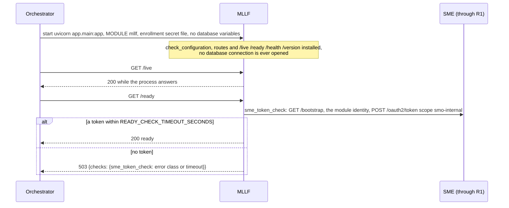
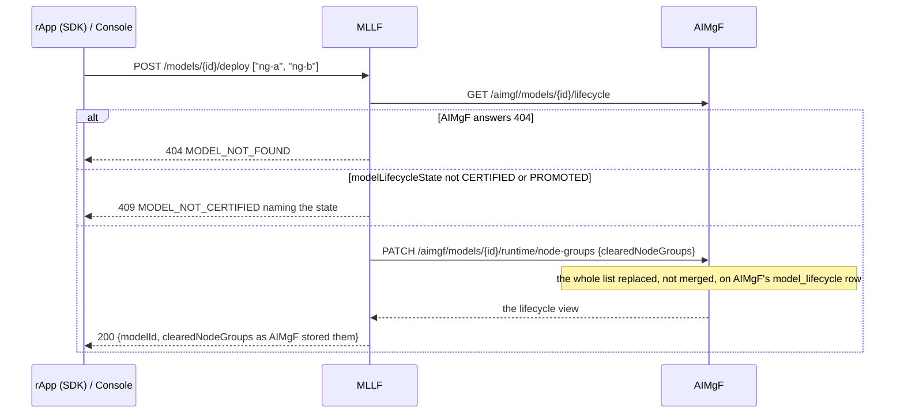
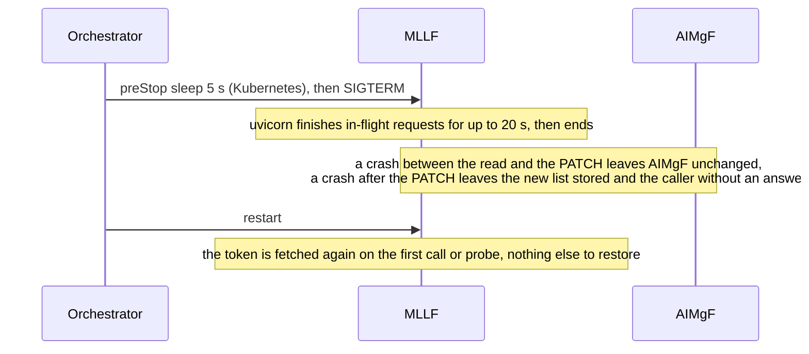

# MLLF: lifecycle

MLLF, the ML Loading Function, is the deploy-request gate in front of a model's placement: it lets a model be placed only when AIMgF has it `CERTIFIED`
or `PROMOTED`, and writes the node groups it is cleared for onto AIMgF's lifecycle row. It deploys nothing. It is reached at the R1 prefix `/mllf`
through R1 Termination, has no table and no database schema, and has no worker. What its route does is in [`../README.md`](../README.md). Three
diagrams:

| | Step | Who starts it | Ends with |
|---|---|---|---|
| a | Starting and becoming ready | the orchestrator (compose, Kubernetes) | a replica that answers `/live`, and `/ready` once it has an SMO token |
| b | A deploy request | an rApp (SDK), the console | the model's `clearedNodeGroups` replaced at AIMgF, or a refusal |
| c | Stopping, crashing and recovering | the orchestrator, a crash | nothing to recover: MLLF keeps no state |

**How to read the diagrams.** As in the call flows: an arrow is one call with the inputs that matter, a box on the receiver says what it does with them,
an `alt` block is the outcome (success first, then each failure and what the caller gets). Calls reach MLLF through R1 Termination; MLLF's two calls to
AIMgF go back through R1 with MLLF's own token (`R1Client`), as an SMO module, so AIMgF's ownership check does not apply to them (open item `MLLF-NODEGROUP-OWNER`).

## a — Starting and becoming ready

The only readiness check is SME: MLLF needs a token for its calls to AIMgF and has no database (compose and the chart give it none, `database: false`).
It registers nothing at SME but its invoker. **Known gap** (open item `MLLF-IDENTITY`): the shared identity store (`module_identity`, PR-ST-4) is used whenever `MODULE` is set
and `SMO_MODULE_IDENTITY_STORE` is not `off` (`shared/smo_shared/r1_client.py`). MLLF has no `SMO_DATABASE_URL`, so the store cannot be opened and
each process registers an identity of its own at SME (`_identity_store` logs a warning and answers None, as with `SMO_MODULE_IDENTITY_STORE=off`):
MLLF adds one registration per replica and per restart, and the old ones stay until an admin purges stale invokers at SME.

## b — A deploy request

The caller then deploys the runtime at AIMgF (`POST /aimgf/models/{id}/runtime/deploy`, [call flow 17](../../docs/call-flows/17-model-runtime-lifecycle.md)).
The read and the write are two calls, so the state can change between them; a repeated request writes the same list again. **Phase 1:** an AIMgF answer
other than 200 or 404 on the read, and the answer to the `PATCH`, are not checked (an AIMgF error surfaces as a 500 from MLLF), and the node-group
names are not checked against any inventory.

## c — Stopping, crashing and recovering

MLLF keeps nothing between requests, so a restart re-does nothing and any number of replicas serve the same requests. A caller that got no answer
repeats the request: the result is the same list. Because the identity is per process (the gap in a), a restarted MLLF is a new invoker at SME; the old
one stays registered until it is purged (`POST /invoker-registrations/purge-stale` at SME, call flow 18b).

## Configuration it reads

| Variable | Default | What it changes |
|---|---|---|
| `R1_GATEWAY_URL` | `http://r1-termination:8000` | where the calls to AIMgF and SME's bootstrap go |
| `SMO_ENROLLMENT_SECRET_FILE` | unset | makes SME record MLLF as an SMO module (`internal`) |
| `SMO_BOOTSTRAP_KEY` | unset | sent to `/bootstrap` when the gateway asks for one |
| `SMO_INVOKER_ID` / `SMO_INVOKER_SECRET` | unset | a pre-provisioned identity, so no registration and no identity store |
| `SMO_MODULE_IDENTITY_STORE` | `db` | `off` gives each process its own identity without first trying the database (the known gap in a) |
| `READY_CHECK_TIMEOUT_SECONDS` | 3 | how long `/ready` waits for SME |
| `SMO_HTTP_TIMEOUT_SECONDS` | 30 | the bound on the calls to AIMgF |

## Decisions this module depends on

- **The gate reads AIMgF's truth**: the lifecycle state is AIMgF's `model_lifecycle` row, never MLMR's (the AI/ML responsibility matrix, `aimgf/README.md`).
- **Decision here, storage there**: MLLF decides the node groups, AIMgF stores them, so one lifecycle record per model.
- **Stateless**: no table, every call re-reads; the load / unload / activate state machine is AIMgF's `RuntimeLifecycleState` (call flow 17).
- **No operator gate on the runtime transitions yet** (`OI-6.1-runtime-gate`); route coverage is the shallowest of the AI modules (OI-4).
- **Readiness is SME only** (PR-ST-7).
