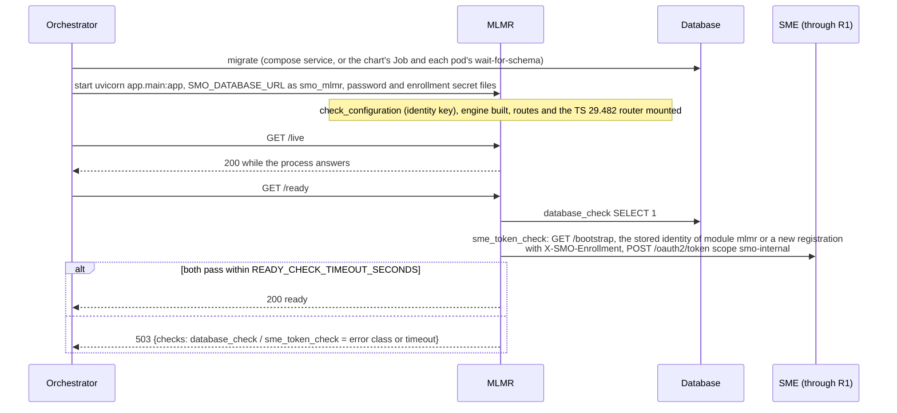
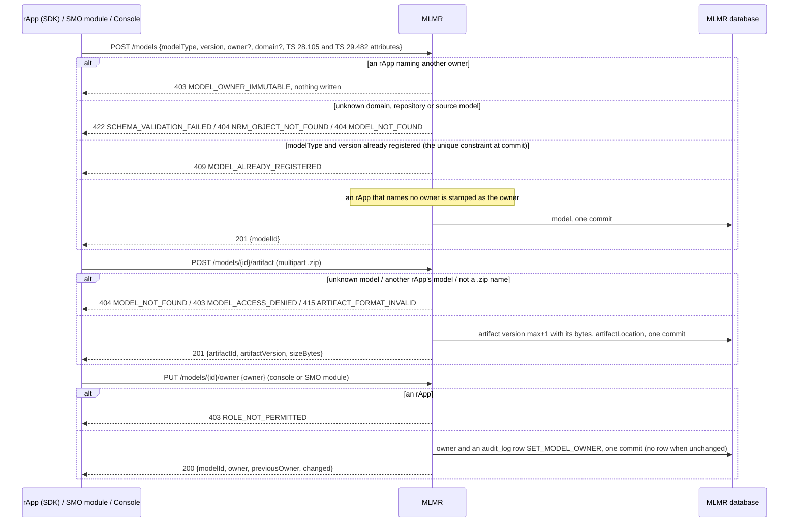
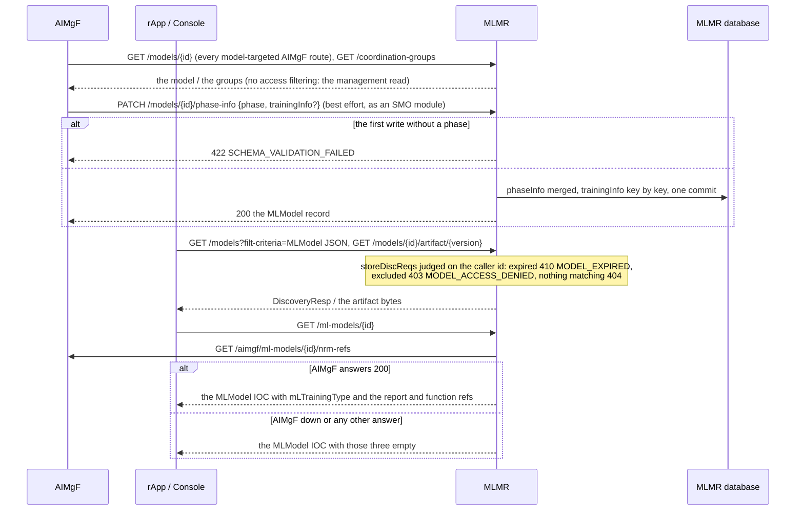
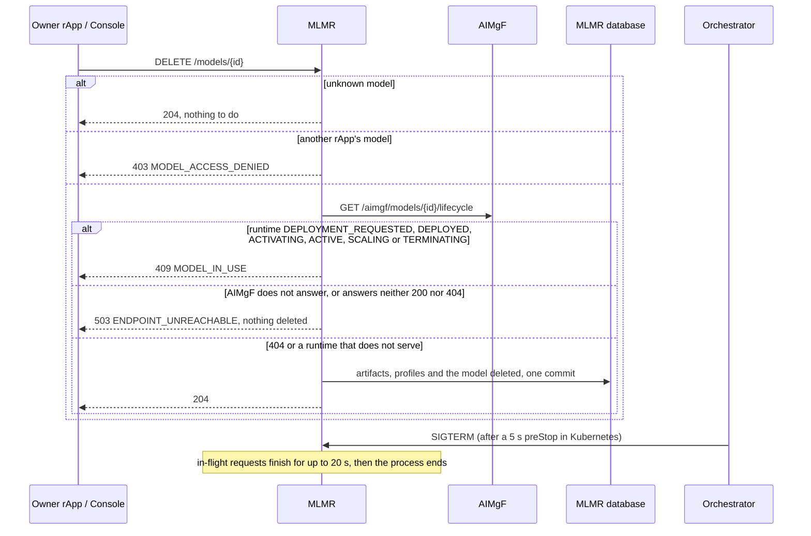

# MLMR: lifecycle

MLMR, the ML Model Repository, holds model truth: a model's identity (`modelType` + `version`), its metadata and TS 28.105 / TS 29.482 attributes, its
owner, the artifact bytes, coordination groups, repositories and storages. It holds no lifecycle state (that is AIMgF's). It is reached at the R1 prefix
`/mlmr` through R1 Termination, keeps its tables in the database schema `mlmr` (role `smo_mlmr`, which also uses the shared `module_identity`), and has
no worker. What each route does is in [`../README.md`](../README.md). Four diagrams:

| | Step | Who starts it | Ends with |
|---|---|---|---|
| a | Starting and becoming ready | the orchestrator (compose, Kubernetes) | a ready replica |
| b | Registering a model, its artifact and its owner | an rApp (SDK), an SMO module, the console | a stored model owned by its registrant, artifact versions, an audited owner change |
| c | What other modules ask of it | AIMgF, rApps, the console | a model read or discovered, its phase written back, AIMgF's refs joined in |
| d | Deleting, stopping, crashing and recovering | an owner or the console, the orchestrator | a model deleted only when AIMgF says it does not serve, nothing half-written |

**How to read the diagrams.** As in the call flows: an arrow is one call with the inputs that matter, a box on the receiver says what it does with them,
an `alt` block is the outcome (success first, then each failure and what the caller gets). Calls reach MLMR through R1 Termination, which stamps the
caller's role (`X-R1-Role`) and invoker id (`X-R1-Invoker-Id`); the ownership rules apply to a caller with the rApp role only. MLMR's own calls (to AIMgF)
go through R1 with MLMR's token. MLMR sends no notifications and has no outbox.

## a — Starting and becoming ready

MLMR registers nothing at SME but its own invoker, shared by its replicas through the `module_identity` row (PR-ST-4). The SME check is part of
readiness because MLMR calls AIMgF on two routes (c and d); without a token those calls get 401 from R1.

## b — Registering a model, its artifact and its owner

`PUT /models/{id}` replaces the metadata (400 `MODEL_IDENTITY_IMMUTABLE` for another `modelType` or `version`, an owner change by the console audited
the same way). Coordination groups (`POST /coordination-groups`, at least two members, 422 `COORDINATION_GROUP_TOO_SMALL`), repositories and storages are
plain rows. The artifact is read into memory and stored in the database; R1 Termination limits the upload body. **Phase 1:** the next artifact version is
read and written without a lock, so two concurrent uploads of one model can take the same number.

## c — What other modules ask of it

AIMgF never reads MLMR's tables and MLMR has no hook into AIMgF: a new model has no lifecycle until AIMgF is first asked about it. The training flow is
[call flow 02](../../docs/call-flows/02-aiml-model-train-to-inference.md), the phase write-back its step after a run starts and ends.

## d — Deleting, stopping, crashing and recovering

AIMgF's rows for a deleted model (lifecycle, jobs, subscriptions) stay as history ([call flow 26e](../../docs/call-flows/26-model-governance-and-end-of-life.md)).
Every write is one request and one commit, so a crash leaves either the whole change or none of it; MLMR re-sends nothing and resumes nothing after a
restart, and a caller that got no answer repeats its request (a repeated register is 409, a repeated delete 204). It has no periodic work. Replicas share
only the database: the duplicate check is the database's unique constraint, so two replicas cannot register the same `modelType` and `version`.

## Configuration it reads

| Variable | Default | What it changes |
|---|---|---|
| `SMO_DATABASE_URL`, `SMO_DATABASE_PASSWORD_FILE` | none (required) | the database; without it the process does not start |
| `R1_GATEWAY_URL` | `http://r1-termination:8000` | where the calls to AIMgF and SME's bootstrap go |
| `SMO_ENROLLMENT_SECRET_FILE` | unset | makes SME record MLMR as an SMO module (`internal`) |
| `SMO_IDENTITY_KEY` (or `_FILE`) | unset | encrypts the stored invoker secret, a wrong value stops the process |
| `READY_CHECK_TIMEOUT_SECONDS` | 3 | how long `/ready` waits for the database and SME |
| `SMO_HTTP_TIMEOUT_SECONDS` | 30 | the bound on the calls to AIMgF |

## Decisions this module depends on

- **Model truth only**: identity, metadata, owner and artifacts here, lifecycle in AIMgF (the AI/ML responsibility matrix, `aimgf/README.md`).
- **The owner is stamped and kept** (SEC-15.3b, SEC-15.3c, SEC-15.3d): an rApp registers, changes, uploads to and deletes only its own models, and an
  owner change by the console is audited.
- **A model that serves is not deleted** (call flow 26e): AIMgF is asked, and no answer refuses the delete.
- **storeDiscReqs are enforced on discovery and download** (SA-MLMR-6); the phase is AIMgF's write-back (SA-MLMR-7).
- **One identity per module** (PR-ST-4); readiness is the database and SME (PR-ST-7).
