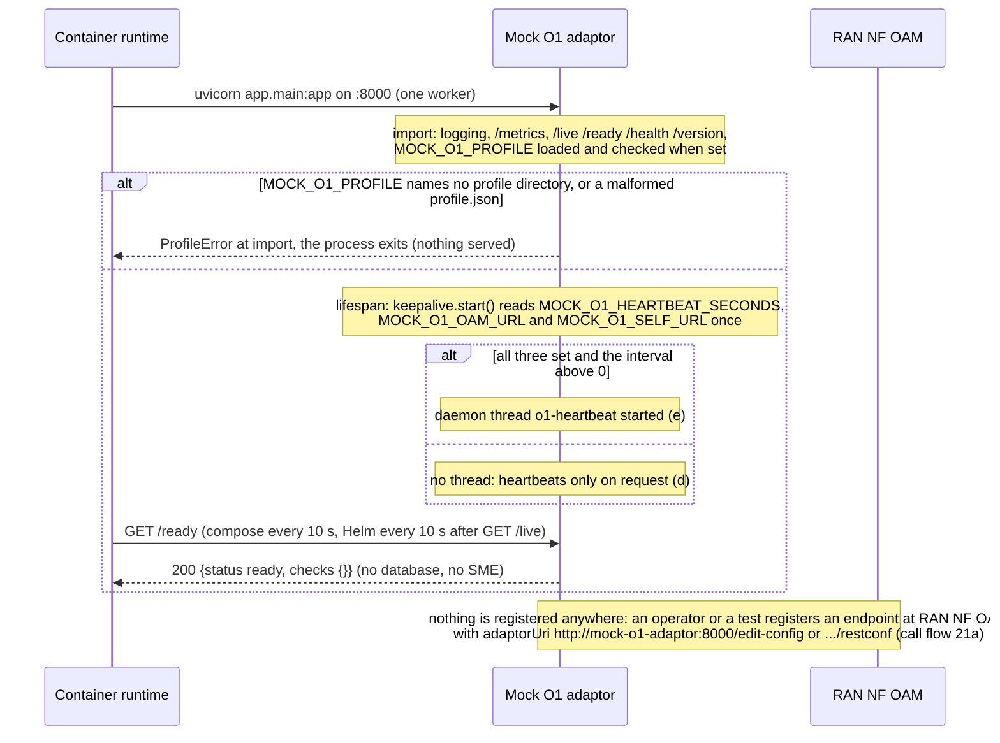
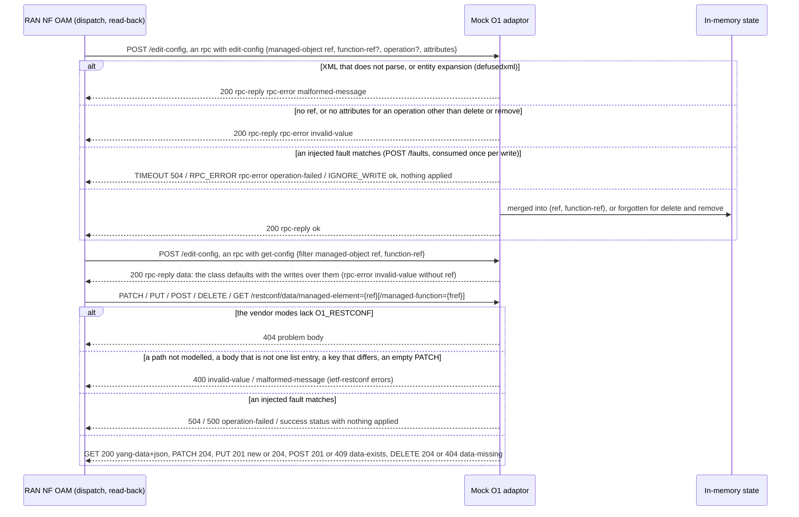
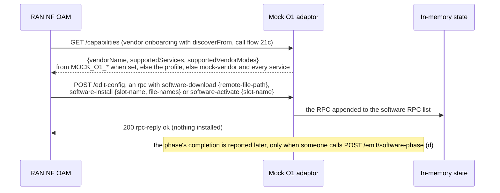
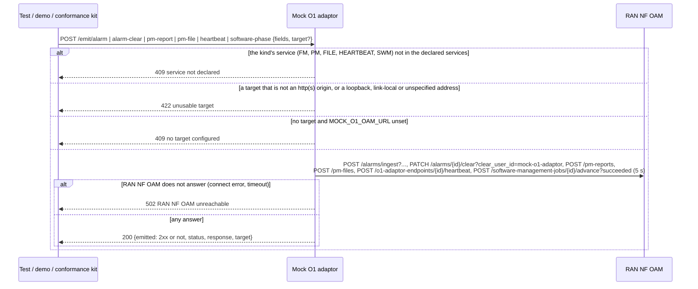
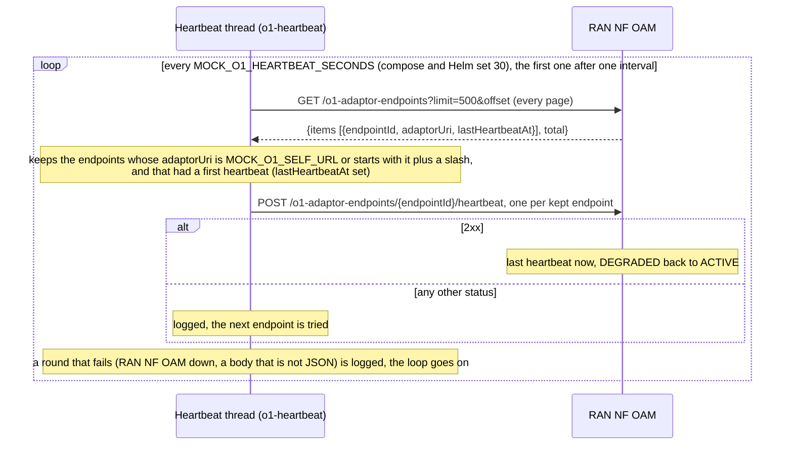
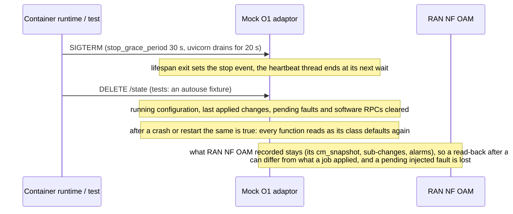

# Mock O1 adaptor: lifecycle

The mock O1 adaptor is the test and demo double of a managed element's O1 adaptor: it answers RAN NF OAM's NETCONF-shaped `edit-config` / `get-config`
and the RFC 8040 RESTCONF data resources over one in-memory running configuration, declares a vendor at `GET /capabilities`, acknowledges the O-RAN
software management RPCs, and, when asked or on its own timer, sends alarms, PM, software-phase results and heartbeats to RAN NF OAM. It is not an SMO
module: it has no R1 prefix (R1 Termination does not route to it), no database schema, no identity at SME and no certificate. It listens on port 8000 on
the compose network as `mock-o1-adaptor`. Its design is in [`../README.md`](../README.md). Six diagrams:

| | Step | Who starts it | Ends with |
|---|---|---|---|
| a | Starting and becoming ready | the container runtime | a process serving `:8000`, its profile checked, the heartbeat thread started or not |
| b | Answering CM writes and reads | RAN NF OAM (call flows 03, 21) | `<ok/>`, an `<rpc-error>`, a RESTCONF status, or an injected fault |
| c | Declaring the vendor and acknowledging software RPCs | RAN NF OAM (call flows 19, 21) | the vendor's declaration, a software RPC recorded |
| d | Emitting towards RAN NF OAM | a test, a demo, the O1 conformance kit | RAN NF OAM's answer relayed, or 409 / 422 / 502 |
| e | The periodic heartbeat | the heartbeat thread | each of this stub's started endpoints kept ACTIVE at RAN NF OAM |
| f | Stopping, crashing and restarting | the container runtime, a test | the thread stopped, every in-memory state gone |

**How to read the diagrams.** As in the call flows: an arrow is one call with the inputs that matter, a box on the receiver says what it does with them, an
`alt` block is the outcome (success first, then each failure and what the caller gets). The mock is called directly over plain HTTP, never through R1
Termination, and it calls RAN NF OAM directly too (`MOCK_O1_OAM_URL`), as a real adaptor would. It authenticates nobody.

## a — Starting and becoming ready

The mock reads no secret and opens no connection at start. `/ready` has no checks, so it is ready as soon as the process answers. Every other setting
(`MOCK_O1_VENDOR_NAME`, `MOCK_O1_SUPPORTED_SERVICES`, `MOCK_O1_VENDOR_MODES`, `MOCK_O1_OAM_URL` for the emit routes) is read on every request, so a test may
change it without a restart; the heartbeat variables are read once, at start. A profile is cached after its first load.

## b — Answering CM writes and reads

Both protocols share one running configuration, so each reads back the other's writes. A rejection is the agent's answer (HTTP 200 with an
`<rpc-error>` on NETCONF); only the `TIMEOUT` fault is an HTTP 504, which RAN NF OAM maps to its retryable `NETCONF_TIMEOUT` / `RESTCONF_TIMEOUT` (call flow
03c). `IGNORE_WRITE` is the lying agent that RAN NF OAM's read-after-write (`GET /managed-entities/{me}/config`) is there to catch. **Phase 1:** no YANG
validation, no SSH or TLS, no datastore but running.

## c — Declaring the vendor and acknowledging software RPCs

The software RPCs are recognised by the namespace `urn:o-ran:software-management:1.0` before any `managed-object` parsing, so they never touch the
running configuration. `GET /software-rpcs` lists what was acknowledged, for a test or a demo.

## d — Emitting towards RAN NF OAM

An emit is one call, sent once: no retry, no queue, nothing kept. A refusal by RAN NF OAM (an unknown element, no PM subscription, a job that has ended)
is relayed with `emitted: false`, never raised. `/emit/alarm` sends a new UUID as `source_alarm_id` unless the body names one, so every call raises a new
alarm (call flow 20a); `/emit/alarm-clear` goes only to `MOCK_O1_OAM_URL` (no `target`). A caller-supplied `target` goes through the shared guarded sender
(`smo_shared.webhook.post_webhook`), the configured URL through plain `httpx`. **Phase 1:** plain HTTP, so with `SMO_MTLS=on` at RAN NF OAM every emit is a
502.

## e — The periodic heartbeat

The first heartbeat of an endpoint stays the operator's (or `/emit/heartbeat`'s): it moves the endpoint from `DISCOVERED` to `ACTIVE` and may apply an
`autoApply` onboarding template at RAN NF OAM, so the thread never sends it. It exists so a demo endpoint does not age to `DEGRADED` after RAN NF OAM's
90 s missed-heartbeat threshold and refuse a later write. The list call reaches RAN NF OAM directly, without a token, and an endpoint of another adaptor is
never touched.

## f — Stopping, crashing and restarting

Nothing is persisted and nothing is re-sent after a restart: an emit that was in flight is lost, and the heartbeat thread starts again one interval
after start. The state is per process and not locked, so running more than one replica (or `UVICORN_WORKERS` above 1) splits it between processes: a write
and its read-back could land on different ones. Run one.

## Configuration it reads

| Variable | Default | What it changes |
|---|---|---|
| `MOCK_O1_PROFILE` | unset | A vendor profile under `app/profiles/` (`example-du`); a name that is not a profile stops the process at start |
| `MOCK_O1_VENDOR_NAME`, `MOCK_O1_SUPPORTED_SERVICES`, `MOCK_O1_VENDOR_MODES` | the profile's, else `mock-vendor`, every service, `O1_NETCONF,O1_RESTCONF` | The declaration (c), which emit routes are offered (d), whether the RESTCONF root exists (b); read on every request |
| `MOCK_O1_OAM_URL` | unset (compose and Helm: `http://ran-nf-oam:8000`) | Where emits and heartbeats go; unset, an emit without `target` is 409 and there is no heartbeat thread |
| `MOCK_O1_HEARTBEAT_SECONDS` | `0`, off (compose and Helm: `30`) | The heartbeat interval (e); read at start |
| `MOCK_O1_SELF_URL` | unset (compose and Helm: `http://mock-o1-adaptor:8000`) | Which endpoints are this stub's (e); unset, no heartbeat thread |
| `UVICORN_GRACEFUL_SHUTDOWN_SECONDS` | `20` (Dockerfile) | How long a stopping process finishes requests in flight |

## Decisions this module depends on

- **A test double, not a protocol implementation** (`OI-1-cm-sync-restconf`; HISTORY.md section 2: the O-RAN-SC simulator stays a pattern reference): just
  enough NETCONF-shaped XML and RESTCONF-shaped JSON to close RAN NF OAM's loop, over plain HTTP.
- **Rejection is an RPC answer**, and faults are consumed per write, so retry and read-after-write paths are deterministic (call flow 03c).
- **The stub is a source as well as a target** (`SB-9.8`, `PR-SB-9b`): it emits only what it declares, only when asked, and relays RAN NF OAM's answer
  rather than judging it; the periodic heartbeat is the one thing it sends on its own.
- **A vendor is a profile, and a profile is data** (`SB-10`), checked at start.
- **Software RPCs are acknowledged, completion is reported** (call flow 19b, 19c).
- **Probes from the shared library** (`PR-ST-7`): `/live`, `/ready`, `/health`, `/version`, with no checks.
