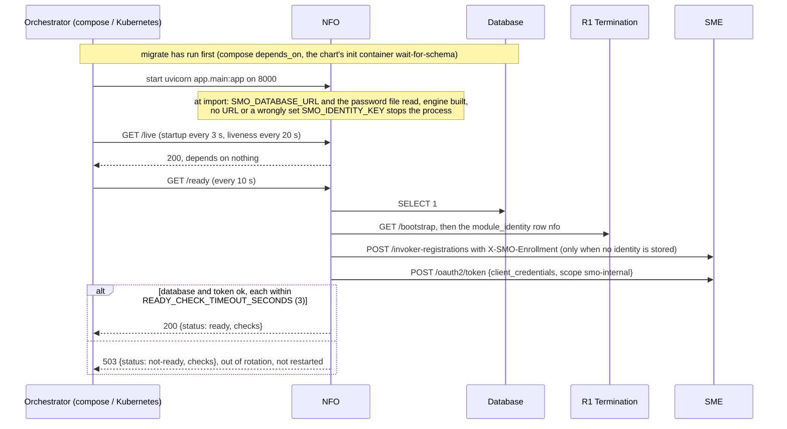
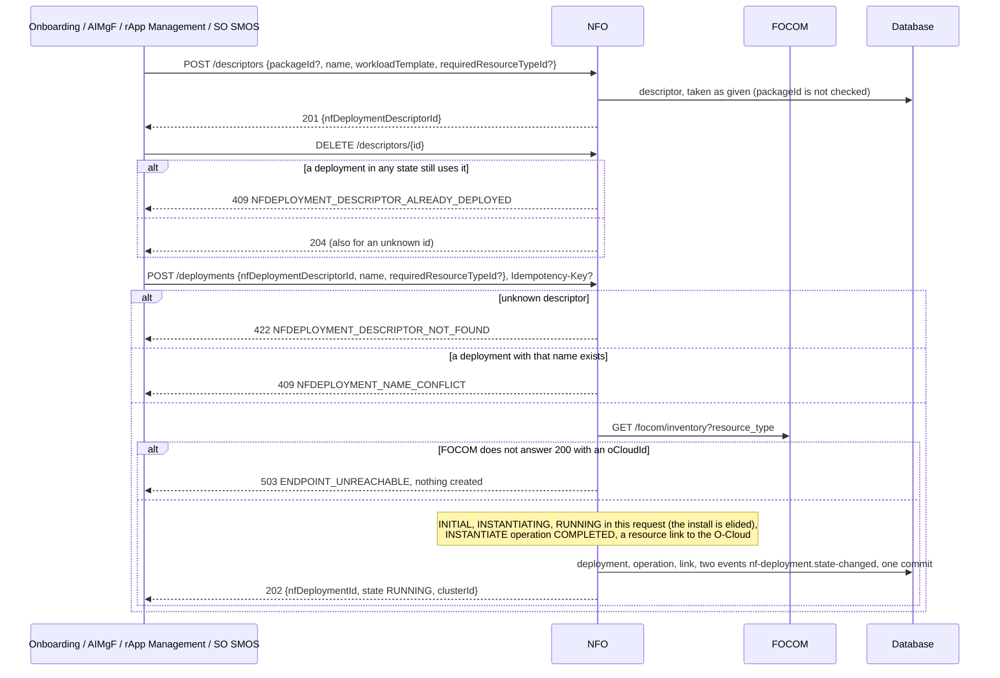
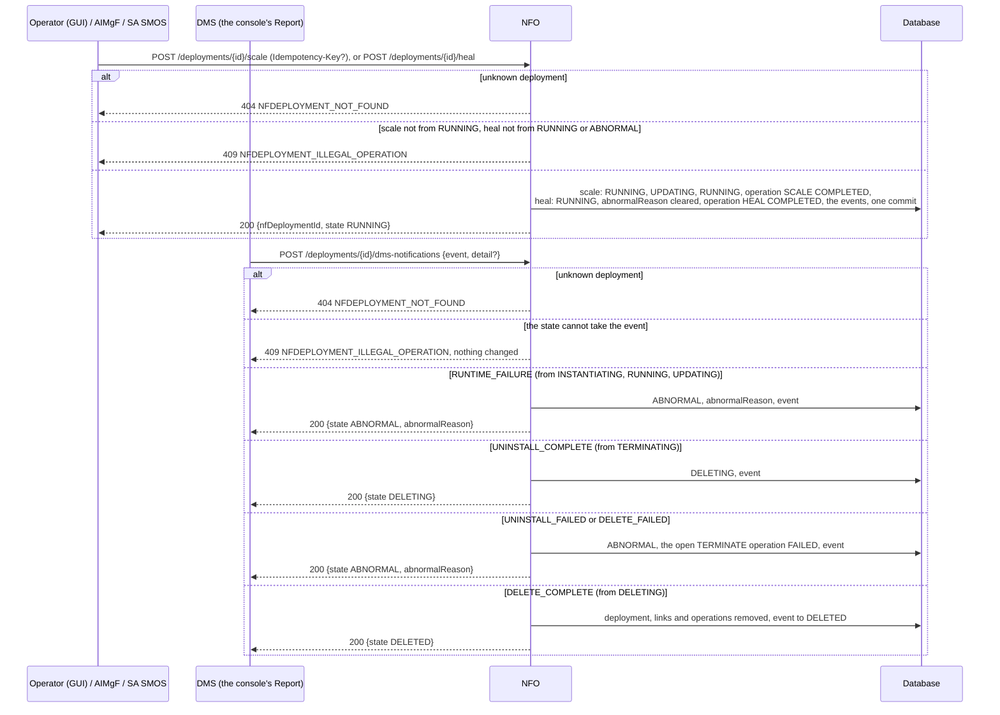
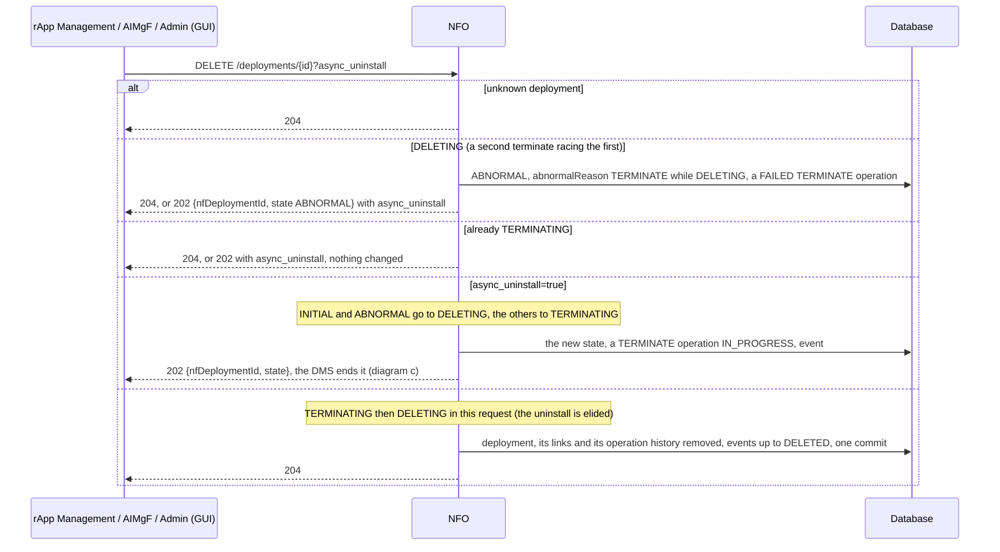
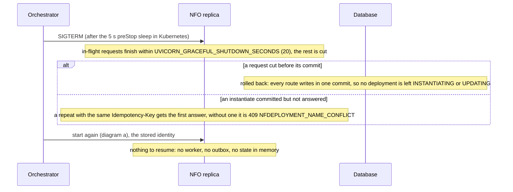

# NFO: lifecycle

NFO (the Network Function Orchestrator, the SMO's O2 DMS-style service) keeps deployment descriptors and the lifecycle of the NF deployments made from
them: instantiate, scale, heal and terminate, and the deployment manager's reports. It is served behind R1 Termination at `/nfo`, keeps its tables
(`nf_deployment_descriptor`, `nf_deployment`, `nf_ocloud_resource`, `lcm_operation`) in the database schema `nfo` and connects as the role `smo_nfo`.
The design is in its [README](../README.md); the workload flows are call flow [15](../../docs/call-flows/15-nfo-workload-lifecycle.md). This
document follows the module itself. Five diagrams:

| | Step | Who starts it | Ends with |
|---|---|---|---|
| a | Starting and becoming ready | the orchestrator | a replica that answers `/ready` 200, with the module's identity at SME |
| b | Descriptors and instantiation | Onboarding, AIMgF, rApp Management, SO SMOS | a descriptor, or a deployment RUNNING on the O-Cloud FOCOM names |
| c | Scale, heal and the deployment manager's reports | Operator (GUI), AIMgF, SA SMOS, the DMS | the deployment RUNNING again, or ABNORMAL with a reason |
| d | Terminating | rApp Management, AIMgF, Admin (GUI) | the deployment gone, or TERMINATING until the DMS reports |
| e | Stopping, crashing and recovering | the orchestrator, a crash | requests finished or rolled back, nothing to resume |

**How to read the diagrams.** As in call flow 01: an arrow is one call with the inputs that matter, a box on the receiver says what it does with them,
an `alt` block is the outcome (success first, then each failure and what the caller gets). Every call reaches NFO through R1 Termination; an rApp may
read but change nothing under `/nfo` (R1 refuses it). NFO's one outgoing call, to FOCOM's inventory, goes through R1 with the module's token. *DMS* is the
deployment manager; none runs in Phase 1, so its reports come from whoever calls `dms-notifications` (the console's **Report** button).

## a — Starting and becoming ready

NFO registers nothing and seeds nothing at start; its identity at SME is the shared `module_identity` row of `nfo`, made by the first replica that needs
a token and adopted by the others (PR-ST-4). It needs the token only for the FOCOM call, but `/ready` asks for it, so an NFO that cannot reach SME takes
no traffic once its cached token has run out. The compose service has no Docker socket and no privileges (PR-SEC-13): NFO starts no container.

## b — Descriptors and instantiation

A descriptor is a template: it may back any number of deployments, one per rApp instance of a package (call flow 15b), and AIMgF creates its own,
without a package, for model runtimes. With an `Idempotency-Key` a repeated instantiate returns the first answer (PR-ST-3). **Phase 1:** nothing is
installed (no Helm, no `docker run`), `workloadRef` is never set, and the name check is a SELECT, not a unique index, so two replicas instantiating the
same name at the same moment can both succeed.

## c — Scale, heal and the deployment manager's reports

An ABNORMAL deployment stays ABNORMAL until healed or terminated; rApp Management shows it on the instance's page (`workload`) without changing the
instance's state (call flow 15e). Every transition is published as `org.oran.smo.nf-deployment.state-changed` in the same commit. **Phase 1:** scale takes
no target size and heal touches no workload (`OI-7-nfo-scale-size`, D-DEPLOY-NFO-3); any authenticated internal caller may send a DMS report.

## d — Terminating

The synchronous form is what every SMO caller uses: rApp Management records a 204 (or a 404) as `nfoTerminate: DONE` in the instance's
`lastTeardown`. Once a deployment is gone its descriptor can be deleted again, which is what lets Onboarding delete a package (call flow 06c).
**Phase 1:** a deployment left TERMINATING by an asynchronous terminate waits for the DMS with no timeout, and a synchronous terminate of it answers
204 without removing it.

## e — Stopping, crashing and recovering

A deployment's state is all in the database, so any number of replicas can serve: `nf_deployment` is versioned, and a concurrent write to the same
deployment is 409 `CONCURRENT_MODIFICATION` (PR-ST-2). The idempotency reservation of a replica that died mid-request is taken over after
`IDEMPOTENCY_IN_PROGRESS_SECONDS` (300). Events are rows in the same commit as the change, so a crash never publishes a change that did not happen.

## Configuration it reads

| Variable | Default | What it changes |
|---|---|---|
| `SMO_DATABASE_URL`, `SMO_DATABASE_PASSWORD_FILE` | none (required) | the database and the role `smo_nfo` |
| `R1_GATEWAY_URL` | `http://r1-termination:8000` | where `/bootstrap` and FOCOM are reached |
| `SMO_ENROLLMENT_SECRET_FILE` | compose secret | makes the module's invoker `internal` at SME (PR-SEC-14) |
| `SMO_IDENTITY_KEY` (`_FILE`) | empty | encrypts the stored module identity; a wrong value stops the start |
| `SMO_HTTP_TIMEOUT_SECONDS` | `30` | how long the FOCOM inventory call waits before instantiate answers 503 |
| `IDEMPOTENCY_IN_PROGRESS_SECONDS`, `IDEMPOTENCY_KEY_TTL_SECONDS` | `300`, `86400` | instantiate and scale replays |
| `READY_CHECK_TIMEOUT_SECONDS` | `3` | how long each `/ready` check may take |
| `UVICORN_WORKERS`, `UVICORN_GRACEFUL_SHUTDOWN_SECONDS` | `1`, `20` | processes per container, and how long a stop lets requests finish |

## Decisions this module depends on

- **The deployment state machine and guards are the reference's** (HISTORY.md §5), every change through `NFO_FSM.fire`, each transition on the event feed
  (PR-MSG-3.5, call flow 15e).
- **A descriptor backs any number of deployments** and cannot be deleted while one exists (call flow 15b, 06c, DOC-CF-1.4).
- **Placement is FOCOM's answer** (NFO+FOCOM LLD section 4): no `oCloudId`, no deployment (503).
- **An asynchronous terminate is ended by the DMS**, and a broken workload is ABNORMAL until healed or terminated (OI-3-nfo-abnormal).
- **Phase 1 elides the install**: instantiate, scale and the default terminate complete in their request.
- **No privileges, no Docker socket** (PR-SEC-13); the schema belongs to the migration (PR-OPS-1.5), the role to `db_roles.py` (PR-DB-2.6).
- **Stale writes are 409, repeated commands replay** (PR-ST-2, PR-ST-3); the identity is shared by replicas (PR-ST-4).
